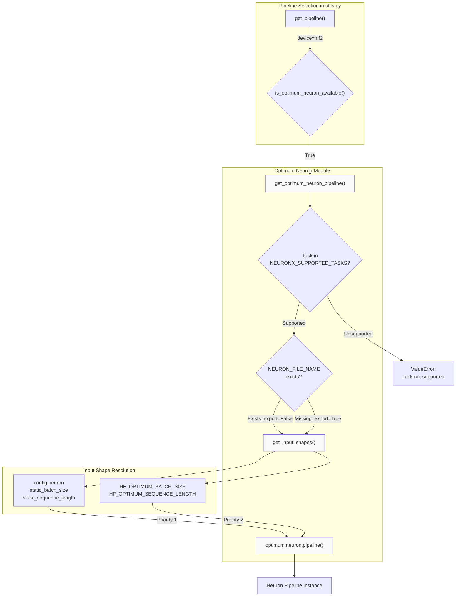
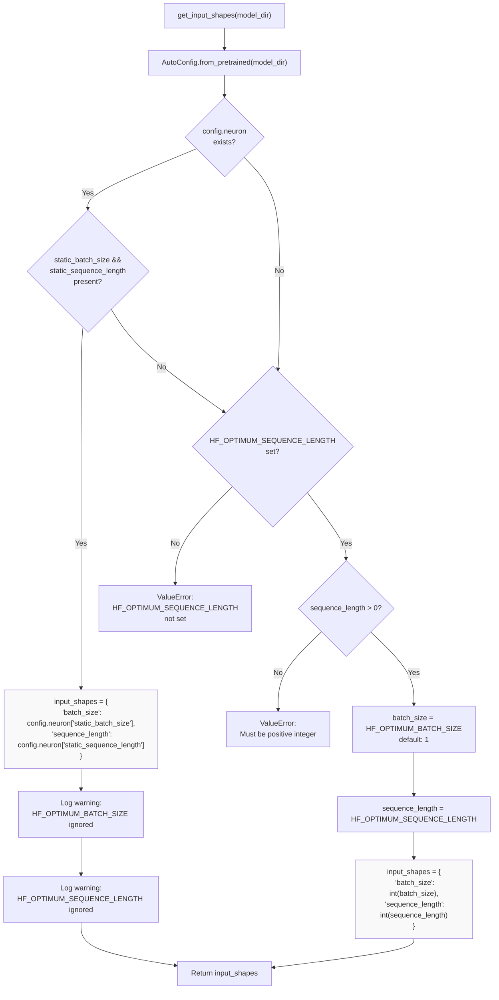
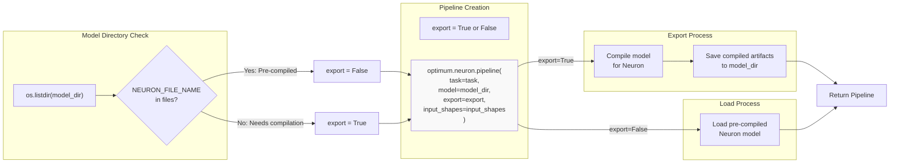
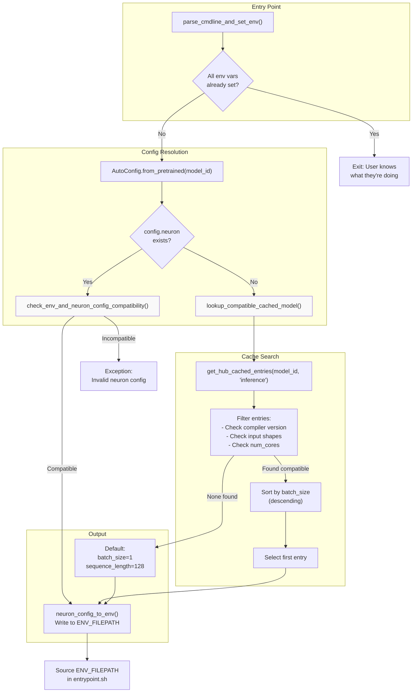
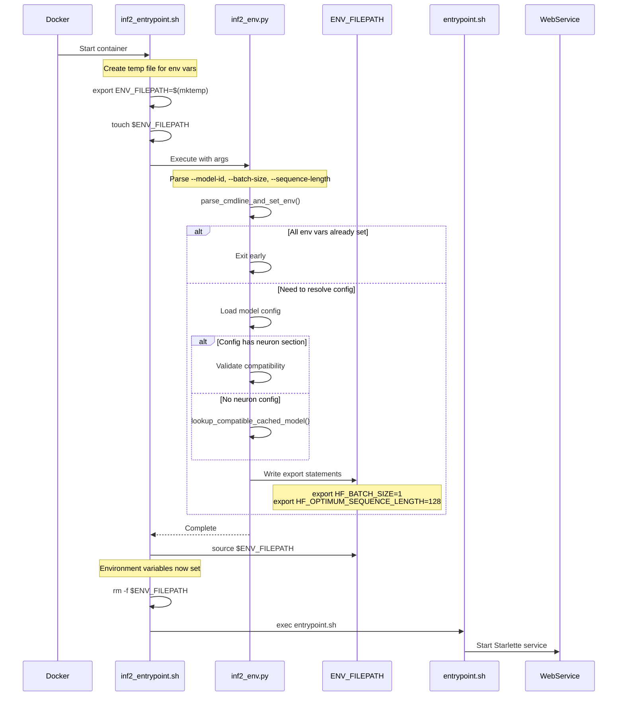

<!-- source: DeepWiki mcp.deepwiki.com · repo huggingface/huggingface-inference-toolkit · page 6.3 AWS Neuron Optimization · fetched 2026-10-26 -->

# AWS Neuron Optimization

<details>
<summary>Relevant source files</summary>

The following files were used as context for generating this wiki page:

- [.gitignore](.gitignore)
- [dockerfiles/pytorch/Dockerfile.inf2](dockerfiles/pytorch/Dockerfile.inf2)
- [scripts/inf2_entrypoint.sh](scripts/inf2_entrypoint.sh)
- [scripts/inf2_env.py](scripts/inf2_env.py)
- [src/huggingface_inference_toolkit/optimum_utils.py](src/huggingface_inference_toolkit/optimum_utils.py)
- [tests/integ/test_pytorch_local_inf2.py](tests/integ/test_pytorch_local_inf2.py)
- [tests/unit/test_optimum_utils.py](tests/unit/test_optimum_utils.py)

</details>


## Purpose and Scope

This document describes the AWS Neuron optimization support in the Hugging Face Inference Toolkit, which enables efficient inference on AWS Inferentia2 accelerators. This specialized pipeline support allows the toolkit to compile and run Transformer models on Neuron hardware using the Optimum Neuron library.

For general deployment instructions on Inferentia2 infrastructure, see [AWS Inferentia2 Deployment](#5.4). For information on other specialized pipelines, see [Diffusers Integration](#6.1) and [Sentence Transformers Support](#6.2).

## Overview

AWS Inferentia2 is a purpose-built machine learning inference accelerator that requires models to be compiled for the Neuron architecture. The compilation process uses static input shapes (batch size and sequence length) to optimize the model graph. This optimization support enables the toolkit to:

- Detect Inferentia2 hardware availability
- Automatically compile models for Neuron if not already converted
- Load pre-compiled Neuron models from cache
- Validate compiler version compatibility
- Configure static input shapes from environment variables or model configuration

Unlike standard CPU/GPU inference, Neuron models cannot accept variable input sizes at runtime. The compiled model artifacts are tied to specific input dimensions chosen during compilation.

**Sources:** [src/huggingface_inference_toolkit/optimum_utils.py:1-115](), [dockerfiles/pytorch/Dockerfile.inf2:1-79]()

## Optimum Neuron Integration

The toolkit integrates with the `optimum.neuron` library to provide Neuron-optimized inference pipelines. The integration point is the `get_optimum_neuron_pipeline` function, which wraps the standard `optimum.neuron.pipelines.transformers.base.pipeline` factory.



**Availability Detection**

The toolkit checks for Optimum Neuron availability using `is_optimum_neuron_available()`, which tests whether the `optimum.neuron` module is importable [src/huggingface_inference_toolkit/optimum_utils.py:6-13]().

```python
# From optimum_utils.py
_optimum_neuron = False
if importlib.util.find_spec("optimum") is not None:
    if importlib.util.find_spec("optimum.neuron") is not None:
        _optimum_neuron = True
```

**Supported Tasks**

The Neuron pipeline supports a subset of Transformers tasks defined in `optimum.neuron.pipelines.transformers.base.NEURONX_SUPPORTED_TASKS` [src/huggingface_inference_toolkit/optimum_utils.py:91-94](). The toolkit validates task support and raises a `ValueError` for unsupported tasks. 

The `sentence-embeddings` task is automatically mapped to `feature-extraction` [src/huggingface_inference_toolkit/optimum_utils.py:86-88](), as Neuron's feature extraction pipeline handles sentence embedding workloads.

**Sources:** [src/huggingface_inference_toolkit/optimum_utils.py:12-13](), [src/huggingface_inference_toolkit/optimum_utils.py:73-114](), [tests/integ/test_pytorch_local_inf2.py:13-32]()

## Static Input Shape Configuration

Neuron models require static input shapes to be specified at compilation time. The toolkit provides a two-tier configuration system for determining these shapes, with model configuration taking precedence over environment variables.



**Configuration Priority**

1. **Model Config (Highest Priority)**: If the model's `config.json` contains a `neuron` section with `static_batch_size` and `static_sequence_length`, these values are used [src/huggingface_inference_toolkit/optimum_utils.py:24-37](). Environment variables are ignored with a warning [src/huggingface_inference_toolkit/optimum_utils.py:39-47]().

2. **Environment Variables (Fallback)**: If the model config does not specify Neuron parameters, the toolkit reads:
   - `HF_OPTIMUM_SEQUENCE_LENGTH` (required) [src/huggingface_inference_toolkit/optimum_utils.py:56-65]()
   - `HF_OPTIMUM_BATCH_SIZE` (optional, defaults to 1) [src/huggingface_inference_toolkit/optimum_utils.py:66-70]()

**Validation**

The `HF_OPTIMUM_SEQUENCE_LENGTH` must be set to a positive integer when environment variable configuration is used. If not set or invalid, the function raises a `ValueError` [src/huggingface_inference_toolkit/optimum_utils.py:57-65]().

**Sources:** [src/huggingface_inference_toolkit/optimum_utils.py:16-71](), [tests/unit/test_optimum_utils.py:35-58]()

## Model Loading and Compilation

The Neuron pipeline automatically handles both pre-compiled and non-compiled models through the `export` parameter passed to `optimum.neuron.pipeline()`.



**Pre-compiled Models**

If `NEURON_FILE_NAME` (typically `"model.neuron"`) exists in the model directory, the pipeline sets `export=False` and directly loads the compiled artifacts [src/huggingface_inference_toolkit/optimum_utils.py:96-99]().

**On-demand Compilation**

If the model is not pre-compiled, the pipeline sets `export=True` and triggers compilation during pipeline instantiation [src/huggingface_inference_toolkit/optimum_utils.py:100-103](). The compilation process:
- Converts the PyTorch model to the Neuron format
- Applies graph optimizations for the specified input shapes
- Saves the compiled artifacts to the model directory for future use

The compiled model is cached and can be reused by subsequent requests with the same configuration.

**Sources:** [src/huggingface_inference_toolkit/optimum_utils.py:96-114](), [tests/unit/test_optimum_utils.py:63-88]()

## Cached Model Lookup and Compatibility

The `inf2_env.py` script implements a sophisticated cached model lookup system that searches for compatible pre-compiled models in the Hugging Face Hub cache. This enables automatic selection of compatible models based on the current environment and neuronxcc compiler version.



**Compatibility Checks**

The `check_env_and_neuron_config_compatibility` function validates that a cached model configuration matches the current environment [scripts/inf2_env.py:131-174]():

| Check | Description | Source |
|-------|-------------|--------|
| **Compiler Version** | `neuron_config["compiler_version"]` must match `get_neuronxcc_version()` | [scripts/inf2_env.py:146-155]() |
| **Batch Size** | `neuron_config["static_batch_size"]` must match `HF_BATCH_SIZE` env var (if set) | [scripts/inf2_env.py:157-172]() |
| **Sequence Length** | `neuron_config["static_sequence_length"]` must match `HF_OPTIMUM_SEQUENCE_LENGTH` env var (if set) | [scripts/inf2_env.py:157-172]() |

**Environment Variable Peering**

The script maintains a mapping between environment variables and model config keys [scripts/inf2_env.py:23-26]():

```python
env_config_peering = [
    ("HF_BATCH_SIZE", "static_batch_size"),
    ("HF_OPTIMUM_SEQUENCE_LENGTH", "static_sequence_length"),
]
```

**Selection Strategy**

When multiple compatible cached models are found, the script selects the one with the largest batch size [scripts/inf2_env.py:86-88](), [scripts/inf2_env.py:122-128]():

```python
def sort_neuron_configs(dictionary):
    return -dictionary["static_batch_size"]

all_compatible = sorted(all_compatible, key=sort_neuron_configs)
entry = all_compatible[0]
```

**Fallback Defaults**

If no compatible cached model is found and the model config doesn't contain Neuron parameters, the script falls back to default values [scripts/inf2_env.py:222-227]():

```python
neuron_config = {'static_batch_size': 1, 'static_sequence_length': 128}
```

**Sources:** [scripts/inf2_env.py:80-232]()

## Entrypoint Bootstrap Process

The Inferentia2 deployment uses a specialized two-stage entrypoint process that configures the environment before launching the main service.



**Stage 1: Environment Setup (inf2_entrypoint.sh)**

The `inf2_entrypoint.sh` script [scripts/inf2_entrypoint.sh:1-18]():

1. Creates a temporary file to store environment variable exports [scripts/inf2_entrypoint.sh:4]()
2. Registers a cleanup trap to delete the temp file on exit [scripts/inf2_entrypoint.sh:6]()
3. Invokes `inf2_env.py` with all command-line arguments [scripts/inf2_entrypoint.sh:12]()
4. Sources the generated environment file [scripts/inf2_entrypoint.sh:14]()
5. Executes the standard `entrypoint.sh` [scripts/inf2_entrypoint.sh:18]()

**Stage 2: Main Service (entrypoint.sh)**

After environment configuration, the standard entrypoint script starts the Starlette web service with the configured Neuron environment variables. The Dockerfile specifies this entrypoint [dockerfiles/pytorch/Dockerfile.inf2:78]():

```dockerfile
ENTRYPOINT ["bash", "-c", "./inf2_entrypoint.sh"]
```

**Command-line Argument Mapping**

The `inf2_env.py` script accepts command-line arguments that override environment variables [scripts/inf2_env.py:37-77]():

| Argument | Environment Variable | Default |
|----------|---------------------|---------|
| `--batch-size` | `HF_BATCH_SIZE` | From `BATCH_SIZE` or 0 |
| `--sequence-length` | `HF_OPTIMUM_SEQUENCE_LENGTH` | From `SEQUENCE_LENGTH` or 0 |
| `--model-id` | `MODEL_ID` | From `HF_MODEL_ID` or `HF_MODEL_DIR` |
| `--revision` | `REVISION` | From `REVISION` |

**Sources:** [scripts/inf2_entrypoint.sh:1-18](), [scripts/inf2_env.py:37-77](), [dockerfiles/pytorch/Dockerfile.inf2:74-78]()

## Docker Image Configuration

The Inferentia2 Docker image is based on Ubuntu 22.04 and includes the AWS Neuron SDK components required for inference on Inferentia2 hardware.

**Base Dependencies**

The Dockerfile installs three critical Neuron packages [dockerfiles/pytorch/Dockerfile.inf2:6-43]():

| Package | Version Variable | Purpose |
|---------|-----------------|---------|
| `aws-neuronx-tools` | `NEURONX_TOOLS_VERSION=2.19.0.0` | Command-line tools and utilities |
| `aws-neuronx-collectives` | `NEURONX_COLLECTIVES_LIB_VERSION=2.22.33.0-d2128d1aa` | Collective communication libraries |
| `aws-neuronx-runtime-lib` | `NEURONX_RUNTIME_LIB_VERSION=2.22.19.0-5856c0b42` | Neuron runtime libraries |

**Python Environment**

The image configures environment variables for Neuron SDK [dockerfiles/pytorch/Dockerfile.inf2:14-16]():

```dockerfile
ENV LD_LIBRARY_PATH=/opt/aws/neuron/lib:/lib/x86_64-linux-gnu:/opt/conda/lib/:$LD_LIBRARY_PATH
ENV PATH=/opt/aws/neuron/bin:$PATH
```

**Optimum Neuron Installation**

The toolkit installs `optimum-neuron[neuronx]` from the Neuron pip repository [dockerfiles/pytorch/Dockerfile.inf2:59-63]():

```dockerfile
RUN pip install --extra-index-url https://pip.repos.neuron.amazonaws.com \
    --no-cache-dir optimum-neuron[neuronx]==${OPTIMUM_NEURON_VERSION}
```

The image currently uses `OPTIMUM_NEURON_VERSION=0.0.28` [dockerfiles/pytorch/Dockerfile.inf2:11]() with a temporary override to a specific git commit [dockerfiles/pytorch/Dockerfile.inf2:63]().

**Toolkit Installation**

The toolkit is installed with the sentence-transformers extra [dockerfiles/pytorch/Dockerfile.inf2:67]():

```dockerfile
RUN pip install --no-cache-dir -U pip ".[st]"
```

**Sources:** [dockerfiles/pytorch/Dockerfile.inf2:1-79]()

## Configuration Reference

The following environment variables control AWS Neuron optimization behavior:

### Required Configuration

| Variable | Description | Valid Values | Used By |
|----------|-------------|--------------|---------|
| `HF_OPTIMUM_SEQUENCE_LENGTH` | Static sequence length for compilation | Positive integer | [optimum_utils.py:56-60]() |

### Optional Configuration

| Variable | Description | Default | Used By |
|----------|-------------|---------|---------|
| `HF_OPTIMUM_BATCH_SIZE` | Static batch size for compilation | `1` | [optimum_utils.py:66]() |
| `HF_BATCH_SIZE` | Alias for batch size (inf2_env.py) | From `BATCH_SIZE` or `0` | [inf2_env.py:45]() |
| `BATCH_SIZE` | Legacy batch size variable | None | [inf2_env.py:45]() |
| `SEQUENCE_LENGTH` | Legacy sequence length variable | None | [inf2_env.py:49-50]() |
| `REVISION` | Model revision/commit hash | Latest | [inf2_env.py:54]() |

### Model Source Configuration

These variables are inherited from the general configuration system but have special handling in the inf2 entrypoint:

| Variable | Description | Used By |
|----------|-------------|---------|
| `HF_MODEL_ID` | Hugging Face Hub model identifier | [inf2_env.py:53]() |
| `HF_MODEL_DIR` | Local model directory path | [inf2_env.py:53]() |
| `MODEL_ID` | Resolved model identifier | [inf2_env.py:64]() |

### Internal Configuration

| Variable | Description | Purpose |
|----------|-------------|---------|
| `ENV_FILEPATH` | Path to temporary environment file | Created by [inf2_entrypoint.sh:4]() |
| `NEURON_RT_NUM_CORES` | Number of Neuron cores to use | Future optimization (commented out in [optimum_utils.py:108]()) |

**Sources:** [src/huggingface_inference_toolkit/optimum_utils.py:16-71](), [scripts/inf2_env.py:23-76](), [scripts/inf2_entrypoint.sh:1-18]()

## Supported Tasks

The toolkit supports the following tasks on AWS Inferentia2, as defined by `NEURONX_SUPPORTED_TASKS` in Optimum Neuron:

- `feature-extraction`
- `fill-mask`
- `question-answering`
- `text-classification`
- `token-classification`

The `sentence-embeddings` task is automatically mapped to `feature-extraction` for compatibility [src/huggingface_inference_toolkit/optimum_utils.py:86-88]().

Tasks not in this list will raise a `ValueError` during pipeline creation [src/huggingface_inference_toolkit/optimum_utils.py:91-94](). For the complete list of supported tasks and their current status, refer to the Optimum Neuron documentation.

**Sources:** [src/huggingface_inference_toolkit/optimum_utils.py:73-94](), [tests/integ/test_pytorch_local_inf2.py:16-26]()

---

