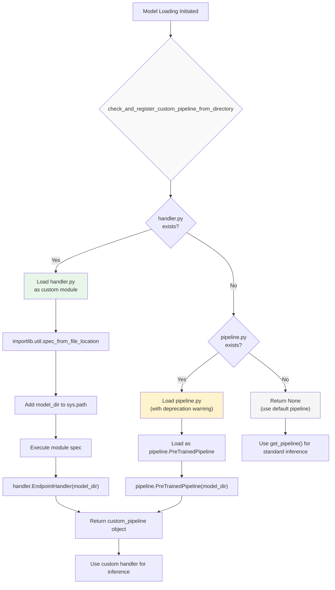
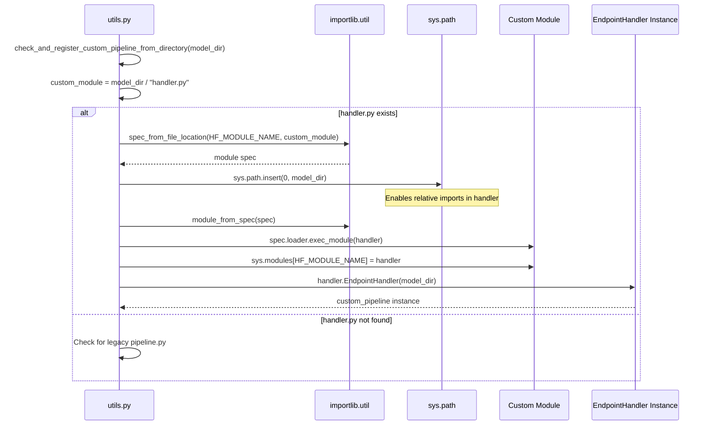
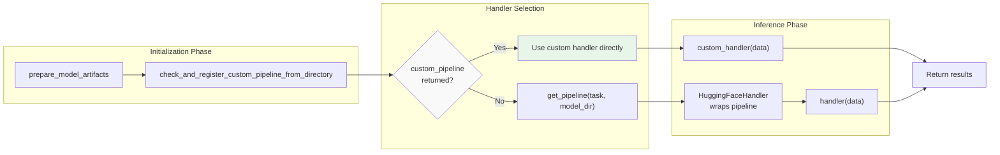

<!-- source: DeepWiki mcp.deepwiki.com · repo huggingface/huggingface-inference-toolkit · page 6.4 Custom Handlers and Pipelines · fetched 2026-10-26 -->

# Custom Handlers and Pipelines

<details>
<summary>Relevant source files</summary>

The following files were used as context for generating this wiki page:

- [README.md](README.md)
- [src/huggingface_inference_toolkit/utils.py](src/huggingface_inference_toolkit/utils.py)
- [tests/unit/test_utils.py](tests/unit/test_utils.py)

</details>


This document explains how to implement custom inference logic by providing a `handler.py` file in your model repository. Custom handlers allow you to override the default preprocessing, model loading, and postprocessing behavior provided by the toolkit. This is useful when you need specialized logic that is not covered by the standard Transformers, Diffusers, or Sentence Transformers pipelines.

For information about the default inference handler implementation, see [Inference Handlers](#4.3). For specialized built-in pipeline support, see sections [6.1](#6.1), [6.2](#6.2), and [6.3](#6.3).

## Custom Handler Overview

The Hugging Face Inference Toolkit automatically detects and loads custom handlers from the model directory. When a custom handler is present, it replaces the default pipeline-based inference logic entirely, giving you full control over the inference process.



**Sources:** [src/huggingface_inference_toolkit/utils.py:152-191]()

## EndpointHandler Interface

Custom handlers must implement the `EndpointHandler` class with a callable interface. The handler receives the `model_dir` during initialization and is invoked with request data during inference.

### Required Implementation

```python
class EndpointHandler:
    def __init__(self, path: str):
        """
        Initialize the handler.
        
        Args:
            path: Directory path where model artifacts are stored
        """
        pass
    
    def __call__(self, data: dict) -> dict:
        """
        Process inference request.
        
        Args:
            data: Request payload containing 'inputs' and optional 'parameters'
            
        Returns:
            Inference results
        """
        pass
```

The `__call__` method receives the request data as a dictionary and should return the inference results. The handler has complete control over how inputs are processed, how the model is loaded and invoked, and how outputs are formatted.

**Sources:** [src/huggingface_inference_toolkit/utils.py:160-170](), [README.md:63-78]()

## Repository Structure

A model repository with a custom handler typically includes the following files:

| File | Required | Purpose |
|------|----------|---------|
| `handler.py` | Yes | Contains the `EndpointHandler` class implementation |
| `requirements.txt` | Optional | Additional Python dependencies needed by the handler |
| Model artifacts (e.g., `pytorch_model.bin`) | Yes | The actual model weights and configuration |
| Configuration files (e.g., `config.json`) | Yes | Model configuration and metadata |
| Tokenizer files | Depends | Required if the handler uses tokenization |

Example repository structure from `philschmid/custom-pipeline-text-classification`:

```
model.tar.gz/
├── pytorch_model.bin
├── config.json
├── tokenizer_config.json
├── vocab.txt
├── handler.py
└── requirements.txt
```

**Sources:** [README.md:69-75](), [tests/unit/test_utils.py:176-186]()

## Custom Handler Loading Process

The toolkit uses dynamic module loading to import and instantiate custom handlers:



Key constants used in the loading process:
- `HF_MODULE_NAME`: Module name for the custom handler (imported from `const.py`)
- `HF_DEFAULT_PIPELINE_NAME`: Expected filename ("handler.py")

The model directory is added to `sys.path` to support relative imports within the custom handler code, allowing handlers to import local modules or dependencies.

**Sources:** [src/huggingface_inference_toolkit/utils.py:156-170](), [src/huggingface_inference_toolkit/const.py:11]()

## Example Custom Handler

Here's a complete example of a custom handler that performs reversed text output (for demonstration purposes):

```python
class EndpointHandler:
    def __init__(self, path: str):
        """Initialize with model directory path"""
        self.path = path
        # Load model, tokenizer, or any other resources here
        
    def __call__(self, data: dict) -> str:
        """
        Process inference request
        
        Args:
            data: Dictionary with 'inputs' and optional 'parameters'
            
        Returns:
            Processed result
        """
        inputs = data.get("inputs", "")
        parameters = data.get("parameters", {})
        
        # Custom inference logic
        result = inputs[::-1]  # Reverse the input
        
        return result
```

This handler can be tested as shown in [tests/unit/test_utils.py:168-173]():

```python
model_dir = "path/to/custom_handler"
pipeline = check_and_register_custom_pipeline_from_directory(model_dir)
result = pipeline("test")  # Returns "tset"
```

**Sources:** [tests/unit/test_utils.py:168-173]()

## Legacy Pipeline Support

The toolkit also supports a legacy format using `pipeline.py` with a `PreTrainedPipeline` class. This format is deprecated but maintained for backward compatibility.

### Legacy Format Structure

```python
# pipeline.py (deprecated)
class PreTrainedPipeline:
    def __init__(self, path: str):
        """Initialize with model directory path"""
        self.path = path
        
    def __call__(self, data):
        """Process inference request"""
        pass
```

When a `pipeline.py` file is detected without a `handler.py` file, the toolkit loads it with a deprecation warning:

```
You are using a legacy custom pipeline.
Please update to the new format.
See documentation for more information.
```

The loading process for legacy pipelines is similar to the modern format but uses different module names:
- Module name: `"pipeline.PreTrainedPipeline"`
- Class name: `PreTrainedPipeline`

**Sources:** [src/huggingface_inference_toolkit/utils.py:172-187]()

## Integration with Default Handler

Custom handlers are integrated into the inference flow through the `get_inference_handler_either_custom_or_default_handler` function (referenced in [tests/unit/test_utils.py:189-206]()):



When a custom handler is present:
1. It bypasses the default pipeline creation logic entirely
2. The custom handler is invoked directly with the request data
3. No additional wrapping or processing is applied

When no custom handler is found:
1. The standard `get_pipeline()` function creates a task-specific pipeline
2. The pipeline is wrapped in a `HuggingFaceHandler` or `VertexAIHandler`
3. The handler normalizes request/response formats

**Sources:** [tests/unit/test_utils.py:189-206]()

## Requirements and Dependencies

Custom handlers can specify additional Python dependencies through a `requirements.txt` file in the model repository. These dependencies are installed when the model is deployed.

### Dependency Installation

The dependencies are typically installed during the container build or initialization phase, not during the handler loading itself. The toolkit expects the environment to have all required dependencies available when the handler is loaded.

Example `requirements.txt`:

```
numpy>=1.21.0
pillow>=9.0.0
scipy>=1.7.0
```

### Import Resolution

Because the model directory is added to `sys.path` (as shown in [src/huggingface_inference_toolkit/utils.py:164]()), custom handlers can:
- Import local Python modules from the same directory
- Use relative imports for submodules
- Access any files or resources in the model directory

**Sources:** [README.md:73-77](), [src/huggingface_inference_toolkit/utils.py:164]()

## Use Cases for Custom Handlers

Custom handlers are appropriate when:

| Use Case | Description |
|----------|-------------|
| **Custom preprocessing** | Input data requires specialized preprocessing not provided by standard pipelines |
| **Multi-model inference** | Inference requires multiple models or complex model orchestration |
| **Post-processing logic** | Results need custom formatting, filtering, or transformation |
| **External resources** | Inference requires external API calls, databases, or file resources |
| **Proprietary models** | Using models not supported by Transformers, Diffusers, or Sentence Transformers |
| **Performance optimization** | Implementing custom batching, caching, or optimization strategies |

For standard Transformers tasks without special requirements, the default pipelines (see [#4.2](#4.2)) are recommended as they require less code and are maintained by the toolkit.

**Sources:** [README.md:63-78]()

## Testing Custom Handlers

Custom handlers can be tested both locally and remotely:

### Local Testing

```python
from huggingface_inference_toolkit.utils import check_and_register_custom_pipeline_from_directory

# Test with local directory
model_dir = "path/to/model/with/handler"
handler = check_and_register_custom_pipeline_from_directory(model_dir)

# Test inference
result = handler({"inputs": "test input", "parameters": {}})
```

### Remote Testing

```python
from huggingface_inference_toolkit.utils import _load_repository_from_hf, check_and_register_custom_pipeline_from_directory

# Download model with custom handler from Hub
storage_dir = _load_repository_from_hf(
    "philschmid/custom-pipeline-text-classification",
    "/tmp/model",
    framework="pytorch"
)

# Load and test handler
handler = check_and_register_custom_pipeline_from_directory(str(storage_dir))
result = handler("test input")
```

The test suite includes examples of both approaches in [tests/unit/test_utils.py:168-186]().

**Sources:** [tests/unit/test_utils.py:168-186]()

## Error Handling

If the custom handler module fails to load or execute, the toolkit will raise an exception during initialization. Common issues include:

1. **Module not found**: The `handler.py` file is missing or incorrectly named
2. **Missing dependencies**: Required packages are not installed
3. **Import errors**: Relative imports fail if module structure is incorrect
4. **Class not found**: The `EndpointHandler` class is not defined in the module
5. **Initialization errors**: The `__init__` method raises an exception

The loading process in [src/huggingface_inference_toolkit/utils.py:152-191]() will propagate these errors, causing the web service startup to fail with a descriptive error message.

**Sources:** [src/huggingface_inference_toolkit/utils.py:152-191]()

---

