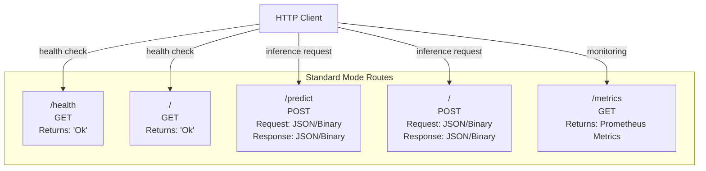
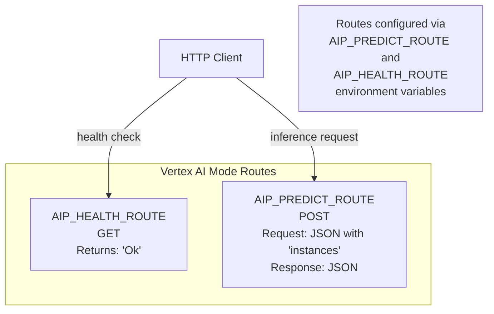
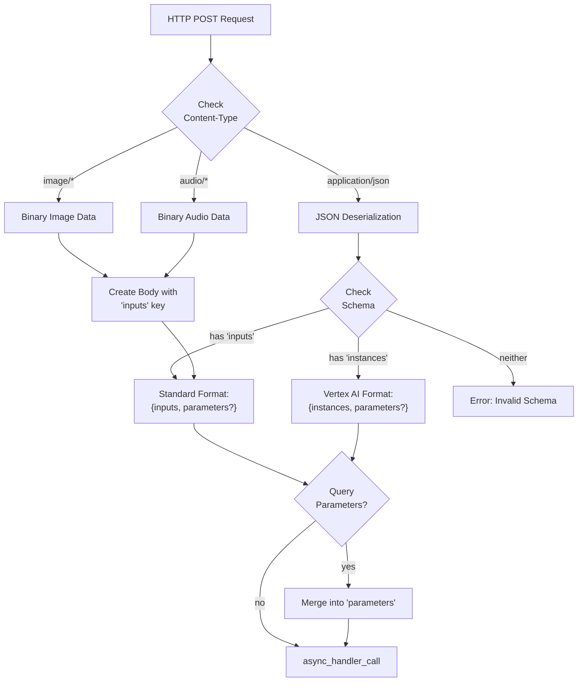
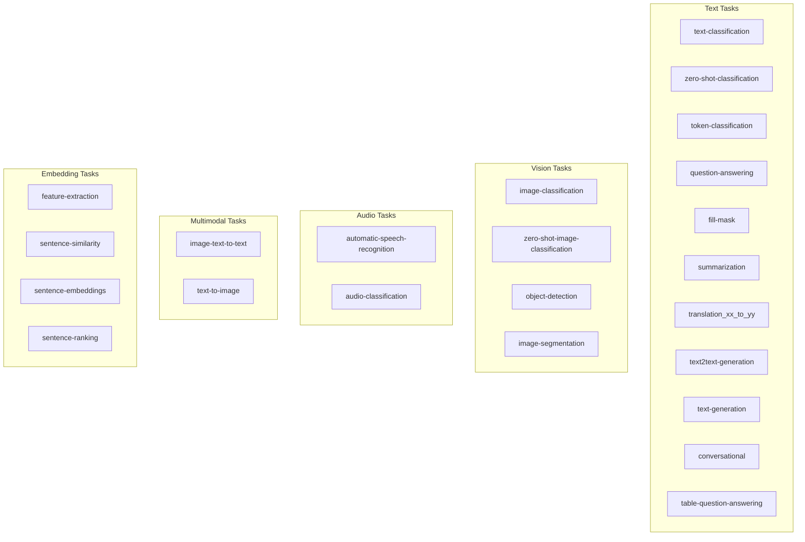
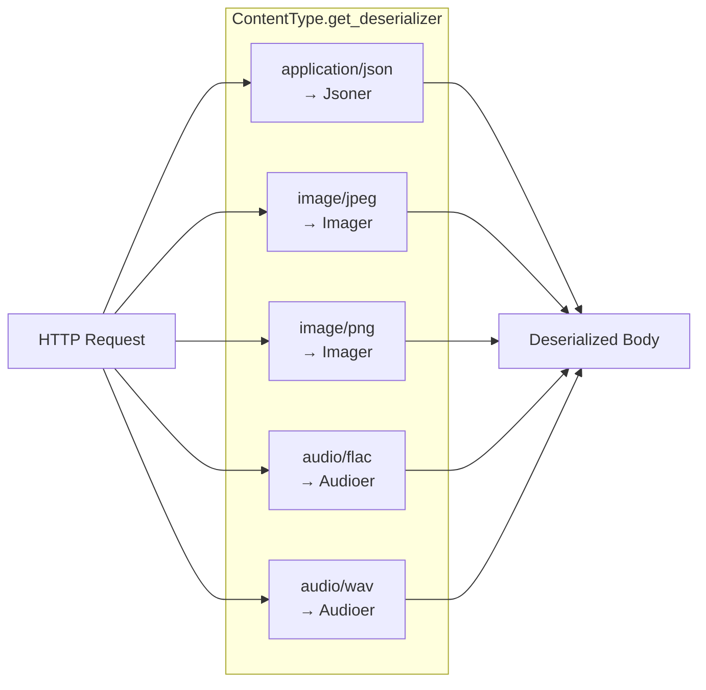
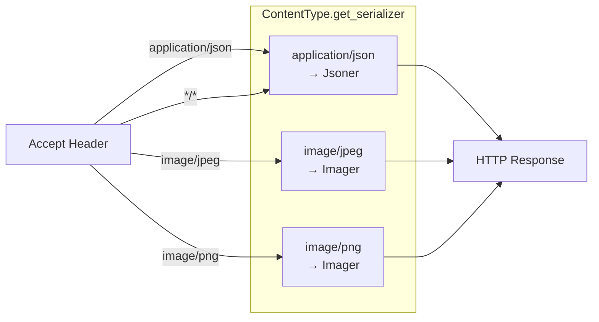

<!-- source: DeepWiki mcp.deepwiki.com · repo huggingface/huggingface-inference-toolkit · page 7 API Reference · fetched 2026-10-26 -->

# API Reference

<details>
<summary>Relevant source files</summary>

The following files were used as context for generating this wiki page:

- [README.md](README.md)
- [src/huggingface_inference_toolkit/const.py](src/huggingface_inference_toolkit/const.py)
- [src/huggingface_inference_toolkit/webservice_starlette.py](src/huggingface_inference_toolkit/webservice_starlette.py)
- [tests/integ/config.py](tests/integ/config.py)
- [tests/integ/utils.py](tests/integ/utils.py)
- [tests/unit/test_const.py](tests/unit/test_const.py)

</details>


This document provides a comprehensive reference for the HTTP API exposed by the Hugging Face Inference Toolkit. It covers all available endpoints, request/response formats, content type handling, and detailed specifications for each of the 31+ supported task types.

For deployment-specific configuration details, see [Configuration](#3). For information about implementing custom inference handlers, see [Custom Handlers and Pipelines](#6.4).

## HTTP Endpoints

The toolkit exposes different endpoints depending on the deployment mode. The web service layer is implemented in [src/huggingface_inference_toolkit/webservice_starlette.py]().

### Standard Mode Endpoints

When running in standard mode (non-Vertex AI), the following endpoints are available:



**Sources:** [src/huggingface_inference_toolkit/webservice_starlette.py:162-172]()

### Vertex AI Mode Endpoints

When `AIP_MODE=PREDICTION`, the toolkit uses custom routes defined by environment variables:



**Sources:** [src/huggingface_inference_toolkit/webservice_starlette.py:143-160]()

### Health Check Endpoint

**Route:** `GET /health` (standard) or `GET ${AIP_HEALTH_ROUTE}` (Vertex AI)

**Implementation:** [src/huggingface_inference_toolkit/webservice_starlette.py:69-70]()

**Response:**
```
Ok
```

**Content-Type:** `text/plain`

### Metrics Endpoint

**Route:** `GET /metrics` (standard mode only)

**Implementation:** [src/huggingface_inference_toolkit/webservice_starlette.py:76-82]()

**Response Format:**
```
inf_batch_current_size <number>
inf_queue_size <number>
```

Metrics exposed:
- `inf_batch_current_size`: Current number of requests being processed
- `inf_queue_size`: Number of requests waiting in the queue

**Sources:** [src/huggingface_inference_toolkit/webservice_starlette.py:73-82]()

## Request Format

The prediction endpoint accepts POST requests with either JSON or binary content.

### Request Structure Flow



**Sources:** [src/huggingface_inference_toolkit/webservice_starlette.py:85-139]()

### Standard Request Format

**Content-Type:** `application/json`

**Schema:**
```json
{
  "inputs": "<input_data>",
  "parameters": {
    "<parameter_name>": "<value>"
  }
}
```

**Fields:**
- `inputs` (required): The input data for inference. Format varies by task type.
- `parameters` (optional): Task-specific parameters to control inference behavior.

**Example:**
```bash
curl --request POST \
  --url http://localhost:5000 \
  --header 'Content-Type: application/json' \
  --data '{
    "inputs": "I love this product",
    "parameters": { "top_k": 2 }
  }'
```

**Sources:** [README.md:52-61](), [src/huggingface_inference_toolkit/webservice_starlette.py:94-97]()

### Vertex AI Request Format

When `AIP_MODE=PREDICTION`, the request format uses `instances` instead of `inputs`:

**Schema:**
```json
{
  "instances": ["<input_1>", "<input_2>"],
  "parameters": {
    "<parameter_name>": "<value>"
  }
}
```

**Example:**
```bash
curl --request POST \
  --url http://localhost:8080/pred \
  --header 'Content-Type: application/json' \
  --data '{
    "instances": ["I love this product", "I hate this product"],
    "parameters": { "top_k": 2 }
  }'
```

**Sources:** [README.md:96-103](), [src/huggingface_inference_toolkit/webservice_starlette.py:94]()

### Query Parameters

Query parameters can be used as an alternative to the `parameters` field in the request body. They will be automatically merged into the parameters dictionary.

**Implementation:** [src/huggingface_inference_toolkit/webservice_starlette.py:110-113]()

**Example:**
```bash
curl --request POST \
  --url http://localhost:5000?top_k=2&max_length=50 \
  --header 'Content-Type: application/json' \
  --data '{"inputs": "Translate this text"}'
```

**Sources:** [src/huggingface_inference_toolkit/webservice_starlette.py:110-113](), [src/huggingface_inference_toolkit/utils.py]() (convert_params_to_int_or_bool function)

### Binary Input Format

For image and audio tasks, binary data can be sent directly with appropriate content types.

**Image Tasks:**
- Content-Type: `image/jpeg`, `image/png`, etc.
- Body: Raw image bytes

**Audio Tasks:**
- Content-Type: `audio/flac`, `audio/wav`, etc.
- Body: Raw audio bytes (or base64-encoded in JSON with parameters)

**Example:**
```bash
curl --request POST \
  --url http://localhost:5000 \
  --header 'Content-Type: image/jpeg' \
  --data-binary @tiger.jpeg
```

**Base64 Encoding for Audio (with parameters):**

For audio tasks that require parameters, audio data must be base64-encoded within the JSON request:

```json
{
  "inputs": "<base64_encoded_audio>",
  "parameters": { "return_timestamps": "word" }
}
```

**Implementation:** [src/huggingface_inference_toolkit/webservice_starlette.py:100-107]()

**Sources:** [src/huggingface_inference_toolkit/webservice_starlette.py:100-107](), [tests/integ/config.py:142-147]()

## Response Format

### Success Response

**Status Code:** `200 OK`

**Content-Type:** Determined by the `Accept` header (defaults to `application/json`)

**Response Structure:**

The response format varies by task type but generally follows these patterns:

**Classification Tasks:**
```json
[
  {
    "label": "POSITIVE",
    "score": 0.9998
  },
  {
    "label": "NEGATIVE", 
    "score": 0.0002
  }
]
```

**Generation Tasks:**
```json
[
  {
    "generated_text": "The generated output text..."
  }
]
```

**Token Tasks:**
```json
[
  {
    "word": "Wolfgang",
    "score": 0.99,
    "entity": "I-PER",
    "index": 4,
    "start": 11,
    "end": 19
  }
]
```

**Sources:** [src/huggingface_inference_toolkit/webservice_starlette.py:125-132](), [tests/integ/config.py:182-265]()

### Error Response

**Status Code:** `400 Bad Request`

**Content-Type:** `application/json`

**Schema:**
```json
{
  "error": "<error_message>"
}
```

**Example:**
```json
{
  "error": "Body needs to provide a inputs key, received: {}"
}
```

**Implementation:** [src/huggingface_inference_toolkit/webservice_starlette.py:133-139]()

**Sources:** [src/huggingface_inference_toolkit/webservice_starlette.py:133-139]()

## Supported Tasks

The toolkit supports 31+ machine learning tasks across text, vision, audio, and multimodal domains. The task type is specified via the `HF_TASK` environment variable.

### Task Categories Overview



**Sources:** [tests/integ/config.py:22-116]()

### Complete Task Reference Table

The following table provides a comprehensive reference for all supported tasks, including model framework support, input format, and output structure.

| Task Type | PyTorch | TensorFlow | Input Format | Output Type |
|-----------|---------|------------|--------------|-------------|
| `text-classification` | ✓ | ✓ | String | Classification scores |
| `zero-shot-classification` | ✓ | ✓ | String + labels | Classification scores |
| `feature-extraction` | ✓ | ✓ | String | Embeddings array |
| `token-classification` | ✓ | ✓ | String | Token entities |
| `question-answering` | ✓ | ✓ | Question + context | Answer span |
| `fill-mask` | ✓ | ✓ | String with [MASK] | Token predictions |
| `summarization` | ✓ | ✓ | String | Summary text |
| `translation_xx_to_yy` | ✓ | ✓ | String | Translated text |
| `text2text-generation` | ✓ | ✓ | String | Generated text |
| `text-generation` | ✓ | ✓ | String | Generated text |
| `image-classification` | ✓ | ✓ | Image bytes | Classification scores |
| `zero-shot-image-classification` | ✓ | ✓ | Image bytes | Classification scores |
| `automatic-speech-recognition` | ✓ | ✗ | Audio bytes | Transcribed text |
| `audio-classification` | ✓ | ✗ | Audio bytes | Classification scores |
| `object-detection` | ✓ | ✗ | Image bytes | Bounding boxes |
| `image-segmentation` | ✓ | ✗ | Image bytes | Segmentation masks |
| `conversational` | ✓ | ✗ | Conversation history | Generated response |
| `sentence-similarity` | ✓ | ✗ | Source + sentences | Similarity scores |
| `sentence-embeddings` | ✓ | ✗ | String | Embedding vector |
| `sentence-ranking` | ✓ | ✗ | String array | Ranking scores |
| `text-to-image` | ✓ | ✗ | String prompt | Image bytes |
| `table-question-answering` | ✓ | ✗ | Query + table | Answer |
| `image-text-to-text` | ✓ | ✗ | Image URL + text | Generated text |

**Sources:** [tests/integ/config.py:22-116]()

## Task-Specific Examples

### Text Classification

**Task ID:** `text-classification`

**Request:**
```json
{
  "inputs": "I love you. I like you"
}
```

**Response:**
```json
[
  {
    "label": "POSITIVE",
    "score": 0.9998
  }
]
```

**Example Model:** `hf-internal-testing/tiny-random-distilbert`

**Sources:** [tests/integ/config.py:23-26, 120, 183]()

### Zero-Shot Classification

**Task ID:** `zero-shot-classification`

**Request:**
```json
{
  "inputs": "Hi, I recently bought a device from your company but it is not working as advertised and I would like to get reimbursed!",
  "parameters": {
    "candidate_labels": ["refund", "legal", "faq"]
  }
}
```

**Response:**
```json
{
  "sequence": "Hi, I recently bought a device...",
  "labels": ["refund", "faq", "legal"],
  "scores": [0.96, 0.027, 0.008]
}
```

**Example Model:** `hf-internal-testing/tiny-random-bart`

**Sources:** [tests/integ/config.py:28-30, 121-124, 184-188]()

### Token Classification (Named Entity Recognition)

**Task ID:** `token-classification`

**Request:**
```json
{
  "inputs": "My name is Wolfgang and I live in Berlin"
}
```

**Response:**
```json
[
  {
    "word": "Wolfgang",
    "score": 0.99,
    "entity": "I-PER",
    "index": 4,
    "start": 11,
    "end": 19
  },
  {
    "word": "Berlin",
    "score": 0.99,
    "entity": "I-LOC",
    "index": 9,
    "start": 34,
    "end": 40
  }
]
```

**Example Model:** `hf-internal-testing/tiny-random-roberta`

**Sources:** [tests/integ/config.py:35-38, 126, 189-206]()

### Question Answering

**Task ID:** `question-answering`

**Request:**
```json
{
  "inputs": {
    "question": "What is used for inference?",
    "context": "My Name is Philipp and I live in Nuremberg. This model is used with sagemaker for inference."
  }
}
```

**Response:**
```json
{
  "score": 0.99,
  "start": 68,
  "end": 77,
  "answer": "sagemaker"
}
```

**Example Model:** `hf-internal-testing/tiny-random-electra`

**Sources:** [tests/integ/config.py:39-42, 127-132, 207-212](), [README.md:56-60]()

### Fill Mask

**Task ID:** `fill-mask`

**Request:**
```json
{
  "inputs": "Paris is the [MASK] of France."
}
```

**Response:**
```json
[
  {
    "token": 1234,
    "token_str": "capital",
    "score": 0.95,
    "sequence": "Paris is the capital of France."
  }
]
```

**Example Model:** `hf-internal-testing/tiny-random-bert`

**Sources:** [tests/integ/config.py:43-46, 133]()

### Summarization

**Task ID:** `summarization`

**Request:**
```json
{
  "inputs": "The tower is 324 metres (1,063 ft) tall, about the same height as an 81-storey building, and the tallest structure in Paris. Its base is square, measuring 125 metres (410 ft) on each side. During its construction, the Eiffel Tower surpassed the Washington Monument to become the tallest man-made structure in the world, a title it held for 41 years until the Chrysler Building in New York City was finished in 1930..."
}
```

**Response:**
```json
[
  {
    "summary_text": "The Eiffel Tower is 324 metres tall and was the tallest structure in the world for 41 years."
  }
]
```

**Example Model:** `hf-internal-testing/tiny-random-bart`

**Sources:** [tests/integ/config.py:47-50, 134-136, 213]()

### Translation

**Task ID:** `translation_xx_to_yy`

**Request:**
```json
{
  "inputs": "My name is Sarah and I live in London"
}
```

**Response:**
```json
[
  {
    "translation_text": "Mein Name ist Sarah und ich lebe in London"
  }
]
```

**Example Model:** `hf-internal-testing/tiny-random-t5` (PyTorch), `hf-internal-testing/tiny-random-marian` (TensorFlow)

**Sources:** [tests/integ/config.py:51-54, 137, 214]()

### Text Generation

**Task ID:** `text-generation`

**Request:**
```json
{
  "inputs": "My name is philipp and I am",
  "parameters": {
    "max_length": 50,
    "temperature": 0.7
  }
}
```

**Response:**
```json
[
  {
    "generated_text": "My name is philipp and I am a software engineer working on machine learning..."
  }
]
```

**Example Model:** `hf-internal-testing/tiny-random-gpt2`

**Sources:** [tests/integ/config.py:59-62, 141]()

### Text-to-Text Generation

**Task ID:** `text2text-generation`

**Request:**
```json
{
  "inputs": "question: What is 42 context: 42 is the answer to life, the universe and everything."
}
```

**Response:**
```json
[
  {
    "generated_text": "42 is the answer to life, the universe and everything"
  }
]
```

**Example Model:** `hf-internal-testing/tiny-random-t5`

**Sources:** [tests/integ/config.py:55-58, 138-140, 215]()

### Image Classification

**Task ID:** `image-classification`

**Request:**
```bash
curl --request POST \
  --url http://localhost:5000 \
  --header 'Content-Type: image/jpeg' \
  --data-binary @tiger.jpeg
```

**Response:**
```json
[
  {
    "score": 0.8858,
    "label": "tiger, Panthera tigris"
  },
  {
    "score": 0.1094,
    "label": "tiger cat"
  }
]
```

**Example Model:** `hf-internal-testing/tiny-random-vit`

**Sources:** [tests/integ/config.py:63-66, 142, 219-231]()

### Automatic Speech Recognition

**Task ID:** `automatic-speech-recognition`

**Request (with base64 encoding):**
```json
{
  "inputs": "<base64_encoded_audio_data>",
  "parameters": {
    "return_timestamps": "word"
  }
}
```

**Response:**
```json
{
  "text": "GOING ALONG SLUSHY COUNTRY ROADS AND SPEAKING TO DAMP AUDIENCES..."
}
```

**Example Model:** `hf-internal-testing/tiny-random-Wav2Vec2Model`

**Note:** Audio data must be base64-encoded when sent with parameters. See [src/huggingface_inference_toolkit/webservice_starlette.py:100-107]() for implementation details.

**Sources:** [tests/integ/config.py:67-70, 146, 245-247](), [src/huggingface_inference_toolkit/webservice_starlette.py:100-107]()

### Audio Classification

**Task ID:** `audio-classification`

**Request:**
```bash
curl --request POST \
  --url http://localhost:5000 \
  --header 'Content-Type: audio/flac' \
  --data-binary @sample1.flac
```

**Response:**
```json
[
  {
    "label": "no",
    "score": 0.5053
  },
  {
    "label": "yes",
    "score": 0.4947
  }
]
```

**Example Model:** `hf-internal-testing/tiny-random-WavLMModel`

**Sources:** [tests/integ/config.py:71-74, 147, 248-251]()

### Object Detection

**Task ID:** `object-detection`

**Request:**
```bash
curl --request POST \
  --url http://localhost:5000 \
  --header 'Content-Type: image/jpeg' \
  --data-binary @image.jpeg
```

**Response:**
```json
[
  {
    "score": 0.9143,
    "label": "cat",
    "box": {
      "xmin": 100,
      "ymin": 150,
      "xmax": 400,
      "ymax": 500
    }
  }
]
```

**Example Model:** `hustvl/yolos-tiny`

**Sources:** [tests/integ/config.py:75-78, 144, 252]()

### Image Segmentation

**Task ID:** `image-segmentation`

**Request:**
```bash
curl --request POST \
  --url http://localhost:5000 \
  --header 'Content-Type: image/jpeg' \
  --data-binary @image.jpeg
```

**Response:**
```json
[
  {
    "score": 0.9143,
    "label": "cat",
    "mask": "<base64_encoded_mask>"
  }
]
```

**Example Model:** `hf-internal-testing/tiny-random-beit-pipeline`

**Sources:** [tests/integ/config.py:108-111, 145, 253]()

### Conversational

**Task ID:** `conversational`

**Request:**
```json
{
  "inputs": [
    {"role": "user", "content": "Which movie is the best?"}
  ]
}
```

**Response:**
```json
[
  {"role": "user", "content": "Which movie is the best?"},
  {"role": "assistant", "content": "It's Die Hard for sure."}
]
```

**Example Model:** `microsoft/DialoGPT-small`

**Sources:** [tests/integ/config.py:83-87, 159-163, 255-258]()

### Sentence Similarity

**Task ID:** `sentence-similarity`

**Request:**
```json
{
  "inputs": {
    "source_sentence": "Lets create an embedding",
    "sentences": ["Lets create an embedding", "This is different"]
  }
}
```

**Response:**
```json
{
  "similarities": [0.99, 0.42]
}
```

**Example Model:** `sentence-transformers/all-MiniLM-L6-v2`

**Sources:** [tests/integ/config.py:88-91, 164-169, 259]()

### Sentence Embeddings

**Task ID:** `sentence-embeddings`

**Request:**
```json
{
  "inputs": "Lets create an embedding"
}
```

**Response:**
```json
{
  "embeddings": [0.123, -0.456, 0.789, ...]
}
```

**Example Model:** `sentence-transformers/all-MiniLM-L6-v2`

**Sources:** [tests/integ/config.py:92-95, 170, 260]()

### Sentence Ranking

**Task ID:** `sentence-ranking`

**Request:**
```json
{
  "inputs": ["First sentence to rank", "Second sentence to rank"]
}
```

**Response:**
```json
{
  "scores": [0.85, 0.92]
}
```

**Example Model:** `cross-encoder/ms-marco-MiniLM-L-6-v2`

**Sources:** [tests/integ/config.py:96-99, 171, 261]()

### Text-to-Image

**Task ID:** `text-to-image`

**Request:**
```json
{
  "inputs": "a man on a horse jumps over a broken down airplane",
  "parameters": {
    "guidance_scale": 7.5,
    "num_inference_steps": 50,
    "seed": 42,
    "target_size": {"width": 512, "height": 512}
  }
}
```

**Response:**
Binary image data (Content-Type: `image/jpeg` or `image/png`)

**Example Models:** 
- `hf-internal-testing/tiny-stable-diffusion-torch`
- `stabilityai/stable-diffusion-xl-base-1.0`

**Note:** For detailed text-to-image parameter handling, see [Diffusers Integration](#6.1).

**Sources:** [tests/integ/config.py:100-103, 172, 262](), [README.md:44-45]()

### Table Question Answering

**Task ID:** `table-question-answering`

**Request:**
```json
{
  "inputs": {
    "query": "How many stars does the transformers repository have?",
    "table": {
      "Repository": ["Transformers", "Datasets", "Tokenizers"],
      "Stars": ["36542", "4512", "3934"],
      "Contributors": ["651", "77", "34"],
      "Programming language": ["Python", "Python", "Rust, Python and NodeJS"]
    }
  }
}
```

**Response:**
```json
{
  "answer": "36542"
}
```

**Example Model:** `philschmid/tapex-tiny`

**Sources:** [tests/integ/config.py:104-107, 148-158, 254]()

### Image-Text-to-Text

**Task ID:** `image-text-to-text`

**Request:**
```json
{
  "inputs": {
    "images": "https://huggingface.co/datasets/Narsil/image_dummy/raw/main/parrots.png",
    "text": "A photo of"
  }
}
```

**Response:**
```json
[
  {
    "input_text": "A photo of",
    "generated_text": "two colorful parrots sitting on a branch"
  }
]
```

**Example Model:** `Salesforce/blip-image-captioning-base`

**Sources:** [tests/integ/config.py:112-116, 174-179, 263]()

## Content Type Handling

The toolkit supports multiple content types for both requests and responses through a serialization system.

### Request Content Types



**Implementation:** [src/huggingface_inference_toolkit/webservice_starlette.py:88-92]()

**Supported Input Content Types:**
- `application/json` - Default for most tasks
- `image/jpeg`, `image/png`, `image/gif` - For vision tasks
- `audio/flac`, `audio/wav`, `audio/mp3` - For audio tasks

**Sources:** [src/huggingface_inference_toolkit/webservice_starlette.py:88-92](), [src/huggingface_inference_toolkit/serialization/]()

### Response Content Types

The response content type is determined by the `Accept` header in the request. If not specified or set to `*/*`, it defaults to `application/json`.



**Implementation:** [src/huggingface_inference_toolkit/webservice_starlette.py:125-132]()

**Supported Output Content Types:**
- `application/json` - Default for all tasks
- `image/jpeg`, `image/png` - For text-to-image tasks

**Sources:** [src/huggingface_inference_toolkit/webservice_starlette.py:125-132]()

## Common Parameters

Many tasks support common parameters that control inference behavior:

### Generation Parameters

Available for text generation tasks (`text-generation`, `text2text-generation`, `summarization`, `translation`):

| Parameter | Type | Default | Description |
|-----------|------|---------|-------------|
| `max_length` | int | varies | Maximum length of generated sequence |
| `max_new_tokens` | int | varies | Maximum number of tokens to generate |
| `min_length` | int | varies | Minimum length of generated sequence |
| `do_sample` | bool | false | Whether to use sampling |
| `temperature` | float | 1.0 | Sampling temperature |
| `top_k` | int | 50 | Top-k sampling parameter |
| `top_p` | float | 1.0 | Top-p (nucleus) sampling parameter |
| `num_beams` | int | 1 | Number of beams for beam search |
| `repetition_penalty` | float | 1.0 | Penalty for repetition |

### Classification Parameters

Available for classification tasks (`text-classification`, `image-classification`, etc.):

| Parameter | Type | Default | Description |
|-----------|------|---------|-------------|
| `top_k` | int | varies | Return top k predictions |

### Diffusers Parameters

Available for `text-to-image` task:

| Parameter | Type | Default | Description |
|-----------|------|---------|-------------|
| `guidance_scale` | float | 7.5 | Classifier-free guidance scale |
| `num_inference_steps` | int | 50 | Number of denoising steps |
| `seed` | int | random | Random seed for reproducibility |
| `target_size` | dict | {"width": 512, "height": 512} | Output image dimensions |
| `negative_prompt` | string | None | Negative prompt for guidance |

For detailed parameter handling per task, refer to the specific task sections above.

**Sources:** [tests/integ/config.py:119-180](), [src/huggingface_inference_toolkit/diffusers_utils.py]()

## AWS Inferentia2 Support

When deploying on AWS Inferentia2, additional configuration parameters are required:

### Required Environment Variables

- `HF_OPTIMUM_BATCH_SIZE`: Batch size for Neuron compilation (default: 1)
- `HF_OPTIMUM_SEQUENCE_LENGTH`: Sequence length for Neuron compilation (required)

### Example Request

```bash
curl --request POST \
  --url http://localhost:5000 \
  --header 'Content-Type: application/json' \
  --data '{
    "inputs": "Wow, this is such a great product. I love it!",
    "parameters": { "top_k": 2 }
  }'
```

For more details on Inferentia2 deployment, see [AWS Inferentia2 Deployment](#5.4) and [AWS Neuron Optimization](#6.3).

**Sources:** [README.md:131-196](), [src/huggingface_inference_toolkit/const.py]()

---

