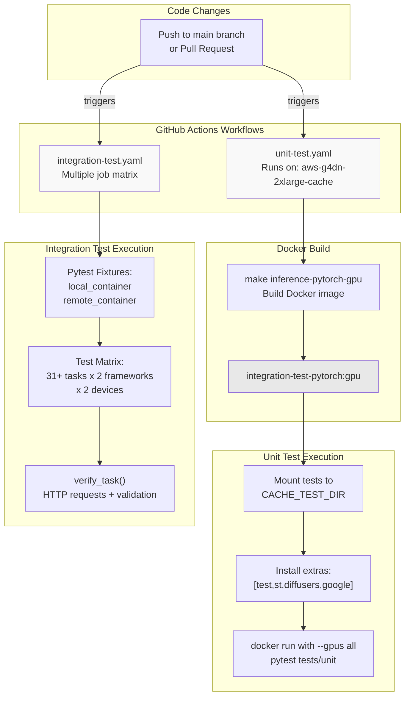
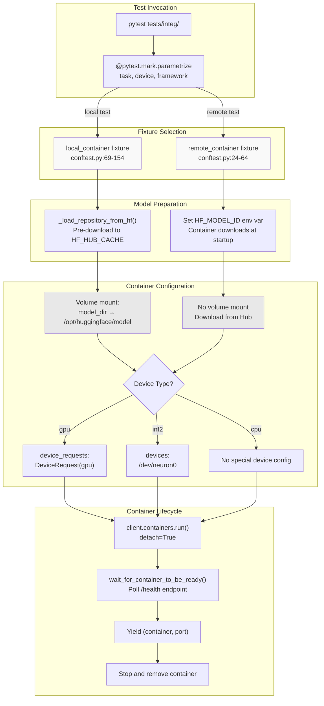
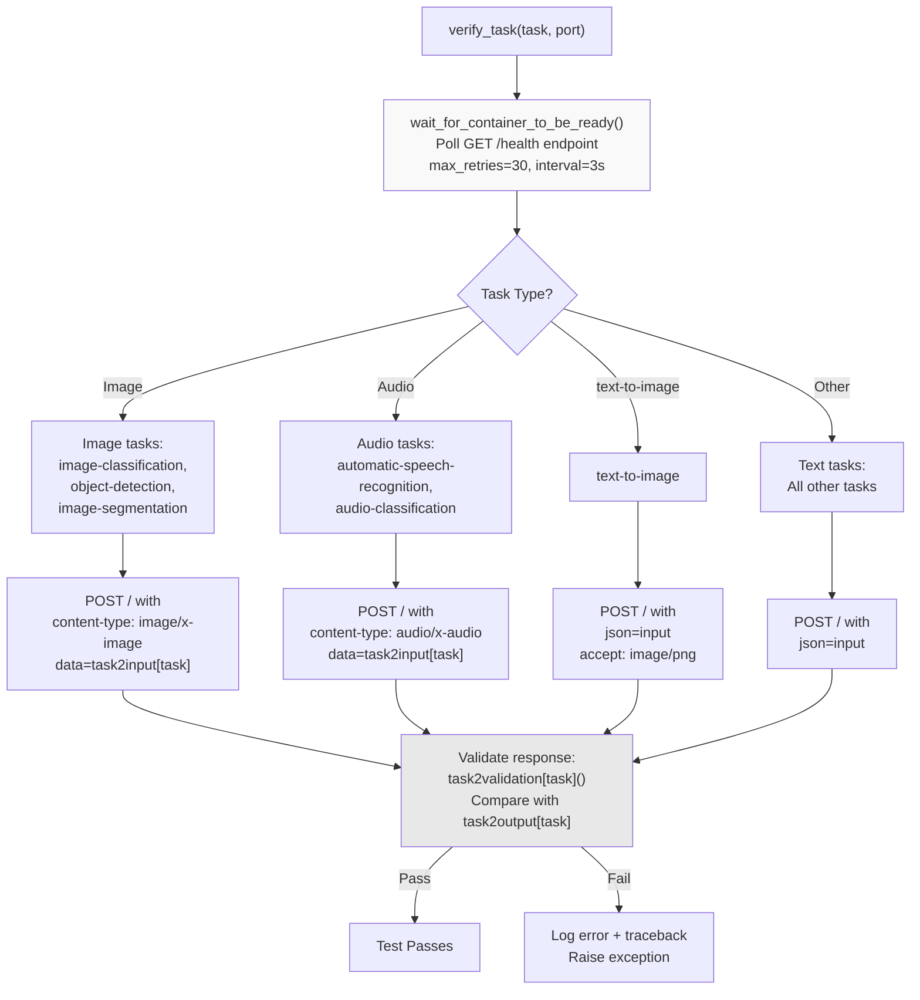

<!-- source: DeepWiki mcp.deepwiki.com · repo huggingface/huggingface-inference-toolkit · page 8 Testing · fetched 2026-10-26 -->

# Testing

<details>
<summary>Relevant source files</summary>

The following files were used as context for generating this wiki page:

- [.github/workflows/unit-test.yaml](.github/workflows/unit-test.yaml)
- [tests/integ/conftest.py](tests/integ/conftest.py)
- [tests/integ/helpers.py](tests/integ/helpers.py)

</details>


The Hugging Face Inference Toolkit employs a comprehensive testing strategy to ensure reliability across multiple deployment scenarios, frameworks (PyTorch and TensorFlow), device types (CPU, GPU, Inferentia2), and 31+ ML task types. The testing infrastructure consists of unit tests that validate individual components in isolation and integration tests that verify end-to-end functionality using Docker containers.

For details on CI/CD automation of these tests, see [CI/CD Pipeline](#9). For specific deployment testing scenarios, see [Deployment Guide](#5).

## Testing Strategy Overview

The toolkit uses a two-tier testing approach:

**Unit Tests**: Fast, isolated tests that validate individual functions and classes without requiring Docker containers or external dependencies. These tests focus on model loading logic, pipeline factory functions, handler initialization, and utility functions.

**Integration Tests**: Comprehensive end-to-end tests that validate the entire inference pipeline by launching Docker containers and making HTTP requests. These tests verify that models can be loaded, inference requests are processed correctly, and responses match expected formats across different task types, frameworks, and hardware configurations.

The testing infrastructure supports two distinct model loading scenarios:
- **Remote Model Testing**: Containers download models from Hugging Face Hub at runtime using `HF_MODEL_ID`
- **Local Model Testing**: Containers mount pre-downloaded models from the host filesystem using `HF_MODEL_DIR`

Sources: [.github/workflows/unit-test.yaml:1-50](), [tests/integ/conftest.py:1-154]()

## Test Infrastructure Architecture



**Test Infrastructure Components**

| Component | Purpose | Location |
|-----------|---------|----------|
| `unit-test.yaml` | GitHub Actions workflow for unit tests | [.github/workflows/unit-test.yaml:1-50]() |
| `conftest.py` | Pytest fixtures for container management | [tests/integ/conftest.py:1-154]() |
| `helpers.py` | Integration test helpers and verification | [tests/integ/helpers.py:1-445]() |
| `config.py` | Task-to-model mappings and test data | Referenced in child page [8.3](#8.3) |
| `aws-g4dn-2xlarge-cache` | Self-hosted GPU runner | [.github/workflows/unit-test.yaml:23]() |

Sources: [.github/workflows/unit-test.yaml:1-50](), [tests/integ/conftest.py:1-154](), [tests/integ/helpers.py:1-445]()

## Unit Test Execution

Unit tests run in a Docker container with GPU support and verify individual components without requiring full HTTP service startup.

### Unit Test Workflow

The unit test workflow executes the following steps:

1. **Container Build**: Builds the `integration-test-pytorch:gpu` Docker image using `make inference-pytorch-gpu` [.github/workflows/unit-test.yaml:39]()
2. **Test Directory Mounting**: Copies test files to a cache directory to avoid permission issues [.github/workflows/unit-test.yaml:30-35]()
3. **Dependency Installation**: Installs the package with test extras: `pip install '.[test,st,diffusers,google]'` [.github/workflows/unit-test.yaml:49]()
4. **Test Execution**: Runs pytest against the unit test directory with GPU access [.github/workflows/unit-test.yaml:40-49]()

### Running Unit Tests Locally

To run unit tests locally without Docker:

```bash
# Install with test dependencies
pip install -e '.[test,st,diffusers,google]'

# Run all unit tests
pytest tests/unit

# Run with verbose output
pytest tests/unit -v

# Run specific test file
pytest tests/unit/test_utils.py
```

To run unit tests in Docker (matching CI environment):

```bash
# Build the Docker image
make inference-pytorch-gpu

# Run unit tests in container
docker run \
  --gpus all \
  -v ./tests:/tests \
  --entrypoint /bin/bash \
  integration-test-pytorch:gpu \
  -c "pip install '.[test,st,diffusers,google]' && pytest /tests/unit"
```

**Environment Variables for Unit Tests**

| Variable | Default | Purpose |
|----------|---------|---------|
| `RUN_SLOW` | `True` | Enable slow tests (GPU-intensive) |
| `CACHE_TEST_DIR` | `/mnt/hf_cache/hf-inference-toolkit-tests` | Cache directory for test artifacts |

Sources: [.github/workflows/unit-test.yaml:1-50]()

## Integration Test Fixtures

Integration tests use pytest fixtures to manage Docker container lifecycle. The toolkit provides two distinct fixture strategies for different testing scenarios.



### `local_container` Fixture

The `local_container` fixture pre-downloads models to the host filesystem and mounts them into the container. This approach:

- **Speeds up tests** by avoiding repeated downloads
- **Simulates production deployments** where models are pre-packaged in container images
- **Tests the `HF_MODEL_DIR` code path** [tests/integ/conftest.py:80]()

**Key Implementation Details**:

```python
# Model directory construction
object_id = model.replace("/", "--")
model_dir = f"{HF_HUB_CACHE}/{object_id}"

# Pre-download model
_storage_dir = _load_repository_from_hf(
    repository_id=model, target_dir=model_dir
)

# Mount into container
volumes={model_dir: {"bind": "/opt/huggingface/model", "mode": "ro"}}
```

**Device-Specific Configuration**:

| Device | Configuration | Location |
|--------|---------------|----------|
| CPU | No special config | [tests/integ/conftest.py:122]() |
| GPU | `device_requests=[DeviceRequest(count=-1, capabilities=[["gpu"]])]` | [tests/integ/conftest.py:107-111]() |
| Inferentia2 | `devices={"/dev/neuron0": {...}}` + batch size/sequence length env vars | [tests/integ/conftest.py:112-122]() |

Sources: [tests/integ/conftest.py:67-154]()

### `remote_container` Fixture

The `remote_container` fixture passes the model ID as an environment variable, causing the container to download the model from Hugging Face Hub at startup. This approach:

- **Tests the `HF_MODEL_ID` code path** [tests/integ/conftest.py:53]()
- **Simulates first-time deployments** without pre-cached models
- **Verifies Hub integration** and authentication

**Key Implementation Details**:

```python
environment={
    "HF_MODEL_ID": model,
    "HF_TASK": task,
    "CUDA_LAUNCH_BLOCKING": 1
}
# No volume mount - model downloaded at runtime
```

Sources: [tests/integ/conftest.py:20-64]()

## Test Verification Process

Integration tests verify inference functionality using the `verify_task()` helper function, which executes the following workflow:



### Health Check Mechanism

The `wait_for_container_to_be_ready()` function polls the `/health` endpoint with exponential backoff:

- **Max retries**: 30 attempts [tests/integ/helpers.py:36]()
- **Retry interval**: 3 seconds [tests/integ/helpers.py:36]()
- **Success condition**: HTTP 200 response [tests/integ/helpers.py:44]()
- **Failure**: Raises the last exception after exhausting retries [tests/integ/helpers.py:55]()

### Task-Specific Request Handling

Different task types require different HTTP content types and request formats:

| Task Category | Content-Type | Request Format | Example Tasks |
|---------------|--------------|----------------|---------------|
| Image | `image/x-image` | Binary data | image-classification, object-detection |
| Audio | `audio/x-audio` | Binary data | automatic-speech-recognition |
| Text-to-Image | `application/json` | JSON with `accept: image/png` | text-to-image |
| Text/Other | `application/json` | JSON | text-classification, summarization |

Sources: [tests/integ/helpers.py:36-109]()

## Test Matrix Coverage

The integration test suite covers a comprehensive matrix of configurations:

### Supported Task Types (31+ tasks)

The test suite validates the following task categories:

**Transformers Standard Tasks** (21 tasks):
- Text: `text-classification`, `zero-shot-classification`, `token-classification`, `question-answering`, `fill-mask`, `summarization`, `translation_xx_to_yy`, `text2text-generation`, `text-generation`, `feature-extraction`, `conversational`
- Vision: `image-classification`, `object-detection`, `image-segmentation`, `image-text-to-text`
- Audio: `automatic-speech-recognition`, `audio-classification`
- Multimodal: `table-question-answering`

**Sentence Transformers Tasks** (3 tasks):
- `sentence-similarity`, `sentence-embeddings`, `sentence-ranking`

**Diffusers Tasks** (1 task):
- `text-to-image`

**Custom Handler Tasks**:
- Custom `handler.py` implementations
- Legacy `pipeline.py` implementations

### Test Function Matrix

| Test Function | Frameworks | Tasks | Fixture | Source |
|---------------|------------|-------|---------|--------|
| `test_pt_container_remote_model` | PyTorch | All 31 tasks | `remote_container` | [tests/integ/helpers.py:143-165]() |
| `test_pt_container_local_model` | PyTorch | All 31 tasks | `local_container` | [tests/integ/helpers.py:200-224]() |
| `test_pt_container_custom_handler` | PyTorch | Custom handlers | `local_container` | [tests/integ/helpers.py:232-261]() |
| `test_pt_container_legacy_custom_pipeline` | PyTorch | Legacy pipelines | `local_container` | [tests/integ/helpers.py:269-298]() |
| `test_tf_container_remote_model` | TensorFlow | 28 tasks (excludes diffusers) | `remote_container` | [tests/integ/helpers.py:330-352]() |
| `test_tf_container_local_model` | TensorFlow | 28 tasks (excludes diffusers) | `local_container` | [tests/integ/helpers.py:384-410]() |

### Device Configurations

Tests run across multiple device types based on environment:

| Device | Trigger | Docker Config | Source |
|--------|---------|---------------|--------|
| CPU | Default | No special config | [tests/integ/conftest.py:17]() |
| GPU | `RUN_SLOW=True` | `device_requests=[DeviceRequest(gpu)]` | [tests/integ/conftest.py:16-17]() |
| Inferentia2 | Manual/separate workflow | `devices={"/dev/neuron0": ...}` | [tests/integ/conftest.py:112-122]() |

Sources: [tests/integ/helpers.py:112-410](), [tests/integ/conftest.py:14-17]()

## Running Integration Tests Locally

### Prerequisites

1. Docker installed and running
2. Docker image built: `make inference-pytorch-gpu` or `make inference-pytorch-cpu`
3. (Optional) GPU with NVIDIA drivers for GPU tests

### Run All Integration Tests

```bash
# Build container
make inference-pytorch-gpu

# Run all integration tests (CPU mode)
pytest tests/integ/

# Run with GPU support
RUN_SLOW=True pytest tests/integ/
```

### Run Specific Task Tests

```bash
# Test only text-classification
pytest tests/integ/ -k "text-classification"

# Test only remote model loading
pytest tests/integ/ -k "remote_model"

# Test only local model loading
pytest tests/integ/ -k "local_model"

# Test custom handlers
pytest tests/integ/ -k "custom_handler"
```

### Environment Variables for Integration Tests

| Variable | Default | Purpose |
|----------|---------|---------|
| `RUN_SLOW` | `False` | Enable GPU tests |
| `HF_HUB_CACHE` | `~/.cache/huggingface/hub` | Model cache directory |
| `HF_HUB_TOKEN` | None | Authentication token for private models |

### Debugging Failed Tests

When an integration test fails, the fixture teardown logs the container output:

```python
# Teardown section of fixtures
previous = client.containers.get(container_name)
logs = previous.logs().decode("utf-8")
logging.info(f"Container logs:\n{logs}")
```

To access these logs:
1. Run pytest with `-s` flag to see stdout: `pytest tests/integ/ -s`
2. Increase logging verbosity: `pytest tests/integ/ -s --log-cli-level=DEBUG`
3. Keep container running by commenting out teardown code

Sources: [tests/integ/conftest.py:60-64](), [tests/integ/conftest.py:145-153]()

## Test Data Management

Integration tests rely on configuration mappings that define:

- **task2model**: Maps task types to specific Hugging Face model IDs for both PyTorch and TensorFlow
- **task2input**: Provides sample inputs for each task type
- **task2output**: Expected output snapshots for validation
- **task2validation**: Validation functions to compare predictions with expected outputs

For detailed documentation of these mappings, see [Test Configuration](#8.3).

Sources: [tests/integ/helpers.py:14](), [tests/integ/conftest.py:13]()

---

