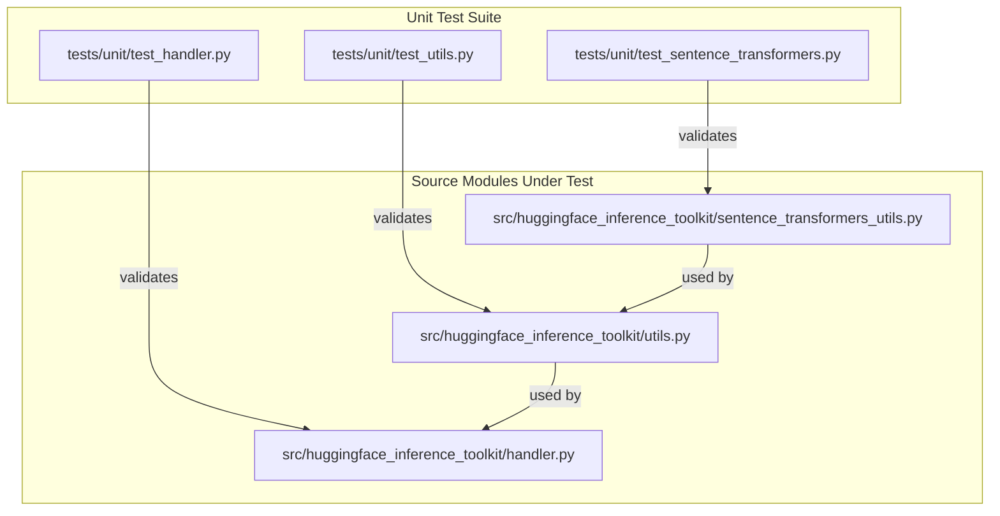
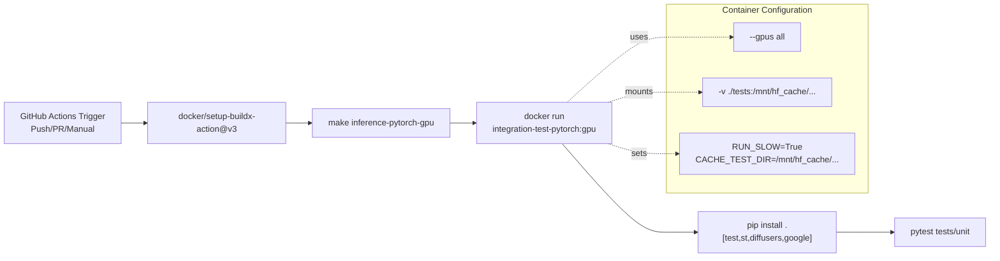
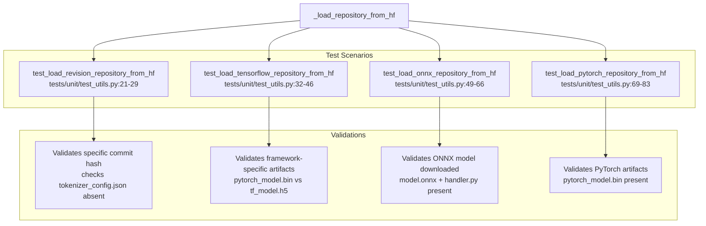
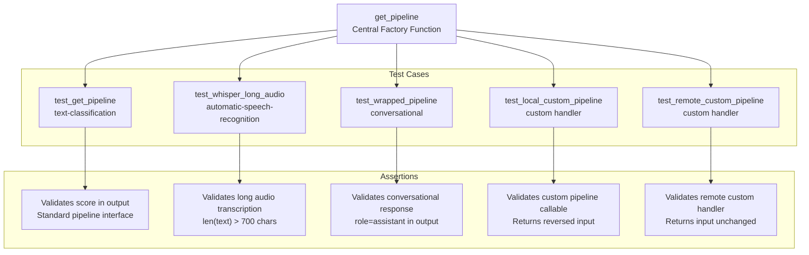
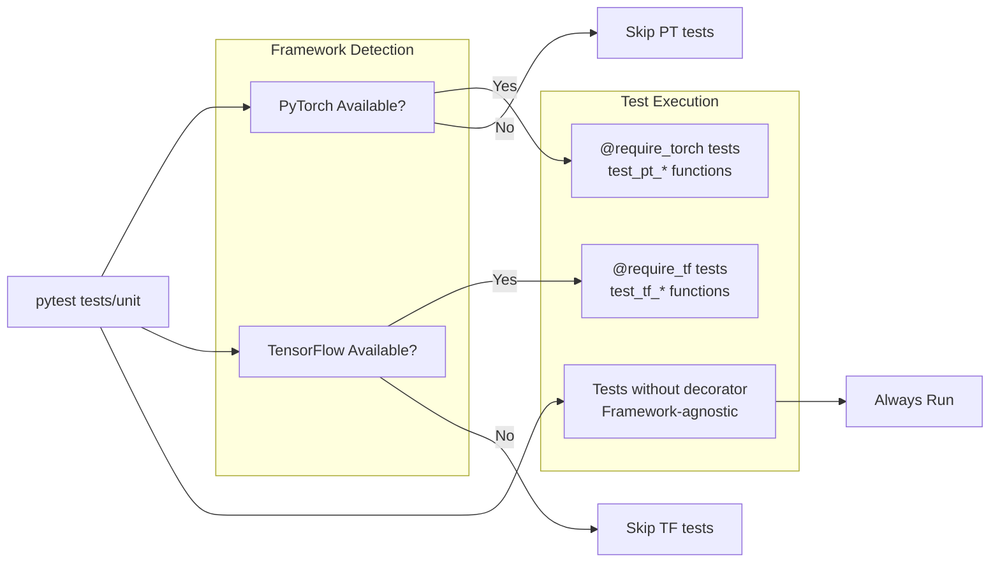

<!-- source: DeepWiki mcp.deepwiki.com · repo huggingface/huggingface-inference-toolkit · page 8.1 Unit Tests · fetched 2026-10-26 -->

# Unit Tests

<details>
<summary>Relevant source files</summary>

The following files were used as context for generating this wiki page:

- [.github/workflows/unit-test.yaml](.github/workflows/unit-test.yaml)
- [tests/unit/test_handler.py](tests/unit/test_handler.py)
- [tests/unit/test_sentence_transformers.py](tests/unit/test_sentence_transformers.py)
- [tests/unit/test_utils.py](tests/unit/test_utils.py)

</details>


## Purpose and Scope

This document describes the unit test suite for the Hugging Face Inference Toolkit. Unit tests validate individual components in isolation, including model loading utilities, framework detection, pipeline creation, inference handlers, and specialized pipeline implementations. These tests run quickly without requiring full integration with external services or Docker containers.

For information about Docker-based end-to-end testing across multiple tasks and devices, see [Integration Tests](#8.2). For the CI/CD automation that executes these tests, see [Unit Test Workflow](#9.1).

## Test Organization

The unit test suite is organized into three primary test modules, each focusing on a specific subsystem:



**Test Module Responsibilities:**

| Module | Lines of Code | Primary Functions Tested | Key Assertions |
|--------|---------------|-------------------------|----------------|
| `test_utils.py` | 207 | Model loading, framework detection, pipeline creation | Model artifacts downloaded correctly, framework detected properly, pipelines instantiated |
| `test_handler.py` | 120 | Handler initialization, device placement, inference execution | Correct device assignment, valid predictions, custom pipeline handling |
| `test_sentence_transformers.py` | 115 | Sentence transformers pipeline creation, embedding generation | Pipeline type correct, embeddings returned, similarity computed |

Sources: [tests/unit/test_utils.py:1-207](), [tests/unit/test_handler.py:1-120](), [tests/unit/test_sentence_transformers.py:1-115]()

## Test Execution Environment

Unit tests run in a GPU-enabled Docker container to validate GPU detection and device placement logic. The execution environment is configured through the GitHub Actions workflow:



**Environment Variables:**

- `RUN_SLOW`: When set to `True`, enables tests marked with `@slow` decorator [tests/unit/test_utils.py:86-89]()
- `CACHE_TEST_DIR`: Points to `/mnt/hf_cache/hf-inference-toolkit-tests` for model caching [.github/workflows/unit-test.yaml:26]()
- `AWS_REGION`: Set to `us-east-1` for any AWS-related operations [.github/workflows/unit-test.yaml:25]()

The workflow uses the `aws-g4dn-2xlarge-cache` runner group, which provides GPU capabilities for testing device assignment logic [.github/workflows/unit-test.yaml:23]().

Sources: [.github/workflows/unit-test.yaml:21-49]()

## Core Test Categories

### Model Loading Tests

Model loading tests validate the `_load_repository_from_hf` function's ability to download models from the Hugging Face Hub with various configurations:



**Key Test Functions:**

- `test_load_revision_repository_from_hf`: Downloads model at specific revision `eb4c77816edd604d0318f8e748a1c606a2888493` and verifies revision-specific artifacts [tests/unit/test_utils.py:21-29]()
- `test_load_tensorflow_repository_from_hf`: Uses `framework="tensorflow"` parameter to filter for TensorFlow artifacts, asserting `tf_model.h5` present and `pytorch_model.bin` absent [tests/unit/test_utils.py:32-46]()
- `test_load_onnx_repository_from_hf`: Downloads ONNX model and validates both `model.onnx` and `handler.py` are present [tests/unit/test_utils.py:49-66]()
- `test_load_pytorch_repository_from_hf`: Validates PyTorch model download with framework filtering [tests/unit/test_utils.py:69-83]()

Sources: [tests/unit/test_utils.py:21-83]()

### Framework Detection Tests

Framework detection tests validate the `_get_framework` function, which determines whether PyTorch or TensorFlow should be used:

**Test Coverage:**

- `test_get_framework_pytorch`: Decorated with `@require_torch`, asserts framework returns `"pytorch"` [tests/unit/test_utils.py:92-95]()
- `test_get_framework_tensorflow`: Decorated with `@require_tf`, checks if PyTorch is available and falls back to TensorFlow appropriately [tests/unit/test_utils.py:98-104]()

The tests use `transformers.testing_utils` decorators (`@require_torch`, `@require_tf`) to skip when dependencies are unavailable [tests/unit/test_utils.py:7]().

Sources: [tests/unit/test_utils.py:92-104]()

### Pipeline Creation Tests

Pipeline creation tests validate the `get_pipeline` factory function across different task types and model configurations:



**Notable Test Cases:**

- `test_get_pipeline`: Creates text-classification pipeline with `hf-internal-testing/tiny-random-BertForSequenceClassification` and validates prediction contains `score` field [tests/unit/test_utils.py:107-118]()
- `test_whisper_long_audio`: Tests automatic speech recognition with OpenAI Whisper, asserting transcription exceeds 700 characters for long audio file [tests/unit/test_utils.py:121-137]()
- `test_wrapped_pipeline`: Tests conversational pipeline with Microsoft DialoGPT, validating multi-turn conversation handling with `max_new_tokens=100` [tests/unit/test_utils.py:139-165]()

Sources: [tests/unit/test_utils.py:107-165]()

### Handler Tests

Handler tests validate the `HuggingFaceHandler` class, which wraps pipelines for inference execution:

```mermaid
graph TB
    subgraph "Handler Test Matrix"
        direction TB
        
        PTDevice["test_pt_get_device<br/>PyTorch device placement"]
        PTPredict["test_pt_predict_call<br/>PyTorch inference"]
        PTCustom["test_pt_custom_pipeline<br/>PyTorch custom handler"]
        PTST["test_pt_sentence_transformers_pipeline<br/>PyTorch sentence transformers"]
        
        TFDevice["test_tf_get_device<br/>TensorFlow device placement"]
        TFPredict["test_tf_predict_call<br/>TensorFlow inference"]
        TFCustom["test_tf_custom_pipeline<br/>TensorFlow custom handler"]
        TFST["test_tf_sentence_transformers_pipeline<br/>TensorFlow sentence transformers"]
    end
    
    subgraph "Device Assertions"
        PTDeviceCheck["CUDA available → cuda:0<br/>else → cpu"]
        TFDeviceCheck["GPU available → device=0<br/>else → device=-1"]
    end
    
    subgraph "Prediction Assertions"
        PredCheck["Output contains label and score"]
        CustomCheck["Custom handler returns input unchanged"]
        STCheck["Embeddings list returned"]
        STFailCheck["TF sentence transformers raises Exception"]
    end
    
    PTDevice --> PTDeviceCheck
    PTPredict --> PredCheck
    PTCustom --> CustomCheck
    PTST --> STCheck
    
    TFDevice --> TFDeviceCheck
    TFPredict --> PredCheck
    TFCustom --> CustomCheck
    TFST --> STFailCheck
```



**Device Placement Tests:**

- `test_pt_get_device`: Checks `h.pipeline.model.device` against `torch.cuda.is_available()`, expecting `torch.device(type="cuda", index=0)` when GPU available [tests/unit/test_handler.py:27-37]()
- `test_tf_get_device`: Validates TensorFlow handler sets `pipeline.device` to `0` for GPU or `-1` for CPU based on `_is_gpu_available()` [tests/unit/test_handler.py:76-84]()

**Inference Execution Tests:**

- `test_pt_predict_call` and `test_tf_predict_call`: Both validate handler callable returns predictions with `label` and `score` keys [tests/unit/test_handler.py:41-49](), [tests/unit/test_handler.py:88-96]()
- Custom pipeline tests use `philschmid/custom-pipeline-text-classification` model and validate `get_inference_handler_either_custom_or_default_handler` returns custom handler [tests/unit/test_handler.py:53-61](), [tests/unit/test_handler.py:100-108]()

Sources: [tests/unit/test_handler.py:1-120]()

### Custom Pipeline Tests

Custom pipeline tests validate the `check_and_register_custom_pipeline_from_directory` function, which detects and loads user-defined inference logic:

**Test Scenarios:**

1. **Local Custom Pipeline**: Tests local custom handler at `tests/resources/custom_handler`, validates pipeline path and reverses input string [tests/unit/test_utils.py:168-173]()
2. **Remote Custom Pipeline**: Downloads `philschmid/custom-pipeline-text-classification` from Hub, validates custom pipeline returns input unchanged [tests/unit/test_utils.py:176-186]()
3. **Handler Integration**: Tests `get_inference_handler_either_custom_or_default_handler` function's ability to detect and use custom handlers [tests/unit/test_utils.py:189-199]()

The local custom handler test uses a `cache_test_dir` fixture that provides access to test resources [tests/unit/test_utils.py:168]().

Sources: [tests/unit/test_utils.py:168-199]()

### Sentence Transformers Tests

Sentence transformers tests validate specialized pipelines for embeddings, similarity, and ranking tasks:

```mermaid
graph TB
    subgraph "Sentence Transformers Test Suite"
        direction TB
        
        GetPipeTest["test_get_sentence_transformers_pipeline<br/>Validates pipeline type"]
        EmbedTest["test_sentence_embedding_task<br/>Single and batch embeddings"]
        SimTest["test_sentence_similarity<br/>Cosine similarity"]
        RankTest["test_sentence_ranking<br/>Cross-encoder scoring"]
        RankTEITest["test_sentence_ranking_tei<br/>TEI-compatible format"]
        ValidationTest["test_sentence_ranking_validation_errors<br/>Input validation"]
    end
    
    subgraph "Models Used"
        AllMiniLM["sentence-transformers/all-MiniLM-L6-v2<br/>Bi-encoder for embeddings/similarity"]
        MsMarco["cross-encoder/ms-marco-MiniLM-L-6-v2<br/>Cross-encoder for ranking"]
    end
    
    subgraph "Assertions"
        TypeCheck["isinstance(pipe, SentenceEmbeddingPipeline)"]
        EmbedCheck["embeddings is list<br/>len(embeddings) == num_sentences"]
        SimCheck["similarities is list"]
        ScoreCheck["scores is list or float"]
        TEICheck["Output has index and score keys<br/>Optional text key"]
        ErrorCheck["ValueError raised for invalid inputs"]
    end
    
    GetPipeTest --> AllMiniLM
    EmbedTest --> AllMiniLM
    SimTest --> AllMiniLM
    RankTest --> MsMarco
    RankTEITest --> MsMarco
    ValidationTest --> MsMarco
    
    GetPipeTest --> TypeCheck
    EmbedTest --> EmbedCheck
    SimTest --> SimCheck
    RankTest --> ScoreCheck
    RankTEITest --> TEICheck
    ValidationTest --> ErrorCheck
```



**Test Coverage:**

- `test_get_sentence_transformers_pipeline`: Validates `get_pipeline` returns `SentenceEmbeddingPipeline` instance for `sentence-embeddings` task [tests/unit/test_sentence_transformers.py:16-21]()
- `test_sentence_embedding_task`: Tests both single sentence and batch embedding generation [tests/unit/test_sentence_transformers.py:24-33]()
- `test_sentence_similarity`: Validates similarity computation between source sentence and candidates [tests/unit/test_sentence_transformers.py:36-42]()
- `test_sentence_ranking`: Tests cross-encoder scoring for both sentence pairs and single sentences [tests/unit/test_sentence_transformers.py:45-58]()
- `test_sentence_ranking_tei`: Validates Text Embeddings Inference (TEI) compatible format with `query` and `texts` parameters [tests/unit/test_sentence_transformers.py:61-79]()
- `test_sentence_ranking_validation_errors`: Validates input validation raises `ValueError` for conflicting or missing parameters [tests/unit/test_sentence_transformers.py:82-114]()

Sources: [tests/unit/test_sentence_transformers.py:1-115]()

## Test Utilities and Fixtures

### Pytest Fixtures

The test suite defines custom fixtures for shared test resources:

**`input_data` Fixture**: Provides mutable input dictionary for handler tests, defined as fixture to prevent side effects from `pop` operations [tests/unit/test_handler.py:21-23]()

```python
@pytest.fixture
def input_data():
    return {"inputs": "My name is Wolfgang and I live in Berlin"}
```

**`cache_test_dir` Fixture**: Referenced in `test_whisper_long_audio` and `test_local_custom_pipeline`, provides path to test resources directory [tests/unit/test_utils.py:122](), [tests/unit/test_utils.py:169]()

### Transformers Test Utilities

Tests leverage decorators from `transformers.testing_utils` for conditional execution:

- `@require_torch`: Skips test if PyTorch not installed [tests/unit/test_utils.py:7]()
- `@require_tf`: Skips test if TensorFlow not installed [tests/unit/test_utils.py:7]()
- `@slow`: Marks test as slow, only runs when `RUN_SLOW` environment variable is `True` [tests/unit/test_utils.py:7]()

Example usage:
```python
@require_torch
def test_get_pipeline():
    # Test only runs if PyTorch available
    ...

@slow
def test_gpu_available():
    # Test only runs when RUN_SLOW=True
    device = _is_gpu_available()
    assert device is True
```

Sources: [tests/unit/test_utils.py:1-17](), [tests/unit/test_handler.py:1-14](), [tests/unit/test_sentence_transformers.py:1-13]()

## Running Unit Tests Locally

### Prerequisites

Install the package with test dependencies:

```bash
pip install '.[test,st,diffusers,google]'
```

This installs:
- `pytest` for test execution
- `sentence-transformers` extras for sentence transformers tests
- `diffusers` extras for diffusers tests (if needed)
- `google` extras for Google Cloud Storage tests (if needed)

### Execution Commands

**Run all unit tests:**
```bash
pytest tests/unit
```

**Run specific test module:**
```bash
pytest tests/unit/test_utils.py
pytest tests/unit/test_handler.py
pytest tests/unit/test_sentence_transformers.py
```

**Run specific test function:**
```bash
pytest tests/unit/test_utils.py::test_get_pipeline
pytest tests/unit/test_handler.py::test_pt_predict_call
```

**Run slow tests:**
```bash
RUN_SLOW=True pytest tests/unit
```

**Run with verbose output:**
```bash
pytest tests/unit -v
```

**Run with coverage:**
```bash
pytest tests/unit --cov=huggingface_inference_toolkit --cov-report=html
```

Sources: [.github/workflows/unit-test.yaml:41-49]()

## Test Dependencies and Models

### Test Models

The unit tests use small, fast-loading models to minimize test execution time:

| Test | Model Repository | Size | Purpose |
|------|------------------|------|---------|
| Framework detection | `lysandre/tiny-bert-random` | Tiny | Fast loading for framework tests |
| Handler tests | `hf-internal-testing/tiny-random-distilbert` | Tiny | Device placement and inference |
| Pipeline tests | `hf-internal-testing/tiny-random-BertForSequenceClassification` | Tiny | Classification pipeline |
| Speech recognition | `openai/whisper-tiny` | ~150MB | Audio transcription |
| Conversational | `microsoft/DialoGPT-small` | ~350MB | Multi-turn conversation |
| Sentence embeddings | `sentence-transformers/all-MiniLM-L6-v2` | ~90MB | Embeddings and similarity |
| Cross-encoder | `cross-encoder/ms-marco-MiniLM-L-6-v2` | ~90MB | Ranking tasks |
| Custom pipeline | `philschmid/custom-pipeline-text-classification` | Small | Custom handler validation |

### Framework-Specific Tests

Tests are conditionally executed based on installed frameworks:



This design allows the test suite to run in environments with only PyTorch, only TensorFlow, or both frameworks installed.

Sources: [tests/unit/test_utils.py:6-7](), [tests/unit/test_handler.py:5](), [tests/unit/test_sentence_transformers.py:4]()

---

