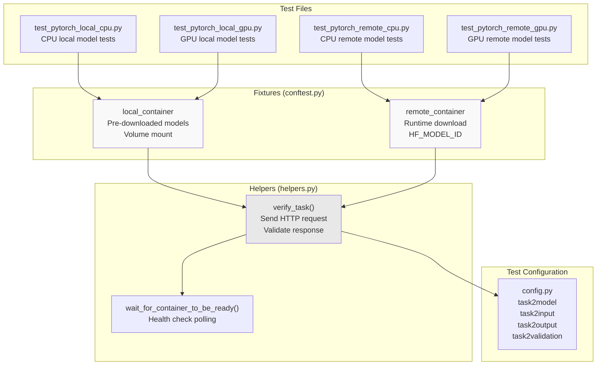
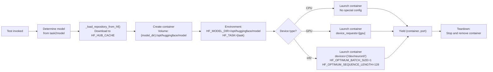
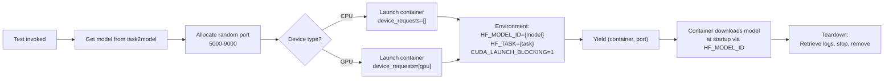
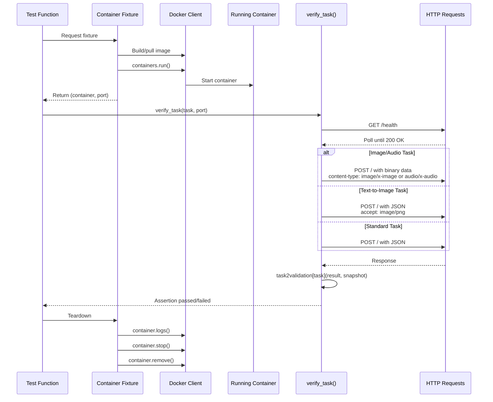
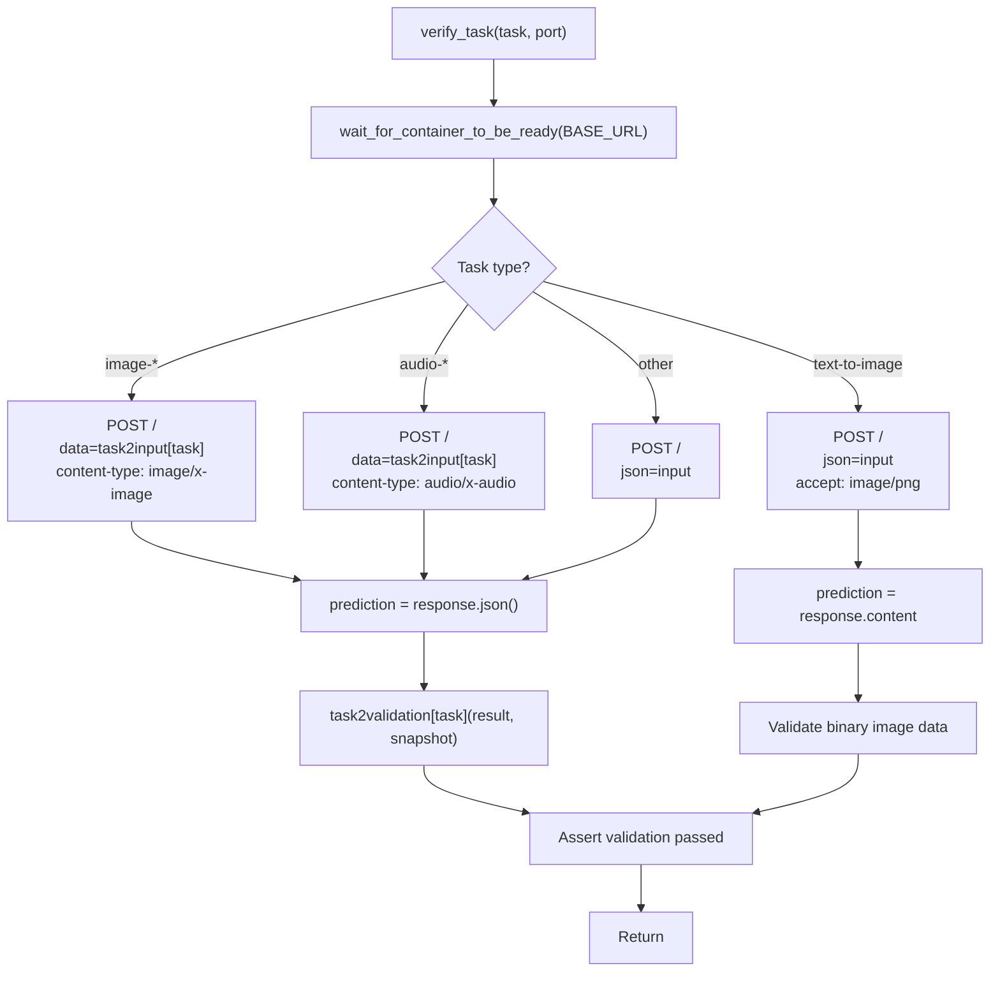
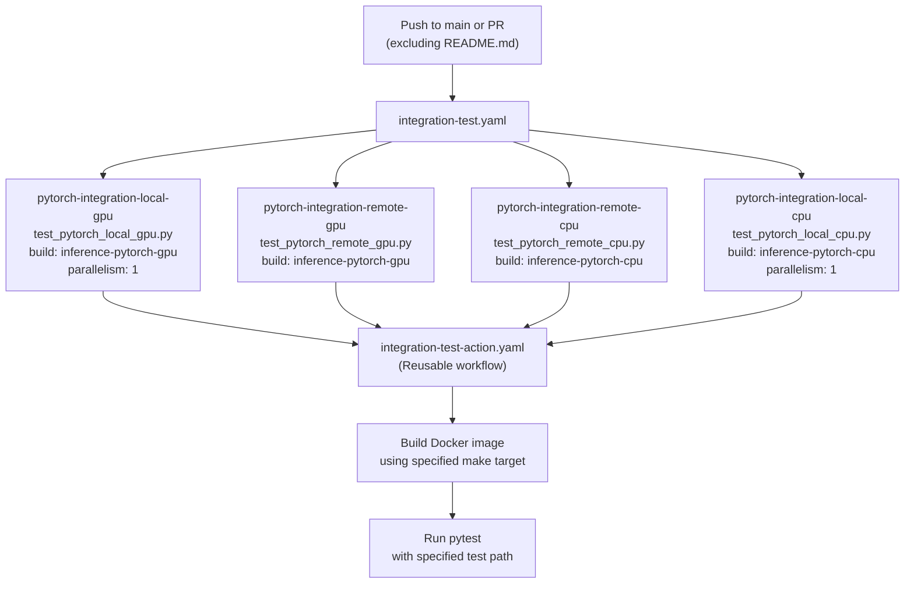
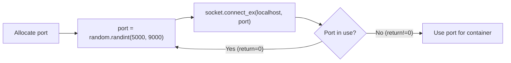
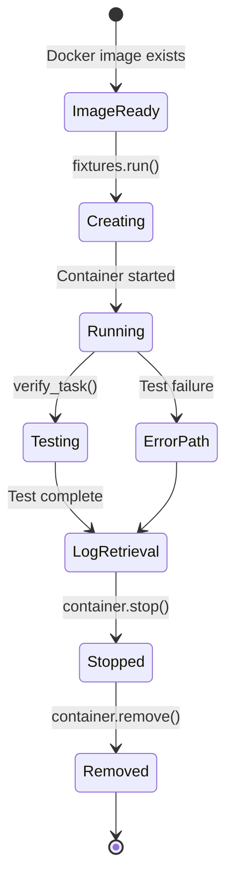

<!-- source: DeepWiki mcp.deepwiki.com · repo huggingface/huggingface-inference-toolkit · page 8.2 Integration Tests · fetched 2026-10-26 -->

# Integration Tests

<details>
<summary>Relevant source files</summary>

The following files were used as context for generating this wiki page:

- [.github/workflows/integration-test.yaml](.github/workflows/integration-test.yaml)
- [.github/workflows/quality.yaml](.github/workflows/quality.yaml)
- [tests/integ/conftest.py](tests/integ/conftest.py)
- [tests/integ/helpers.py](tests/integ/helpers.py)
- [tests/integ/test_pytorch_local_cpu.py](tests/integ/test_pytorch_local_cpu.py)
- [tests/integ/test_pytorch_local_gpu.py](tests/integ/test_pytorch_local_gpu.py)
- [tests/integ/test_pytorch_remote_cpu.py](tests/integ/test_pytorch_remote_cpu.py)
- [tests/integ/test_pytorch_remote_gpu.py](tests/integ/test_pytorch_remote_gpu.py)

</details>


## Purpose and Scope

Integration tests validate end-to-end inference functionality by running Docker containers and making HTTP requests to deployed models. These tests ensure that the complete system works correctly across different device types (CPU, GPU, Inferentia2), frameworks (PyTorch, TensorFlow), and model loading strategies (local vs. remote).

For information about unit testing individual components, see [Unit Tests](#8.1). For details about the task-to-model mappings and validation logic used by these tests, see [Test Configuration](#8.3).

Sources: [tests/integ/conftest.py:1-154](), [tests/integ/helpers.py:1-445]()

## Test Architecture Overview

The integration test suite is organized around **Docker-based container testing** where each test:
1. Builds a Docker image with the inference toolkit installed
2. Launches a container with specific environment variables
3. Waits for the container to become healthy
4. Sends HTTP requests to validate inference outputs
5. Tears down the container



Sources: [tests/integ/conftest.py:1-154](), [tests/integ/helpers.py:1-445](), [tests/integ/test_pytorch_local_cpu.py:1-90](), [tests/integ/test_pytorch_local_gpu.py:1-78]()

## Container Fixtures

### local_container Fixture

The `local_container` fixture pre-downloads models to the host machine and mounts them as read-only volumes into the container. This approach:
- **Reduces test execution time** by avoiding repeated downloads
- **Tests the local model loading path** (HF_MODEL_DIR)
- **Simulates deployment scenarios** where models are baked into images or mounted from persistent storage



Key implementation details in [tests/integ/conftest.py:68-154]():

| Line Range | Functionality |
|------------|---------------|
| 69-77 | Determines model from `task2model` mapping; handles custom tasks |
| 79-82 | Sets environment variables (HF_MODEL_DIR, HF_TASK) |
| 96-102 | Allocates random port and checks for conflicts |
| 107-111 | Configures GPU device requests |
| 112-122 | Configures Inferentia2 device mounting and environment variables |
| 124-129 | Downloads model using `_load_repository_from_hf` |
| 131-142 | Launches container with volume mount |
| 145-150 | Teardown: retrieves logs, stops, and removes container |

Sources: [tests/integ/conftest.py:68-154]()

### remote_container Fixture

The `remote_container` fixture provides the model ID as an environment variable and lets the container download it at startup. This approach:
- **Tests the Hub download path** (HF_MODEL_ID)
- **Validates runtime model loading** from Hugging Face Hub
- **Simulates typical production deployments** where containers fetch models on startup



Key implementation details in [tests/integ/conftest.py:20-65]():

| Line Range | Functionality |
|------------|---------------|
| 20-23 | Retry decorator for Docker API errors (up to 10 attempts) |
| 26 | Random sleep to stagger parallel test execution |
| 29-32 | Container naming and model lookup |
| 34-38 | Port allocation with conflict checking |
| 43-47 | GPU device request configuration |
| 49-57 | Container launch with HF_MODEL_ID environment variable |
| 60-64 | Teardown with log retrieval |

Sources: [tests/integ/conftest.py:20-65]()

## Test Execution Flow

The diagram below shows how a single integration test executes from start to finish:



Sources: [tests/integ/helpers.py:36-56](), [tests/integ/helpers.py:58-108]()

## Test Coverage Matrix

The integration tests cover a comprehensive set of tasks across different configurations:

### PyTorch Tests

| Test File | Fixture Type | Device | Task Count | Special Tests |
|-----------|--------------|--------|------------|---------------|
| test_pytorch_local_cpu.py | local_container | CPU | 18 standard tasks | Custom handler, legacy pipeline |
| test_pytorch_local_gpu.py | local_container | GPU | 18 standard tasks | Custom handler, legacy pipeline |
| test_pytorch_remote_cpu.py | remote_container | CPU | 18 standard tasks | - |
| test_pytorch_remote_gpu.py | remote_container | GPU | 18 standard tasks | - |

### Standard Tasks Tested

All PyTorch test files validate the following 18 tasks:

```python
# NLP Tasks
"text-classification", "zero-shot-classification", "token-classification",
"question-answering", "fill-mask", "summarization", "translation_xx_to_yy",
"text2text-generation", "text-generation", "feature-extraction",
"table-question-answering", "conversational"

# Vision Tasks
"image-classification", "object-detection", "image-segmentation"

# Audio Tasks
"automatic-speech-recognition", "audio-classification"

# Sentence Transformers Tasks
"sentence-similarity", "sentence-embeddings", "sentence-ranking"

# Diffusers Tasks
"text-to-image"
```

Sources: [tests/integ/test_pytorch_local_cpu.py:14-38](), [tests/integ/test_pytorch_local_gpu.py:10-34](), [tests/integ/test_pytorch_remote_cpu.py:15-40](), [tests/integ/test_pytorch_remote_gpu.py:16-40]()

### Custom Handler Tests

Both CPU and GPU local tests include validation for custom inference handlers:

| Repository ID | Purpose | Test Location |
|---------------|---------|---------------|
| philschmid/custom-handler-test | Basic custom handler | [tests/integ/test_pytorch_local_cpu.py:48-70]() |
| philschmid/custom-handler-distilbert | DistilBERT with custom handler | [tests/integ/test_pytorch_local_cpu.py:48-70]() |
| philschmid/custom-pipeline-text-classification | Legacy pipeline.py format | [tests/integ/test_pytorch_local_cpu.py:72-89]() |

Sources: [tests/integ/test_pytorch_local_cpu.py:54-89](), [tests/integ/test_pytorch_local_gpu.py:46-77]()

## Helper Functions

### verify_task Function

The `verify_task` function performs the actual inference validation by:
1. Polling the `/health` endpoint until the container is ready
2. Sending the appropriate HTTP request based on task type
3. Validating the response against expected output snapshots



**Implementation details** [tests/integ/helpers.py:58-108]():

- Lines 66-70: Retrieves task-specific input from `task2input` mapping
- Lines 72-87: Routes request based on task type (image, audio, text-to-image, standard)
- Lines 89-101: Validates responses using `task2validation` functions
- Lines 102-108: Comprehensive error logging with stack traces

Sources: [tests/integ/helpers.py:58-108]()

### wait_for_container_to_be_ready Function

This function implements a polling mechanism to wait for containers to complete startup:

```python
def wait_for_container_to_be_ready(
    base_url, 
    time_between_retries=3, 
    max_retries=30
)
```

**Behavior** [tests/integ/helpers.py:36-56]():
- Polls `GET /health` every 3 seconds
- Maximum of 30 retries (90 seconds total)
- Returns `True` on successful health check (200 status)
- Raises the last encountered error if all retries exhausted

This is critical because containers need time to:
1. Load model artifacts
2. Initialize the pipeline
3. Start the Starlette web server

Sources: [tests/integ/helpers.py:36-56]()

## Test Organization and Parametrization

Integration tests use pytest's parametrization extensively to create comprehensive test matrices:

### Parametrization Strategy

```python
@pytest.mark.parametrize("task", [18_tasks...])
@pytest.mark.parametrize("device", ["cpu"])
@pytest.mark.parametrize("framework", ["pytorch"])
@pytest.mark.parametrize("repository_id", [""])
@pytest.mark.usefixtures("local_container")
def test_pt_container_local_model(self, local_container, task, framework, device):
    verify_task(task=task, port=local_container[1])
```

This creates:
- **18 separate test instances** (one per task)
- Each test runs with its own container
- Fixtures receive parameters via pytest's parametrization mechanism

Sources: [tests/integ/test_pytorch_local_cpu.py:13-48]()

### Retry Mechanisms

Tests include retry logic to handle transient failures:

| Retry Type | Implementation | Purpose |
|------------|----------------|---------|
| Fixture-level | `@tenacity.retry` on fixtures | Handle Docker API errors during container creation |
| Test-level | `@tenacity.retry` on test methods | Retry entire test on any failure (CPU tests only) |

**Example** from [tests/integ/conftest.py:20-23]():
```python
@tenacity.retry(
    retry=tenacity.retry_if_exception(docker.errors.APIError),
    stop=tenacity.stop_after_attempt(10),
)
```

Sources: [tests/integ/conftest.py:20-23](), [tests/integ/test_pytorch_local_cpu.py:9-12]()

## GitHub Actions Integration

The integration tests run automatically via GitHub Actions workflows:



### Workflow Configuration

Each job in [.github/workflows/integration-test.yaml:18-44]() specifies:

| Parameter | Purpose | Example Values |
|-----------|---------|----------------|
| `test_path` | Which test file to execute | `tests/integ/test_pytorch_local_gpu.py` |
| `build_img_cmd` | Make command to build image | `make inference-pytorch-gpu` |
| `test_parallelism` | Number of parallel workers | `1` (local tests), default (remote tests) |

**Parallelism notes:**
- Local tests run with `parallelism: 1` to avoid volume mount conflicts
- Remote tests can run in parallel since each downloads its own model copy

Sources: [.github/workflows/integration-test.yaml:1-44]()

### Concurrency Control

The workflow uses concurrency groups to cancel redundant runs:

```yaml
concurrency:
  group: ${{ github.workflow }}-${{ github.head_ref || github.run_id }}
  cancel-in-progress: true
```

This ensures that:
- New pushes to a PR cancel previous integration test runs
- Resources are not wasted on outdated code versions

Sources: [.github/workflows/integration-test.yaml:14-16]()

## Port Allocation Strategy

Tests use random port allocation to avoid conflicts during parallel execution:



**Implementation** in fixtures:
- [tests/integ/conftest.py:31-38]() (remote_container)
- [tests/integ/conftest.py:96-102]() (local_container)

This prevents race conditions when multiple test workers start containers simultaneously.

Sources: [tests/integ/conftest.py:31-38](), [tests/integ/conftest.py:96-102]()

## Container Lifecycle Management

Each test follows a strict lifecycle to ensure proper cleanup:



**Teardown implementation** [tests/integ/conftest.py:145-150]():
1. Retrieve container logs using `previous.logs().decode("utf-8")`
2. Log output for debugging
3. Stop the container with `previous.stop()`
4. Remove the container with `previous.remove()`

This ensures no orphaned containers remain after test execution, even on failure.

Sources: [tests/integ/conftest.py:145-150](), [tests/integ/conftest.py:60-64]()

## Device-Specific Configuration

### GPU Configuration

GPU tests configure Docker device requests:

```python
device_request = [docker.types.DeviceRequest(count=-1, capabilities=[["gpu"]])]
```

- `count=-1`: Allocate all available GPUs
- Used in both local and remote container fixtures
- Allows testing GPU-accelerated inference

Sources: [tests/integ/conftest.py:43-47](), [tests/integ/conftest.py:107-111]()

### Inferentia2 Configuration

Inf2 tests mount Neuron devices and set optimization parameters:

```python
devices = {
    "/dev/neuron0": {
        "PathInContainer": "/dev/neuron0",
        "CgroupPermissions": "rwm",
    }
}
env["HF_OPTIMUM_BATCH_SIZE"] = 1
env["HF_OPTIMUM_SEQUENCE_LENGTH"] = 128
```

This configuration in [tests/integ/conftest.py:112-122]():
- Mounts the Neuron device into the container
- Sets required compilation parameters for static shapes
- Enables testing of AWS Inferentia2 deployment scenarios

Sources: [tests/integ/conftest.py:112-122]()

---

