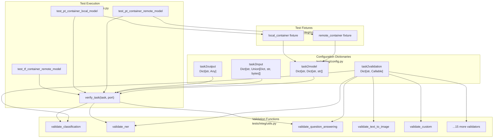
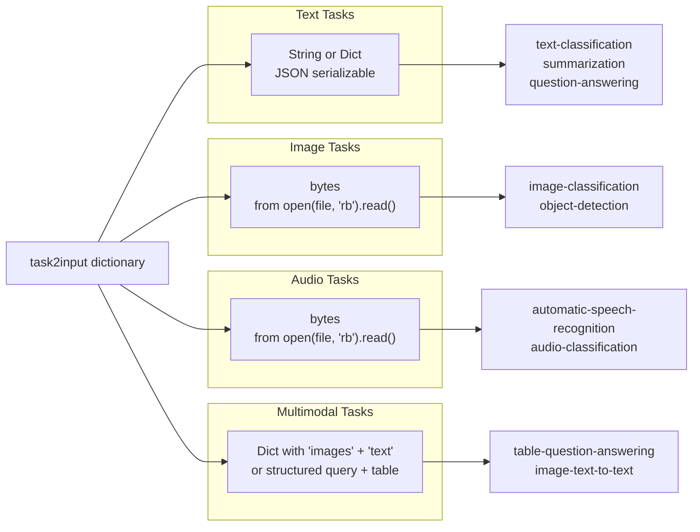
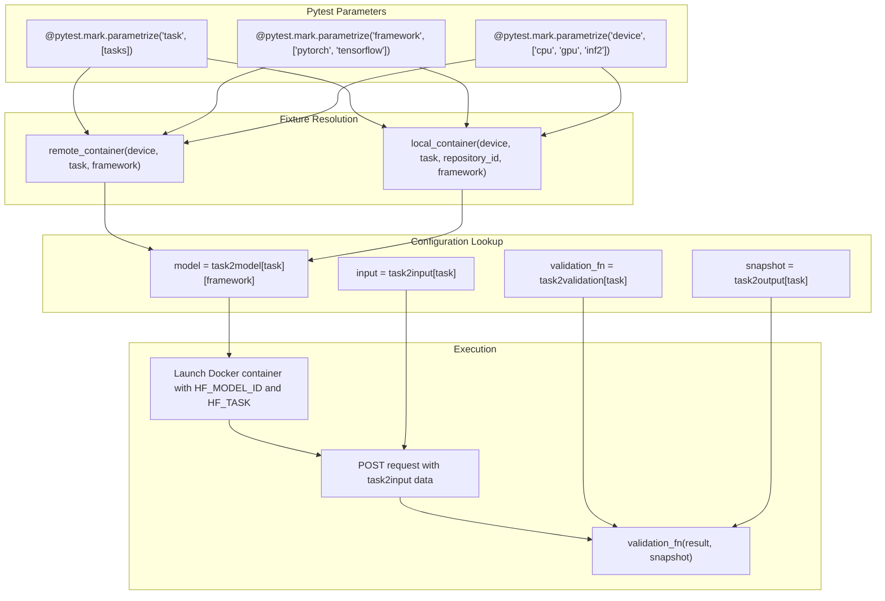

<!-- source: DeepWiki mcp.deepwiki.com · repo huggingface/huggingface-inference-toolkit · page 8.3 Test Configuration · fetched 2026-10-26 -->

# Test Configuration

<details>
<summary>Relevant source files</summary>

The following files were used as context for generating this wiki page:

- [tests/integ/config.py](tests/integ/config.py)
- [tests/integ/conftest.py](tests/integ/conftest.py)
- [tests/integ/helpers.py](tests/integ/helpers.py)
- [tests/integ/utils.py](tests/integ/utils.py)

</details>


## Purpose and Scope

This document describes the test configuration system located in [tests/integ/config.py]() that drives parametrized integration testing across the Hugging Face Inference Toolkit. The configuration defines mappings between tasks, models, test inputs, expected outputs, and validation functions that enable automated testing of 31+ machine learning tasks across multiple frameworks (PyTorch and TensorFlow).

For information about how these configurations are used in Docker-based integration tests, see [Integration Tests](#8.2). For unit testing details, see [Unit Tests](#8.1).

## Overview of Configuration Architecture

The test configuration system consists of four primary dictionaries that work together to enable comprehensive, parametrized testing:



**Sources:** [tests/integ/config.py:1-293](), [tests/integ/utils.py:1-97](), [tests/integ/helpers.py:1-445]()

## Configuration Dictionaries

### task2model: Model Selection Matrix

The `task2model` dictionary maps task types to specific model identifiers for each supported framework. This configuration determines which models are used during integration testing.

**Structure:** [tests/integ/config.py:22-116]()

```python
task2model = {
    "task-name": {
        "pytorch": "model-id-or-None",
        "tensorflow": "model-id-or-None",
    }
}
```

#### Supported Task Matrix

The following table shows all 31 supported tasks and their corresponding test models:

| Task Type | PyTorch Model | TensorFlow Model | Notes |
|-----------|---------------|------------------|-------|
| `text-classification` | `hf-internal-testing/tiny-random-distilbert` | `hf-internal-testing/tiny-random-distilbert` | Standard NLP |
| `zero-shot-classification` | `hf-internal-testing/tiny-random-bart` | `typeform/distilbert-base-uncased-mnli` | NLP |
| `feature-extraction` | `hf-internal-testing/tiny-random-bert` | `hf-internal-testing/tiny-random-bert` | Embeddings |
| `token-classification` | `hf-internal-testing/tiny-random-roberta` | `hf-internal-testing/tiny-random-roberta` | NER tasks |
| `question-answering` | `hf-internal-testing/tiny-random-electra` | `hf-internal-testing/tiny-random-electra` | QA |
| `fill-mask` | `hf-internal-testing/tiny-random-bert` | `hf-internal-testing/tiny-random-bert` | MLM |
| `summarization` | `hf-internal-testing/tiny-random-bart` | `hf-internal-testing/tiny-random-bart` | Seq2Seq |
| `translation_xx_to_yy` | `hf-internal-testing/tiny-random-t5` | `hf-internal-testing/tiny-random-marian` | Translation |
| `text2text-generation` | `hf-internal-testing/tiny-random-t5` | `hf-internal-testing/tiny-random-bart` | Seq2Seq |
| `text-generation` | `hf-internal-testing/tiny-random-gpt2` | `hf-internal-testing/tiny-random-gpt2` | Causal LM |
| `image-classification` | `hf-internal-testing/tiny-random-vit` | `hf-internal-testing/tiny-random-vit` | Vision |
| `automatic-speech-recognition` | `hf-internal-testing/tiny-random-Wav2Vec2Model` | `None` | PyTorch only |
| `audio-classification` | `hf-internal-testing/tiny-random-WavLMModel` | `None` | PyTorch only |
| `object-detection` | `hustvl/yolos-tiny` | `None` | PyTorch only |
| `zero-shot-image-classification` | `hf-internal-testing/tiny-random-clip-zero-shot-image-classification` | `hf-internal-testing/tiny-random-clip-zero-shot-image-classification` | Vision |
| `conversational` | `microsoft/DialoGPT-small` | `None` | PyTorch only |
| `sentence-similarity` | `sentence-transformers/all-MiniLM-L6-v2` | `None` | Sentence Transformers |
| `sentence-embeddings` | `sentence-transformers/all-MiniLM-L6-v2` | `None` | Sentence Transformers |
| `sentence-ranking` | `cross-encoder/ms-marco-MiniLM-L-6-v2` | `None` | Sentence Transformers |
| `text-to-image` | `hf-internal-testing/tiny-stable-diffusion-torch` | `None` | Diffusers |
| `table-question-answering` | `philschmid/tapex-tiny` | `None` | PyTorch only |
| `image-segmentation` | `hf-internal-testing/tiny-random-beit-pipeline` | `None` | PyTorch only |
| `image-text-to-text` | `Salesforce/blip-image-captioning-base` | `None` | Multimodal |

**Key Characteristics:**
- 23 tasks support PyTorch
- 15 tasks support TensorFlow
- All models use small/tiny variants for fast test execution
- Models prefixed with `hf-internal-testing/` are specifically designed for testing

**Sources:** [tests/integ/config.py:22-116]()

### task2input: Test Input Data

The `task2input` dictionary defines sample inputs for each task. Inputs vary by modality and include text strings, dictionaries with structured data, and binary file content for images and audio.

**Structure:** [tests/integ/config.py:119-180]()

#### Input Data Types by Task Category



**Sources:** [tests/integ/config.py:119-180]()

#### Example Input Configurations

**Simple Text Input:**
```python
"text-classification": {"inputs": "I love you. I like you"}
```
[tests/integ/config.py:120]()

**Structured Input with Parameters:**
```python
"zero-shot-classification": {
    "inputs": "Hi, I recently bought a device...",
    "parameters": {"candidate_labels": ["refund", "legal", "faq"]}
}
```
[tests/integ/config.py:121-124]()

**Context-based QA Input:**
```python
"question-answering": {
    "inputs": {
        "question": "What is used for inference?",
        "context": "My Name is Philipp and I live in Nuremberg. This model is used with sagemaker for inference."
    }
}
```
[tests/integ/config.py:127-132]()

**Binary Image Input:**
```python
"image-classification": open(os.path.join(os.getcwd(), "tests/resources/image/tiger.jpeg"), "rb").read()
```
[tests/integ/config.py:142]()

**Binary Audio Input:**
```python
"automatic-speech-recognition": open(os.path.join(os.getcwd(), "tests/resources/audio/sample1.flac"), "rb").read()
```
[tests/integ/config.py:146]()

**Multimodal Input:**
```python
"image-text-to-text": {
    "inputs": {
        "images": "https://huggingface.co/datasets/Narsil/image_dummy/raw/main/parrots.png",
        "text": "A photo of"
    }
}
```
[tests/integ/config.py:174-179]()

**Sources:** [tests/integ/config.py:119-180]()

### task2output: Expected Output Schemas

The `task2output` dictionary defines the expected structure and format of inference results. These serve as snapshots for validation, ensuring that API responses conform to expected schemas.

**Structure:** [tests/integ/config.py:182-265]()

#### Output Schema Examples

**Classification Output:**
```python
"text-classification": [{"label": "POSITIVE", "score": 0.01}]
```
[tests/integ/config.py:183]()

**Zero-Shot Classification Output:**
```python
"zero-shot-classification": {
    "sequence": "Hi, I recently bought a device...",
    "labels": ["refund", "faq", "legal"],
    "scores": [0.96, 0.027, 0.008]
}
```
[tests/integ/config.py:184-188]()

**Token Classification (NER) Output:**
```python
"token-classification": [
    {
        "word": "Wolfgang",
        "score": 0.99,
        "entity": "I-PER",
        "index": 4,
        "start": 11,
        "end": 19
    }
]
```
[tests/integ/config.py:189-206]()

**Image Output (Text-to-Image):**
```python
"text-to-image": bytes  # Binary PNG/JPEG data
```
[tests/integ/config.py:262]()

**Sentinel Values:** Some tasks use `None` as the snapshot value when exact output matching is not required:
- `feature-extraction`: `None` [tests/integ/config.py:216]()
- `fill-mask`: `None` [tests/integ/config.py:217]()
- `text-generation`: `None` [tests/integ/config.py:218]()

**Sources:** [tests/integ/config.py:182-265]()

### task2validation: Validation Function Registry

The `task2validation` dictionary maps each task to its validation function. These functions compare the actual inference result against the expected snapshot.

**Structure:** [tests/integ/config.py:268-293]()

```python
task2validation = {
    "text-classification": validate_classification,
    "token-classification": validate_ner,
    "question-answering": validate_question_answering,
    # ... 28 more mappings
}
```

#### Validation Function Mapping

```mermaid
graph TB
    subgraph "Validation Functions<br/>tests/integ/utils.py"
        direction TB
        ValidateClass["validate_classification<br/>lines 4-7"]
        ValidateZeroShot["validate_zero_shot_classification<br/>lines 14-22"]
        ValidateNER["validate_ner<br/>lines 25-31"]
        ValidateQA["validate_question_answering<br/>lines 34-38"]
        ValidateSumm["validate_summarization<br/>lines 41-43"]
        ValidateTranslation["validate_translation<br/>lines 51-53"]
        ValidateTextGen["validate_text_generation<br/>lines 56-58"]
        ValidateFE["validate_feature_extraction<br/>lines 61-63"]
        ValidateFM["validate_fill_mask<br/>lines 66-68"]
        ValidateASR["validate_automatic_speech_recognition<br/>lines 71-74"]
        ValidateOD["validate_object_detection<br/>lines 77-79"]
        ValidateT2I["validate_text_to_image<br/>lines 82-84"]
        ValidateIT2T["validate_image_text_to_text<br/>lines 87-90"]
        ValidateCustom["validate_custom<br/>lines 93-96"]
        ValidateConv["validate_conversational<br/>lines 10-11"]
    end
    
    subgraph "Task Groups"
        direction TB
        ClassificationTasks["text-classification<br/>image-classification<br/>audio-classification"]
        ZeroShotTasks["zero-shot-classification<br/>sentence-similarity<br/>sentence-embeddings<br/>sentence-ranking<br/>table-question-answering"]
        StructuredTasks["token-classification<br/>question-answering<br/>object-detection<br/>image-segmentation"]
        GenerationTasks["summarization<br/>translation<br/>text-generation<br/>text2text-generation<br/>fill-mask<br/>feature-extraction"]
        SpecializedTasks["automatic-speech-recognition<br/>text-to-image<br/>image-text-to-text<br/>conversational<br/>custom"]
    end
    
    ClassificationTasks --> ValidateClass
    ZeroShotTasks --> ValidateZeroShot
    StructuredTasks --> ValidateNER
    StructuredTasks --> ValidateQA
    StructuredTasks --> ValidateOD
    GenerationTasks --> ValidateSumm
    GenerationTasks --> ValidateTranslation
    GenerationTasks --> ValidateTextGen
    GenerationTasks --> ValidateFE
    GenerationTasks --> ValidateFM
    SpecializedTasks --> ValidateASR
    SpecializedTasks --> ValidateT2I
    SpecializedTasks --> ValidateIT2T
    SpecializedTasks --> ValidateConv
    SpecializedTasks --> ValidateCustom
```



**Sources:** [tests/integ/config.py:268-293](), [tests/integ/utils.py:1-97]()

## Validation Function Implementations

Validation functions in [tests/integ/utils.py]() implement different validation strategies based on task requirements.

### Strict Schema Validation

**validate_classification** [tests/integ/utils.py:4-7]()
- Validates that result contains same keys as snapshot
- Used for: `text-classification`, `image-classification`, `audio-classification`
- Checks structure but not exact values

**validate_ner** [tests/integ/utils.py:25-31]()
- Validates token classification output structure
- Checks first item's keys match snapshot
- Used for: `token-classification`

**validate_question_answering** [tests/integ/utils.py:34-38]()
- Validates QA response contains required keys: `score`, `start`, `end`, `answer`
- Used for: `question-answering`

### Flexible Content Validation

**validate_zero_shot_classification** [tests/integ/utils.py:14-22]()
- Validates dictionary keys match between result and snapshot
- Does not enforce exact label ordering or score values
- Used for: `zero-shot-classification`, `sentence-similarity`, `sentence-embeddings`, `sentence-ranking`, `table-question-answering`

**validate_object_detection** [tests/integ/utils.py:77-79]()
- Validates first item's keys match snapshot structure
- Used for: `object-detection`, `image-segmentation`

### Existence-Only Validation

**validate_summarization** [tests/integ/utils.py:41-43]()
```python
def validate_summarization(result=None, snapshot=None):
    assert result is not None
    return True
```

Similar simple existence checks are used for:
- `validate_text_generation` [tests/integ/utils.py:56-58]()
- `validate_translation` [tests/integ/utils.py:51-53]()
- `validate_feature_extraction` [tests/integ/utils.py:61-63]()
- `validate_fill_mask` [tests/integ/utils.py:66-68]()
- `validate_text2text_generation` [tests/integ/utils.py:46-48]()

### Type-Based Validation

**validate_text_to_image** [tests/integ/utils.py:82-84]()
```python
def validate_text_to_image(result=None, snapshot=None):
    assert isinstance(result, snapshot)  # snapshot is 'bytes' type
    return True
```

**validate_image_text_to_text** [tests/integ/utils.py:87-90]()
```python
def validate_image_text_to_text(result=None, snapshot=None):
    assert isinstance(result, list)
    assert all(isinstance(d, dict) and d.keys() == {"input_text", "generated_text"} for d in result)
    return True
```

### Special Cases

**validate_automatic_speech_recognition** [tests/integ/utils.py:71-74]()
- Validates result exists and contains `"text"` key
- Checks transcription was produced

**validate_conversational** [tests/integ/utils.py:10-11]()
- Validates generated conversation is longer than original input
- Checks for absence of error keys

**validate_custom** [tests/integ/utils.py:93-96]()
- Performs exact equality check
- Used for custom handler validation

**Sources:** [tests/integ/utils.py:1-97]()

## Usage in Parametrized Tests

The configuration dictionaries enable parametrized testing through pytest's `@pytest.mark.parametrize` decorator. This allows running the same test logic across all supported tasks.

### Test Fixture Integration



**Sources:** [tests/integ/conftest.py:24-154](), [tests/integ/helpers.py:58-109]()

### Container Fixture Configuration

**remote_container fixture** [tests/integ/conftest.py:24-64]()
- Downloads model at runtime via `HF_MODEL_ID` environment variable
- Retrieves model from `task2model[task][framework]`
- Sets `HF_TASK` environment variable
- Example: [tests/integ/conftest.py:32]()
  ```python
  model = task2model[task][framework]
  ```

**local_container fixture** [tests/integ/conftest.py:68-153]()
- Pre-downloads model using `_load_repository_from_hf`
- Mounts model directory to `/opt/huggingface/model`
- Sets `HF_MODEL_DIR` and `HF_TASK` environment variables
- Also uses `task2model` for model lookup: [tests/integ/conftest.py:73]()
  ```python
  model = task2model[task][framework]
  ```

**Sources:** [tests/integ/conftest.py:24-154]()

### Verification Flow

The `verify_task` function demonstrates how all configuration dictionaries are used together:

[tests/integ/helpers.py:58-108]()

**Step 1: Input Lookup**
```python
input = task2input[task]
```

**Step 2: Content-Type Detection**
- Image tasks: `content-type: image/x-image` [tests/integ/helpers.py:72-81]()
- Audio tasks: `content-type: audio/x-audio` [tests/integ/helpers.py:82-87]()
- Text-to-image: `accept: image/png` [tests/integ/helpers.py:88-89]()
- Default: JSON payload [tests/integ/helpers.py:91]()

**Step 3: Response Validation**
```python
assert task2validation[task](result=prediction, snapshot=task2output[task])
```
[tests/integ/helpers.py:101]()

**Sources:** [tests/integ/helpers.py:58-108]()

### Example Parametrized Test

[tests/integ/helpers.py:111-166]()

```python
@require_torch
@pytest.mark.parametrize(
    "task",
    [
        "text-classification",
        "zero-shot-classification",
        # ... 18 more tasks
        "text-to-image",
    ],
)
def test_pt_container_remote_model(task: str) -> None:
    framework = "pytorch"
    model = task2model[task][framework]  # Configuration lookup
    
    container = client.containers.run(
        container_image,
        environment={"HF_MODEL_ID": model, "HF_TASK": task},
        # ...
    )
    
    verify_task(task=task, port=port)  # Uses all 4 config dicts
```

This single test function is executed 21 times (once per task in the parametrize list), with each execution using the appropriate model, input, output, and validation function from the configuration dictionaries.

**Sources:** [tests/integ/helpers.py:111-166]()

## Framework Support Matrix

The following table summarizes framework support across all tasks:

| Support Level | Task Count | Examples |
|---------------|------------|----------|
| PyTorch + TensorFlow | 9 | `text-classification`, `question-answering`, `fill-mask` |
| PyTorch only | 14 | `automatic-speech-recognition`, `object-detection`, `sentence-similarity`, `text-to-image` |

**PyTorch-only tasks** are skipped in TensorFlow test runs via:
```python
if model is None:
    pytest.skip("no supported TF model")
```
[tests/integ/helpers.py:337]()

**Sources:** [tests/integ/config.py:22-116](), [tests/integ/helpers.py:330-352]()

## Custom Handler Testing

Special task configurations exist for testing custom inference handlers:

**Custom Handler Input:** [tests/integ/config.py:173]()
```python
"custom": {"inputs": "this is a test"}
```

**Custom Handler Output:** [tests/integ/config.py:264]()
```python
"custom": {"inputs": "this is a test"}  # Echo expected
```

**Custom Handler Validation:** [tests/integ/config.py:292]()
```python
"custom": validate_custom  # Exact equality check
```

Custom handler tests use repository IDs instead of task names:
- `philschmid/custom-handler-test` [tests/integ/helpers.py:230]()
- `philschmid/custom-handler-distilbert` [tests/integ/helpers.py:230]()
- `philschmid/custom-pipeline-text-classification` [tests/integ/helpers.py:267]()

**Sources:** [tests/integ/config.py:173,264,292](), [tests/integ/helpers.py:228-299]()

---

