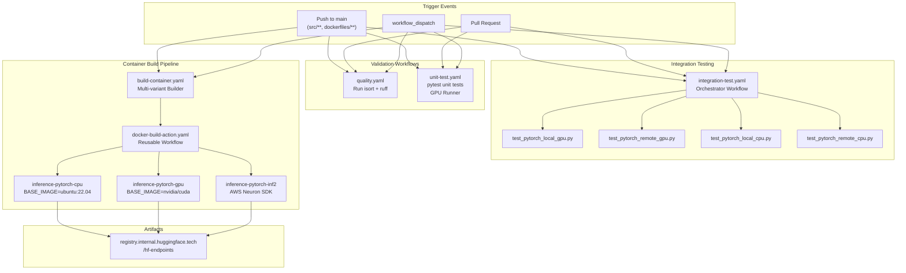
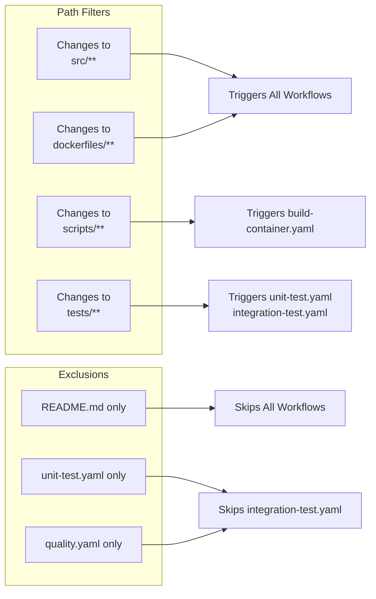
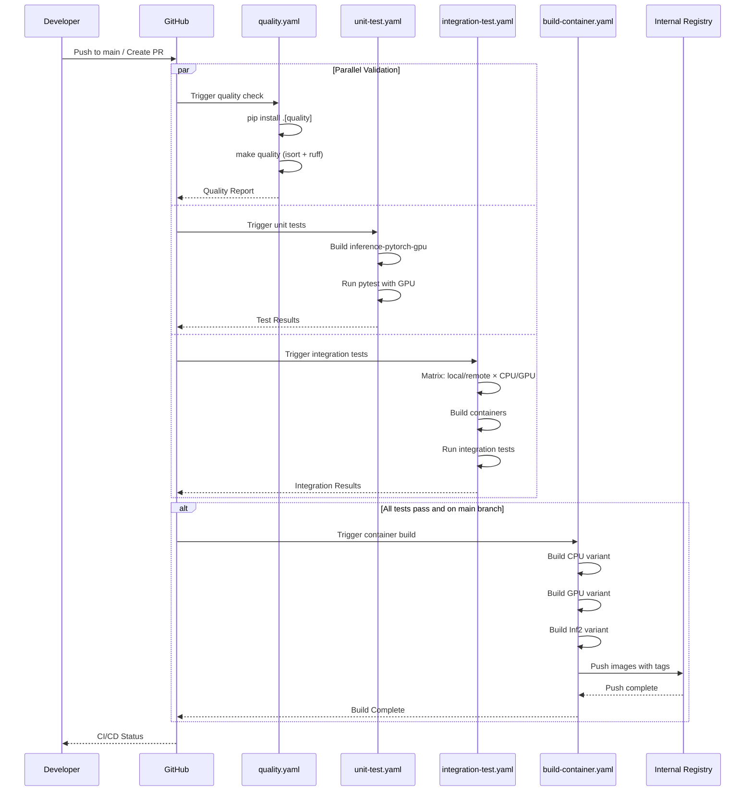
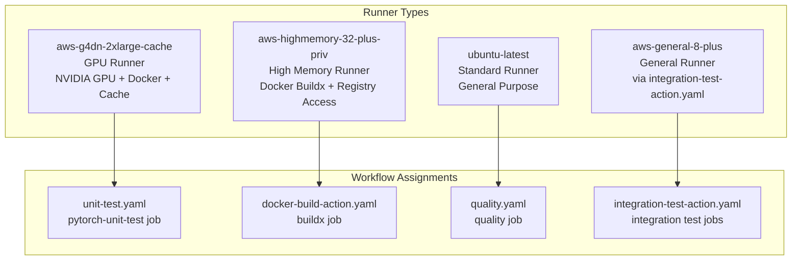
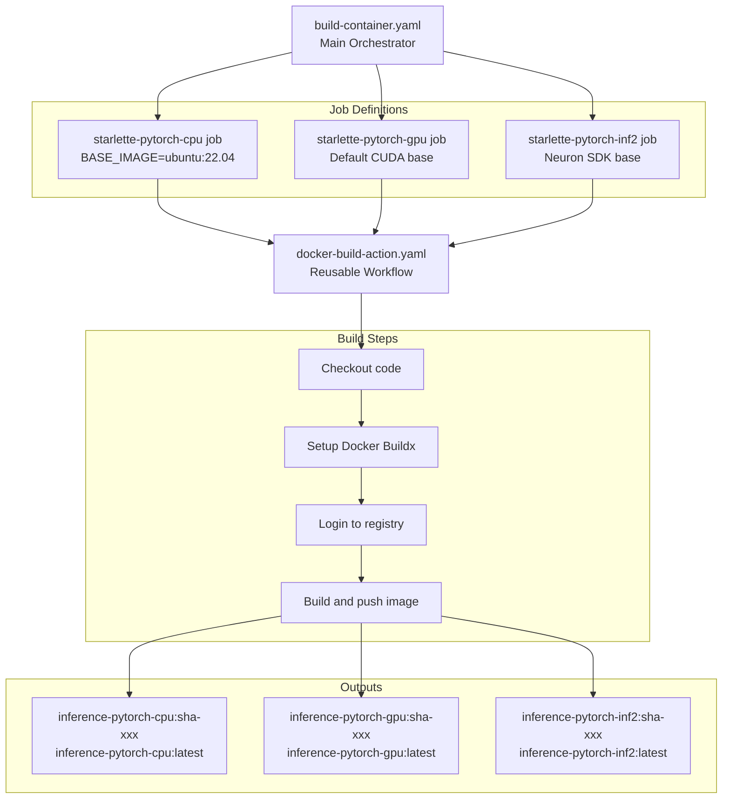

<!-- source: DeepWiki mcp.deepwiki.com · repo huggingface/huggingface-inference-toolkit · page 9 CI/CD Pipeline · fetched 2026-10-26 -->

# CI/CD Pipeline

<details>
<summary>Relevant source files</summary>

The following files were used as context for generating this wiki page:

- [.github/workflows/build-container.yaml](.github/workflows/build-container.yaml)
- [.github/workflows/docker-build-action.yaml](.github/workflows/docker-build-action.yaml)
- [.github/workflows/integration-test.yaml](.github/workflows/integration-test.yaml)
- [.github/workflows/quality.yaml](.github/workflows/quality.yaml)
- [.github/workflows/unit-test.yaml](.github/workflows/unit-test.yaml)

</details>


## Purpose and Scope

This document provides an overview of the automated CI/CD pipeline that validates, tests, and publishes the Hugging Face Inference Toolkit. The pipeline consists of GitHub Actions workflows that enforce code quality, run comprehensive test suites, and build Docker container images for deployment.

For detailed information about specific workflow components, see:
- [Unit Test Workflow](#9.1) - GPU-accelerated unit testing
- [Integration Test Workflows](#9.2) - Docker-based integration testing across multiple configurations
- [Container Build Pipeline](#9.3) - Automated image building and registry publishing

Testing infrastructure and test organization are covered in [Testing](#8).

## Workflow Overview

The CI/CD pipeline consists of five primary GitHub Actions workflows that execute automatically on code changes:

| Workflow | File | Primary Purpose | Runner Type |
|----------|------|-----------------|-------------|
| Unit Tests | `.github/workflows/unit-test.yaml` | Run pytest unit tests with GPU support | `aws-g4dn-2xlarge-cache` |
| Integration Tests | `.github/workflows/integration-test.yaml` | Run end-to-end Docker container tests | `aws-general-8-plus` (via reusable workflow) |
| Quality Check | `.github/workflows/quality.yaml` | Run linting and formatting checks | `ubuntu-latest` |
| Build Container | `.github/workflows/build-container.yaml` | Build and publish Docker images | `aws-highmemory-32-plus-priv` |
| Docker Build Action | `.github/workflows/docker-build-action.yaml` | Reusable workflow for Docker builds | `aws-highmemory-32-plus-priv` |

Sources: [.github/workflows/unit-test.yaml:1-50](), [.github/workflows/integration-test.yaml:1-45](), [.github/workflows/quality.yaml:1-28](), [.github/workflows/build-container.yaml:1-42](), [.github/workflows/docker-build-action.yaml:1-62]()

## Pipeline Architecture



**Pipeline Architecture**: Shows how trigger events (push, PR, manual) activate validation workflows (quality, unit tests), integration tests, and container builds. The container build pipeline produces three image variants that are pushed to the internal registry.

Sources: [.github/workflows/unit-test.yaml:3-10](), [.github/workflows/integration-test.yaml:3-12](), [.github/workflows/quality.yaml:3-10](), [.github/workflows/build-container.yaml:3-11]()

## Workflow Trigger Conditions

Each workflow defines specific trigger conditions to optimize CI/CD execution and avoid redundant builds:



**Trigger Conditions**: Path-based filtering ensures workflows only run when relevant code changes. README updates skip CI/CD entirely, and integration tests skip when only test configuration files change.

Sources: [.github/workflows/unit-test.yaml:4-10](), [.github/workflows/integration-test.yaml:4-12](), [.github/workflows/quality.yaml:4-10](), [.github/workflows/build-container.yaml:4-11]()

### Trigger Configuration Details

**Unit Test Workflow** [.github/workflows/unit-test.yaml:3-10]():
```yaml
on:
  push:
    paths-ignore:
      - 'README.md'
    branches:
     - main
  pull_request:
  workflow_dispatch:
```

**Integration Test Workflow** [.github/workflows/integration-test.yaml:3-12]():
```yaml
on:
  push:
    paths-ignore:
      - 'README.md'
      - '.github/workflows/unit-test.yaml'
      - '.github/workflows/quality.yaml'
    branches:
     - main
  pull_request:
  workflow_dispatch:
```

**Build Container Workflow** [.github/workflows/build-container.yaml:3-11]():
```yaml
on:
  push:
    branches:
      - main
    paths:
      - "src/**"
      - "dockerfiles/**"
      - "scripts/**"
  workflow_dispatch:
```

## Concurrency Control

All workflows implement concurrency control to prevent resource contention and reduce unnecessary execution:

| Workflow | Concurrency Group | Behavior |
|----------|-------------------|----------|
| `unit-test.yaml` | `${{ github.workflow }}-${{ github.head_ref \|\| github.run_id }}` | Cancel in-progress runs on new commits |
| `integration-test.yaml` | `${{ github.workflow }}-${{ github.head_ref \|\| github.run_id }}` | Cancel in-progress runs on new commits |
| `quality.yaml` | `${{ github.workflow }}-${{ github.head_ref \|\| github.run_id }}` | Cancel in-progress runs on new commits |
| `build-container.yaml` | `${{ github.workflow }}-${{ github.ref }}` | Cancel in-progress builds on new pushes |

The `cancel-in-progress: true` setting ensures that when new code is pushed, outdated pipeline runs are terminated to conserve runner resources and provide faster feedback.

Sources: [.github/workflows/unit-test.yaml:16-18](), [.github/workflows/integration-test.yaml:14-16](), [.github/workflows/quality.yaml:12-14](), [.github/workflows/build-container.yaml:13-15]()

## CI/CD Execution Flow



**CI/CD Execution Flow**: Shows the parallel execution of validation workflows followed by conditional container builds. All validation steps run concurrently for fast feedback, with container builds only executing on successful main branch commits.

Sources: [.github/workflows/unit-test.yaml:1-50](), [.github/workflows/integration-test.yaml:1-45](), [.github/workflows/quality.yaml:1-28](), [.github/workflows/build-container.yaml:1-42]()

## Runner Infrastructure

The CI/CD pipeline utilizes specialized GitHub Actions runners for different workload requirements:



**Runner Infrastructure**: Different runner types are assigned based on workload requirements. GPU runners for unit tests, high-memory runners for Docker builds, and standard runners for quality checks.

Sources: [.github/workflows/unit-test.yaml:22-23](), [.github/workflows/docker-build-action.yaml:31-32](), [.github/workflows/quality.yaml:18]()

### Runner Configuration

**GPU Runner for Unit Tests** [.github/workflows/unit-test.yaml:22-27]():
```yaml
runs-on: 
  group: aws-g4dn-2xlarge-cache
env:
  AWS_REGION: us-east-1
  CACHE_TEST_DIR: /mnt/hf_cache/hf-inference-toolkit-tests
  RUN_SLOW: True
```

The GPU runner provides:
- NVIDIA GPU access via `--gpus all` flag [.github/workflows/unit-test.yaml:44]()
- Persistent cache mount at `/mnt/hf_cache` for model artifacts
- AWS region configuration for accessing resources

**High-Memory Runner for Container Builds** [.github/workflows/docker-build-action.yaml:31-32]():
```yaml
runs-on:
  group: aws-highmemory-32-plus-priv
```

This runner type is optimized for:
- Docker Buildx multi-platform builds
- Large memory requirements for parallel build stages
- Registry authentication and push operations

## Container Build Pipeline Integration

The container build pipeline uses a reusable workflow pattern to avoid code duplication:



**Container Build Pipeline Integration**: The main workflow defines three jobs that call the reusable workflow with different parameters. Each job produces two image tags (commit SHA and latest) pushed to the internal registry.

Sources: [.github/workflows/build-container.yaml:17-42](), [.github/workflows/docker-build-action.yaml:1-62]()

### Reusable Workflow Interface

The `docker-build-action.yaml` workflow defines a standardized interface for building Docker images:

**Workflow Inputs** [.github/workflows/docker-build-action.yaml:3-22]():

| Input | Type | Required | Default | Purpose |
|-------|------|----------|---------|---------|
| `context` | string | No | `"./"` | Build context directory |
| `repository` | string | No | `"registry.internal.huggingface.tech/hf-endpoints"` | Container registry URL |
| `image` | string | Yes | - | Image name (e.g., `inference-pytorch-cpu`) |
| `build_args` | string | No | `""` | Docker build arguments |
| `dockerfile` | string | No | `"Dockerfile"` | Path to Dockerfile |

**Workflow Secrets** [.github/workflows/docker-build-action.yaml:23-27]():

| Secret | Required | Purpose |
|--------|----------|---------|
| `REGISTRY_USERNAME` | Yes | Container registry authentication |
| `REGISTRY_PASSWORD` | Yes | Container registry authentication |

### Build and Push Configuration

The reusable workflow builds and pushes images with specific optimizations:

**Build Configuration** [.github/workflows/docker-build-action.yaml:52-61]():
- **Push**: Always enabled for tagged builds
- **Target**: `base` stage from multi-stage Dockerfile
- **Outputs**: `type=image,compression=zstd,force-compression=true,push=true`
- **Tags**: Two tags per build:
  - Short SHA: `${{ inputs.repository }}/${{ inputs.image }}:sha-${{ env.GITHUB_SHA_SHORT }}`
  - Latest: `${{ inputs.repository }}/${{ inputs.image }}:latest`

The `zstd` compression format provides better compression ratios than gzip, reducing image transfer times.

## Registry and Artifact Management

All container images are published to the internal Hugging Face registry:

**Registry Configuration**:
- **URL**: `registry.internal.huggingface.tech/hf-endpoints`
- **Authentication**: Via GitHub secrets `REGISTRY_USERNAME` and `REGISTRY_PASSWORD`
- **Access**: Internal Hugging Face infrastructure only

**Image Naming Convention**:

```
registry.internal.huggingface.tech/hf-endpoints/<variant>:<tag>
```

Where:
- `<variant>`: `inference-pytorch-cpu`, `inference-pytorch-gpu`, or `inference-pytorch-inf2`
- `<tag>`: `sha-<7-char-commit-hash>` or `latest`

**Example Images**:
- `registry.internal.huggingface.tech/hf-endpoints/inference-pytorch-cpu:sha-a1b2c3d`
- `registry.internal.huggingface.tech/hf-endpoints/inference-pytorch-gpu:latest`
- `registry.internal.huggingface.tech/hf-endpoints/inference-pytorch-inf2:sha-a1b2c3d`

Sources: [.github/workflows/docker-build-action.yaml:10-11](), [.github/workflows/docker-build-action.yaml:42-47](), [.github/workflows/docker-build-action.yaml:61]()

## Debug Configuration

All test workflows enable GitHub Actions debug logging for troubleshooting:

**Debug Environment Variables** [.github/workflows/unit-test.yaml:12-14]():
```yaml
env:
  ACTIONS_RUNNER_DEBUG: true
  ACTIONS_STEP_DEBUG: true
```

These variables provide:
- **`ACTIONS_RUNNER_DEBUG`**: Detailed runner diagnostics and job information
- **`ACTIONS_STEP_DEBUG`**: Step-by-step execution logs with environment details

This configuration is consistent across `unit-test.yaml` and `integration-test.yaml` workflows.

Sources: [.github/workflows/unit-test.yaml:12-14](), [.github/workflows/integration-test.yaml:14-16]()

## CI/CD Pipeline Summary

The Hugging Face Inference Toolkit CI/CD pipeline provides:

1. **Automated Validation**: Quality checks, unit tests, and integration tests run on every commit
2. **Parallel Execution**: Independent workflows run concurrently for fast feedback
3. **Specialized Runners**: GPU, high-memory, and standard runners optimized for specific workloads
4. **Multi-Variant Builds**: Three container variants (CPU, GPU, Inf2) built from a single codebase
5. **Artifact Management**: Versioned container images with SHA and latest tags
6. **Concurrency Control**: Automatic cancellation of outdated runs to conserve resources

The pipeline ensures code quality and functional correctness before container images are published to the internal registry for deployment.

Sources: [.github/workflows/unit-test.yaml:1-50](), [.github/workflows/integration-test.yaml:1-45](), [.github/workflows/quality.yaml:1-28](), [.github/workflows/build-container.yaml:1-42](), [.github/workflows/docker-build-action.yaml:1-62]()

---

