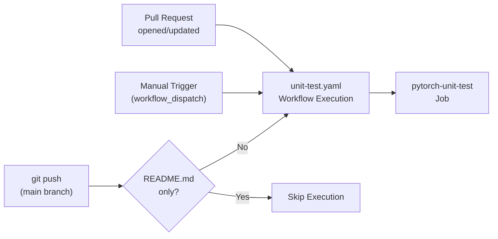
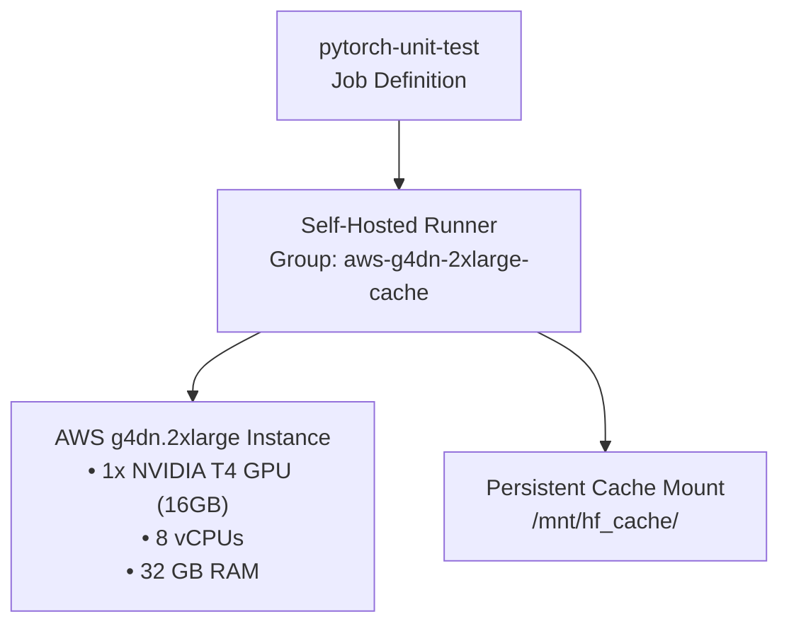
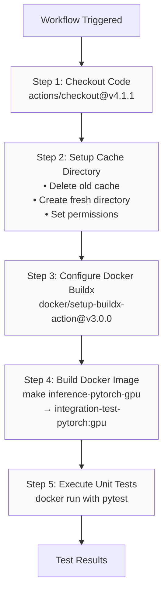
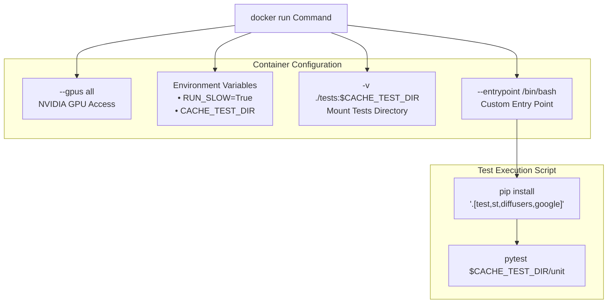
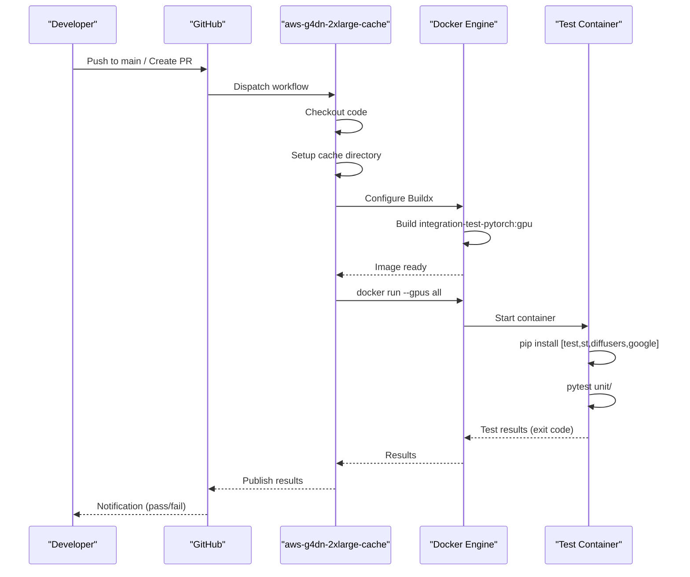

<!-- source: DeepWiki mcp.deepwiki.com · repo huggingface/huggingface-inference-toolkit · page 9.1 Unit Test Workflow · fetched 2026-10-26 -->

# Unit Test Workflow

<details>
<summary>Relevant source files</summary>

The following files were used as context for generating this wiki page:

- [.github/workflows/unit-test.yaml](.github/workflows/unit-test.yaml)

</details>


## Purpose and Scope

This document details the GitHub Actions workflow that executes unit tests for the Hugging Face Inference Toolkit. The workflow validates individual components of the system (handlers, utilities, pipeline factories) in isolation using GPU-accelerated infrastructure. 

For information about integration testing that validates end-to-end behavior in Docker containers, see [Integration Test Workflows](#9.2). For details about the test infrastructure and test cases themselves, see [Unit Tests](#8.1).

## Overview

The unit test workflow is defined in [.github/workflows/unit-test.yaml:1-50]() and provides automated validation of the toolkit's core functionality on every code change. The workflow executes tests in a GPU-enabled Docker container to ensure GPU-dependent code paths are properly tested.

**Key characteristics:**
- Runs on self-hosted AWS GPU runners (`aws-g4dn-2xlarge-cache`)
- Builds a fresh Docker image for each test run
- Installs test dependencies and multiple package extras
- Uses a persistent cache mount for test artifacts
- Enables slow tests (`RUN_SLOW=True`)

## Workflow Triggers

The workflow activates under three conditions:

| Trigger | Description | Configuration |
|---------|-------------|---------------|
| **Push to main** | Automatic execution on merged changes | Ignores `README.md` modifications |
| **Pull Request** | Validates changes before merge | All PRs targeting any branch |
| **Manual Dispatch** | On-demand execution | Via GitHub Actions UI (`workflow_dispatch`) |



**Sources:** [.github/workflows/unit-test.yaml:3-10]()

## Concurrency Control

The workflow implements intelligent concurrency management to avoid redundant test runs:

```yaml
concurrency:
  group: ${{ github.workflow }}-${{ github.head_ref || github.run_id }}
  cancel-in-progress: true
```

**Behavior:**
- Groups runs by workflow name and branch/run ID
- Cancels in-progress runs when new commits are pushed to the same branch
- Prevents resource waste from testing outdated commits
- Each PR branch maintains independent test execution

**Sources:** [.github/workflows/unit-test.yaml:16-18]()

## Job Configuration

The workflow defines a single job `pytorch-unit-test` that executes on specialized GPU infrastructure:

### Runner Infrastructure



**Sources:** [.github/workflows/unit-test.yaml:21-27]()

### Environment Variables

The job configures the test environment with three key variables:

| Variable | Value | Purpose |
|----------|-------|---------|
| `AWS_REGION` | `us-east-1` | AWS region for SDK operations |
| `CACHE_TEST_DIR` | `/mnt/hf_cache/hf-inference-toolkit-tests` | Persistent test artifact location |
| `RUN_SLOW` | `True` | Enables slow-running tests marked with `@pytest.mark.slow` |

**Debug variables** are also enabled at the workflow level:
- `ACTIONS_RUNNER_DEBUG: true` - Verbose runner diagnostics
- `ACTIONS_STEP_DEBUG: true` - Detailed step execution logs

**Sources:** [.github/workflows/unit-test.yaml:12-14,24-27]()

## Execution Steps

The workflow follows a five-step process to build the test environment and execute tests:



**Sources:** [.github/workflows/unit-test.yaml:28-49]()

### Step 1: Code Checkout

Uses the official GitHub Actions checkout action to clone the repository at the triggering commit:

```yaml
- uses: actions/checkout@v4.1.1
```

**Sources:** [.github/workflows/unit-test.yaml:29]()

### Step 2: Cache Directory Management

Prepares the persistent cache mount for test execution:

```bash
sudo rm -rf ${{ env.CACHE_TEST_DIR }} && \
sudo mkdir ${{ env.CACHE_TEST_DIR }} && \
sudo chown -R runner ${{ env.CACHE_TEST_DIR }}
cp -r tests ${{ env.CACHE_TEST_DIR }}
```

**Operations:**
1. Remove stale test artifacts from previous runs
2. Create fresh cache directory
3. Transfer ownership to the `runner` user
4. Copy test files into the cache mount

**Rationale:** The cache mount (`/mnt/hf_cache/`) persists between workflow runs, enabling faster model downloads and preventing disk space exhaustion on the runner's root volume.

**Sources:** [.github/workflows/unit-test.yaml:30-35]()

### Step 3: Docker Buildx Setup

Configures Docker's Buildx engine for advanced image building:

```yaml
- name: Docker Setup Buildx
  uses: docker/setup-buildx-action@v3.0.0
```

Buildx provides:
- Multi-platform build support
- Build caching
- Advanced build features

**Sources:** [.github/workflows/unit-test.yaml:36-37]()

### Step 4: Docker Image Build

Builds the GPU-enabled test container:

```bash
make inference-pytorch-gpu
```

This Makefile target builds the image tagged as `integration-test-pytorch:gpu` using the GPU-specific Dockerfile. The image includes PyTorch with CUDA support and all necessary dependencies for GPU-accelerated inference.

**Sources:** [.github/workflows/unit-test.yaml:38-39]()

### Step 5: Test Execution

Runs pytest inside the Docker container with full GPU access:



**Complete command:**
```bash
docker run \
  -e RUN_SLOW='True' \
  --gpus all \
  -e CACHE_TEST_DIR='/mnt/hf_cache/hf-inference-toolkit-tests' \
  -v ./tests:/mnt/hf_cache/hf-inference-toolkit-tests \
  --entrypoint /bin/bash \
  integration-test-pytorch:gpu \
  -c "pip install '.[test,st,diffusers,google]' && pytest /mnt/hf_cache/hf-inference-toolkit-tests/unit"
```

**Sources:** [.github/workflows/unit-test.yaml:40-49]()

## Test Dependencies

The workflow installs the toolkit with multiple extras to ensure comprehensive testing:

| Extra | Dependencies | Purpose |
|-------|--------------|---------|
| `test` | `pytest`, `pytest-asyncio`, `httpx` | Core testing framework |
| `st` | `sentence-transformers` | Sentence embedding tests |
| `diffusers` | `diffusers`, `accelerate` | Text-to-image generation tests |
| `google` | `google-cloud-storage` | Vertex AI integration tests |

**Installation command:**
```bash
pip install '.[test,st,diffusers,google]'
```

This ensures all specialized pipeline types can be tested, even though unit tests primarily focus on core utilities rather than full pipeline execution.

**Sources:** [.github/workflows/unit-test.yaml:49]()

## GPU Access

The `--gpus all` flag provides the container with access to all available NVIDIA GPUs on the runner. This enables:

- Testing GPU-specific code paths in `utils.py` (device detection)
- Validating torch CUDA operations
- Ensuring GPU memory management works correctly
- Testing mixed precision and distributed inference utilities

The g4dn.2xlarge instance provides a single NVIDIA T4 GPU with 16GB memory, sufficient for unit test validation without requiring full model loading.

**Sources:** [.github/workflows/unit-test.yaml:44]()

## Test Execution Flow

The complete test execution process from trigger to results:



**Sources:** [.github/workflows/unit-test.yaml:1-50]()

## Caching Strategy

The workflow leverages a persistent cache mount to optimize test execution:

**Cache location:** `/mnt/hf_cache/hf-inference-toolkit-tests`

**Cached artifacts:**
- Downloaded model files (for tests that load models)
- Hugging Face Hub cache
- Pip package cache
- Compiled Python bytecode

**Benefits:**
1. **Faster test execution** - Avoids re-downloading models on each run
2. **Reduced network usage** - Minimizes Hub API calls
3. **Consistent test data** - Same model versions across runs
4. **Runner disk management** - Separates large test artifacts from root volume

**Cleanup:** The cache directory is cleared at the start of each run ([.github/workflows/unit-test.yaml:31-34]()), ensuring tests always start with a clean slate while the underlying cache mount persists.

**Sources:** [.github/workflows/unit-test.yaml:26,30-35]()

## Running Tests Locally

To replicate the CI environment locally:

1. **Build the GPU image:**
   ```bash
   make inference-pytorch-gpu
   ```

2. **Run tests with GPU access:**
   ```bash
   docker run \
     -e RUN_SLOW=True \
     --gpus all \
     -v $(pwd)/tests:/tests \
     --entrypoint /bin/bash \
     integration-test-pytorch:gpu \
     -c "pip install '.[test,st,diffusers,google]' && pytest /tests/unit"
   ```

For detailed information about the unit test structure and test cases, see [Unit Tests](#8.1).

**Sources:** [.github/workflows/unit-test.yaml:38-49]()

## Workflow Limitations

The current workflow has several notable characteristics:

1. **GPU-only testing** - No separate CPU-only test job (GPU image includes CPU code paths)
2. **No Inferentia2 testing** - Unit tests do not validate Neuron-specific code
3. **No test result caching** - Each run executes all tests (no incremental testing)
4. **Single Python version** - Tests only the Python version in the Docker image
5. **No coverage reporting** - No code coverage metrics are collected or published

Integration tests ([Integration Test Workflows](#9.2)) provide broader device and deployment validation.

**Sources:** [.github/workflows/unit-test.yaml:1-50]()

---

