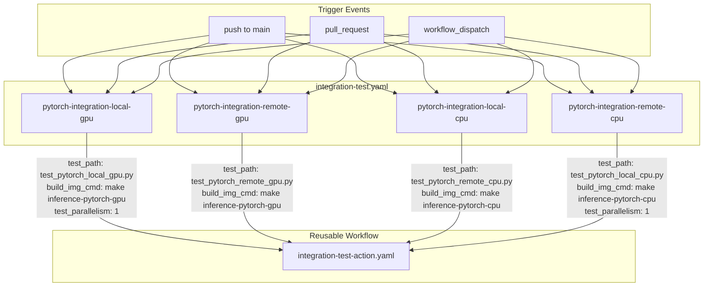
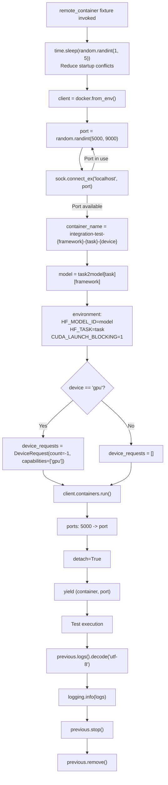
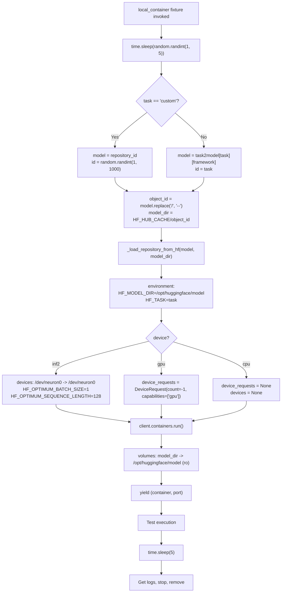
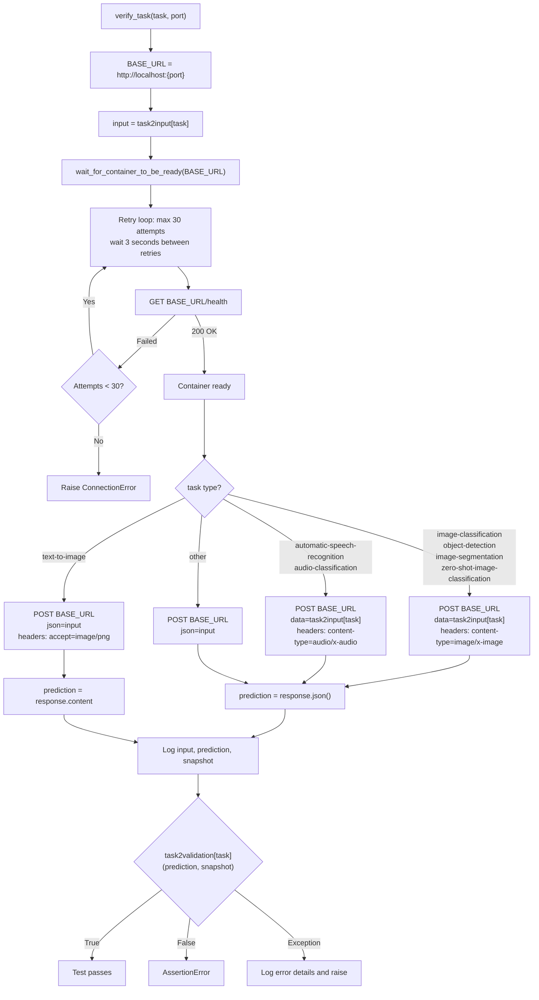
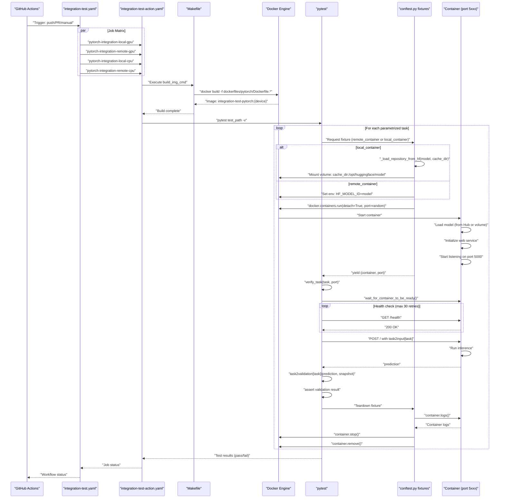

<!-- source: DeepWiki mcp.deepwiki.com · repo huggingface/huggingface-inference-toolkit · page 9.2 Integration Test Workflows · fetched 2026-10-26 -->

# Integration Test Workflows

<details>
<summary>Relevant source files</summary>

The following files were used as context for generating this wiki page:

- [.github/workflows/integration-test.yaml](.github/workflows/integration-test.yaml)
- [.github/workflows/quality.yaml](.github/workflows/quality.yaml)
- [tests/integ/conftest.py](tests/integ/conftest.py)
- [tests/integ/helpers.py](tests/integ/helpers.py)

</details>


## Purpose and Scope

This document details the automated integration testing system that validates end-to-end functionality of the inference toolkit. The system tests Docker containers across multiple dimensions: device types (CPU, GPU, Inferentia2), model loading strategies (local vs remote), frameworks (PyTorch, TensorFlow), and 31+ ML task types.

For information about unit testing individual components, see [Unit Tests](#8.1). For details on the test configuration mappings (task2model, task2input, task2output, task2validation), see [Test Configuration](#8.3). For the broader CI/CD context, see [CI/CD Pipeline](#9).

Sources: [.github/workflows/integration-test.yaml:1-45](), [tests/integ/conftest.py:1-154](), [tests/integ/helpers.py:1-445]()

## Overview

The integration test system uses Docker containers to simulate real deployment environments. Tests execute automatically on pushes to main branches, pull requests, and can be triggered manually via `workflow_dispatch`. The system validates that:

- Models load correctly from different sources (Hugging Face Hub, local storage)
- Containers start successfully with appropriate device configuration
- The `/health` endpoint responds correctly
- Inference requests produce expected outputs
- All supported tasks work across frameworks and devices

The test suite is organized into a job matrix covering:
- **Model Loading**: Local (pre-downloaded, volume-mounted) vs Remote (download at runtime from Hub)
- **Device Type**: CPU, GPU, AWS Inferentia2
- **Framework**: PyTorch (31+ tasks), TensorFlow (22+ tasks)

Sources: [.github/workflows/integration-test.yaml:1-45](), [tests/integ/conftest.py:15-17]()

## Workflow Architecture

### Job Matrix Structure

The main workflow file defines four parallel jobs that cover different combinations of device type and loading strategy:

| Job Name | Device | Loading Strategy | Test File | Image Build | Parallelism |
|----------|--------|------------------|-----------|-------------|-------------|
| `pytorch-integration-local-gpu` | GPU | Local | `test_pytorch_local_gpu.py` | `make inference-pytorch-gpu` | 1 |
| `pytorch-integration-remote-gpu` | GPU | Remote | `test_pytorch_remote_gpu.py` | `make inference-pytorch-gpu` | default |
| `pytorch-integration-local-cpu` | CPU | Local | `test_pytorch_local_cpu.py` | `make inference-pytorch-cpu` | 1 |
| `pytorch-integration-remote-cpu` | CPU | Remote | `test_pytorch_remote_cpu.py` | `make inference-pytorch-cpu` | default |

Each job invokes the reusable workflow `integration-test-action.yaml` with job-specific parameters for test path, image build command, and parallelism settings.



**Diagram: Integration Test Job Matrix**

Sources: [.github/workflows/integration-test.yaml:18-44]()

### Concurrency Control

The workflow implements concurrency control to prevent resource conflicts and reduce redundant test runs:

```yaml
concurrency:
  group: ${{ github.workflow }}-${{ github.head_ref || github.run_id }}
  cancel-in-progress: true
```

This configuration ensures that:
- Only one workflow run executes per branch at a time
- New commits automatically cancel in-progress runs for the same branch
- Different branches can run tests simultaneously without interference

Sources: [.github/workflows/integration-test.yaml:14-16]()

### Test Parallelism Strategy

**Local tests** (`test_pytorch_local_*`) set `test_parallelism: "1"` to run sequentially because:
- They share the `HF_HUB_CACHE` directory for pre-downloaded models
- Volume mounts may conflict if tests run in parallel
- Sequential execution ensures stable model downloads and cache usage

**Remote tests** (`test_pytorch_remote_*`) use default parallelism because:
- Each container downloads models independently into its own filesystem
- No shared resources between test containers
- Parallel execution reduces overall test time

Sources: [.github/workflows/integration-test.yaml:22-25](), [.github/workflows/integration-test.yaml:40-44]()

## Container Fixtures

The integration tests use pytest fixtures defined in `tests/integ/conftest.py` to manage Docker container lifecycle. Two primary fixtures implement different model loading strategies.

### Remote Container Fixture

The `remote_container` fixture creates containers that download models at runtime from the Hugging Face Hub.

**Signature:**
```python
@pytest.fixture(scope="function")
def remote_container(device, task, framework):
```

**Behavior:**
1. Generates random port (5000-9000) and verifies availability
2. Creates container with environment variables:
   - `HF_MODEL_ID`: Model identifier from `task2model[task][framework]`
   - `HF_TASK`: Task type
   - `CUDA_LAUNCH_BLOCKING`: Set to 1 for debugging
3. Configures device access (GPU device requests or none)
4. Starts container in detached mode
5. Yields `(container, port)` tuple to test
6. Teardown: Collects logs, stops container, removes container



**Diagram: remote_container Fixture Lifecycle**

Sources: [tests/integ/conftest.py:20-64]()

### Local Container Fixture

The `local_container` fixture mounts pre-downloaded models as read-only volumes, simulating scenarios with persistent model storage.

**Signature:**
```python
@pytest.fixture(scope="function")
def local_container(device, task, repository_id, framework):
```

**Behavior:**
1. Determines model based on task type (standard or custom)
2. Downloads model to cache directory using `_load_repository_from_hf`
3. Creates container with environment variables:
   - `HF_MODEL_DIR`: `/opt/huggingface/model`
   - `HF_TASK`: Task type
4. Mounts model directory as read-only volume
5. Configures device-specific settings (GPU, Inferentia2)
6. Starts container and yields to test
7. Teardown: Waits 5 seconds, collects logs, stops and removes container



**Diagram: local_container Fixture Lifecycle**

Sources: [tests/integ/conftest.py:67-153]()

### Fixture Comparison

| Aspect | `remote_container` | `local_container` |
|--------|-------------------|-------------------|
| Model source | Hugging Face Hub | Pre-downloaded to `HF_HUB_CACHE` |
| Environment variable | `HF_MODEL_ID` | `HF_MODEL_DIR` |
| Volume mount | None | `{model_dir}:/opt/huggingface/model:ro` |
| Startup time | Slower (download + load) | Faster (load only) |
| Cache efficiency | Each container downloads | Shared cache across tests |
| Device support | CPU, GPU | CPU, GPU, Inferentia2 |
| Custom handler support | Limited | Full support |
| Retry decorator | `@tenacity.retry(retry=docker.errors.APIError)` | `@tenacity.retry(reraise=True)` |
| Use case simulation | Production Hub pulls | Cached/persistent storage |

Sources: [tests/integ/conftest.py:20-153]()

## Test Implementation

### Test Functions Overview

The test suite in `tests/integ/helpers.py` implements parametrized test functions that cover different combinations of framework and loading strategy:

**PyTorch Tests:**
- `test_pt_container_remote_model`: 24 tasks with remote model loading
- `test_pt_container_local_model`: 24 tasks with local model loading
- `test_pt_container_custom_handler`: 2 custom handler repositories
- `test_pt_container_legacy_custom_pipeline`: 1 legacy pipeline repository

**TensorFlow Tests:**
- `test_tf_container_remote_model`: 22 tasks with remote model loading
- `test_tf_container_local_model`: 22 tasks with local model loading

Each test function uses `@pytest.mark.parametrize` to generate multiple test cases from a single implementation.

Sources: [tests/integ/helpers.py:111-445]()

### Test Verification Flow

The `verify_task` function implements the core test execution logic:



**Diagram: verify_task Execution Flow**

**Content-Type Handling:**

The function dispatches requests based on task type to handle different input formats:
- **Image tasks**: Send raw image bytes with `content-type: image/x-image`
- **Audio tasks**: Send raw audio bytes with `content-type: audio/x-audio`
- **Text-to-image**: Send JSON input, accept PNG response
- **All other tasks**: Send/receive JSON

Sources: [tests/integ/helpers.py:58-108]()

### Health Check Implementation

The `wait_for_container_to_be_ready` function polls the `/health` endpoint until the container is ready:

```python
def wait_for_container_to_be_ready(base_url, time_between_retries=3, max_retries=30):
    retries = 0
    error = None
    
    while retries < max_retries:
        time.sleep(time_between_retries)
        try:
            response = requests.get(f"{base_url}/health")
            if response.status_code == 200:
                return True
            else:
                raise ConnectionError(f"Couldn't start container, Error: {response.status_code}")
        except Exception as exception:
            error = exception
        retries += 1
    
    raise error
```

**Parameters:**
- `base_url`: Container base URL (e.g., `http://localhost:5432`)
- `time_between_retries`: Seconds between health check attempts (default: 3)
- `max_retries`: Maximum number of attempts (default: 30, total ~90 seconds)

This handles variable startup times for:
- Container initialization
- Model download (remote containers)
- Model loading into memory
- Web service startup

Sources: [tests/integ/helpers.py:36-55]()

### Task Coverage Matrix

The integration tests cover 31+ ML task types across three pipeline categories:

**Transformers Tasks (PyTorch & TensorFlow):**

| Category | Tasks |
|----------|-------|
| **Text Processing** | `text-classification`, `zero-shot-classification`, `token-classification`, `question-answering`, `fill-mask`, `summarization`, `translation_xx_to_yy`, `text2text-generation`, `text-generation`, `feature-extraction`, `table-question-answering`, `conversational` |
| **Vision** | `image-classification`, `object-detection`, `image-segmentation`, `image-text-to-text` |
| **Audio** | `automatic-speech-recognition`, `audio-classification` |

**Sentence Transformers Tasks (PyTorch only):**
- `sentence-similarity`
- `sentence-embeddings`
- `sentence-ranking`

**Diffusers Tasks (PyTorch only):**
- `text-to-image`

Each task references configuration from `task2model` (model IDs), `task2input` (test inputs), `task2output` (expected outputs), and `task2validation` (validation functions).

Sources: [tests/integ/helpers.py:113-141](), [tests/integ/helpers.py:170-198](), [tests/integ/helpers.py:303-328](), [tests/integ/helpers.py:358-382]()

## Container Management

### Naming Convention

Containers follow a consistent naming pattern for identification and cleanup:

```
integration-test-{framework}-{task}-{device}       # remote_container
integration-test-{framework}-{id}-{device}         # local_container (standard tasks)
integration-test-{framework}-{random_id}-{device}  # local_container (custom tasks)
integration-test-custom                            # custom handler tests
```

Examples:
- `integration-test-pytorch-text-classification-gpu`
- `integration-test-pytorch-42-cpu`
- `integration-test-custom`

This naming enables:
- Easy identification in `docker ps` output
- Programmatic cleanup via `make_sure_other_containers_are_stopped`
- Prevention of name conflicts across parallel test runs

Sources: [tests/integ/conftest.py:29](), [tests/integ/conftest.py:93](), [tests/integ/helpers.py:144](), [tests/integ/helpers.py:233]()

### Port Management

The system implements dynamic port allocation to avoid conflicts:

```python
port = random.randint(5000, 9000)
sock = socket.socket(socket.AF_INET, socket.SOCK_STREAM)
while sock.connect_ex(("localhost", port)) == 0:
    logging.debug(f"Port {port} is already being used; getting a new one...")
    port = random.randint(5000, 9000)
```

**Strategy:**
1. Generate random port between 5000-9000
2. Test port availability using socket connection
3. If port is in use, generate new random port
4. Repeat until available port is found
5. Map container port 5000 to host port

The random sleep at fixture startup (1-5 seconds) further reduces port collision probability when multiple tests start simultaneously.

Sources: [tests/integ/conftest.py:31-38](), [tests/integ/conftest.py:96-102]()

### Device Configuration

**GPU Configuration:**

GPU tests use Docker device requests to expose NVIDIA GPUs:

```python
device_request = [docker.types.DeviceRequest(count=-1, capabilities=[["gpu"]])]
```

The `count=-1` parameter makes all available GPUs accessible to the container. The `IS_GPU` flag determines whether GPU tests run, derived from `transformers.testing_utils._run_slow_tests`.

Sources: [tests/integ/conftest.py:43-46](), [tests/integ/conftest.py:107-110](), [tests/integ/conftest.py:16-17]()

**Inferentia2 Configuration:**

Inferentia2 tests map the Neuron device and set compiler-specific environment variables:

```python
devices = {
    "/dev/neuron0": {
        "PathInContainer": "/dev/neuron0",
        "CgroupPermissions": "rwm",
    }
}
env["HF_OPTIMUM_BATCH_SIZE"] = 1
env["HF_OPTIMUM_SEQUENCE_LENGTH"] = 128
```

These configurations enable:
- Access to AWS Neuron accelerator hardware
- Static shape compilation for optimized inference
- Batch size and sequence length optimization

Sources: [tests/integ/conftest.py:112-122]()

### Cleanup and Teardown

Both fixtures implement comprehensive cleanup in their teardown phase:

**Cleanup sequence:**
1. Retrieve container by name: `client.containers.get(container_name)`
2. Optional wait: `time.sleep(5)` (local_container only)
3. Collect logs: `previous.logs().decode('utf-8')`
4. Log to console: `logging.info(f"Container logs:\n{logs}")`
5. Stop container: `previous.stop()`
6. Remove container: `previous.remove()`

The 5-second sleep in `local_container` ensures all I/O operations complete before log collection.

Sources: [tests/integ/conftest.py:60-64](), [tests/integ/conftest.py:145-150]()

## Error Handling and Retry Logic

### Fixture Retry Mechanisms

Both container fixtures use `@tenacity.retry` to handle transient failures:

**remote_container:**
```python
@tenacity.retry(
    retry=tenacity.retry_if_exception(docker.errors.APIError),
    stop=tenacity.stop_after_attempt(10),
)
```
- Retries only on `docker.errors.APIError`
- Stops after 10 attempts
- No reraise (allows test to continue if fixture creation fails)

**local_container:**
```python
@tenacity.retry(stop=tenacity.stop_after_attempt(10), reraise=True)
```
- Retries on any exception
- Stops after 10 attempts
- Reraises the final exception

These retry mechanisms handle:
- Temporary Docker daemon unavailability
- Container startup race conditions
- Network-related transient failures

Sources: [tests/integ/conftest.py:20-23](), [tests/integ/conftest.py:67]()

### Error Logging

The test framework logs extensive debugging information on failures:

**verify_task error logging:**
```python
logging.error(f"Base URL: {BASE_URL}")
logging.error(f"Task: {task}")
logging.error(f"Input: {input}")
logging.error(f"Error: {str(exception)}")
logging.error(f"Stack: {traceback.format_exc()}")
```

**Container logs:**
- Captured via `container.logs().decode('utf-8')`
- Logged using `logging.info(f"Container logs:\n{logs}")`
- Available in CI/CD workflow output for debugging

This information enables rapid diagnosis of test failures across the entire test matrix.

Sources: [tests/integ/conftest.py:61-62](), [tests/integ/conftest.py:147-148](), [tests/integ/helpers.py:103-108]()

## Cache and Performance Optimization

### Model Cache Directory

The `HF_HUB_CACHE` environment variable specifies the shared cache for Hugging Face Hub downloads:

```python
HF_HUB_CACHE = os.environ.get("HF_HUB_CACHE", "/home/ubuntu/.cache/huggingface/hub")
```

**Caching strategy for local_container:**
1. Generate object ID: `object_id = model.replace("/", "--")`
2. Build cache path: `model_dir = f"{HF_HUB_CACHE}/{object_id}"`
3. Download if not exists: `_load_repository_from_hf(model, model_dir)`
4. Mount as read-only volume: `{model_dir}:/opt/huggingface/model:ro`

**Benefits:**
- Avoids redundant model downloads across test runs
- Reduces test execution time from minutes to seconds
- Minimizes network bandwidth usage
- Enables reliable testing even with intermittent network issues

**Caveat:** Local tests must run sequentially (`test_parallelism: "1"`) to prevent cache conflicts.

Sources: [tests/integ/conftest.py:15](), [tests/integ/conftest.py:124-129]()

### Startup Conflict Reduction

Both fixtures implement a random sleep at initialization:

```python
time.sleep(random.randint(1, 5))
```

This reduces the probability of simultaneous operations that cause:
- Port allocation conflicts (multiple tests selecting the same random port)
- Docker API rate limiting (concurrent container creation requests)
- Resource contention on test runners (CPU, memory, GPU)
- Race conditions in shared cache access

The 1-5 second jitter effectively distributes container startup times across a wider window.

Sources: [tests/integ/conftest.py:26](), [tests/integ/conftest.py:71]()

## Integration Test Execution Sequence

### Complete Test Flow



**Diagram: Complete Integration Test Execution Sequence**

Sources: [.github/workflows/integration-test.yaml:1-45](), [tests/integ/conftest.py:24-153](), [tests/integ/helpers.py:58-108]()

## Reusable Workflow Parameters

The reusable workflow `integration-test-action.yaml` accepts the following parameters:

| Parameter | Type | Description | Example Values |
|-----------|------|-------------|----------------|
| `test_path` | string | Path to pytest test file relative to repository root | `tests/integ/test_pytorch_local_gpu.py` |
| `build_img_cmd` | string | Make command to build Docker image before testing | `make inference-pytorch-gpu`<br/>`make inference-pytorch-cpu` |
| `test_parallelism` | string | Number of parallel pytest workers (optional) | `"1"` (sequential)<br/>unset (default parallelism) |

**Parameter usage:**

```yaml
pytorch-integration-local-gpu:
  name: Local Integration Tests - GPU
  uses: ./.github/workflows/integration-test-action.yaml
  with:
    test_path: "tests/integ/test_pytorch_local_gpu.py"
    build_img_cmd: "make inference-pytorch-gpu"
    test_parallelism: "1"
```

The reusable workflow pattern enables:
- Consistent test execution across all job variants
- Centralized workflow maintenance
- Easy addition of new test job configurations

Sources: [.github/workflows/integration-test.yaml:21-25](), [.github/workflows/integration-test.yaml:39-44]()

## Troubleshooting Integration Tests

### Common Issues and Solutions

| Issue | Symptoms | Solution |
|-------|----------|----------|
| **Port conflict** | `Address already in use` error | Check for orphaned containers: `docker ps -a \| grep integration-test` and remove them |
| **Container startup timeout** | Health check fails after 30 retries | Inspect container logs: `docker logs <container_name>`. Increase `max_retries` in `wait_for_container_to_be_ready` if needed |
| **Model download failure** | `Repository not found` or network errors | Verify `HF_HUB_TOKEN` for gated models. Check network connectivity. Clear cache and retry |
| **GPU not available** | Container cannot access GPU | Verify NVIDIA drivers: `nvidia-smi`. Check Docker GPU support: `docker run --gpus all nvidia/cuda:11.0-base nvidia-smi` |
| **Inferentia2 device not found** | `/dev/neuron0` not accessible | Verify Neuron drivers installed. Check device permissions. Ensure `devices` parameter is correctly configured |
| **Test validation failure** | `AssertionError` on output validation | Review logged prediction vs snapshot. Update `task2output` if model output format changed. Check `task2validation` logic |

### Debug Workflow

1. **Check GitHub Actions logs**: View workflow run details in Actions tab, expand failed job steps
2. **Review container logs**: Captured during teardown and printed via `logging.info`
3. **Run locally**: Execute tests on local machine with same Docker images:
   ```bash
   make inference-pytorch-cpu
   pytest tests/integ/test_pytorch_local_cpu.py::test_pt_container_local_model[text-classification] -v -s
   ```
4. **Inspect running container**: For hanging tests, use `docker ps` to find container, then `docker logs -f <container_name>`
5. **Enable debug logging**: Set environment variable before running pytest:
   ```python
   logging.basicConfig(level=logging.DEBUG)
   ```

### Manual Test Execution

To run a single task test manually:

```bash
# Build the Docker image
make inference-pytorch-cpu

# Run specific test with verbose output
pytest tests/integ/test_pytorch_local_cpu.py::test_pt_container_local_model[text-classification] -v -s

# Run all tests in a file
pytest tests/integ/test_pytorch_remote_gpu.py -v

# Run with specific marker
pytest tests/integ/ -v -m "require_torch"
```

Sources: [tests/integ/conftest.py:61-62](), [tests/integ/conftest.py:147-148](), [tests/integ/helpers.py:103-108]()

---

