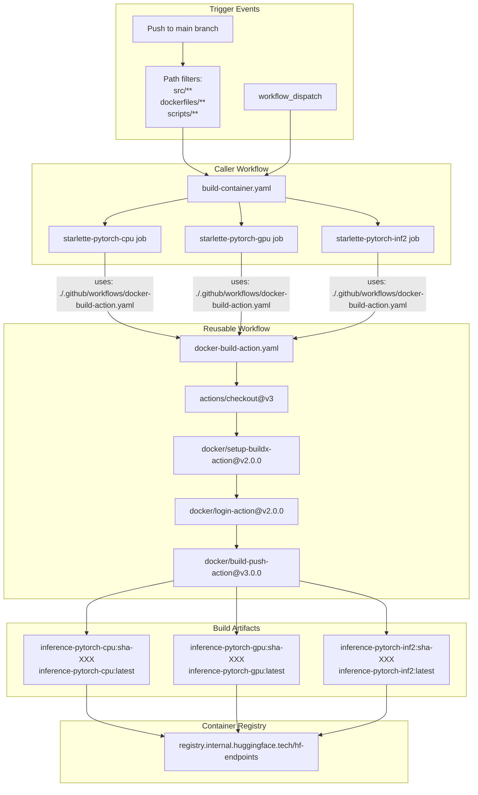
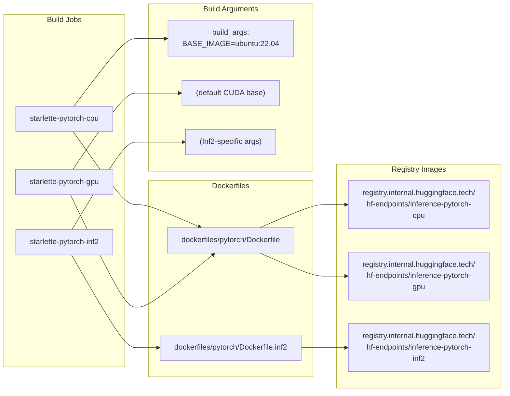
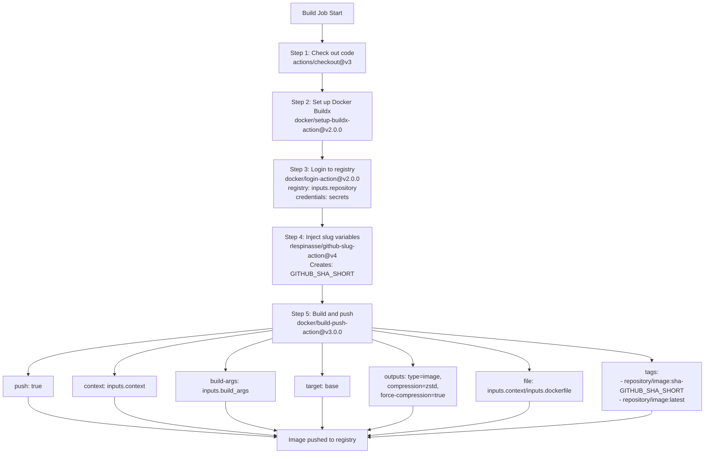
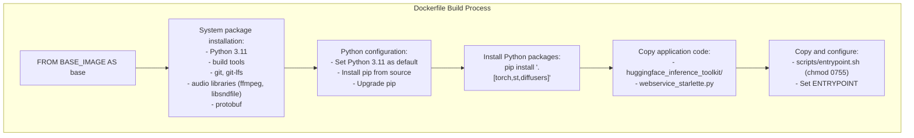

<!-- source: DeepWiki mcp.deepwiki.com · repo huggingface/huggingface-inference-toolkit · page 9.3 Container Build Pipeline · fetched 2026-10-26 -->

# Container Build Pipeline

<details>
<summary>Relevant source files</summary>

The following files were used as context for generating this wiki page:

- [.github/workflows/build-container.yaml](.github/workflows/build-container.yaml)
- [.github/workflows/docker-build-action.yaml](.github/workflows/docker-build-action.yaml)
- [dockerfiles/pytorch/Dockerfile](dockerfiles/pytorch/Dockerfile)

</details>


## Purpose and Scope

This document describes the automated Docker container build system that produces deployable images for the Hugging Face Inference Toolkit. The pipeline creates three specialized image variants (CPU, GPU, and Inferentia2) and publishes them to an internal registry.

For information about using these built containers in different deployment scenarios, see [Docker Deployment](#5.2), [AWS Inferentia2 Deployment](#5.4), and [Hugging Face Inference Endpoints](#5.5). For testing workflows that validate these containers, see [Integration Test Workflows](#9.2).

---

## Build System Architecture

The container build system consists of two GitHub Actions workflows: a reusable workflow template that defines the build logic, and a caller workflow that orchestrates builds for multiple image variants.



**Sources:** [.github/workflows/build-container.yaml:1-42](), [.github/workflows/docker-build-action.yaml:1-62]()

---

## Workflow Structure

### Caller Workflow: build-container.yaml

The main orchestration workflow defines three parallel build jobs, each targeting a different hardware platform. The workflow is triggered automatically on pushes to `main` that modify source code, Dockerfiles, or scripts.

[.github/workflows/build-container.yaml:3-11]() specifies the trigger conditions:

```yaml
on:
  push:
    branches:
      - main
    paths:
      - "src/**"
      - "dockerfiles/**"
      - "scripts/**"
  workflow_dispatch:
```

[.github/workflows/build-container.yaml:13-15]() implements concurrency control to prevent multiple builds from running simultaneously:

```yaml
concurrency:
  group: ${{ github.workflow }}-${{ github.ref }}
  cancel-in-progress: true
```

**Sources:** [.github/workflows/build-container.yaml:1-42]()

---

## Image Variants

The build pipeline produces three specialized Docker images, each optimized for different deployment targets:

| Job Name | Image Name | Dockerfile | Base Image | Purpose |
|----------|------------|------------|------------|---------|
| `starlette-pytorch-cpu` | `inference-pytorch-cpu` | `dockerfiles/pytorch/Dockerfile` | `ubuntu:22.04` | CPU-only inference, local development, Vertex AI CPU instances |
| `starlette-pytorch-gpu` | `inference-pytorch-gpu` | `dockerfiles/pytorch/Dockerfile` | `nvidia/cuda:12.1.0-devel-ubuntu22.04` | GPU-accelerated inference, CUDA support |
| `starlette-pytorch-inf2` | `inference-pytorch-inf2` | `dockerfiles/pytorch/Dockerfile.inf2` | *(Inferentia2-specific base)* | AWS Inferentia2 accelerator support |



The CPU and GPU variants share the same Dockerfile but use different base images. [.github/workflows/build-container.yaml:18-26]() demonstrates the CPU build configuration with an explicit base image override, while [.github/workflows/build-container.yaml:27-34]() shows the GPU build using the default CUDA base image.

**Sources:** [.github/workflows/build-container.yaml:17-42]()

---

## Reusable Workflow: docker-build-action.yaml

The reusable workflow template [.github/workflows/docker-build-action.yaml:1-62]() provides a standardized build process that accepts parameters from caller workflows.

### Input Parameters

[.github/workflows/docker-build-action.yaml:3-22]() defines the workflow interface:

| Parameter | Type | Required | Default | Description |
|-----------|------|----------|---------|-------------|
| `context` | string | No | `"./"` | Build context directory |
| `repository` | string | No | `"registry.internal.huggingface.tech/hf-endpoints"` | Container registry URL |
| `image` | string | Yes | *(none)* | Image name (e.g., `inference-pytorch-cpu`) |
| `build_args` | string | No | `""` | Docker build arguments |
| `dockerfile` | string | No | `"Dockerfile"` | Path to Dockerfile relative to context |

### Required Secrets

[.github/workflows/docker-build-action.yaml:23-27]() specifies authentication secrets:

- `REGISTRY_USERNAME`: Registry authentication username
- `REGISTRY_PASSWORD`: Registry authentication password

**Sources:** [.github/workflows/docker-build-action.yaml:1-62]()

---

## Build Process Execution

The build executes on dedicated GitHub Actions runners with elevated privileges. [.github/workflows/docker-build-action.yaml:31-32]() specifies the runner configuration:

```yaml
runs-on:
  group: aws-highmemory-32-plus-priv
```

### Build Steps



**Key Build Configuration:**

1. **Docker Buildx Setup** [.github/workflows/docker-build-action.yaml:37-40](): Enables advanced Docker build features with `install: true`

2. **Registry Authentication** [.github/workflows/docker-build-action.yaml:42-47](): Authenticates against the internal Hugging Face registry using provided secrets

3. **SHA Short Variables** [.github/workflows/docker-build-action.yaml:49-50](): Generates abbreviated commit SHA for image tagging

4. **Build and Push** [.github/workflows/docker-build-action.yaml:52-61](): Executes the Docker build with:
   - `target: base` - Builds the `base` stage from multi-stage Dockerfile
   - `outputs: type=image,compression=zstd,force-compression=true` - Optimizes image size with zstd compression
   - Dual tagging strategy: `sha-${{ env.GITHUB_SHA_SHORT }}` and `latest`

**Sources:** [.github/workflows/docker-build-action.yaml:29-62]()

---

## Dockerfile Structure

### Base Image Selection

The PyTorch Dockerfile [dockerfiles/pytorch/Dockerfile:1]() supports parameterized base images:

```dockerfile
ARG BASE_IMAGE=nvidia/cuda:12.1.0-devel-ubuntu22.04
```

This allows the same Dockerfile to produce both CPU (with `ubuntu:22.04`) and GPU (with CUDA) variants.

### Build Stages



### Key Installation Steps

1. **System Dependencies** [dockerfiles/pytorch/Dockerfile:12-33](): Installs build tools, Python 3.11, audio processing libraries, and protobuf compiler

2. **Python Setup** [dockerfiles/pytorch/Dockerfile:39-48](): Configures Python 3.11 as default and installs pip

3. **Python Package Installation** [dockerfiles/pytorch/Dockerfile:51](): Installs the toolkit with extras: `".[torch,st,diffusers]"`
   - `torch`: PyTorch, torchvision, torchaudio, peft
   - `st`: sentence-transformers
   - `diffusers`: diffusers library with accelerate

4. **Application Files** [dockerfiles/pytorch/Dockerfile:54-55](): Copies the inference toolkit module and web service entry point

5. **Entrypoint Script** [dockerfiles/pytorch/Dockerfile:58-60](): Sets up the container startup command with proper permissions

**Sources:** [dockerfiles/pytorch/Dockerfile:1-61]()

---

## Image Tagging Strategy

Each successful build produces two tags for each image:

| Tag Pattern | Example | Purpose |
|-------------|---------|---------|
| `sha-$GITHUB_SHA_SHORT` | `sha-a1b2c3d` | Immutable reference to specific commit |
| `latest` | `latest` | Always points to most recent build |

The tagging is implemented in [.github/workflows/docker-build-action.yaml:61]():

```yaml
tags: ${{ inputs.repository }}/${{ inputs.image }}:sha-${{ env.GITHUB_SHA_SHORT }},${{ inputs.repository }}/${{ inputs.image }}:latest
```

### Full Image Names

For a commit with short SHA `a1b2c3d`, the following images are created:

- `registry.internal.huggingface.tech/hf-endpoints/inference-pytorch-cpu:sha-a1b2c3d`
- `registry.internal.huggingface.tech/hf-endpoints/inference-pytorch-cpu:latest`
- `registry.internal.huggingface.tech/hf-endpoints/inference-pytorch-gpu:sha-a1b2c3d`
- `registry.internal.huggingface.tech/hf-endpoints/inference-pytorch-gpu:latest`
- `registry.internal.huggingface.tech/hf-endpoints/inference-pytorch-inf2:sha-a1b2c3d`
- `registry.internal.huggingface.tech/hf-endpoints/inference-pytorch-inf2:latest`

**Sources:** [.github/workflows/docker-build-action.yaml:49-61]()

---

## Triggering Builds

### Automatic Triggers

Builds are automatically triggered when code is pushed to the `main` branch and changes affect monitored paths [.github/workflows/build-container.yaml:7-9]():

- `src/**` - Changes to source code
- `dockerfiles/**` - Changes to Dockerfile definitions
- `scripts/**` - Changes to build or entrypoint scripts

### Manual Triggers

The workflow can be manually triggered via GitHub Actions UI using `workflow_dispatch` [.github/workflows/build-container.yaml:11]().

### Concurrency Control

[.github/workflows/build-container.yaml:13-15]() prevents resource conflicts by canceling in-progress builds when a new commit is pushed:

```yaml
concurrency:
  group: ${{ github.workflow }}-${{ github.ref }}
  cancel-in-progress: true
```

**Sources:** [.github/workflows/build-container.yaml:1-15]()

---

## Build Optimization

### Compression

[.github/workflows/docker-build-action.yaml:59]() enables zstd compression for reduced image size and faster push/pull operations:

```yaml
outputs: type=image,compression=zstd,force-compression=true,push=true
```

### Docker Buildx

[.github/workflows/docker-build-action.yaml:37-40]() uses Docker Buildx for:
- Multi-platform build capability
- Advanced caching features
- Efficient layer management

### Build Context

[.github/workflows/docker-build-action.yaml:56]() uses the repository root as build context, with `.dockerignore` filtering unnecessary files to reduce context size.

**Sources:** [.github/workflows/docker-build-action.yaml:37-61]()

---

## Integration with Deployment

The built container images serve as the foundation for all deployment scenarios documented in [Deployment Guide](#5):

- **Local Development** [#5.1](#5.1): Developers can pull and run these images directly
- **Docker Deployment** [#5.2](#5.2): Images can be used as-is or extended
- **Vertex AI** [#5.3](#5.3): Custom container deployment uses these base images
- **Inferentia2** [#5.4](#5.4): The `inference-pytorch-inf2` image includes Neuron SDK
- **HF Inference Endpoints** [#5.5](#5.5): The platform uses these as default serving containers

The entrypoint script [dockerfiles/pytorch/Dockerfile:60]() references `scripts/entrypoint.sh`, which handles runtime initialization including model loading and service startup based on environment variables documented in [Configuration](#3).

**Sources:** [.github/workflows/build-container.yaml:1-42](), [.github/workflows/docker-build-action.yaml:1-62](), [dockerfiles/pytorch/Dockerfile:1-61]()

---

