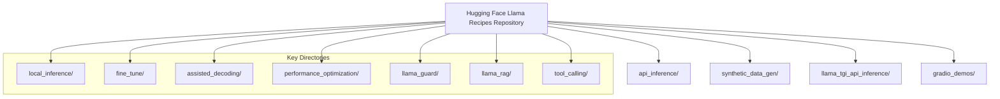
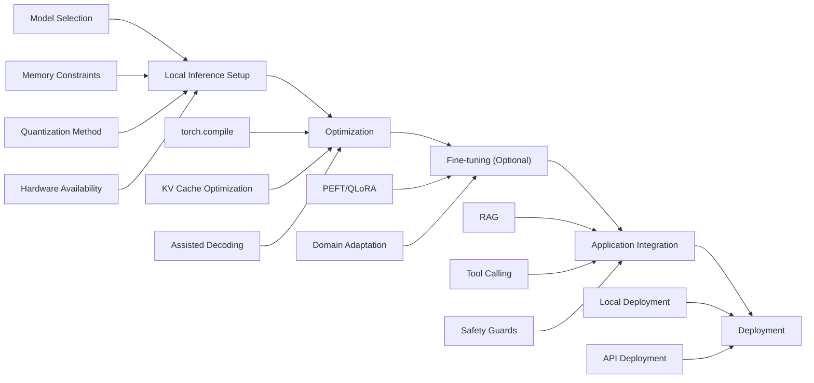
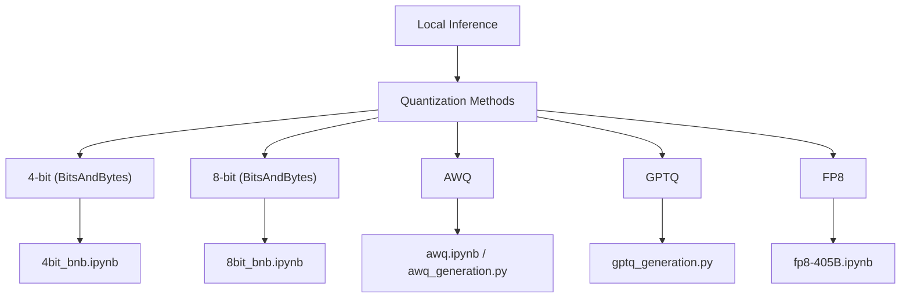
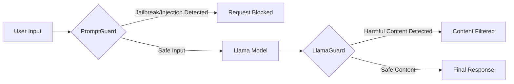

<!-- source: DeepWiki mcp.deepwiki.com · repo huggingface/huggingface-llama-recipes · page 1 Overview · fetched 2026-10-26 -->

# Overview

<details>
<summary>Relevant source files</summary>

The following files were used as context for generating this wiki page:

- [.github/README.md](.github/README.md)
- [tool_calling/tool_calling.ipynb](tool_calling/tool_calling.ipynb)

</details>


## Purpose and Scope

The Hugging Face Llama Recipes repository provides minimal, practical examples to help users quickly get started with Meta's Llama 3.x family of models. This documentation covers the core capabilities, structure, and implementation patterns found in the repository, serving as a reference guide for developers looking to leverage these powerful language models in their applications.

This overview page introduces the repository's purpose and summarizes the available recipes. For specific implementation details, refer to the dedicated pages on [Local Inference](#2), [Model Fine-tuning](#3), [Safety Systems](#4), [Performance Optimization](#5), and [Advanced Applications](#6).

Sources: [.github/README.md:1-12]()

## About Llama 3.x Models

The repository focuses on the Llama 3.x family of models, including:

- **Llama 3.1** - Available in 8B, 70B, and 405B parameter sizes
- **Llama 3.2** - Available in 1B, 3B parameter sizes with vision capabilities
- **Llama 3.3** - Available in 70B parameter size

Each model comes in base and instruction-tuned variants, with the latter optimized for chat and instruction-following use cases.

> **Note:** To use Llama 3.x models, you need to accept the license and request permission to access them via the [Hugging Face Meta-Llama organization](https://huggingface.co/meta-llama).

Sources: [.github/README.md:5-6](), [.github/README.md:14-18]()

## Repository Structure

The Llama Recipes repository is organized around different use cases and optimization techniques, each demonstrated through Jupyter notebooks and Python scripts.



Sources: [.github/README.md:67-172]()

## Hardware Requirements and Model Variants

The Llama 3.x models come in various sizes with different memory requirements depending on the quantization technique used:

| Model Size | Llama Variant | BF16/FP16 | FP8 | INT4 (AWQ/GPTQ/bnb) |
|:----------:|:-------------:|:---------:|:---:|:-------------------:|
| 1B | 3.2 | 2.5 GB | 1.25 GB | 0.75 GB |
| 3B | 3.2 | 6.5 GB | 3.2 GB | 1.75 GB |
| 8B | 3.1 | 16 GB | 8 GB | 4 GB |
| 70B | 3.1 and 3.3 | 140 GB | 70 GB | 35 GB |
| 405B | 3.1 | 810 GB | 405 GB | 204 GB |

This table helps users determine which model and quantization method is appropriate for their hardware constraints.

Sources: [.github/README.md:72-85]()

## Core Features and Recipes

The repository provides recipes across several key categories:

```mermaid
graph TD
    A["Meta Llama 3.x Models"] --> B["Local Inference"]
    A --> C["Model Fine-tuning"]
    A --> D["Assisted Decoding"]
    A --> E["Performance Optimization"]
    A --> F["Safety Systems"]
    A --> G["Advanced Applications"]
    
    B --> B1["BitsAndBytes Quantization"]
    B --> B2["AWQ Quantization"]
    B --> B3["GPTQ Quantization"]
    B --> B4["FP8 Precision"]
    
    C --> C1["Vision Fine-tuning"]
    C --> C2["PEFT/QLoRA"]
    C --> C3["Distributed Training"]
    
    D --> D1["transformers.pipeline"]
    D --> D2["assisted_decoding_70B_3B"]
    D --> D3["assisted_decoding_8B_1B"]
    
    E --> E1["torch.compile"]
    E --> E2["KV Cache Quantization"]
    E --> E3["DeepSpeed Zero3"]
    
    F --> F1["LlamaGuard"]
    F --> F2["PromptGuard"]
    
    G --> G1["RAG Pipeline"]
    G --> G2["Chatbot Interfaces"]
    G --> G3["Tool Calling"]
    G --> G4["Synthetic Data Generation"]
```



Sources: [.github/README.md:67-172]()

## Getting Started

The simplest way to get started with Llama models is using the Hugging Face `transformers` library:

```python
import torch
from transformers import pipeline

device = "cuda" if torch.cuda.is_available() else "cpu"

llama_31 = "meta-llama/Llama-3.1-8B-Instruct"  # Llama 3.1
llama_32 = "meta-llama/Llama-3.2-3B-Instruct"  # Llama 3.2

prompt = [
    {"role": "system", "content": "You are a helpful assistant, that responds as a pirate."},
    {"role": "user", "content": "What's Deep Learning?"},
]

generator = pipeline(model=llama_32, device=device, torch_dtype=torch.bfloat16)
generation = generator(
    prompt,
    do_sample=False,
    temperature=1.0,
    top_p=1,
    max_new_tokens=50
)
```

This example demonstrates loading and running a Llama 3.2 3B model for a chat interaction.

Sources: [.github/README.md:20-65]()

## Model Deployment Workflow

A typical workflow for working with Llama models includes the following stages:



Sources: [.github/README.md:67-172]()

## Local Inference Options

The repository provides several recipes for running Llama models locally with different optimizations:



For more detailed information on each quantization method and its implementation, see [Quantization Methods](#2.1).

Sources: [.github/README.md:87-97]()

## Safety Systems Integration

Llama Recipes includes integration with two safety systems:



- **Prompt Guard**: A small classifier that detects jailbreaks and prompt injections before they reach the model
- **Llama Guard 3**: A specialized 3.1B parameter model that evaluates both inputs and outputs for harmful content

For detailed implementation guides, see [Safety Systems](#4).

Sources: [.github/README.md:138-142]()

## Advanced Applications

The repository demonstrates several advanced applications built with Llama models:

1. **RAG Pipeline**: Combining Llama models with document retrieval for knowledge-intensive tasks
2. **Chatbot Interfaces**: Building interactive chat experiences with Gradio
3. **Tool Calling**: Leveraging Llama models' ability to use external tools and APIs
4. **Synthetic Data Generation**: Creating training data with `distilabel`

These advanced applications showcase how Llama models can be integrated into larger systems and workflows. For detailed implementation guides, see [Advanced Applications](#6).

Sources: [.github/README.md:144-171]()

## Conclusion

The Hugging Face Llama Recipes repository provides a comprehensive set of examples for working with Meta's Llama 3.x models across a variety of use cases and hardware configurations. By following these recipes, developers can quickly implement efficient inference, fine-tuning, and deployment strategies for these powerful language models.

The following pages in this documentation provide more detailed information on specific aspects of working with Llama models.

Sources: [.github/README.md:1-12]()

---

