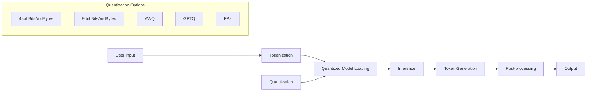
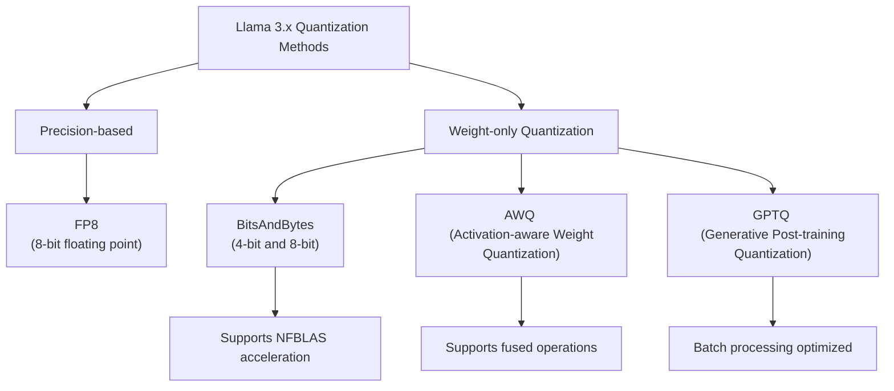
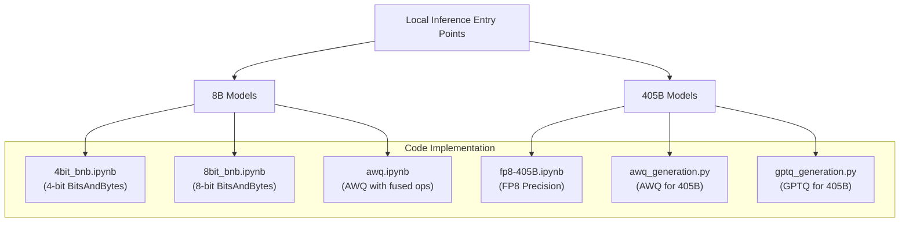

<!-- source: DeepWiki mcp.deepwiki.com · repo huggingface/huggingface-llama-recipes · page 2 Local Inference · fetched 2026-10-26 -->

# Local Inference

<details>
<summary>Relevant source files</summary>

The following files were used as context for generating this wiki page:

- [.github/README.md](.github/README.md)
- [llama.cpp/llama_cpp_python.ipynb](llama.cpp/llama_cpp_python.ipynb)
- [tool_calling/tool_calling.ipynb](tool_calling/tool_calling.ipynb)

</details>


## Purpose and Scope

This document explains how to run Llama 3.x models locally on your own hardware, focusing on various techniques to optimize memory usage and performance. It covers quantization methods and configuration options to make inference possible even on consumer-grade hardware with limited resources.

For information about fine-tuning these models, see [Model Fine-tuning](#3). For performance optimization techniques beyond quantization, see [Performance Optimization](#5).

## Memory Requirements

Running Llama models locally requires understanding their memory footprint, which varies based on model size and precision. Quantization techniques significantly reduce memory requirements while preserving most of the model's capabilities.

The following table shows approximate memory requirements for different Llama models and precision levels:

| Model Size | Llama Variant | BF16/FP16 | FP8 | INT4 (AWQ/GPTQ/BNB) |
| :--: | :--: | :--: | :--: | :--: |
| 1B | 3.2 | 2.5 GB | 1.25 GB | 0.75 GB |
| 3B | 3.2 | 6.5 GB | 3.2 GB | 1.75 GB |
| 8B | 3.1 | 16 GB | 8 GB | 4 GB |
| 70B | 3.1 and 3.3 | 140 GB | 70 GB | 35 GB |
| 405B | 3.1 | 810 GB | 405 GB | 204 GB |

As shown above, quantizing a model from 16-bit (BF16/FP16) to 4-bit precision (INT4) can reduce memory requirements by approximately 75%, making even large models accessible on consumer hardware.

Sources: [.github/README.md:69-86]()

## Local Inference Overview

### Inference Pipeline

The basic workflow for running local inference with Llama models involves loading the model with the appropriate quantization method, preparing inputs, generating outputs, and post-processing.



Sources: [.github/README.md:68-98]()

### Quantization Methods

The Llama Recipes repository supports several quantization methods that trade off between inference speed, memory usage, and output quality:



For detailed explanations of each quantization method and its trade-offs, see [Quantization Methods](#2.1).

Sources: [.github/README.md:87-97]()

## Running Llama 3.1 8B Models

Llama 3.1 8B is an excellent starting point for local inference as it balances capability and resource requirements. Here are three ways to run it locally:

### 4-bit Quantization with BitsAndBytes

This method provides the most memory-efficient option for running Llama 3.1 8B, requiring only about 4 GB of GPU memory. It's ideal for consumer GPUs with limited VRAM.

Key implementation components:
- Uses the `bitsandbytes` library for 4-bit quantization
- Employs `AutoModelForCausalLM.from_pretrained()` with appropriate quantization parameters
- Suitable for most consumer GPUs, including older models

Sources: [.github/README.md:89]()

### 8-bit Quantization with BitsAndBytes

The 8-bit quantization offers a balance between memory efficiency and model quality. It requires approximately 8 GB of GPU memory but generally provides better quality outputs than 4-bit quantization.

Key implementation components:
- Uses the `bitsandbytes` library for 8-bit quantization
- Requires a GPU with at least 8 GB of VRAM
- Provides better quality than 4-bit with modest memory increase

Sources: [.github/README.md:90]()

### AWQ with Fused Operations

AWQ (Activation-aware Weight Quantization) provides advanced quantization with optimized kernel operations, offering better inference speed while maintaining quality.

Key implementation components:
- Implements activation-aware quantization for preserving important weights
- Uses fused CUDA kernels for accelerated inference
- Requires compatible GPUs that support the necessary CUDA operations

Sources: [.github/README.md:91]()

## Running Llama 3.1 405B Models

The massive 405B parameter model requires special techniques to run locally, even with quantization. Here are three approaches:

### FP8 Precision

The FP8 method uses 8-bit floating-point precision to reduce memory requirements while maintaining higher numerical precision than integer quantization.

Key implementation components:
- Uses 8-bit floating-point representation
- Requires approximately 405 GB of memory (suitable for multi-GPU setups)
- Preserves more of the model's quality compared to INT4 quantization

Sources: [.github/README.md:95]()

### INT4 Quantization with AWQ

AWQ quantization reduces the 405B model to a more manageable size, requiring approximately 204 GB of memory.

Key implementation components:
- Uses a calibration dataset to determine optimal quantization parameters
- Preserves activations for important weights during quantization
- Significantly reduces memory requirements while maintaining reasonable quality

Sources: [.github/README.md:96]()

### INT4 Quantization with GPTQ

GPTQ (Generative Post-training Quantization) offers an alternative quantization method that works well for extremely large models.

Key implementation components:
- Uses post-training quantization technique optimized for generative models
- Supports batch processing for improved throughput
- Compatible with distributed inference across multiple GPUs

Sources: [.github/README.md:97]()

## Implementation Architecture

The following diagram illustrates how the quantization methods map to specific implementation files in the repository:



Sources: [.github/README.md:87-97]()

## Inference Example

Here's a basic example of running inference with a Llama model using the transformers library:

```python
import torch
from transformers import pipeline

device = "cuda" if torch.cuda.is_available() else "cpu"

# Choose a model
llama_31 = "meta-llama/Llama-3.1-8B-Instruct"  # Llama 3.1
llama_32 = "meta-llama/Llama-3.2-3B-Instruct"  # Llama 3.2

prompt = [
    {"role": "system", "content": "You are a helpful assistant."},
    {"role": "user", "content": "What's Deep Learning?"},
]

# Create the pipeline with appropriate dtype
generator = pipeline(model=llama_31, device=device, torch_dtype=torch.bfloat16)

# Generate response
generation = generator(
    prompt,
    do_sample=False,
    temperature=1.0,
    top_p=1,
    max_new_tokens=50
)

print(f"Generation: {generation[0]['generated_text']}")
```

Sources: [.github/README.md:25-65]()

## Method Comparison and Trade-offs

When choosing a quantization method for local inference, consider these trade-offs:

| Method | Memory Efficiency | Speed | Quality Preservation | GPU Requirements |
|--------|-------------------|-------|----------------------|------------------|
| FP16/BF16 | Low (Base) | High | Highest | High VRAM |
| FP8 | Medium (50% reduction) | High | Very Good | Medium-High VRAM |
| 8-bit BNB | Good (50% reduction) | Medium | Good | Medium VRAM |
| 4-bit BNB | Excellent (75% reduction) | Medium-Low | Acceptable | Low VRAM |
| AWQ | Excellent (75% reduction) | High | Good | Compatible GPU |
| GPTQ | Excellent (75% reduction) | High | Good | Compatible GPU |

Note that while quantization reduces memory requirements, it may affect model quality to varying degrees. 4-bit quantization generally shows more quality degradation than 8-bit or FP8, but the difference may be negligible for many applications.

Sources: [.github/README.md:69-86]()

## Conclusion

Local inference with Llama 3.x models is feasible across a range of hardware configurations thanks to various quantization techniques. For smaller models like Llama 3.2 1B or 3B, even standard consumer hardware is sufficient. For larger models like the 8B variant, quantization becomes essential, with 4-bit techniques enabling inference on GPUs with as little as 4 GB of VRAM. The largest models like 70B and 405B require either multiple GPUs or extreme quantization techniques.

For specific implementation details of each quantization method, refer to the corresponding notebooks and scripts in the repository.

---

