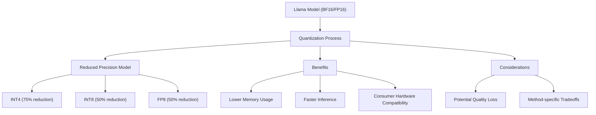
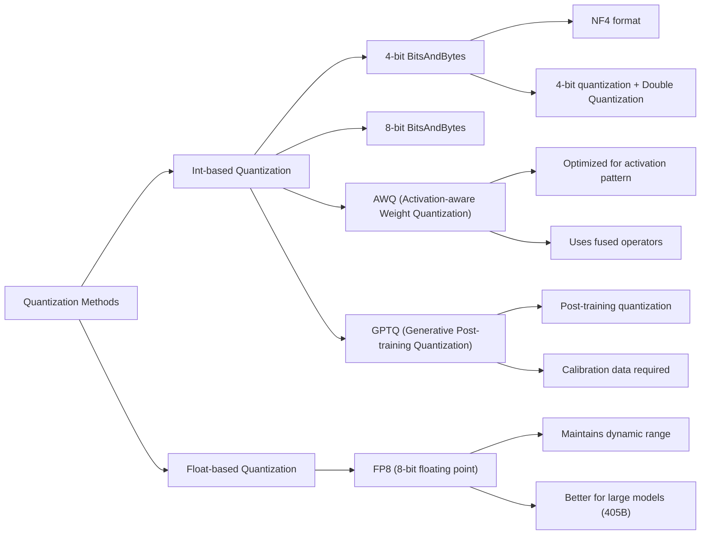
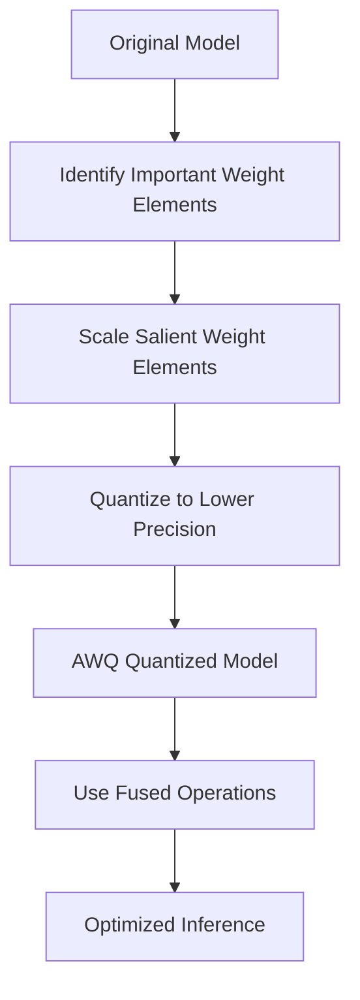
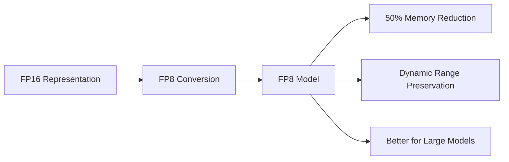
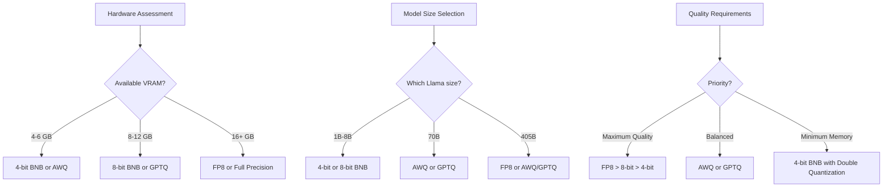
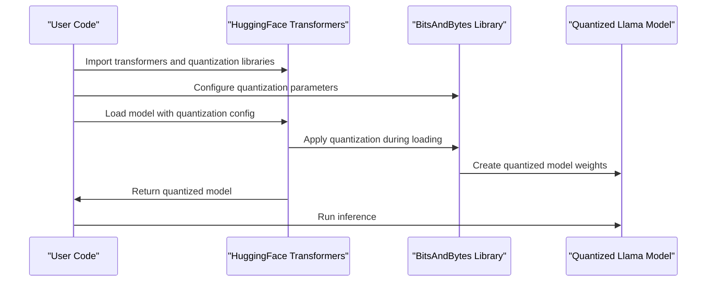

<!-- source: DeepWiki mcp.deepwiki.com · repo huggingface/huggingface-llama-recipes · page 2.1 Quantization Methods · fetched 2026-10-26 -->

# Quantization Methods

Relevant source files

The following files were used as context for generating this wiki page:

- [.github/README.md](.github/README.md)
- [tool_calling/tool_calling.ipynb](tool_calling/tool_calling.ipynb)

This page documents the various quantization techniques available in the Hugging Face Llama Recipes repository for running Llama 3.x models with reduced memory requirements. By using these quantization methods, you can run large language models on consumer hardware with limited VRAM. For information on other optimization techniques like torch.compile or KV cache quantization, see [Performance Optimization](#5).

## What is Quantization?

Quantization reduces the precision of model weights from their original 16-bit or 32-bit floating-point representation to lower precision formats (e.g., 8-bit, 4-bit, or custom formats). This significantly reduces memory requirements while aiming to preserve model quality.

Sources: .github/README.md

## Memory Requirements by Quantization Method

The following table shows the approximate memory requirements for running Llama 3.x models with different quantization methods:

| Model Size | Llama Variant | BF16/FP16 | FP8 | INT4 (AWQ/GPTQ/BNB) |
|:----------:|:-------------:|:---------:|:---:|:-------------------:|
| 1B | 3.2 | 2.5 GB | 1.25 GB | 0.75 GB |
| 3B | 3.2 | 6.5 GB | 3.2 GB | 1.75 GB |
| 8B | 3.1 | 16 GB | 8 GB | 4 GB |
| 70B | 3.1 and 3.3 | 140 GB | 70 GB | 35 GB |
| 405B | 3.1 | 810 GB | 405 GB | 204 GB |

Sources: .github/README.md:74-80

## Quantization Methods Overview

The repository implements several quantization approaches, each with its own advantages and trade-offs:

Sources: .github/README.md:86-97

## 4-bit Quantization with BitsAndBytes

This method uses the BitsAndBytes (BNB) library to quantize model weights to 4 bits, reducing memory usage by approximately 75% compared to FP16.

### Key Features:
- Uses NF4 (normalized float 4) format for better representation of weights
- Supports double quantization to further reduce memory usage
- Maintains most of the model's quality with significant memory savings
- Suitable for running 8B models on consumer GPUs with 8GB+ VRAM

### Implementation
The repository provides a notebook for running the Llama 3.1 8B model in 4-bit precision using BitsAndBytes.

Sources: .github/README.md:89

## 8-bit Quantization with BitsAndBytes

This method quantizes weights to 8 bits using the BitsAndBytes library, offering a good balance between memory reduction and output quality.

### Key Features:
- Reduces memory usage by approximately 50% compared to FP16
- Better preservation of model quality compared to 4-bit quantization
- Slightly higher memory requirements than 4-bit quantization
- Good option when quality is more important than maximum memory reduction

### Implementation
The repository includes a notebook demonstrating how to load and run the Llama 3.1 8B model with 8-bit quantization.

Sources: .github/README.md:90

## AWQ (Activation-aware Weight Quantization)

AWQ is an advanced quantization technique that considers activation patterns when determining how to quantize weights.

### Key Features:
- Optimizes quantization based on activation patterns during inference
- Uses group-wise quantization to preserve important weights
- Incorporates fused operations for faster inference
- Available for both 8B and 405B model variants
- Delivers better quality than standard quantization at the same bit width

### Implementation
The repository provides a notebook for running Llama 3.1 8B with AWQ and a script for applying AWQ to the 405B model.

Sources: .github/README.md:91, .github/README.md:96

## GPTQ (Generative Post-training Quantization)

GPTQ is a post-training quantization method specifically designed for generative models like Llama.

### Key Features:
- Uses calibration data to optimize quantization
- Employs layer-by-layer quantization with error correction
- Requires a one-time quantization process before inference
- Good quality preservation even at 4-bit precision
- Particularly useful for the 405B model

### Implementation
The repository includes a script for running the Llama 3.1 405B model quantized to INT4 with GPTQ.

Sources: .github/README.md:97

## FP8 (8-bit Floating Point)

FP8 quantization uses 8-bit floating-point representation instead of integer quantization, preserving more of the dynamic range important for language models.

### Key Features:
- Maintains floating-point representation with reduced precision
- Better preserves dynamic range compared to integer quantization
- Especially useful for the largest models (405B)
- Reduces memory by approximately 50% compared to FP16
- Good balance of quality and efficiency

### Implementation
The repository provides a notebook for running the Llama 3.1 405B model with FP8 quantization.

Sources: .github/README.md:95

## Quantization Method Selection Guide

The following diagram provides guidance on selecting the appropriate quantization method based on your hardware constraints and quality requirements:

## Comparison of Quantization Methods

| Method | Memory Reduction | Quality Preservation | Implementation Complexity | Best For |
|--------|------------------|----------------------|---------------------------|----------|
| 4-bit BNB | 75% | Moderate | Low | Consumer hardware with limited VRAM |
| 8-bit BNB | 50% | Good | Low | Balanced performance and quality |
| AWQ | 75% | Very Good | Medium | Best quality at 4-bit precision |
| GPTQ | 75% | Very Good | High (requires calibration) | Large models with high quality requirements |
| FP8 | 50% | Excellent | Medium | Preserving quality in large models |

Sources: .github/README.md

## Integration with HuggingFace Transformers

All quantization methods in this repository can be easily integrated with the HuggingFace Transformers library. The following diagram shows the typical usage pattern:

Sources: .github/README.md:25-65

## Conclusion

Quantization is a powerful technique for running large language models like Llama 3.x on hardware with limited memory. The Hugging Face Llama Recipes repository provides implementations of multiple quantization methods, each with different trade-offs between memory usage, inference speed, and output quality. By selecting the appropriate quantization technique for your specific use case, you can run even the largest Llama models (up to 405B parameters) on consumer or enterprise hardware.

For information on additional performance optimization techniques that can be combined with quantization, see [Performance Optimization](#5).

---

