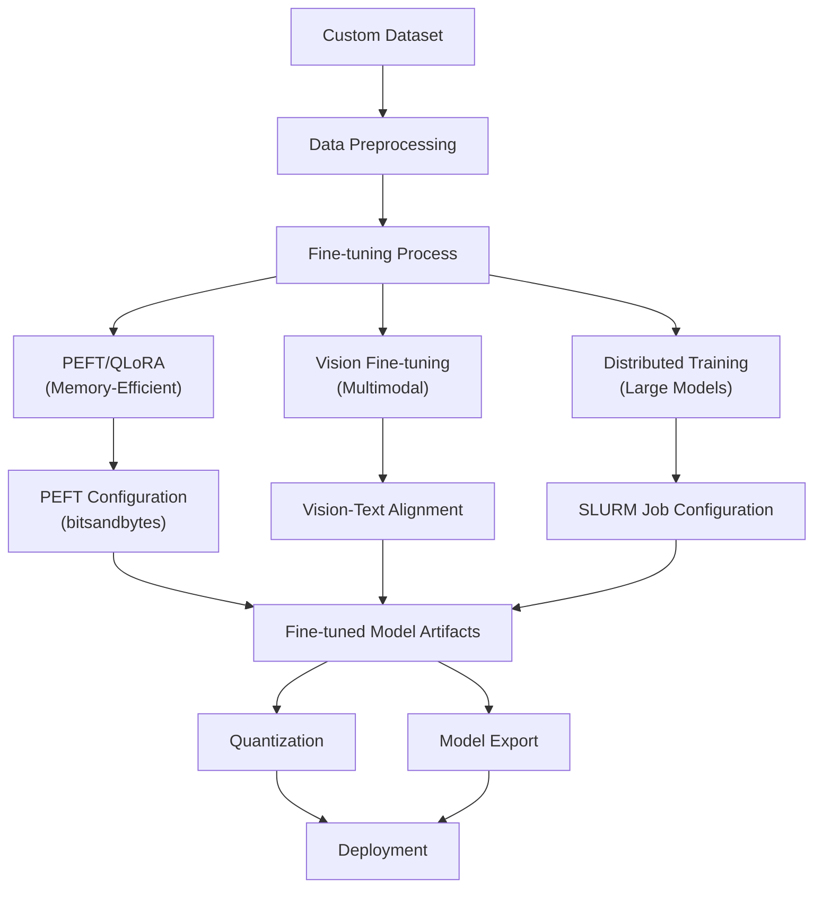
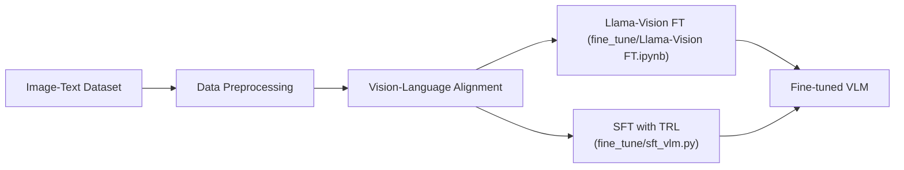
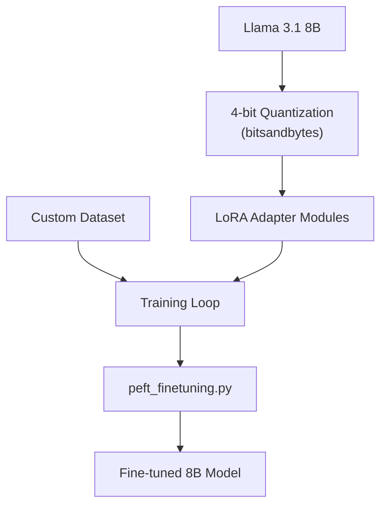
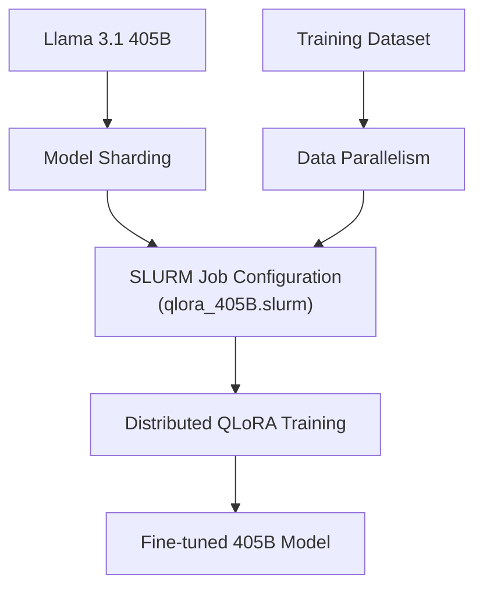
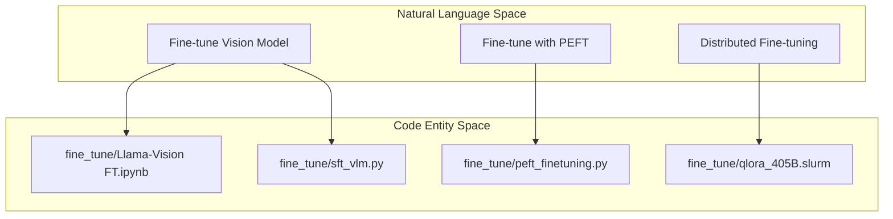
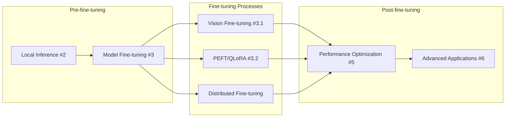

<!-- source: DeepWiki mcp.deepwiki.com · repo huggingface/huggingface-llama-recipes · page 3 Model Fine-tuning · fetched 2026-10-26 -->

# Model Fine-tuning

Relevant source files

The following files were used as context for generating this wiki page:

- [.github/README.md](.github/README.md)
- [tool_calling/tool_calling.ipynb](tool_calling/tool_calling.ipynb)

This document provides a comprehensive overview of fine-tuning techniques for Llama 3.x models available in the Hugging Face Llama Recipes repository. Fine-tuning allows you to adapt pre-trained Llama models to specific tasks, domains, or datasets while requiring significantly fewer computational resources than pre-training from scratch.

For information on running pre-trained models without fine-tuning, see [Local Inference](#2).

## Purpose and Scope

Fine-tuning Llama models enables you to:

1. Adapt models to specific domains or tasks
2. Improve performance on specialized use cases
3. Create custom capabilities while leveraging the base model's knowledge
4. Optimize models for deployment constraints

This document covers multiple fine-tuning approaches including vision fine-tuning, parameter-efficient techniques, and distributed fine-tuning workflows.

Sources: [.github/README.md:99-111]()

## Fine-tuning Approaches Overview

The Llama Recipes repository offers several fine-tuning approaches tailored to different model sizes and hardware capabilities:

| Approach | Suitable For | Hardware Requirements | Key Benefits |
|----------|--------------|------------------------|-------------|
| Vision Fine-tuning | Llama 3.2 Vision | GPU with 24GB+ VRAM | Adapt multimodal capabilities to custom visual tasks |
| PEFT/QLoRA | Llama 3.1 8B | Consumer GPUs (16GB+ VRAM) | Memory-efficient adaptation with minimal quality loss |
| Distributed Fine-tuning | Llama 3.1 405B | SLURM clusters/multiple GPUs | Scale to very large models using distributed resources |

Sources: [.github/README.md:106-110]()

## Fine-tuning Architecture

### General Fine-tuning Workflow

Sources: [.github/README.md:106-110]()

### Technical Components Interaction

Sources: [.github/README.md:106-110]()

## Vision Fine-tuning

Llama 3.2 Vision models can be fine-tuned to adapt their multimodal capabilities to custom visual understanding tasks. This process aligns the model's understanding of images with specific textual descriptions or task requirements.

### Vision Fine-tuning Implementation

Two primary approaches are available in the repository:

1. **Custom Dataset Fine-tuning**: Fine-tunes Llama 3.2 Vision on your own image-text pairs
2. **Supervised Fine-tuning with TRL**: Uses the Training Reinforcement Learning (TRL) library for more controlled vision fine-tuning

For detailed implementation of vision fine-tuning, see [Vision Fine-tuning](#3.1).

Sources: [.github/README.md:107-108]()

## Parameter-Efficient Fine-Tuning (PEFT)

PEFT techniques like QLoRA (Quantized Low-Rank Adaptation) enable efficient fine-tuning of large models on consumer hardware by significantly reducing memory requirements while preserving most of the model quality.

### PEFT with QLoRA Architecture

The QLoRA approach combines quantization with Low-Rank Adapters (LoRA), allowing fine-tuning of 8B parameter models even on consumer GPUs with 16-24GB VRAM. The implementation in `peft_finetuning.py` provides a practical workflow for this approach.

For detailed implementation of PEFT techniques, see [PEFT and QLoRA](#3.2).

Sources: [.github/README.md:109]()

## Distributed Fine-tuning

For very large models like Llama 3.1 405B, distributed fine-tuning across multiple nodes becomes necessary. The repository provides SLURM job configuration for efficiently distributing the training process.

### Distributed Fine-tuning Workflow

The SLURM configuration in the repository handles resource allocation, model sharding, and synchronization across multiple compute nodes, making it possible to fine-tune models that would otherwise be too large for individual machines.

Sources: [.github/README.md:110]()

## Technical Implementation

### Key Components

The fine-tuning implementations utilize several key libraries and techniques:

| Component | Purpose | Implementation |
|-----------|---------|----------------|
| PEFT | Parameter-efficient fine-tuning | `peft_finetuning.py` |
| bitsandbytes | 4-bit/8-bit quantization | Used in QLoRA implementation |
| TRL | Supervised Fine-Tuning | `sft_vlm.py` |
| SLURM | Distributed computing | `qlora_405B.slurm` |

### Code to Concept Mapping

Sources: [.github/README.md:106-110]()

### Integration with Broader Workflows

Sources: [.github/README.md:106-110]()

## Getting Started with Fine-tuning

To start fine-tuning a Llama model, follow these general steps:

1. **Prepare your dataset** in the appropriate format for your task
2. **Choose the appropriate fine-tuning approach** based on your model size and hardware
3. **Configure hyperparameters** for training
4. **Execute the fine-tuning script** from the repository
5. **Evaluate and export** the fine-tuned model

### Example Implementation Selection

| Your Need | Recommended Approach | Repository File |
|-----------|----------------------|-----------------|
| Adapt Llama 3.2 to visual tasks | Vision Fine-tuning | `fine_tune/Llama-Vision FT.ipynb` |
| Fine-tune 8B model on limited hardware | PEFT/QLoRA | `fine_tune/peft_finetuning.py` |
| Fine-tune very large (405B) model | Distributed Fine-tuning | `fine_tune/qlora_405B.slurm` |

Sources: [.github/README.md:106-110]()

## Conclusion

Fine-tuning Llama 3.x models enables adaptation to specific tasks while requiring significantly fewer resources than pre-training. The repository provides implementations for vision fine-tuning, parameter-efficient techniques for consumer hardware, and distributed approaches for very large models.

For more specific details on vision fine-tuning implementation, refer to [Vision Fine-tuning](#3.1), and for PEFT techniques, see [PEFT and QLoRA](#3.2).

Sources: [.github/README.md:99-111]()

---

