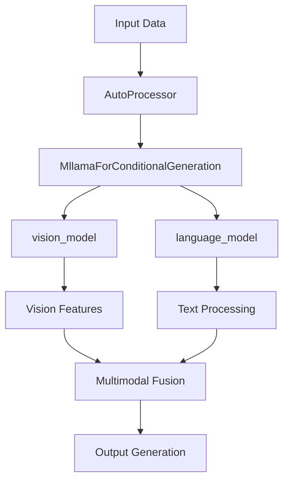
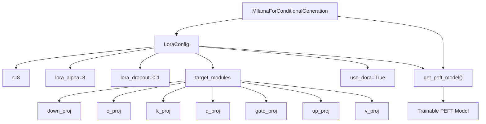
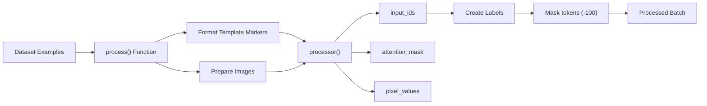
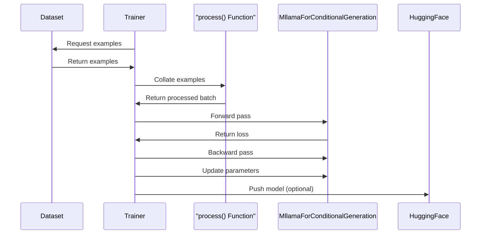

<!-- source: DeepWiki mcp.deepwiki.com · repo huggingface/huggingface-llama-recipes · page 3.1 Vision Fine-tuning · fetched 2026-10-26 -->

# Vision Fine-tuning

<details>
<summary>Relevant source files</summary>

The following files were used as context for generating this wiki page:

- [.github/README.md](.github/README.md)
- [fine_tune/Llama-Vision FT.ipynb](fine_tune/Llama-Vision FT.ipynb)
- [tool_calling/tool_calling.ipynb](tool_calling/tool_calling.ipynb)

</details>


This document explains how to fine-tune Llama 3.2 Vision models on custom datasets using the Hugging Face Transformers library. It covers model configuration, parameter-efficient fine-tuning approaches, data preprocessing, and training workflow.

For parameter-efficient fine-tuning with PEFT and QLoRA for text-only models, see [PEFT and QLoRA](#3.2).

## 1. Vision Fine-tuning Overview

Llama 3.2 Vision is a multimodal large language model that processes both images and text inputs. Fine-tuning adapts this pre-trained model to specific vision-language tasks such as visual question answering (VQA), image captioning, or domain-specific visual understanding.

The repository provides a notebook implementation demonstrating fine-tuning on a VQAv2 dataset subset using the Transformers `Trainer` API.

Sources: [.github/README.md:106-108](), [fine_tune/Llama-Vision FT.ipynb:4-20]()

## 2. Model Architecture and Components



Llama 3.2 Vision uses the `MllamaForConditionalGeneration` class which integrates:
- `vision_model`: Processes images into feature representations
- `language_model`: Handles text generation with additional vision context
- `AutoProcessor`: Handles both image preprocessing and text tokenization

Sources: [fine_tune/Llama-Vision FT.ipynb:109-159]()

## 3. Fine-tuning Approaches

The repository supports three main approaches for fine-tuning Llama 3.2 Vision:

### 3.1. Parameter-Efficient Fine-Tuning with LoRA



The `LoraConfig` defines trainable low-rank adapters that are applied to specific target modules in the model. LoRA significantly reduces the number of trainable parameters while maintaining fine-tuning effectiveness.

The implementation also supports DoRA (Weight-Decomposed Low-Rank Adaptation), an extension of LoRA that can provide improved performance.

Sources: [fine_tune/Llama-Vision FT.ipynb:118-135]()

### 3.2. Selective Component Freezing

Two selective freezing approaches are supported:

1. **Freezing `vision_model`**:
```python
for param in model.vision_model.parameters():
    param.requires_grad = False
```

2. **Freezing `language_model`** (recommended by Llama authors):
```python
for param in model.language_model.parameters():
    param.requires_grad = False
```

These approaches provide a balance between adaptation capability and computational efficiency.

Sources: [fine_tune/Llama-Vision FT.ipynb:137-153]()

### 3.3. Full Fine-tuning

For complete model adaptation, the repository supports full fine-tuning of all parameters:

```python
model = MllamaForConditionalGeneration.from_pretrained(ckpt,
    torch_dtype=torch.bfloat16, device_map="auto")
```

This approach provides maximum adaptation potential but requires significant computational resources.

Sources: [fine_tune/Llama-Vision FT.ipynb:155-157]()

## 4. Data Preprocessing



The `process()` function handles data preparation:

1. Formats text with template markers:
   - `<|begin_of_text|>`, `<|start_header_id|>user<|end_header_id|>`
   - `<|image|>` for image placeholder
   - `<|eot_id|>` for end of text
   - `<|start_header_id|>assistant<|end_header_id|>`

2. Prepares images:
   - Converts to RGB format
   - Groups as lists of single images

3. Creates labels by modifying input IDs:
   - Sets pad tokens to -100 (ignored in loss calculation)
   - Sets image tokens (ID 128256) to -100

The processor outputs tokenized text, attention masks, and processed image pixel values.

Sources: [fine_tune/Llama-Vision FT.ipynb:167-190]()

## 5. Training Configuration

The `TrainingArguments` control the fine-tuning process:

| Parameter | Value | Purpose |
|-----------|-------|---------|
| num_train_epochs | 2 | Number of training iterations |
| per_device_train_batch_size | 1 | Batch size per device |
| gradient_accumulation_steps | 4 | Steps before parameter update |
| learning_rate | 2e-5 | Parameter update rate |
| weight_decay | 1e-6 | L2 regularization |
| adam_beta2 | 0.999 | Adam optimizer beta2 |
| bf16 | True | Use bfloat16 precision |
| optim | "adamw_hf" | Optimizer type |

The configuration emphasizes memory efficiency through small batch sizes and gradient accumulation, which is crucial for large models.

Sources: [fine_tune/Llama-Vision FT.ipynb:209-227]()

## 6. Training Process with Trainer API



The training process uses the Hugging Face `Trainer` class with:
- `model`: The initialized `MllamaForConditionalGeneration`
- `train_dataset`: The dataset to train on
- `data_collator`: The `process()` function
- `args`: Training arguments

The `Trainer.train()` method handles the training loop, gradient computation, parameter updates, and logging.

Sources: [fine_tune/Llama-Vision FT.ipynb:245-269]()

## 7. Example Dataset: VQAv2

The example uses the VQAv2 (Visual Question Answering v2) dataset:

```python
ds = load_dataset("merve/vqav2-small", split="validation[:10%]")
```

Dataset features:
- `multiple_choice_answer`: The correct answer to the question
- `question`: The question about the image
- `image`: The image being questioned about

This structure enables training the model to understand images and answer questions about them.

Sources: [fine_tune/Llama-Vision FT.ipynb:29-56]()

## 8. Hardware Requirements and Best Practices

Fine-tuning Llama 3.2 Vision models has significant hardware requirements:

1. **Memory Requirements**:
   - Full fine-tuning of 11B model: 40GB+ GPU memory
   - LoRA fine-tuning: 24GB+ GPU memory
   - Selective freezing: Varies based on components frozen

2. **Best Practices**:
   - Use parameter-efficient methods (LoRA) for consumer hardware
   - Implement gradient accumulation for effective batch size increase
   - Use mixed precision (bfloat16) for memory efficiency
   - Consider component freezing based on your specific task

These approaches balance computational requirements with model adaptation capabilities.

Sources: [fine_tune/Llama-Vision FT.ipynb:113-157](), [fine_tune/Llama-Vision FT.ipynb:210-227]()

---

