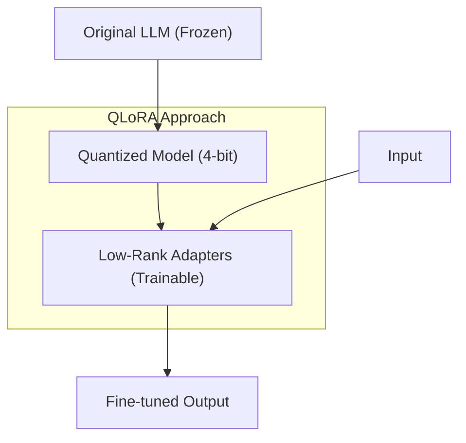
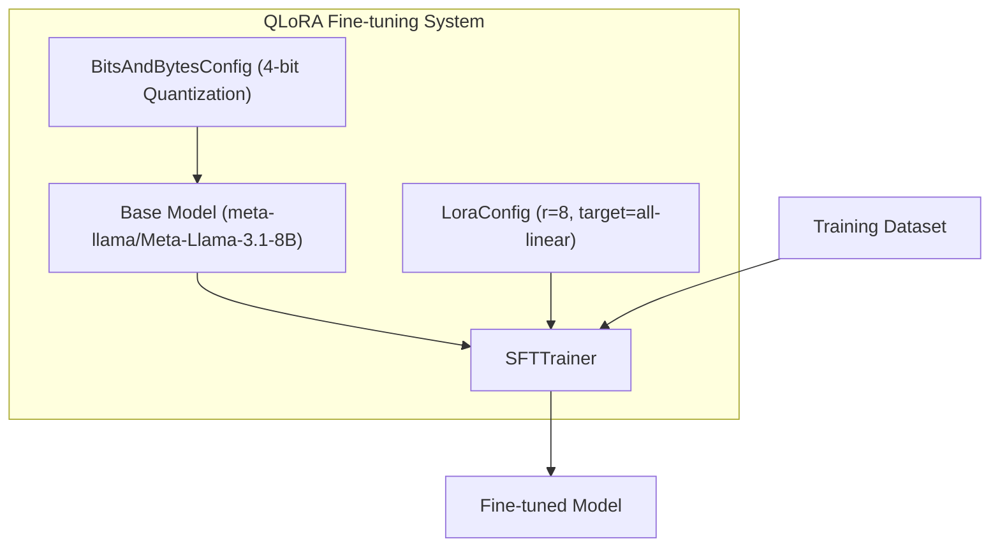
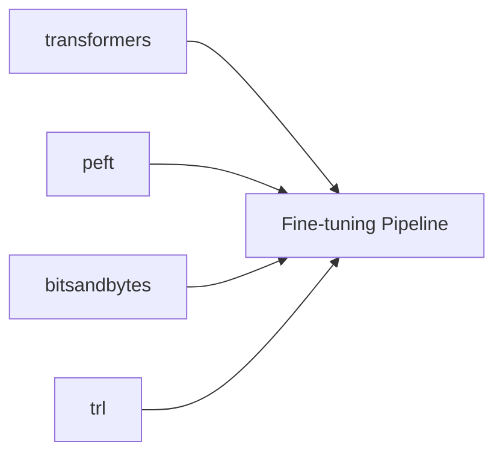
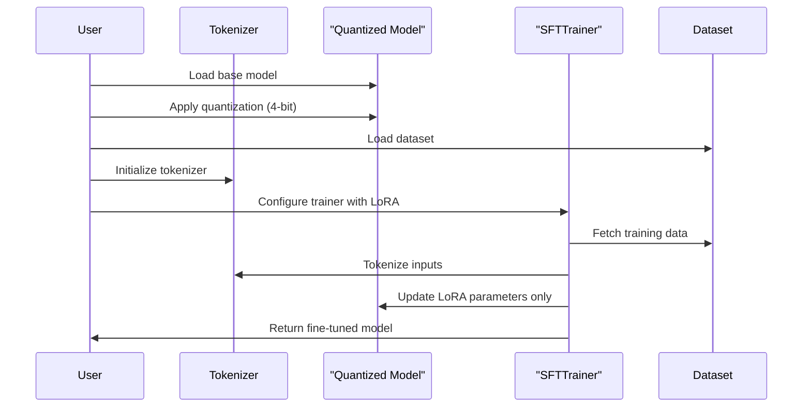
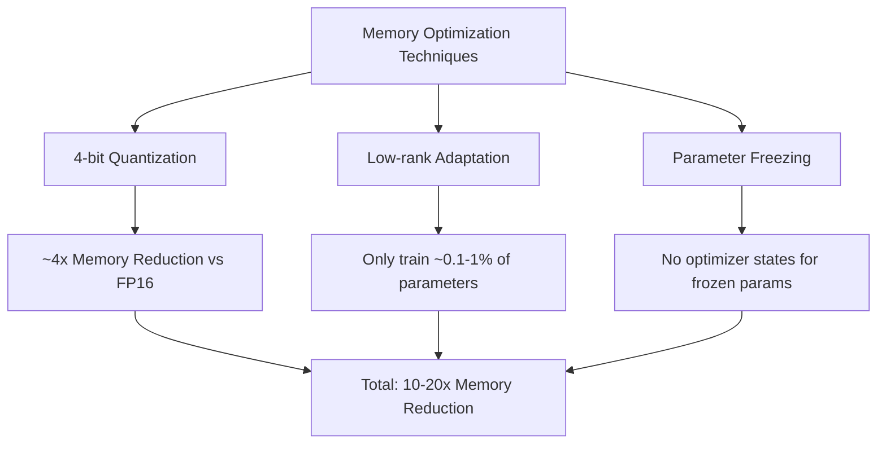

<!-- source: DeepWiki mcp.deepwiki.com · repo huggingface/huggingface-llama-recipes · page 3.2 PEFT and QLoRA · fetched 2026-10-26 -->

# PEFT and QLoRA

<details>
<summary>Relevant source files</summary>

The following files were used as context for generating this wiki page:

- [.github/README.md](.github/README.md)
- [fine_tune/peft_finetuning.py](fine_tune/peft_finetuning.py)
- [tool_calling/tool_calling.ipynb](tool_calling/tool_calling.ipynb)

</details>


## Purpose and Scope

This document explains Parameter-Efficient Fine-Tuning (PEFT) and Quantized Low-Rank Adaptation (QLoRA) techniques as implemented in the Hugging Face Llama Recipes repository. These methods allow fine-tuning large language models like Llama 3.1 on consumer-grade GPUs with limited VRAM. This page focuses specifically on the implementation and usage of these techniques with Llama models.

## Introduction to PEFT and QLoRA

Parameter-Efficient Fine-Tuning (PEFT) is a family of techniques that allow adapting large language models to specific tasks while updating only a small subset of the model's parameters. QLoRA builds on this by combining quantization with Low-Rank Adaptation to further reduce memory requirements during training.

These techniques are essential for fine-tuning large models like Llama on consumer hardware:

| Model | Full Parameters | Full FP16 Memory | With QLoRA Memory |
|-------|----------------|-----------------|-------------------|
| Llama 3.1 8B | ~8 billion | ~16 GB | ~5-6 GB |
| Llama 3.1 70B | ~70 billion | ~140 GB | ~25-30 GB |

Sources: [.github/README.md:73-80]()

## Technical Overview

### How PEFT and QLoRA Work



PEFT techniques reduce memory usage and computational requirements by:

1. **Freezing the original model weights** - The base model parameters remain unchanged
2. **Adding small trainable modules** - Only these new parameters are updated during training
3. **Quantizing the model weights** - QLoRA specifically uses 4-bit quantization to further reduce memory footprint

LoRA (Low-Rank Adaptation) works by representing weight updates as low-rank decompositions, dramatically reducing the number of trainable parameters.

Sources: [fine_tune/peft_finetuning.py:29-42]()

### Key Components



The QLoRA implementation in Llama Recipes consists of:

1. **Quantization Configuration** - Using `BitsAndBytesConfig` to load the model in 4-bit precision
2. **LoRA Configuration** - Defining the rank and target modules for the low-rank adaptation
3. **Training Framework** - Using `SFTTrainer` from the TRL library to manage the fine-tuning process

Sources: [fine_tune/peft_finetuning.py:10-13](), [fine_tune/peft_finetuning.py:30-42]()

## Implementation Details

The Llama Recipes repository provides a straightforward implementation of PEFT with QLoRA for fine-tuning Llama models. Here's how the key components work together:

### Core Libraries



- **transformers** - Provides the model architecture and tokenizer
- **peft** - Implements parameter-efficient fine-tuning techniques
- **bitsandbytes** - Enables 4-bit quantization
- **trl** - Offers the SFTTrainer for streamlined fine-tuning

Sources: [fine_tune/peft_finetuning.py:4-12]()

### Quantization Configuration

The quantization settings are defined through the `BitsAndBytesConfig`:

```python
quantization_config = BitsAndBytesConfig(
    load_in_4bit=True,
    bnb_4bit_compute_dtype=torch.float16,
    bnb_4bit_quant_type="nf4"
)
```

This configuration:
- Loads the model in 4-bit precision (`load_in_4bit=True`)
- Uses float16 for compute operations (`bnb_4bit_compute_dtype=torch.float16`)
- Uses the nf4 quantization format, which is optimized for language models (`bnb_4bit_quant_type="nf4"`)

Sources: [fine_tune/peft_finetuning.py:31-35]()

### LoRA Configuration

The LoRA approach is configured with:

```python
lora_config = LoraConfig(
    r=8,
    target_modules="all-linear",
    bias="none",
    task_type="CAUSAL_LM",
)
```

These settings define:
- The rank of the low-rank decomposition (`r=8`) - higher values provide more capacity but use more memory
- Which modules to apply LoRA to (`target_modules="all-linear"`) - in this case, all linear layers
- No bias parameter adaptation (`bias="none"`)
- The task type as causal language modeling (`task_type="CAUSAL_LM"`)

Sources: [fine_tune/peft_finetuning.py:37-42]()

## Fine-tuning Workflow



The fine-tuning process follows these steps:

1. **Model and Tokenizer Loading**
   ```python
   tokenizer = AutoTokenizer.from_pretrained(model_id)
   model = AutoModelForCausalLM.from_pretrained(model_id)
   ```

2. **Dataset Preparation**
   ```python
   dataset = load_dataset("imdb", split="train")
   ```

3. **Training Configuration**
   ```python
   training_args = TrainingArguments(
       output_dir="./results",
       num_train_epochs=3,
       per_device_train_batch_size=4,
       logging_dir='./logs',
       logging_steps=10,
   )
   ```

4. **Trainer Setup and Training**
   ```python
   trainer = SFTTrainer(
       model=model,
       tokenizer=tokenizer,
       args=training_args,
       peft_config=lora_config,
       train_dataset=dataset,
       dataset_text_field="text",
   )
   
   trainer.train()
   ```

Sources: [fine_tune/peft_finetuning.py:16-55]()

## Memory Optimization

QLoRA significantly reduces memory requirements through several mechanisms:



The combined effect of these techniques allows fine-tuning multi-billion parameter models on consumer GPUs with as little as 8-16GB of VRAM.

Sources: [.github/README.md:73-80](), [fine_tune/peft_finetuning.py:29-42]()

## Usage Guidelines

### System Requirements

- **GPU Memory**: 8GB+ for Llama 3.2 (3B), 16GB+ for Llama 3.1 (8B)
- **Dependencies**: transformers, peft, trl, bitsandbytes

### Best Practices

1. **Adjust Batch Size**: If you encounter CUDA out-of-memory errors, reduce the batch size
2. **Tune LoRA Rank**: Start with a lower rank (r=4 or r=8) and increase if needed
3. **Target Specific Modules**: For more efficiency, target only specific modules (e.g., query/key/value matrices) instead of "all-linear"
4. **Fine-tuning Duration**: Even with a few epochs, PEFT techniques can produce good results

### Saving and Using the Fine-tuned Model

After training, the PEFT adapter can be saved and loaded separately from the base model:

```python
# Save the adapter
trainer.model.save_pretrained("./peft_model")

# Load for inference
from peft import PeftModel, PeftConfig
config = PeftConfig.from_pretrained("./peft_model")
model = AutoModelForCausalLM.from_pretrained(config.base_model_name_or_path)
model = PeftModel.from_pretrained(model, "./peft_model")
```

## Conclusion

PEFT and QLoRA make it feasible to fine-tune large language models like Llama on consumer hardware by dramatically reducing memory requirements. The Llama Recipes repository provides a straightforward implementation that can be adapted to various datasets and tasks.

For more information on fine-tuning other Llama models, such as Llama 3.2 Vision, refer to [Vision Fine-tuning](#3.1).

Sources: [.github/README.md:99-110]()

---

