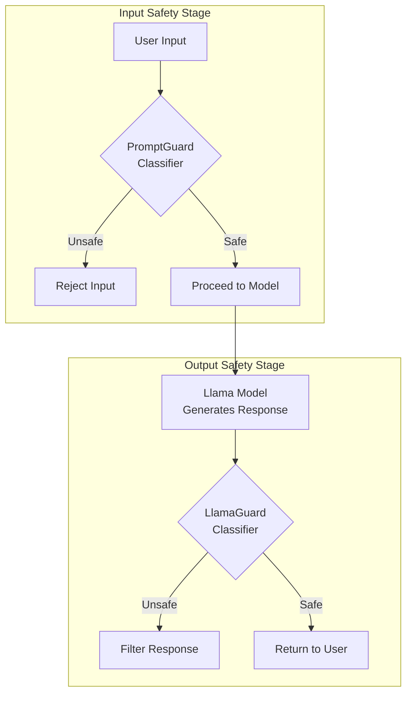
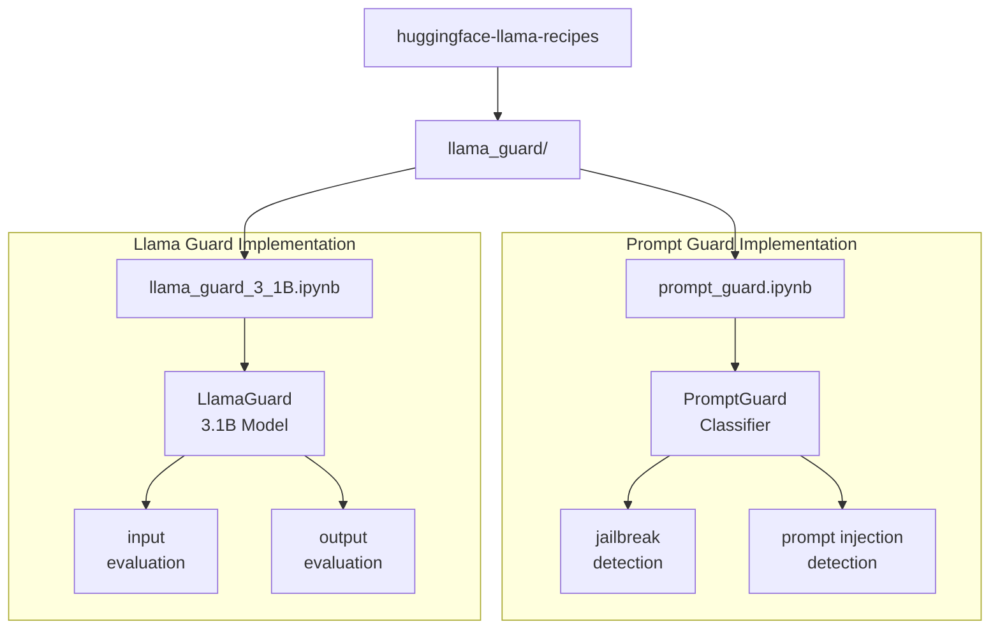
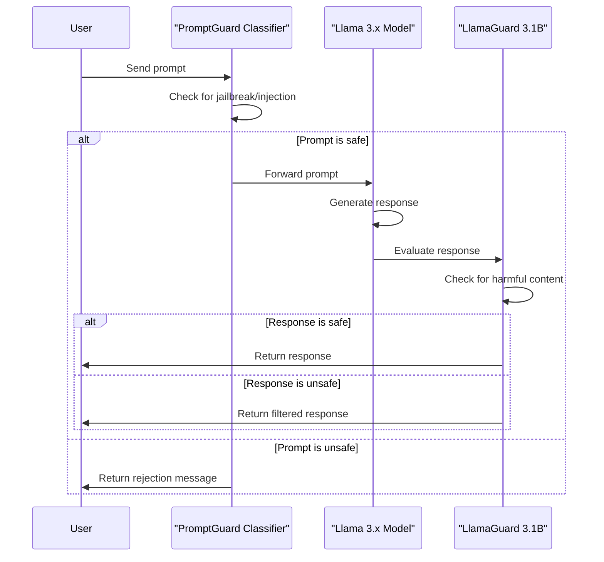
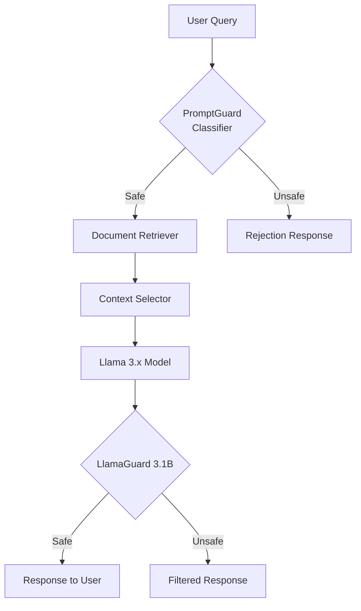
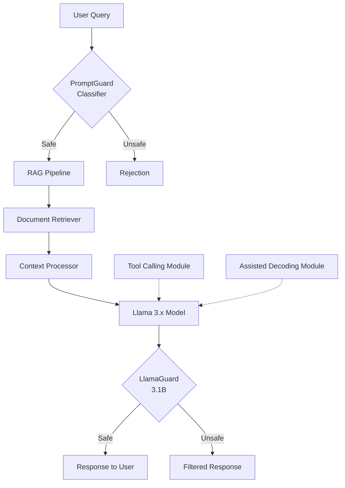

<!-- source: DeepWiki mcp.deepwiki.com · repo huggingface/huggingface-llama-recipes · page 4 Safety Systems · fetched 2026-10-26 -->

# Safety Systems

Relevant source files

The following files were used as context for generating this wiki page:

- [.github/README.md](.github/README.md)
- [assets/prompt_guard_flowchart.png](assets/prompt_guard_flowchart.png)
- [assets/prompt_guard_visual.png](assets/prompt_guard_visual.png)
- [llama_guard/llama_guard_3_1B.ipynb](llama_guard/llama_guard_3_1B.ipynb)
- [tool_calling/tool_calling.ipynb](tool_calling/tool_calling.ipynb)

## Purpose and Scope

This document provides an overview of the safety systems available in the Hugging Face Llama Recipes repository. It covers Llama Guard and Prompt Guard, which are specialized models designed to detect and filter harmful content in both inputs to and outputs from Llama models. These systems help developers implement robust safety measures in their LLM applications.

For detailed implementation instructions, see the dedicated pages on [Llama Guard](#4.1) and [Prompt Guard](#4.2).

## Safety System Components

The repository provides two complementary safety systems:

### Llama Guard

Llama Guard is a specialized 3.1B parameter model designed to evaluate content according to safety guidelines. Unlike the main Llama models which are generative, Llama Guard serves as a content classifier specifically trained to identify harmful content.

Key capabilities:
- Evaluate user inputs before they're processed by the main model
- Evaluate model outputs before they're returned to users
- Classify content across multiple safety categories

### Prompt Guard

Prompt Guard is a lightweight classifier specifically designed to detect:
- Jailbreak attempts (trying to bypass model restrictions)
- Prompt injection attacks (trying to manipulate the model's behavior)

It functions as a first line of defense before inputs reach the main model.

Sources: [.github/README.md:138-142]()

## Safety System Architecture

The safety systems are typically integrated in a two-stage process:

This dual-layer architecture ensures:
1. Harmful content is filtered before reaching the model
2. Any potentially harmful outputs are caught before reaching users

Sources: [.github/README.md:138-142]()

## Implementation Structure

The repository organizes safety systems in the `llama_guard` directory with specific notebooks for each component:

Sources: [.github/README.md:138-142]()

## Integration Patterns

### Basic LLM Integration

### RAG System Integration

Safety systems can be seamlessly integrated with Retrieval-Augmented Generation (RAG) workflows:

Sources: [.github/README.md:138-142](), [.github/README.md:151-156]()

## Typical Usage Flow

The typical usage pattern involves:

1. **Setup**: Load both safety models
2. **Input Validation**: Check user inputs with Prompt Guard
3. **Generation**: Process safe inputs with the main Llama model
4. **Output Validation**: Check generated outputs with Llama Guard

For specific implementation details, see the dedicated notebooks:
- Prompt Guard: [llama_guard/prompt_guard.ipynb]()
- Llama Guard: [llama_guard/llama_guard_3_1B.ipynb]()

Sources: [.github/README.md:138-142]()

## Use Case Examples

Safety systems can be applied in various scenarios:

| Use Case | Safety Challenges | Recommended Configuration |
|----------|-------------------|---------------------------|
| Customer Support | Potential for offensive language, PII exposure | Prompt Guard + Llama Guard with moderate thresholds |
| Educational Tools | Academic freedom vs. safety guidelines | Prompt Guard + context-aware filtering |
| Content Generation | Copyright issues, inappropriate content | Strong output filtering with Llama Guard |
| Health Advice | Potential for harmful recommendations | High-sensitivity settings on both systems |

Sources: [.github/README.md:138-142]()

## Integration with Other Components

Safety systems can be integrated with other components in the repository:

This integrated approach ensures safety throughout complex workflows that involve multiple components.

Sources: [.github/README.md:138-142](), [.github/README.md:151-156](), [.github/README.md:168-171]()

## Key Considerations

When implementing safety systems:

1. **Performance Impact**: Both safety models add some latency to your application. Llama Guard (3.1B parameters) has a more significant impact than the lighter-weight Prompt Guard.

2. **False Positives**: Adjust thresholds to balance safety with usability. Setting thresholds too strict may block legitimate content.

3. **Coverage**: Implement both input and output filtering for comprehensive protection. Input filtering alone may miss harmful content generated by the model.

4. **Customization**: Different applications may require different safety standards based on their audience and use case.

Sources: [.github/README.md:138-142]()

## Further Resources

For implementation details and code examples:
- See [Llama Guard Documentation](#4.1) for using Llama Guard for content evaluation
- See [Prompt Guard Documentation](#4.2) for detecting jailbreaks and prompt injections

---

