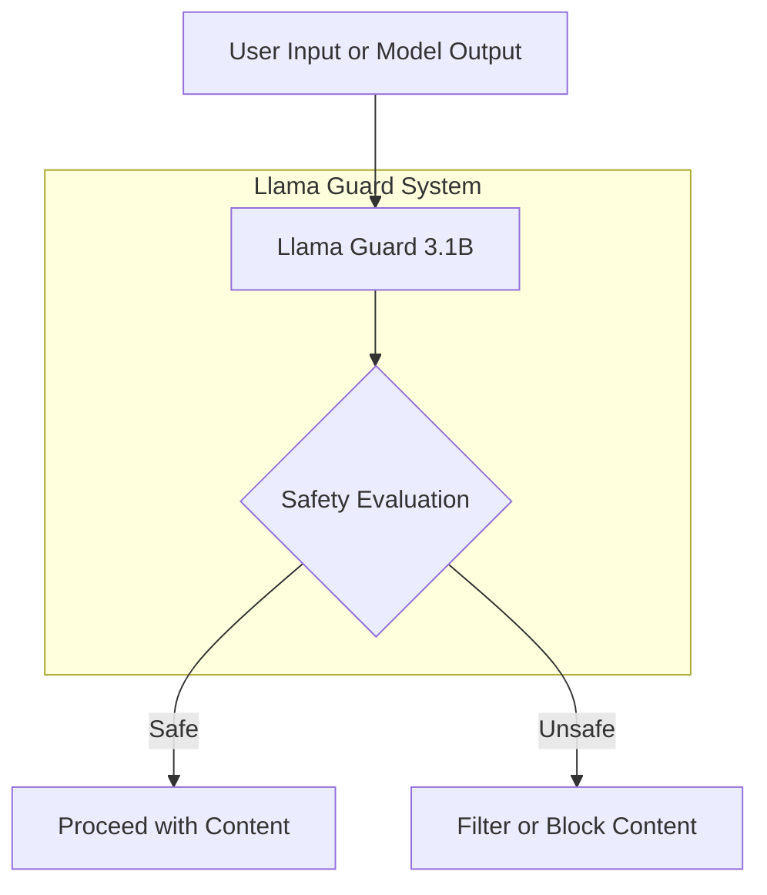
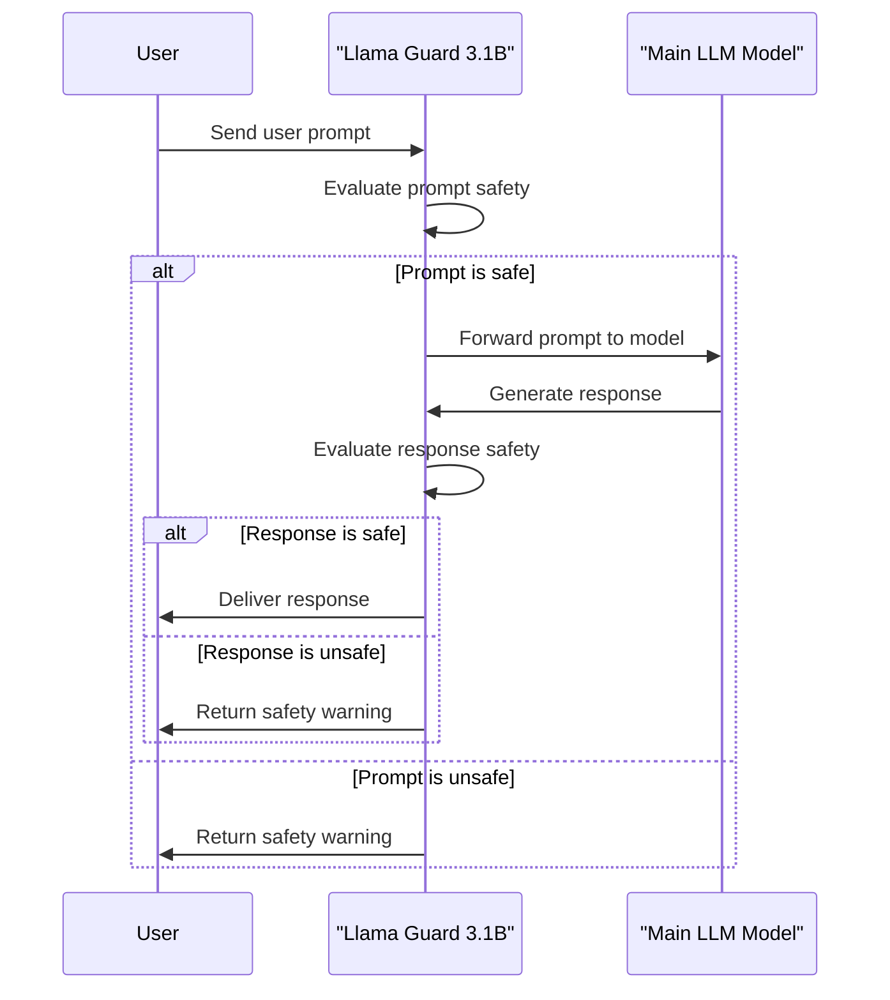
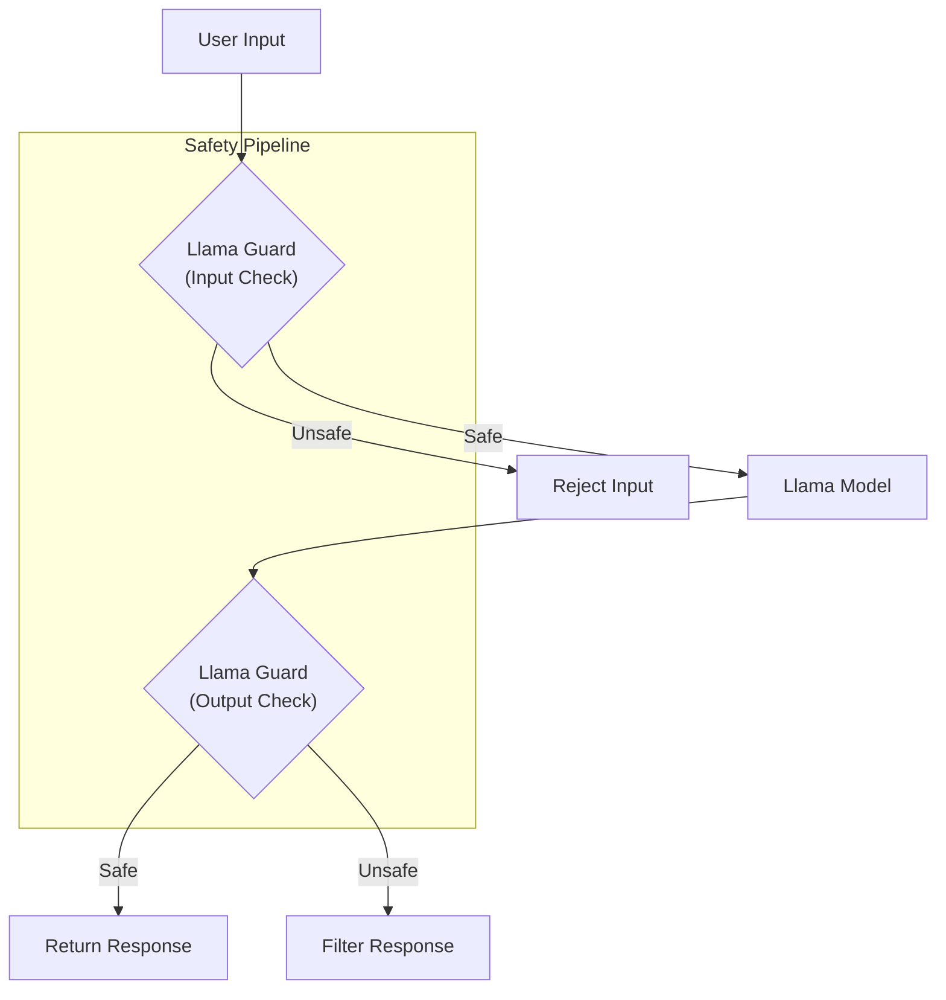
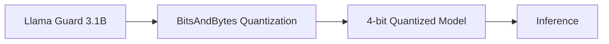

<!-- source: DeepWiki mcp.deepwiki.com · repo huggingface/huggingface-llama-recipes · page 4.1 Llama Guard · fetched 2026-10-26 -->

# Llama Guard

Relevant source files

The following files were used as context for generating this wiki page:

- [llama_guard/llama_guard_3_1B.ipynb](llama_guard/llama_guard_3_1B.ipynb)

Llama Guard is a specialized content moderation model designed to detect and filter harmful content in both user inputs and model outputs within Llama-based applications. This page documents how to use the Llama Guard 3.1B model, a lightweight safety system for identifying unsafe content across various harm categories. For information about detecting jailbreak attempts or prompt injections, see [Prompt Guard](#4.2).

## Overview

Llama Guard 3.1B is a 3.1 billion parameter model specifically trained for content safety evaluation. It serves as one of the primary safety components in the Llama Recipes repository, providing an efficient mechanism to identify and filter potentially harmful content before it reaches users.

Sources: [llama_guard/llama_guard_3_1B.ipynb]()

## Key Features

- **Lightweight**: At 3.1B parameters, the model is small enough to run alongside primary LLMs without significant resource impact
- **Multi-category detection**: Evaluates content across multiple harm categories 
- **Bidirectional analysis**: Can analyze both user inputs (prompts) and model outputs (responses)
- **API-compatible**: Designed to work seamlessly with the Hugging Face transformers library
- **Quantization-friendly**: Compatible with various quantization methods for deployment efficiency

## Safety Categories

Llama Guard 3.1B evaluates content across the following harm categories:

| Category | Description |
|----------|-------------|
| Violence and Hate | Content promoting violence, hate speech, or discrimination |
| Sexual Content | Explicit sexual content or inappropriate discussions |
| Criminal Planning | Instructions or guidance for illegal activities |
| Regulated/Controlled Substances | Content related to drugs, weapons, or regulated items |
| Self-Harm | Content encouraging or providing methods for self-harm |
| Privacy and Personal Data | Requests for personal or private information |
| Unauthorized Answers | Responses to requests that violate use guidelines |

Sources: [llama_guard/llama_guard_3_1B.ipynb]()

## Implementation

### Model Loading

Llama Guard can be loaded using the standard Hugging Face transformers pipeline:

Sources: [llama_guard/llama_guard_3_1B.ipynb]()

### Safety Evaluation Flow

The following diagram illustrates how Llama Guard integrates into a typical conversation flow:

Sources: [llama_guard/llama_guard_3_1B.ipynb]()

## Usage Example

### Basic Safety Check

To check whether a given piece of content is safe, you can use Llama Guard as follows:

1. Load the model
2. Pass the content to the model for evaluation
3. Interpret the safety classification result

The model returns safety classifications along with confidence scores, allowing applications to implement appropriate thresholds and policies.

### Integration with Llama Models

Llama Guard is typically deployed in the following configurations:

Sources: [llama_guard/llama_guard_3_1B.ipynb]()

## Advanced Configuration

### Safety Sensitivity Tuning

Llama Guard allows customizing safety thresholds to adjust sensitivity according to application needs. This enables:

- Stricter filtering for high-risk environments (e.g., educational platforms)
- More permissive policies for specialized applications (e.g., content moderation tools)
- Category-specific configurations (e.g., higher sensitivity for self-harm than for regulated substances)

### Using 4-bit Quantization

For deployment on resource-constrained environments, Llama Guard can be quantized to 4-bit precision while maintaining acceptable performance:

Sources: [llama_guard/llama_guard_3_1B.ipynb]()

## Performance Considerations

### Model Size vs. Accuracy Tradeoff

At 3.1B parameters, Llama Guard strikes a balance between:

- **Efficiency**: Small enough to run alongside primary models
- **Accuracy**: Large enough to provide reliable safety evaluations
- **Latency**: Adds minimal inference delay to the overall pipeline

### Recommended Hardware

While Llama Guard can run on CPU, the following configurations are recommended:

| Deployment Scenario | Recommended Hardware | Notes |
|---------------------|----------------------|-------|
| Development | Single GPU (≥ 8GB VRAM) | Full precision for testing |
| Production | GPU with ≥ 4GB VRAM | With 4-bit quantization |
| Minimal Setup | CPU only | Higher latency, suitable for non-real-time applications |

Sources: [llama_guard/llama_guard_3_1B.ipynb]()

## Comparison with Prompt Guard

Llama Guard and Prompt Guard serve complementary safety functions:

| Feature | Llama Guard | Prompt Guard |
|---------|-------------|--------------|
| Primary Purpose | General content safety | Jailbreak & prompt injection detection |
| Evaluation Targets | Both inputs and outputs | Primarily inputs |
| Model Size | 3.1B parameters | Smaller, rule-based system |
| Detection Scope | Broad harm categories | Focused on system manipulation attempts |
| Integration Point | Before and after main model | Before main model |

For complete security, both systems can be used together in a defense-in-depth approach.

Sources: [llama_guard/llama_guard_3_1B.ipynb]()

## Conclusion

Llama Guard 3.1B provides an effective content safety system that can be easily integrated into Llama-based applications. By evaluating both user inputs and model outputs, it helps ensure that AI interactions remain safe and appropriate. Its lightweight design enables deployment alongside primary models without significant resource overhead, making it suitable for a wide range of applications.

---

