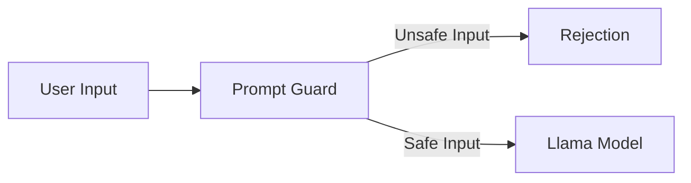
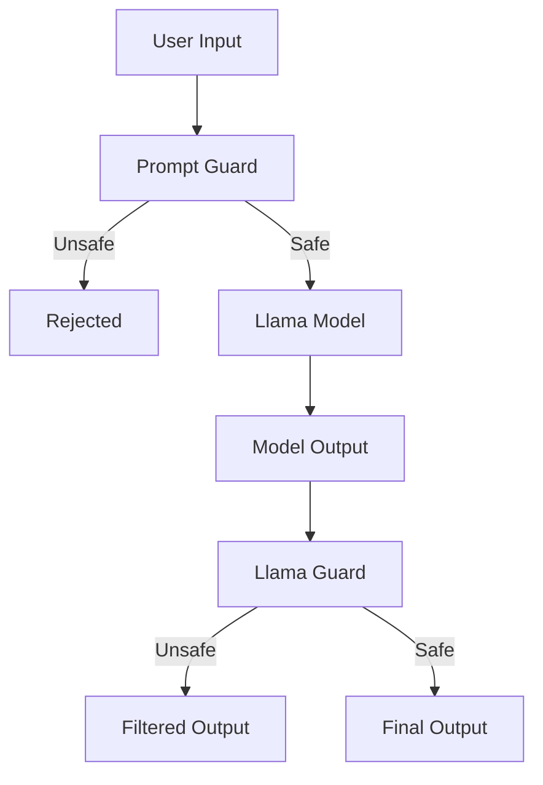
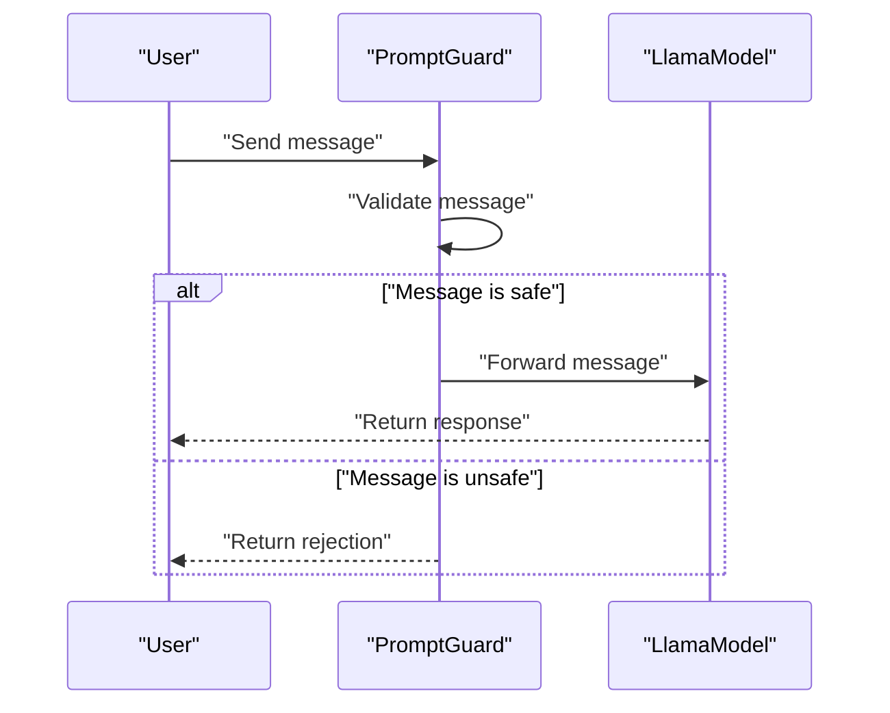
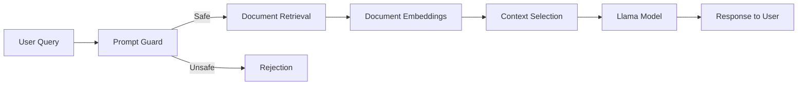
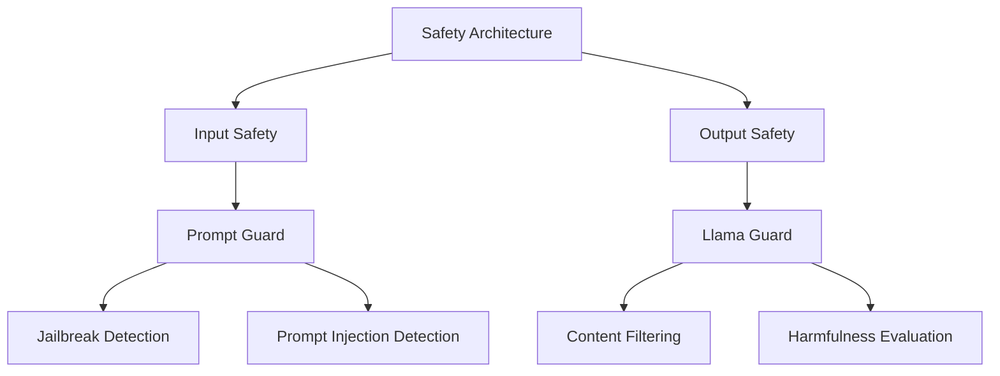

<!-- source: DeepWiki mcp.deepwiki.com · repo huggingface/huggingface-llama-recipes · page 4.2 Prompt Guard · fetched 2026-10-26 -->

# Prompt Guard

Relevant source files

The following files were used as context for generating this wiki page:

- [assets/prompt_guard_flowchart.png](assets/prompt_guard_flowchart.png)
- [assets/prompt_guard_visual.png](assets/prompt_guard_visual.png)

## Purpose and Scope

Prompt Guard is a safety system component within the Hugging Face Llama Recipes repository that acts as a pre-processing filter for user inputs. Its primary purpose is to detect and prevent jailbreaks and prompt injection attempts before they reach the Llama model. This provides an important first line of defense against malicious or manipulative prompts.

For information about comprehensive safety evaluation of both inputs and outputs, see [Llama Guard](#4.1).

Sources: Based on the repository overview provided. No specific file paths were available for reference.

## Conceptual Overview

Prompt Guard functions as an input validation layer that examines user prompts before they're sent to the model. This helps prevent various attacks including:

- Jailbreak attempts (trying to bypass the model's safety guidelines)
- Prompt injections (attempts to manipulate the model's behavior)
- Other forms of potentially harmful inputs

### Prompt Guard Basic Flow

Sources: Based on the system architecture diagrams provided. No specific file paths were available for reference.

## Integration in Workflow

Prompt Guard is typically integrated at the beginning of a Llama model workflow, as shown in the following system architecture:

### Complete Safety Workflow

Sources: Based on the safety systems workflow diagram provided. No specific file paths were available for reference.

## Use Cases

Prompt Guard can be integrated into various Llama model applications:

### Basic Chat Application

Sources: Based on general understanding of chat applications with safety systems. No specific file paths were available for reference.

### RAG System

Sources: Based on the "Safety-Enhanced RAG System" workflow diagram provided. No specific file paths were available for reference.

## Complementary Systems

Prompt Guard works alongside Llama Guard to provide comprehensive safety through a layered approach:

| Safety Component | Focus | Function |
|-----------------|-------|----------|
| **Prompt Guard** | Input safety | Pre-processing filter for detecting jailbreaks and prompt injections |
| **Llama Guard** | Input/output safety | 3.1B parameter model that evaluates both inputs and outputs for safety risks |

Together, these systems create a two-layer safety approach for Llama model applications:

### Safety Architecture

Sources: Based on the repository overview and system architecture diagrams provided. No specific file paths were available for reference.

## Detection Mechanisms

Prompt Guard likely employs various techniques to detect potentially harmful inputs:

- Pattern matching against known jailbreak attempts
- Heuristic analysis of input structure and content
- Detection of attempts to override system prompts
- Identification of instructions that contradict safety guidelines

Without access to specific implementation details, the exact mechanisms used remain conceptual.

Sources: Based on general understanding of safety systems for LLMs. No specific file paths were available for reference.

---

