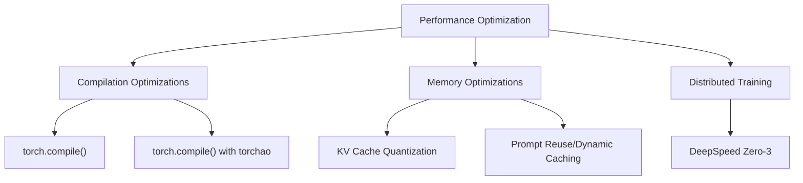
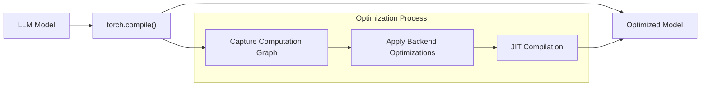
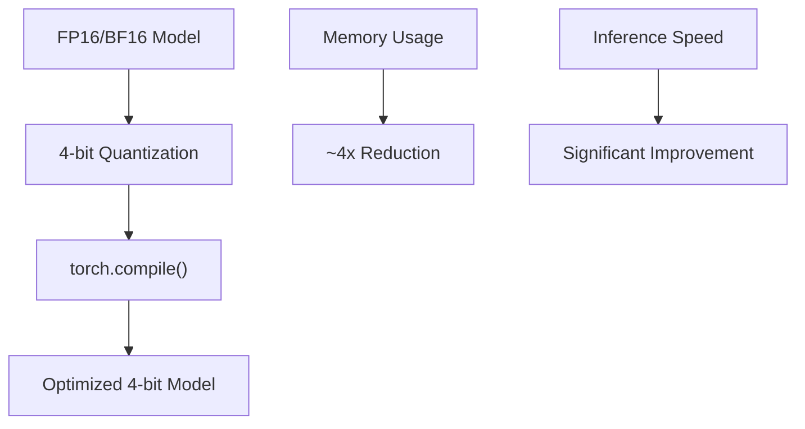
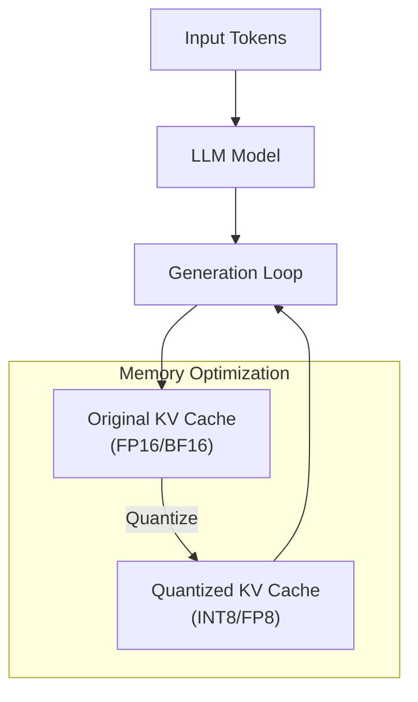
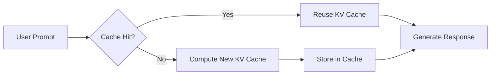
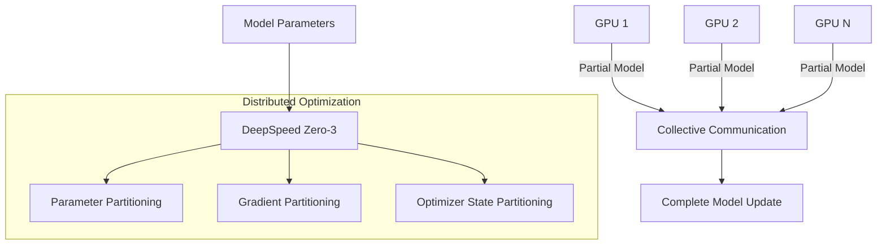
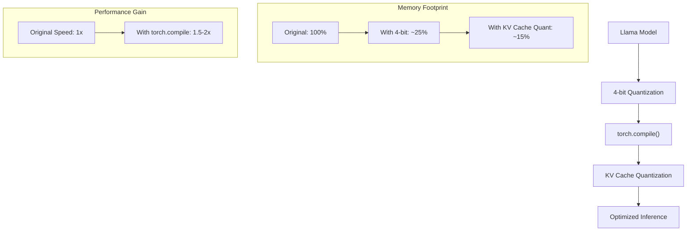

<!-- source: DeepWiki mcp.deepwiki.com · repo huggingface/huggingface-llama-recipes · page 5 Performance Optimization · fetched 2026-10-26 -->

# Performance Optimization

Relevant source files

The following files were used as context for generating this wiki page:

- [.github/README.md](.github/README.md)
- [tool_calling/tool_calling.ipynb](tool_calling/tool_calling.ipynb)

This document covers techniques and approaches for optimizing the performance of Llama 3.x models in terms of inference speed, memory usage, and throughput. These optimizations are critical for deploying large language models efficiently, especially when working with limited computational resources. For information about assisted decoding techniques, which is another way to improve performance, see [Assisted Decoding](#5.1).

## Overview of Performance Optimization Approaches

Optimizing Llama models involves various strategies that target different aspects of model execution. The major optimization techniques available in this repository include:

Sources: [.github/README.md:121-129]()

## Compilation Optimizations

### Accelerating Inference with torch.compile

PyTorch's `torch.compile` feature can significantly improve inference speed for Llama models by optimizing the computational graph and applying just-in-time compilation techniques.

The key benefits of using `torch.compile` include:
- Reduced inference latency
- Improved throughput for batch inference
- Hardware-specific optimizations

**Implementation Example:**
The repository includes a script that demonstrates how to use `torch.compile` with Llama models to accelerate text generation.

Sources: [.github/README.md:125]()

### Torch.compile with 4-bit Quantization

Combining compilation optimizations with quantization provides even greater performance improvements. The repository demonstrates how to use `torch.compile` together with 4-bit quantization using the `torchao` library.

This approach is particularly useful for deploying large models on hardware with limited memory while maintaining good performance characteristics.

Sources: [.github/README.md:126]()

## Memory Optimization Techniques

### KV Cache Quantization

The Key-Value (KV) cache is a significant memory bottleneck during inference, especially for long sequences. Quantizing the KV cache can substantially reduce memory requirements.

KV cache quantization works by:
1. Computing the key-value pairs for each attention layer in FP16/BF16
2. Quantizing them to a lower precision format (INT8 or FP8)
3. Dequantizing when needed for computation
4. Significantly reducing the memory footprint during generation

Sources: [.github/README.md:127]()

### Prompt Reuse with Dynamic Caching

For applications that process similar prompts repeatedly, dynamically caching and reusing computations can significantly improve efficiency.

This technique is especially valuable for:
- Chatbot applications where context is incrementally extended
- Batch processing with overlapping prompts
- API services handling similar requests

Sources: [.github/README.md:128]()

## Distributed Training

### DeepSpeed Zero-3 Optimization

For fine-tuning large Llama models, distributed training becomes essential. The repository includes configuration for DeepSpeed with Zero Redundancy Optimizer (Zero-3), which enables efficient training across multiple GPUs or nodes.

Key features of the DeepSpeed Zero-3 configuration:
- Partitions model parameters, gradients, and optimizer states across GPUs
- Minimizes memory redundancy
- Supports mixed-precision training
- Enables training of models that would otherwise not fit on available hardware

Sources: [.github/README.md:129]()

## Performance Benchmarks and Configuration Guidelines

When optimizing Llama models, the choice of technique depends on your hardware constraints and specific use case. The following table summarizes approximate memory requirements for different model sizes and optimization techniques:

| Model Size | Llama Variant | BF16/FP16 | FP8 | INT4 (AWQ/GPTQ/bnb) |
| :--: | :--: | :--: | :--: | :--: |
| 1B | 3.2 | 2.5 GB | 1.25 GB | 0.75 GB |
| 3B | 3.2 | 6.5 GB | 3.2 GB | 1.75 GB |
| 8B | 3.1 | 16 GB | 8 GB | 4 GB |
| 70B | 3.1 and 3.3 | 140 GB | 70 GB | 35 GB |
| 405B | 3.1 | 810 GB | 405 GB | 204 GB |

Sources: [.github/README.md:68-85]()

## Integration of Optimization Techniques

Multiple optimization techniques can be combined for maximum efficiency. The following diagram illustrates a comprehensive optimization pipeline that leverages several techniques simultaneously:

For the most efficient deployment, consider:
1. Quantizing the model weights to reduce memory footprint
2. Applying `torch.compile` to the quantized model
3. Implementing KV cache quantization for long sequence generation
4. Using prompt reuse when processing similar inputs
5. For large-scale training, employing DeepSpeed Zero-3

Sources: [.github/README.md:121-129]()

## Conclusion

Optimizing the performance of Llama models is essential for practical deployment scenarios, especially when working with limited computational resources. The techniques covered in this document provide various approaches to improve inference speed, reduce memory requirements, and enhance training efficiency. By selectively applying these optimizations based on your specific constraints and requirements, you can significantly improve the performance of Llama models in production environments.

---

