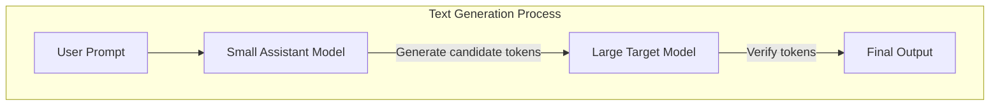
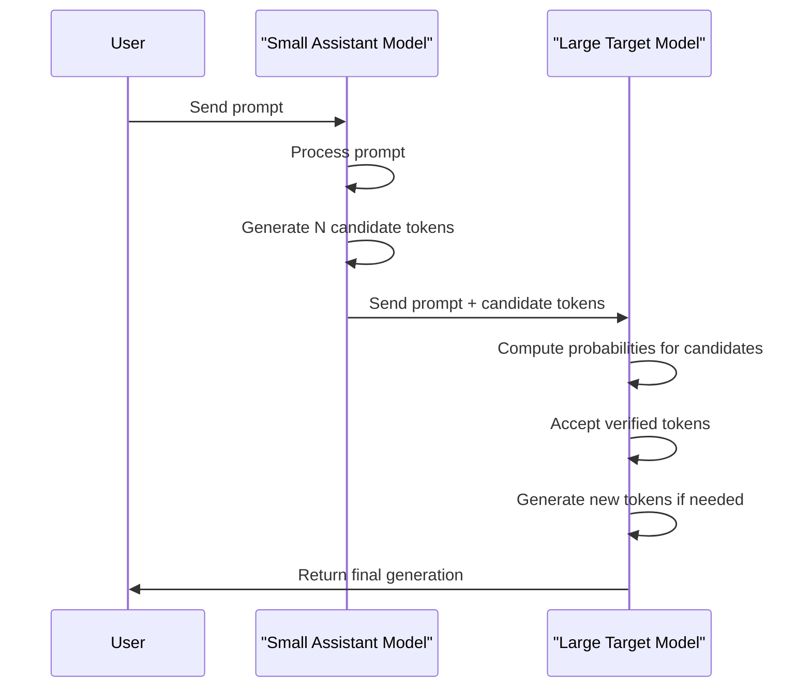
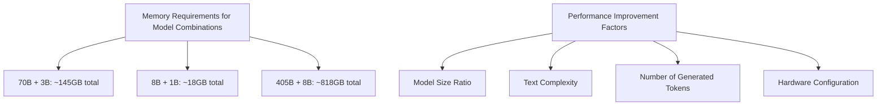
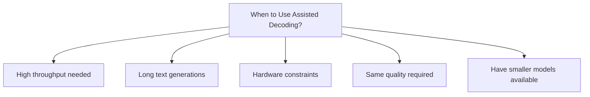

<!-- source: DeepWiki mcp.deepwiki.com · repo huggingface/huggingface-llama-recipes · page 5.1 Assisted Decoding · fetched 2026-10-26 -->

# Assisted Decoding

<details>
<summary>Relevant source files</summary>

The following files were used as context for generating this wiki page:

- [.github/README.md](.github/README.md)
- [assets/hf-llama-recepies.png](assets/hf-llama-recepies.png)
- [assisted_decoding/assisted_decoding.py](assisted_decoding/assisted_decoding.py)
- [assisted_decoding/assisted_decoding_8B_1B.ipynb](assisted_decoding/assisted_decoding_8B_1B.ipynb)
- [tool_calling/tool_calling.ipynb](tool_calling/tool_calling.ipynb)

</details>


This wiki page documents the Assisted Decoding technique available in the Hugging Face Llama Recipes repository. Assisted Decoding (also called Speculative Decoding) is a performance optimization technique that uses a smaller language model to accelerate text generation with a larger language model, providing up to 2x speedup while maintaining output quality.

For information about other performance optimization techniques like torch.compile and KV cache quantization, see [Performance Optimization](#5).

## What is Assisted Decoding?

Assisted Decoding is a technique that accelerates text generation by leveraging a smaller, faster "assistant" model to generate candidate tokens, which a larger, more capable "target" model then verifies. This approach significantly reduces generation time while maintaining the output quality of the larger model.

The key insight behind Assisted Decoding is that smaller models, while less capable overall, can still make reasonable token predictions for many common patterns in text. By using these predictions as a starting point and validating them with the larger model, the system avoids having to compute the full forward pass of the larger model for every token.



Sources: [.github/README.md:112-119](), [assisted_decoding/assisted_decoding.py:1-14]()

## How Assisted Decoding Works

The Assisted Decoding process involves several steps:



1. A prompt is passed to both the assistant model (small) and the target model (large).
2. The assistant model speculatively generates N tokens.
3. The target model computes probabilities for the tokens generated by the assistant.
4. The target model accepts tokens up to the first token it would have generated differently.
5. For any remaining tokens, the target model generates them using its regular generation process.
6. The final output is returned to the user.

This process significantly reduces the computational load because the larger model often only needs to validate tokens rather than generate them from scratch. The larger model retains full control over the final output, ensuring that quality is not compromised.

Sources: [.github/README.md:112-119](), [assisted_decoding/assisted_decoding.py:1-14]()

## Implementations in Llama Recipes

The Llama Recipes repository provides several implementations of Assisted Decoding with different model combinations:

| Target Model | Assistant Model | Implementation |
|--------------|----------------|----------------|
| Llama 3.1 70B | Llama 3.2 3B | Jupyter notebook |
| Llama 3.1 8B | Llama 3.2 1B | Jupyter notebook |
| Llama 3.1 405B | Llama 3.1 8B | Python script |

### Basic Implementation Pattern

All implementations follow a similar pattern, leveraging the built-in assisted generation capabilities of the Hugging Face Transformers library:

```python
from transformers import AutoModelForCausalLM, AutoTokenizer

# Load models
target_model = AutoModelForCausalLM.from_pretrained("target-model-path")
assistant_model = AutoModelForCausalLM.from_pretrained("assistant-model-path")

# Prepare input
tokenizer = AutoTokenizer.from_pretrained("target-model-path")
inputs = tokenizer(prompt, return_tensors="pt").to(target_model.device)

# Generate with assisted decoding
outputs = target_model.generate(**inputs, assistant_model=assistant_model)

# Decode the output
generated_text = tokenizer.batch_decode(outputs, skip_special_tokens=True)
```

This simple pattern enables assisted decoding by simply passing the assistant model as a parameter to the generate method.

Sources: [assisted_decoding/assisted_decoding.py:16-44]()

## Memory Requirements and Performance



### Memory Requirements

Using Assisted Decoding requires loading both the target and assistant models into memory simultaneously. The approximate memory requirements for different model combinations are:

| Target Model | Assistant Model | Approximate Memory (FP16/BF16) |
|--------------|----------------|-----------------------------|
| Llama 3.1 70B | Llama 3.2 3B | ~143 GB |
| Llama 3.1 8B | Llama 3.2 1B | ~18 GB |
| Llama 3.1 405B | Llama 3.1 8B | ~813 GB |

These estimates assume FP16/BF16 precision. Using quantization techniques can significantly reduce these requirements.

### Performance Gains

The speedup from Assisted Decoding varies based on several factors:

1. **Size difference between models**: Larger differences typically yield greater speedups
2. **Text complexity**: The assistant model may be more successful at predicting common patterns
3. **Number of generated tokens**: Longer generations typically see better overall speedup
4. **Hardware configuration**: GPU memory bandwidth can affect performance

In practice, users can expect up to 2x speedup in text generation when using Assisted Decoding, with the exact improvement depending on the specific use case and configuration.

Sources: [.github/README.md:70-81](), [.github/README.md:112-119]()

## Caveats and Limitations

There are some important considerations when using Assisted Decoding:

1. **Sampling disrupts output matching**: When using sampling (non-greedy decoding), the assisted generation may not match what the target model would have generated on its own, even with seeding.

2. **Tiny logit fluctuations**: Due to the nature of floating-point operations, there may be small differences in outputs between assisted and non-assisted generation, although the quality should remain consistent.

3. **Memory constraints**: Both models must fit in memory simultaneously, which may be challenging for very large models without quantization.

4. **API limitations**: Some model access APIs may not support assisted decoding.

Sources: [assisted_decoding/assisted_decoding.py:11-14]()

## Example Usage

Here's an example of how to implement Assisted Decoding with Llama 3.1 8B and Llama 3.2 1B:

```python
# Load models
model = AutoModelForCausalLM.from_pretrained("meta-llama/Llama-3.1-8B", device_map="auto", torch_dtype=torch.bfloat16)
assistant_model = AutoModelForCausalLM.from_pretrained("meta-llama/Llama-3.2-1B", device_map="auto", torch_dtype=torch.bfloat16)
tokenizer = AutoTokenizer.from_pretrained("meta-llama/Llama-3.1-8B")

# Prepare input
prompt = "Write a short poem about artificial intelligence."
inputs = tokenizer(prompt, return_tensors="pt").to(model.device)

# Generate with and without assisted decoding to compare
import time

# Without assisted decoding
start = time.time()
standard_outputs = model.generate(**inputs, max_new_tokens=100)
end = time.time()
standard_time = end - start
standard_text = tokenizer.batch_decode(standard_outputs, skip_special_tokens=True)[0]

# With assisted decoding
start = time.time()
assisted_outputs = model.generate(**inputs, assistant_model=assistant_model, max_new_tokens=100)
end = time.time()
assisted_time = end - start
assisted_text = tokenizer.batch_decode(assisted_outputs, skip_special_tokens=True)[0]

print(f"Standard generation time: {standard_time:.2f}s")
print(f"Assisted generation time: {assisted_time:.2f}s")
print(f"Speedup: {standard_time/assisted_time:.2f}x")
```

Sources: [assisted_decoding/assisted_decoding.py:16-44]()

## When to Use Assisted Decoding



Assisted Decoding is most beneficial in the following scenarios:

1. **High throughput requirements**: When you need to generate text quickly for multiple requests.
2. **Long text generations**: The benefits compound when generating many tokens.
3. **Hardware constraints**: When you want to use a large model but face inference speed limitations.
4. **Quality-sensitive applications**: When you cannot compromise on the quality of the larger model.
5. **Available model pairs**: When you have access to both a large model and a suitable smaller model.

For very short generations or when using heavily quantized models, the setup overhead might outweigh the benefits.

Sources: [.github/README.md:112-119]()

## Conclusion

Assisted Decoding is a powerful technique for accelerating text generation with large language models without sacrificing output quality. By leveraging a smaller assistant model to propose tokens that a larger model then verifies, this approach can achieve up to 2x speedup in generation time.

The Hugging Face Llama Recipes repository provides implementations of this technique with various Llama model combinations, making it accessible for different hardware configurations and use cases. While there are some caveats and limitations to be aware of, Assisted Decoding represents a valuable optimization for many text generation applications.

---

