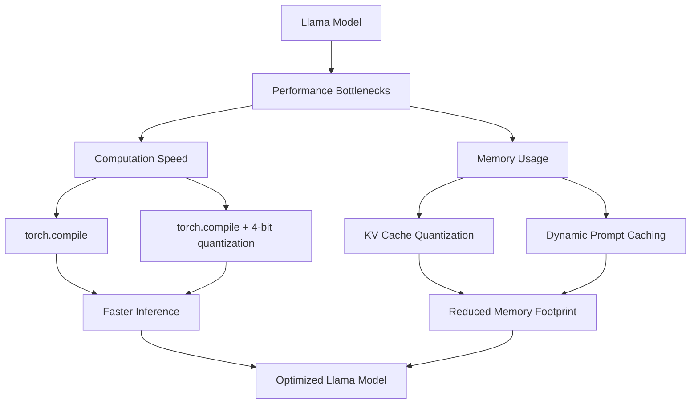
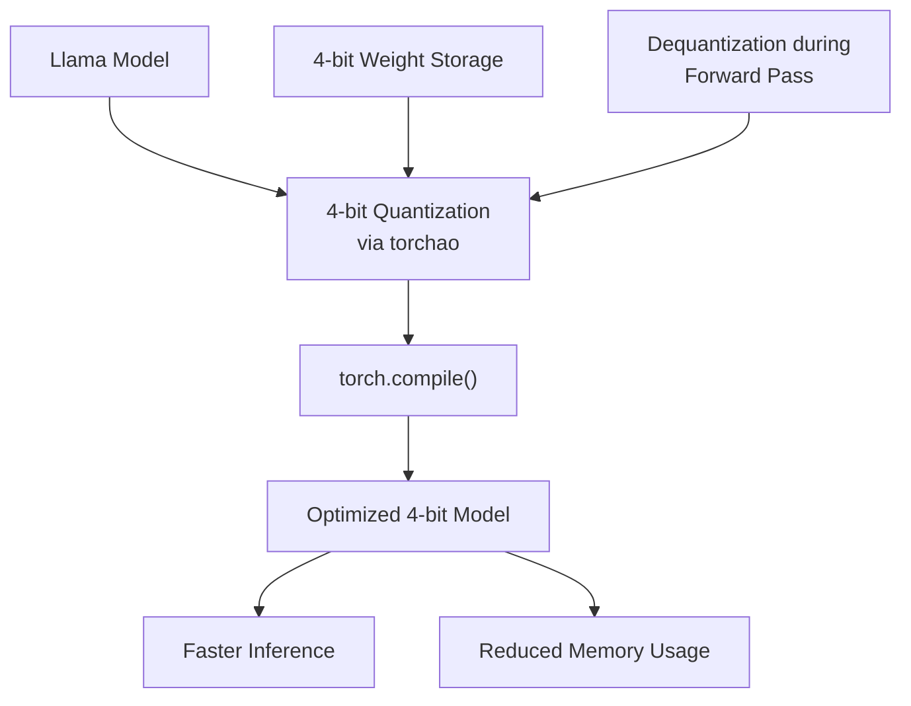
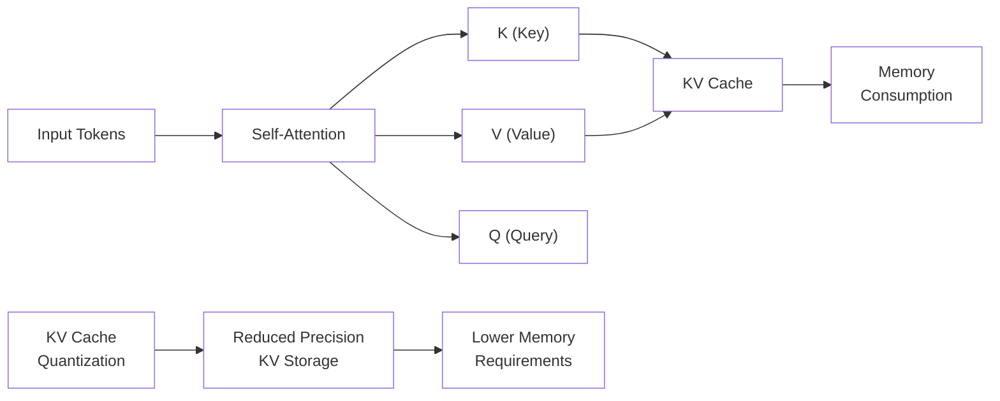
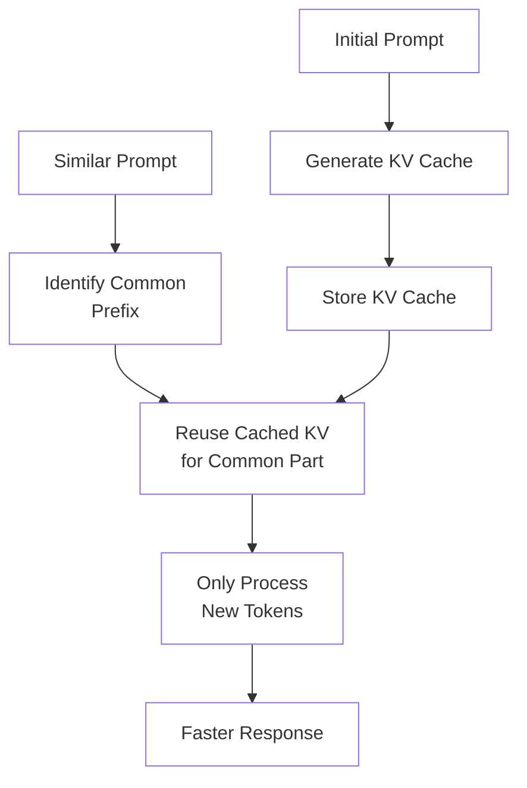
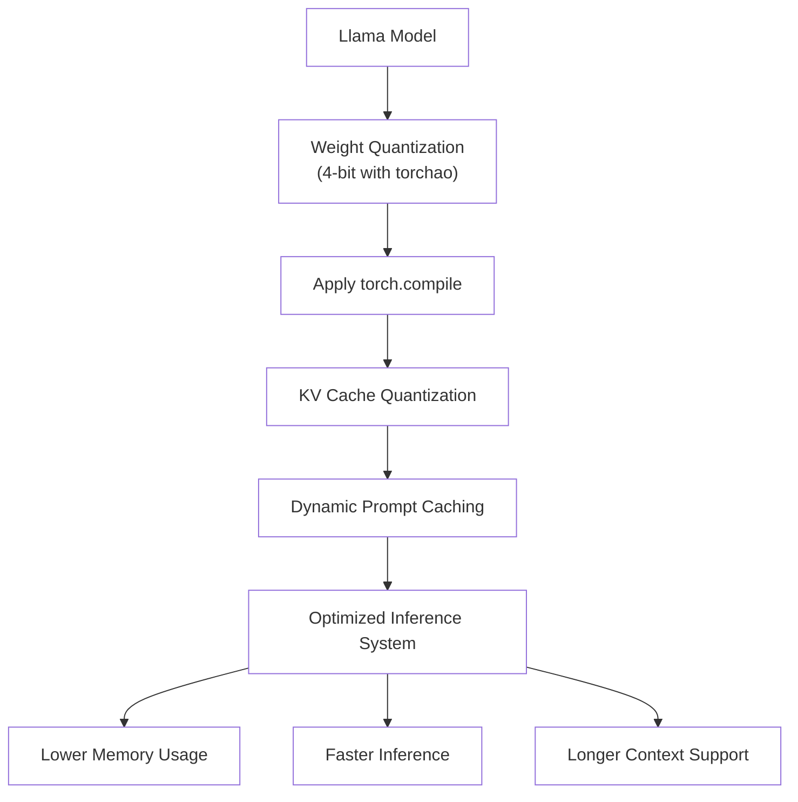
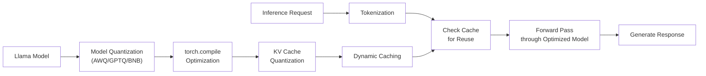

<!-- source: DeepWiki mcp.deepwiki.com · repo huggingface/huggingface-llama-recipes · page 5.2 Compilation and Caching · fetched 2026-10-26 -->

# Compilation and Caching

<details>
<summary>Relevant source files</summary>

The following files were used as context for generating this wiki page:

- [.github/README.md](.github/README.md)
- [tool_calling/tool_calling.ipynb](tool_calling/tool_calling.ipynb)

</details>


This page documents the compilation and caching optimization techniques available for Llama models in the huggingface-llama-recipes repository. These techniques significantly improve inference speed and memory efficiency without sacrificing model quality, enabling more effective deployment of Llama models on resource-constrained hardware.

For information about assisted decoding optimization techniques, see [Assisted Decoding](#5.1).

## Overview of Compilation and Caching Techniques

The repository provides several key optimization methods for Llama models:

1. **Torch Compile**: Accelerates inference through PyTorch's just-in-time (JIT) compilation
2. **KV Cache Quantization**: Reduces memory requirements by quantizing the key-value cache
3. **Dynamic Prompt Caching**: Optimizes repeated execution with similar prompts
4. **Combined Optimizations**: Integrating multiple techniques for maximum performance



Sources: performance_optimization/torch_compile.py, performance_optimization/torch_compile_with_torchao.ipynb, performance_optimization/quantized_cache.py, performance_optimization/prompt_reuse.py

## Torch Compile

`torch.compile` is a PyTorch feature that applies just-in-time (JIT) compilation to optimize model execution. For Llama models, this technique can significantly accelerate inference without requiring model architecture changes.

### How Torch Compile Works


When applying `torch.compile` to a Llama model:

1. PyTorch captures the computational graph of the model
2. It optimizes this graph through various passes (fusion, dead code elimination, etc.)
3. It generates optimized code for the target hardware
4. The compiled model runs more efficiently during inference

### Basic Implementation

The implementation is straightforward and requires minimal code changes:

```python
import torch
from transformers import AutoModelForCausalLM

# Load model
model = AutoModelForCausalLM.from_pretrained("meta-llama/Llama-3.1-8B")
model = model.to(torch.bfloat16).cuda()

# Apply torch.compile to the model
compiled_model = torch.compile(model, mode="reduce-overhead")

# Use the compiled model for inference
```

Key parameters for `torch.compile`:
- `mode`: Options include "default", "reduce-overhead", and "max-autotune"
- `fullgraph`: Boolean indicating whether to compile the full model graph
- `backend`: Compilation backend ("inductor" is default and recommended for Llama)

Sources: performance_optimization/torch_compile.py

## Torch Compile with 4-bit Quantization

For even greater performance gains, `torch.compile` can be combined with 4-bit quantization using the torchao library. This combination reduces memory usage while maintaining the speed advantages of compilation.

### Integration with Torchao



The process involves:
1. Quantizing the model weights to 4-bit precision using torchao
2. Applying `torch.compile` to the quantized model
3. Benefiting from both memory savings and computational speedups

### Implementation Example

```python
import torch
import torchao
from transformers import AutoModelForCausalLM

# Load model
model = AutoModelForCausalLM.from_pretrained("meta-llama/Llama-3.1-8B")

# Apply 4-bit quantization
quantized_model = torchao.quantize(model, weights_dtype=torch.int4)

# Apply torch.compile
compiled_quantized_model = torch.compile(
    quantized_model, 
    mode="reduce-overhead",
    fullgraph=True
)
```

This approach can reduce memory requirements by up to 75% compared to FP16/BF16 while still providing significant speedups from compilation.

Sources: performance_optimization/torch_compile_with_torchao.ipynb

## KV Cache Quantization

The Key-Value (KV) cache is a significant memory consumer during LLM inference, especially for long sequences. The repository provides techniques to quantize this cache, substantially reducing memory requirements.

### Understanding KV Cache



KV cache memory usage scales with:
- Batch size
- Sequence length
- Model hidden dimension
- Number of layers
- Data precision (FP16/BF16 vs. quantized formats)

### Quantization Techniques

The repository implements KV cache quantization by:
1. Converting the cache from FP16/BF16 to INT8 or FP8 format
2. Applying dynamic quantization during inference
3. Dequantizing values only when needed for computation

The quantized cache offers:
- Up to 2x memory reduction compared to FP16/BF16
- Minimal impact on generation quality
- Compatibility with other optimization techniques

Sources: performance_optimization/quantized_cache.py

## Dynamic Prompt Caching

For applications where similar prompts are processed repeatedly, dynamic prompt caching provides significant efficiency gains by reusing computational results.

### How Prompt Reuse Works



The process involves:
1. Caching the KV states from previous prompt processing
2. For new prompts, identifying common prefixes with previously processed prompts
3. Reusing the cached KV states for the common parts
4. Only computing new KV states for the unique portion of the prompt

This approach is particularly valuable for:
- Chatbot applications where context remains similar
- Iterative prompt refinement scenarios
- API services handling similar requests

Sources: performance_optimization/prompt_reuse.py

## Performance Benchmarks and Use Cases

Different optimization techniques yield different benefits depending on the use case. This section provides guidance on choosing the right approach.

### Technique Comparison

| Optimization Technique | Memory Reduction | Speed Improvement | Implementation Complexity | Best For |
|------------------------|------------------|-------------------|--------------------------|----------|
| torch.compile | Minimal | High (1.5-3x) | Low | Compute-bound scenarios |
| torch.compile + 4-bit | High (75%) | Moderate-High | Medium | Memory-constrained devices |
| KV Cache Quantization | Medium (50%) | Minimal | Medium | Long-sequence generation |
| Dynamic Prompt Caching | Variable | High for similar prompts | Medium | Chatbots, iterative prompting |
| Combined Approaches | Very High | High | High | Production deployments |

### Combining Optimization Techniques

For maximum performance, these techniques can be combined in a complementary fashion:



## Integration with Other Performance Techniques

The compilation and caching techniques documented here work well with other optimization approaches in the repository.

### Complementary Optimizations

- **Assisted Decoding**: Can be combined with KV cache quantization for efficient speculative decoding
- **DeepSpeed Zero-3**: For training scenarios, compilation techniques can be integrated with distributed training
- **Quantization Methods**: The various quantization approaches (AWQ, GPTQ, BNB) can be combined with torch.compile

### Implementation Architecture



## Practical Considerations and Limitations

When implementing these optimization techniques, consider the following:

1. **Warmup Time**: torch.compile has an initial compilation overhead which is amortized over multiple runs
2. **Memory-Speed Tradeoff**: Each technique offers different balances between memory usage and speed
3. **Hardware Dependencies**: Some optimizations work better on specific hardware (CUDA vs. CPU)
4. **Model Size Considerations**: Larger models (70B, 405B) benefit more dramatically from these optimizations than smaller ones

Sources: performance_optimization/torch_compile.py, performance_optimization/torch_compile_with_torchao.ipynb, performance_optimization/quantized_cache.py, performance_optimization/prompt_reuse.py

## Conclusion

Compilation and caching techniques provide essential optimizations for deploying Llama models efficiently. By leveraging torch.compile, KV cache quantization, and dynamic prompt caching, you can significantly improve inference speed and reduce memory requirements. These techniques can be combined for maximum efficiency, enabling more effective deployment of even the largest Llama models on limited hardware resources.

For more advanced performance optimization topics, consider exploring assisted decoding techniques in [Assisted Decoding](#5.1).

---

