<!-- source: DeepWiki mcp.deepwiki.com · repo huggingface/huggingface-llama-recipes · page 6 Advanced Applications · fetched 2026-10-26 -->

# Advanced Applications

Relevant source files

The following files were used as context for generating this wiki page:

- [.github/README.md](.github/README.md)
- [tool_calling/tool_calling.ipynb](tool_calling/tool_calling.ipynb)

## Purpose and Scope

This document provides an overview of advanced applications built using Llama 3.x models in the huggingface-llama-recipes repository. These applications combine multiple capabilities of Llama models to create more complex and powerful systems that address real-world use cases. For information about basic inference techniques, see [Local Inference](#2), and for fine-tuning approaches, see [Model Fine-tuning](#3).

The main advanced applications covered in this repository include:
1. Retrieval-Augmented Generation (RAG) Pipelines
2. Interactive Chatbot Interfaces 
3. Tool Calling Capabilities
4. Synthetic Data Generation

Sources: [.github/README.md:150-171]()

## RAG Pipelines

Retrieval-Augmented Generation (RAG) enhances Llama models with external knowledge by retrieving relevant information from a document corpus and incorporating it into the generation process. This enables Llama models to access up-to-date or domain-specific information not present in their training data.

### RAG Architecture

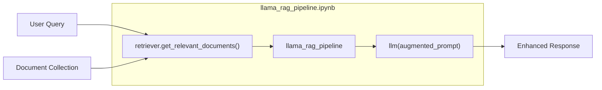

The RAG implementation in the repository demonstrates a streamlined approach to:
1. Index documents for efficient retrieval
2. Retrieve relevant context based on user queries
3. Augment Llama model prompts with this context
4. Generate informed and accurate responses

### Key Components and Workflow

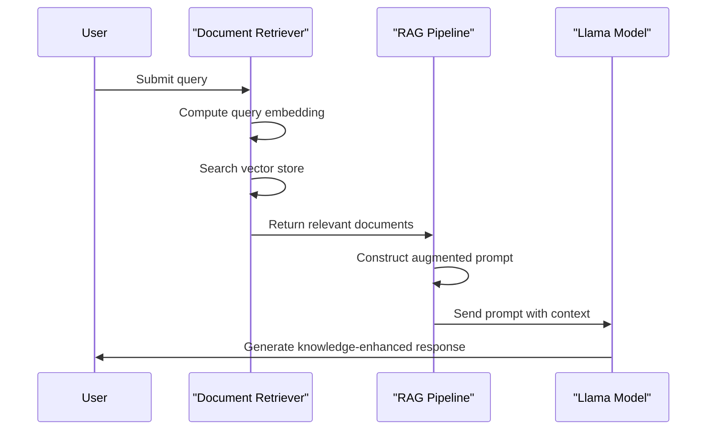

The simple RAG pipeline implementation uses Hugging Face components to create a knowledge-based question answering system with minimal code. The pipeline retrieves relevant documents, incorporates them into the prompt context, and leverages Llama's reasoning capabilities to generate accurate responses based on the provided information.

Sources: [.github/README.md:151-154]()

## Chatbot Interfaces

Building interactive chatbot interfaces is a common advanced application for Llama models. The repository includes examples of how to create user-friendly chat interfaces using Gradio.

### Chatbot Architecture

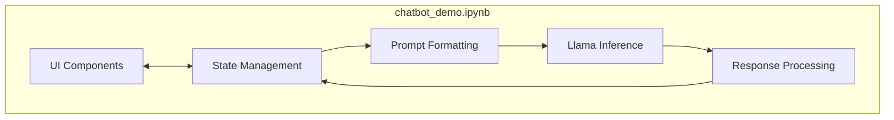

The chatbot implementation demonstrates how to:
1. Create an intuitive user interface for chat interactions
2. Manage conversation history across turns
3. Format prompts according to Llama's chat template
4. Generate context-aware responses
5. Display and update the conversation in real-time

### Interactive User Experience

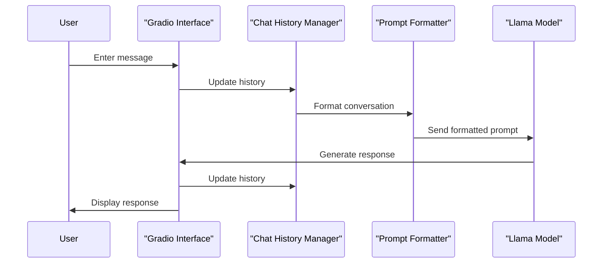

The chatbot demo provides a foundation for building more sophisticated conversational applications with customizable interfaces and extensible functionality.

Sources: [.github/README.md:162-165]()

## Tool Calling

Tool calling enables Llama models to interact with external tools and APIs, extending their capabilities beyond text generation. This feature allows models to perform actions such as retrieving real-time information, executing computations, or interacting with external systems.

### Tool Calling Architecture

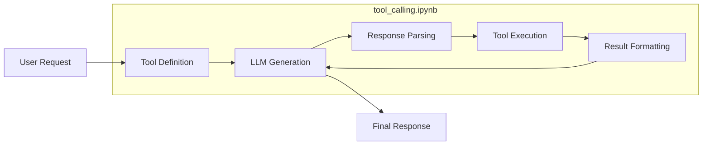

The tool calling implementation demonstrates how to:
1. Define tools with parameters and descriptions
2. Format prompts to enable tool calling
3. Parse Llama's responses to extract tool calls
4. Execute the tools with the provided parameters
5. Provide tool results back to Llama
6. Generate final responses incorporating tool outputs

### Tool Calling Workflow

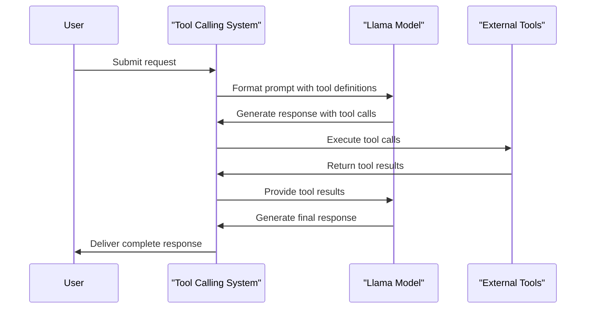

The implementation integrates with the Llama chat template functionality to provide a standardized approach to tool calling, making it easier to develop applications that leverage external capabilities.

Sources: [.github/README.md:167-171]()

## Synthetic Data Generation

Synthetic data generation allows for creating custom datasets using Llama models. This is particularly valuable for augmenting training data, creating test scenarios, or simulating user interactions in various domains.

### Synthetic Data Generation Architecture

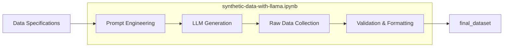

The synthetic data generation implementation demonstrates how to:
1. Design effective prompts for generating specific types of data
2. Leverage `distilabel` for structured data generation
3. Process and validate the generated data
4. Create datasets ready for use in training or evaluation

### Data Generation Workflow

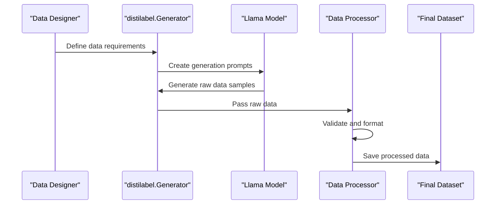

This implementation enables the creation of custom datasets for various purposes, from fine-tuning specialized models to evaluating model performance across different scenarios.

Sources: [.github/README.md:144-148]()

## Integration Patterns

The advanced applications described above can be combined to create even more powerful systems. Here are some common integration patterns:

### RAG + Tool Calling Integration

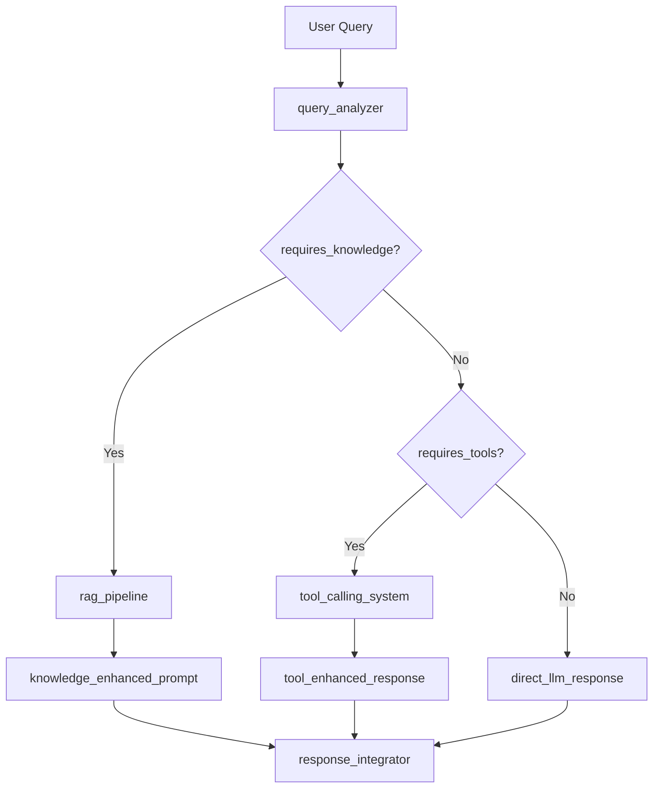

This pattern combines knowledge retrieval with tool execution capabilities, allowing the system to both answer questions based on a knowledge base and perform actions when needed.

### Safety-Enhanced RAG System

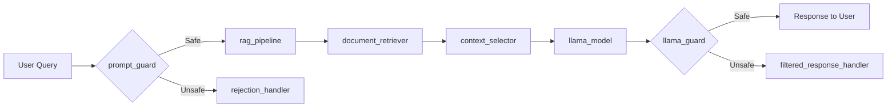

This integration pattern adds safety layers both before and after the RAG pipeline, ensuring that both inputs and outputs adhere to content policies.

### Comprehensive Chatbot System

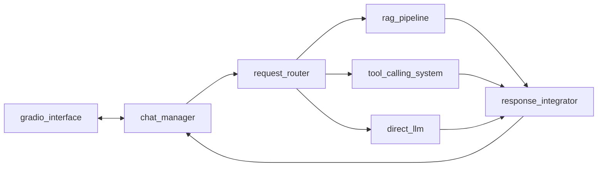

This pattern creates a complete chatbot system that can handle knowledge-based queries through RAG, perform actions through tool calling, and provide direct responses when appropriate.

Sources: [.github/README.md:150-171]()

## Implementation Examples

The repository provides complete implementation examples for each of these advanced applications:

| Application | Implementation | Description |
|-------------|---------------|-------------|
| RAG Pipeline | [llama_rag/llama_rag_pipeline.ipynb]() | Simple RAG implementation for knowledge-based QA |
| Chatbot Interface | [gradio_demos/chatbot_demo.ipynb]() | Interactive chat interface using Gradio |
| Tool Calling | [tool_calling/tool_calling.ipynb]() | Implementation of tool calling capabilities |
| Synthetic Data Generation | [synthetic_data_gen/synthetic-data-with-llama.ipynb]() | Data generation using distilabel |
| TGI & API Inference | [llama_tgi_api_inference/tgi_api_inference_recipe.ipynb]() | Text Generation Inference integration |

These implementations serve as starting points for building more complex applications tailored to specific use cases. They demonstrate best practices for working with Llama models in advanced scenarios and can be extended or combined to create more sophisticated systems.

Sources: [.github/README.md:150-171]()

---

