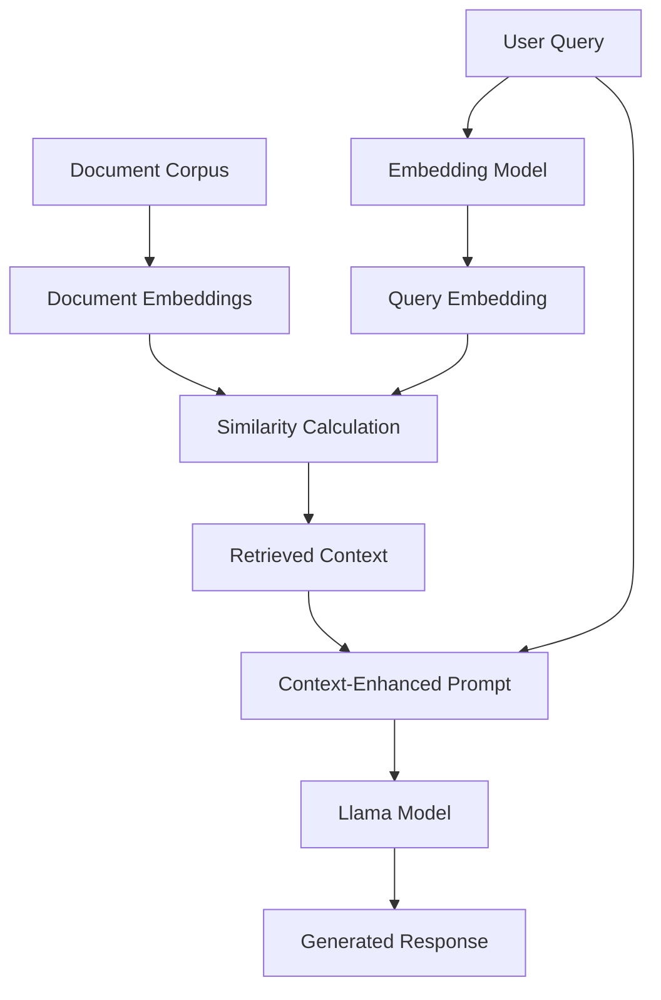
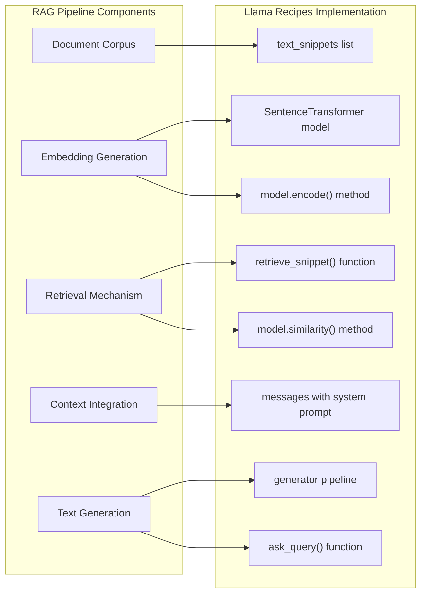
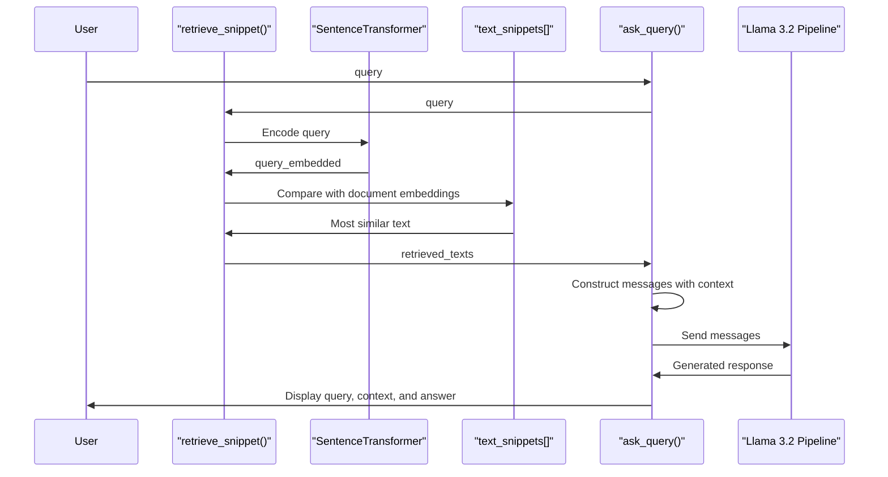

<!-- source: DeepWiki mcp.deepwiki.com · repo huggingface/huggingface-llama-recipes · page 6.1 RAG Pipelines · fetched 2026-10-26 -->

# RAG Pipelines

<details>
<summary>Relevant source files</summary>

The following files were used as context for generating this wiki page:

- [.github/README.md](.github/README.md)
- [llama_rag/llama_rag_pipeline.ipynb](llama_rag/llama_rag_pipeline.ipynb)
- [tool_calling/tool_calling.ipynb](tool_calling/tool_calling.ipynb)

</details>


This document describes Retrieval-Augmented Generation (RAG) pipelines as implemented in the Hugging Face Llama Recipes repository. It focuses on the simple, minimal implementation provided in the repository, which demonstrates how to enhance Llama models with external knowledge retrieval capabilities.

## Introduction to RAG

Retrieval-Augmented Generation is a technique that enhances large language models by providing them with relevant information retrieved from an external knowledge base at inference time. This approach addresses one of the key limitations of LLMs: their reliance on information learned during training, which may be outdated or incomplete.

The core idea behind RAG is to:
1. Convert a user query into a semantic representation (embedding)
2. Retrieve relevant text from a document corpus
3. Incorporate the retrieved information into the prompt for the LLM
4. Generate a response based on both the query and the retrieved context

This approach significantly improves the factuality, accuracy, and relevance of LLM responses for knowledge-intensive tasks.

Sources: [llama_rag/llama_rag_pipeline.ipynb](), [.github/README.md:151-155]()

## RAG Pipeline Components

The simple RAG implementation in Llama Recipes consists of the following key components:

### RAG Pipeline Architecture



Sources: [llama_rag/llama_rag_pipeline.ipynb:367-368](), [llama_rag/llama_rag_pipeline.ipynb:386-390](), [llama_rag/llama_rag_pipeline.ipynb:410-428]()

### 1. Document Corpus

In the Llama Recipes implementation, the document corpus is a simple in-memory list of text snippets. In a real-world application, this would typically be a larger collection of documents, potentially stored in a vector database.

```python
text_snippets = [
    "Fiona thanked Ethan for his unwavering support and promised to cherish their friendship.",
    "As they ventured deeper into the forest, they encountered a wide array of obstacles.",
    # ... more snippets ...
]
```

Sources: [llama_rag/llama_rag_pipeline.ipynb:215-221]()

### 2. Embedding Model

The implementation uses SentenceTransformer's `all-MiniLM-L6-v2` model to convert text to dense vector representations (embeddings). These embeddings capture the semantic meaning of the text and enable similarity-based retrieval.

Sources: [llama_rag/llama_rag_pipeline.ipynb:367-368]()

### 3. Retrieval Mechanism

A custom `retrieve_snippet` function implements the retrieval logic:
1. Encode the user query into an embedding
2. Calculate similarity between the query embedding and document embeddings
3. Return the text snippet with the highest similarity score

Sources: [llama_rag/llama_rag_pipeline.ipynb:386-390]()

### 4. Language Model

The implementation uses the Llama 3.2 3B Instruct model for text generation, loaded using the HuggingFace Transformers library.

Sources: [llama_rag/llama_rag_pipeline.ipynb:193-197]()

## Code Components to Implementation Mapping



Sources: [llama_rag/llama_rag_pipeline.ipynb:215-221](), [llama_rag/llama_rag_pipeline.ipynb:367-368](), [llama_rag/llama_rag_pipeline.ipynb:386-390](), [llama_rag/llama_rag_pipeline.ipynb:410-428]()

## Detailed RAG Process Flow

The following diagram shows the detailed flow of information through the RAG pipeline:



Sources: [llama_rag/llama_rag_pipeline.ipynb:410-428]()

## Implementation Details

### Model and Tokenizer Setup

The implementation first initializes the Llama model and tokenizer:

```python
chechpoint = "meta-llama/Llama-3.2-3B-Instruct"
tokenizer = AutoTokenizer.from_pretrained(chechpoint)
llama_model = AutoModelForCausalLM.from_pretrained(chechpoint, torch_dtype=torch.bfloat16)
generator = pipeline("text-generation", model=llama_model, tokenizer=tokenizer, device="cuda")
```

Sources: [llama_rag/llama_rag_pipeline.ipynb:193-197]()

### Document Embedding

The text snippets are converted to embeddings during initialization:

```python
model = SentenceTransformer("all-MiniLM-L6-v2")
embeddings_text_snippets = model.encode(text_snippets)
```

Sources: [llama_rag/llama_rag_pipeline.ipynb:367-368]()

### Retrieval Function

The `retrieve_snippet` function handles retrieval of the most relevant document:

```python
def retrieve_snippet(query):
    query_embedded = model.encode([query])
    similarities = model.similarity(embeddings_text_snippets, query_embedded)
    retrieved_texts = text_snippets[similarities.argmax().item()]
    return retrieved_texts
```

Sources: [llama_rag/llama_rag_pipeline.ipynb:386-390]()

### Question Answering with RAG

The `ask_query` function combines retrieval and text generation:

```python
def ask_query(query):
    retrieved_texts = retrieve_snippet(query)
    
    messages = [
        {"role": "system", "content": "You are a helpful AI assistant."
                "Provide one Answer ONLY the following query based on the context provided below. "
                "Do not generate or answer any other questions. "
                "Do not make up or infer any information that is not directly stated in the context. "
                "Provide a concise answer."
                f"{retrieved_texts}"},
        {"role": "user", "content": query}
    ]
    
    response = generator(messages, max_new_tokens=128)[-1]["generated_text"][-1]["content"]
    print(f"Query: \n\t{query}")
    print(f"Context: \n\t{retrieved_texts}")
    print(f"Answer: \n\t{response}")
```

Sources: [llama_rag/llama_rag_pipeline.ipynb:410-428]()

## Example Usage

The notebook demonstrates the RAG pipeline with a simple query:

```python
query = "Why did Fiona thank Ethan?"
ask_query(query)

# Output:
# Query: 
#	Why did Fiona thank Ethan?
# Context: 
#	Fiona thanked Ethan for his unwavering support and promised to cherish their friendship.
# Answer: 
#	Fiona thanked Ethan for his unwavering support.
```

Sources: [llama_rag/llama_rag_pipeline.ipynb:470-471]()

## Limitations and Potential Enhancements

This implementation provides a minimal example of RAG, but has several limitations:

| Limitation | Potential Enhancement |
|------------|----------------------|
| In-memory document storage | Use a vector database like FAISS, Pinecone, or Chroma |
| Single document retrieval | Implement multi-document retrieval and aggregation |
| No document chunking | Add chunking for longer documents |
| Simple similarity search | Implement advanced retrieval with re-ranking |
| Fixed system prompt | Adapt instructions based on query type |

Sources: [llama_rag/llama_rag_pipeline.ipynb]()

## Conclusion

The RAG pipeline implementation in the Llama Recipes repository demonstrates a simple yet effective approach to enhancing LLMs with external knowledge. By combining the powerful text generation capabilities of Llama models with retrieval mechanisms, it enables more accurate and contextually appropriate responses.

This minimal implementation serves as a starting point for building more sophisticated RAG systems that could include vector databases, advanced retrieval techniques, and more complex document processing workflows.

Sources: [llama_rag/llama_rag_pipeline.ipynb](), [.github/README.md:151-155]()

---

