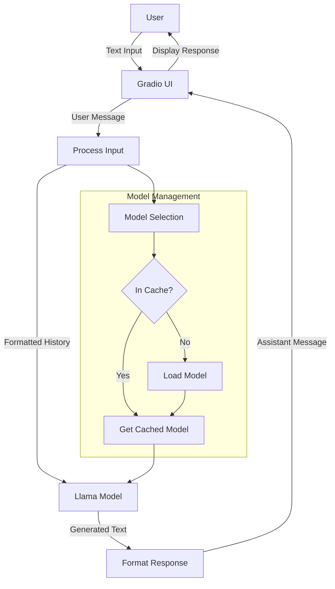
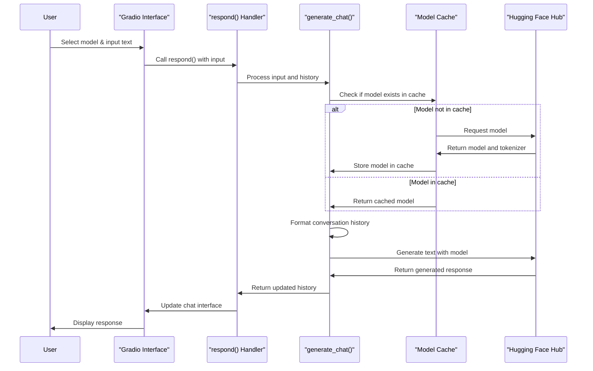
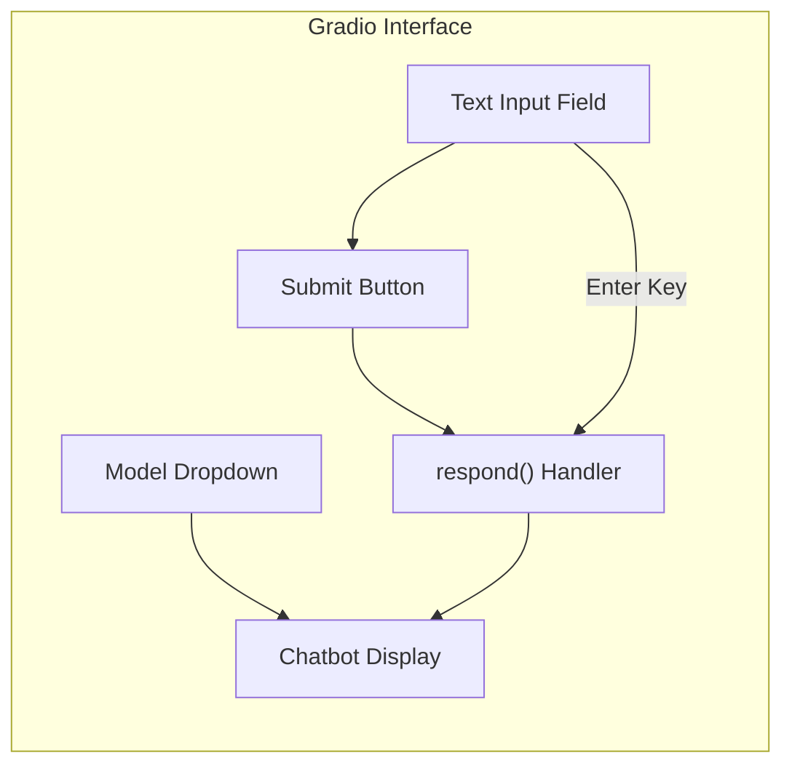
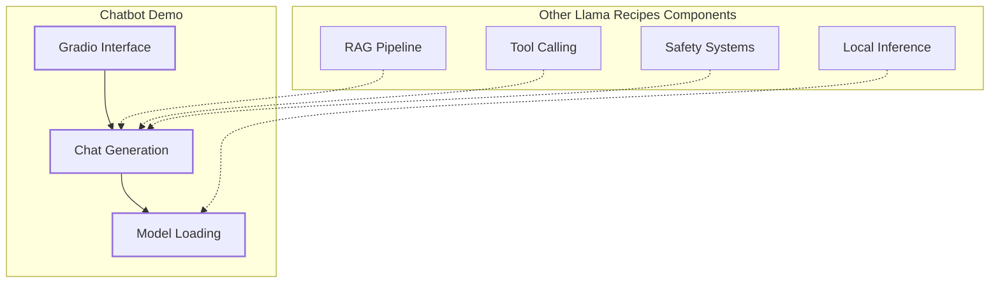

<!-- source: DeepWiki mcp.deepwiki.com · repo huggingface/huggingface-llama-recipes · page 6.2 Chatbot Interfaces · fetched 2026-10-26 -->

# Chatbot Interfaces

<details>
<summary>Relevant source files</summary>

The following files were used as context for generating this wiki page:

- [.github/README.md](.github/README.md)
- [assets/gradio_chatbot_demo.png](assets/gradio_chatbot_demo.png)
- [gradio_demos/chatbot_demo.ipynb](gradio_demos/chatbot_demo.ipynb)
- [gradio_demos/chatbot_demo.py](gradio_demos/chatbot_demo.py)
- [tool_calling/tool_calling.ipynb](tool_calling/tool_calling.ipynb)

</details>


This document describes the chatbot interfaces provided in the Hugging Face Llama Recipes repository. These interfaces allow users to interact with Llama models through a web-based UI, providing an accessible way to test and demonstrate different Llama model variants without needing to write code.

For information about tool calling capabilities in Llama models, see [Tool Calling](#6.3). For Retrieval-Augmented Generation pipelines, see [RAG Pipelines](#6.1).

## Overview

The chatbot interfaces in this repository provide:

1. A simple web-based UI for interacting with Llama models
2. Support for multiple Llama model variants (3.x series)
3. Efficient model caching to avoid reloading
4. Customizable conversation formats

The implementation consists of both a Jupyter notebook and a standalone Python script, allowing for flexible deployment options.

Sources: [gradio_demos/chatbot_demo.ipynb:1-17](), [gradio_demos/chatbot_demo.py:1-20]()

## System Architecture

### Chatbot System Flow



Sources: [gradio_demos/chatbot_demo.py:22-62](), [gradio_demos/chatbot_demo.ipynb:169-206]()

### Component Interaction



Sources: [gradio_demos/chatbot_demo.py:32-62](), [gradio_demos/chatbot_demo.py:76-80]()

## Key Components

### Model Registry

The system maintains a registry of supported Llama models with their corresponding Hugging Face model IDs:

```python
llama_models = {
    "Llama 3 70B Instruct": "meta-llama/Meta-Llama-3-70B-Instruct",
    "Llama 3 8B Instruct": "meta-llama/Meta-Llama-3-8B-Instruct",
    "Llama 3.1 70B Instruct": "meta-llama/Llama-3.1-70B-Instruct",
    "Llama 3.1 8B Instruct": "meta-llama/Llama-3.1-8B-Instruct",
    "Llama 3.2 3B Instruct": "meta-llama/Llama-3.2-3B-Instruct",
    "Llama 3.2 1B Instruct": "meta-llama/Llama-3.2-1B-Instruct",
}
```

This allows users to select from different Llama model variants through a dropdown menu in the interface.

Sources: [gradio_demos/chatbot_demo.py:13-20](), [gradio_demos/chatbot_demo.ipynb:148-155]()

### Model Loading and Caching

The system includes a model caching mechanism to avoid reloading models multiple times, which significantly improves the user experience by reducing wait times after the initial load.

```python
# Cache to store loaded models
model_cache = {}

# Function to load the model and tokenizer
def load_model(model_name):
    tokenizer = AutoTokenizer.from_pretrained(model_name)
    model = AutoModelForCausalLM.from_pretrained(model_name)
    generator = pipeline('text-generation', model=model, tokenizer=tokenizer, device=device)
    return generator
```

When a user selects a model, the system first checks if it's already loaded in the cache before initiating a new load operation.

Sources: [gradio_demos/chatbot_demo.py:22-30](), [gradio_demos/chatbot_demo.ipynb:171-205]()

### Chat Generation Pipeline

The core functionality is implemented in the `generate_chat` function, which:

1. Retrieves the appropriate model based on user selection
2. Formats the conversation history with system, user, and assistant messages
3. Generates a response using the model
4. Updates the conversation history with the new response

```python
def generate_chat(user_input, history, model_choice):
    # Load the model if not already cached
    if model_choice not in model_cache:
        model_cache[model_choice] = load_model(llama_models[model_choice])
    generator = model_cache[model_choice]

    # Initial system prompt
    system_prompt = {"role": "system", "content": "You are a helpful assistant"}

    # Initialize history if it's None
    if history is None:
        history = [system_prompt]
    
    # Append user input to history
    history.append({"role": "user", "content": user_input})

    # Generate response using the model
    response = generator(
        history,
        max_length=512,
        pad_token_id=generator.tokenizer.eos_token_id,
        do_sample=True,
        temperature=0.7,
        top_p=0.9
    )[-1]["generated_text"][-1]["content"]

    # Append model response to history
    history.append({"role": "assistant", "content": response})
    
    return history
```

The generation parameters such as `temperature` and `top_p` control the randomness and diversity of model responses.

Sources: [gradio_demos/chatbot_demo.py:32-62](), [gradio_demos/chatbot_demo.ipynb:219-258]()

### Gradio User Interface

The user interface is built using Gradio, providing a clean and intuitive way to interact with the models:



The interface consists of:
- A dropdown menu for model selection
- A chatbot display for conversation history
- A text input field for user messages
- A submit button to send messages

Sources: [gradio_demos/chatbot_demo.py:65-86](), [gradio_demos/chatbot_demo.ipynb:270-338]()

## Code Structure and Components

### Code Organization

The chatbot interface is available in two equivalent forms:

| File | Description |
|------|-------------|
| `gradio_demos/chatbot_demo.py` | Standalone Python script implementation |
| `gradio_demos/chatbot_demo.ipynb` | Jupyter notebook implementation with the same functionality |

Both files implement the same functionality, with the notebook version providing additional explanations and the ability to run interactively in environments like Colab.

Sources: [gradio_demos/chatbot_demo.py](), [gradio_demos/chatbot_demo.ipynb]()

### Key Functions

| Function | Purpose |
|----------|---------|
| `load_model(model_name)` | Loads a model and tokenizer and creates a text generation pipeline |
| `generate_chat(user_input, history, model_choice)` | Processes user input and generates model responses |
| `respond(user_input, chat_history, model_choice)` | Handles UI interaction between Gradio and the generation function |

Sources: [gradio_demos/chatbot_demo.py:23-27, 33-62, 76-80]()

### Message Format

The chatbot uses a structured message format that is compatible with Llama's chat template:

| Role | Purpose | Example |
|------|---------|---------|
| system | Sets the assistant's behavior | `{"role": "system", "content": "You are a helpful assistant"}` |
| user | Contains user messages | `{"role": "user", "content": "What is deep learning?"}` |
| assistant | Contains model responses | `{"role": "assistant", "content": "Deep learning is..."}` |

Sources: [gradio_demos/chatbot_demo.py:40-47](), [gradio_demos/chatbot_demo.ipynb:230-237]()

## Usage

### Running the Interface

To run the chatbot interface, you can either:

1. Execute the Python script:
   ```bash
   python gradio_demos/chatbot_demo.py
   ```

2. Or run the Jupyter notebook:
   ```bash
   jupyter notebook gradio_demos/chatbot_demo.ipynb
   ```

Both methods will start a Gradio web server that you can access in your browser.

### Authentication Requirements

Before using the chatbot, you need to:

1. Have an account on the Hugging Face Hub
2. Request access to the Llama models you want to use
3. Authenticate using either the login prompt or an API token

Sources: [gradio_demos/chatbot_demo.py:6-7](), [gradio_demos/chatbot_demo.ipynb:31-34]()

### Customization Options

The chatbot can be customized in various ways:

1. **System Prompt**: Modify the `system_prompt` variable to change the assistant's behavior
   ```python
   system_prompt = {"role": "system", "content": "You are a helpful assistant that answers in rhyming verse"}
   ```

2. **Generation Parameters**: Adjust parameters like `temperature` and `top_p` to control response characteristics
   ```python
   response = generator(
       history,
       max_length=512,
       temperature=0.5,  # Lower for more focused responses
       top_p=0.95        # Higher for more diverse outputs
   )
   ```

3. **Model Selection**: Add or remove models from the `llama_models` dictionary
   ```python
   llama_models["Custom Fine-tuned Model"] = "path/to/your/model"
   ```

Sources: [gradio_demos/chatbot_demo.py:40, 50-57](), [gradio_demos/chatbot_demo.ipynb:230, 240-247]()

## UI Demonstration

The Gradio interface presents a clean, user-friendly chatbot experience that resembles popular chat applications:


Key UI elements include:
1. A dropdown menu at the top for model selection
2. A central area displaying the conversation history
3. A text input box at the bottom for entering messages
4. A submit button to send messages

Sources: [assets/gradio_chatbot_demo.png]()

## Integration with Other Components

The chatbot interfaces can be integrated with other components in the Llama Recipes repository:



Potential integrations include:
- Adding RAG capabilities to improve factual responses
- Incorporating tool calling to enable actions beyond text generation
- Implementing safety measures using Llama Guard or Prompt Guard
- Using quantized models for improved performance on consumer hardware

Sources: [.github/README.md:162-166]()

## Performance Considerations

When using the chatbot interface, consider the following performance factors:

1. **Model Size**: Larger models (70B) require more memory and time to load than smaller ones (1B, 3B, 8B)
2. **Hardware Requirements**: GPU acceleration significantly improves response time
3. **Caching**: The first response after selecting a model will be slower due to model loading
4. **Input Length**: Very long conversations may exceed context limits and require truncation

Sources: [gradio_demos/chatbot_demo.py:10](), [gradio_demos/chatbot_demo.ipynb:126]()

## Summary

The chatbot interfaces in the Llama Recipes repository provide an accessible way to interact with various Llama models through a web-based UI. The implementation features model caching for efficiency, a structured message format for conversations, and customizable generation parameters.

By using Gradio, the interface offers a user-friendly experience that can be deployed either as a standalone script or through a Jupyter notebook, making it versatile for different use cases from quick demos to interactive tutorials.

---

