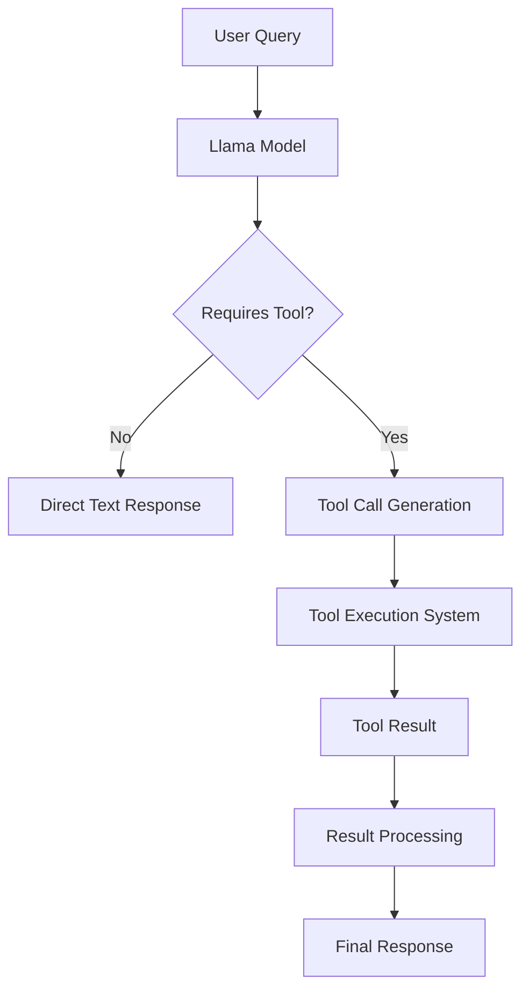
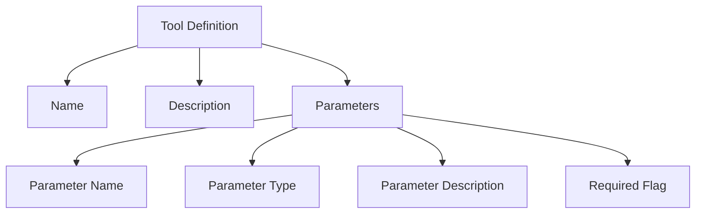
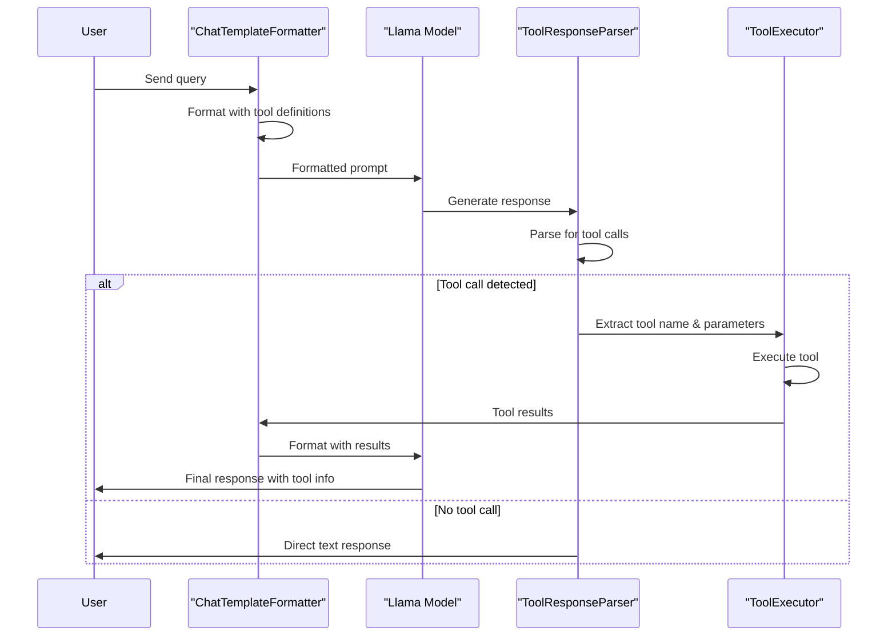

<!-- source: DeepWiki mcp.deepwiki.com · repo huggingface/huggingface-llama-recipes · page 6.3 Tool Calling · fetched 2026-10-26 -->

# Tool Calling

<details>
<summary>Relevant source files</summary>

The following files were used as context for generating this wiki page:

- [.github/README.md](.github/README.md)
- [tool_calling/tool_calling.ipynb](tool_calling/tool_calling.ipynb)

</details>


This document explains how to leverage the tool-calling capabilities of Llama models, which enable them to interact with external tools, APIs, and functions to perform tasks beyond text generation. For information about building chatbot interfaces without tool calling, see [Chatbot Interfaces](#6.2). For information about knowledge-based question answering, see [RAG Pipelines](#6.1).

## Introduction to Tool Calling

Tool calling enables Llama models to:

1. Recognize when a task requires an external tool
2. Generate structured function calls with appropriate parameters
3. Process tool execution results and incorporate them into responses

This functionality allows Llama models to perform actions such as calculations, database queries, API interactions, or retrieving real-time information.



Sources: [.github/README.md:167-171]()

## Tool Calling Implementation

The Llama Recipes repository demonstrates tool calling implementation in the notebook `tool_calling/tool_calling.ipynb`. This notebook integrates with the `chat_template` functionality to properly format tool-related interactions.

### Tool Definition Structure

Tools are defined with specific attributes that help the model understand their purpose and parameters:



A typical tool definition includes:
- **Name**: A unique identifier for the tool
- **Description**: A clear explanation of what the tool does
- **Parameters**: The inputs the tool requires
  - Type (string, number, boolean, etc.)
  - Description for each parameter
  - Required vs. optional status

Sources: [.github/README.md:167-171]()

## Workflow Components

The tool calling implementation consists of several components that work together:



1. **ChatTemplateFormatter**: Structures the conversation format including tool definitions
2. **Llama Model**: Generates responses that may include tool calls
3. **ToolResponseParser**: Extracts tool calls from model output
4. **ToolExecutor**: Runs the requested tools with provided parameters
5. **Result Formatter**: Prepares tool results for the model

Sources: [.github/README.md:167-171]()

## Example Use Cases

Tool calling with Llama models enables various practical applications:

| Tool Type | Description | Example Use |
|-----------|-------------|-------------|
| Calculator | Performs mathematical operations | Complex calculations beyond model capabilities |
| Weather API | Retrieves current weather data | Providing up-to-date weather information |
| Search Tool | Queries databases or search engines | Finding specific information not in training data |
| Calendar API | Manages appointments | Scheduling and event management |
| Code Executor | Runs code in various languages | Testing, debugging, or generating sample outputs |
| Database Query | Retrieves or stores structured data | Managing and analyzing data |

## Implementation Guide

To implement tool calling with Llama models:

1. **Define Tools**: Create structured definitions of available tools
2. **Prepare Prompts**: Include tool definitions in your system prompt
3. **Generate Responses**: Have the model generate responses that may include tool calls
4. **Parse Tool Calls**: Extract tool names and parameters from the model's output
5. **Execute Tools**: Run the requested tools with the provided parameters
6. **Format Results**: Present tool results back to the model
7. **Generate Final Response**: Have the model incorporate tool results into its response

### Example Tool Definition Format

```
{
  "name": "get_weather",
  "description": "Get the current weather for a specific location",
  "parameters": {
    "type": "object",
    "properties": {
      "location": {
        "type": "string",
        "description": "The city and state/country"
      },
      "unit": {
        "type": "string",
        "enum": ["celsius", "fahrenheit"],
        "description": "Temperature unit"
      }
    },
    "required": ["location"]
  }
}
```

## Technical Considerations

When implementing tool calling:

1. **Input Validation**: Validate parameters before executing tools
2. **Error Handling**: Manage cases where tools fail or return unexpected results
3. **Security**: Implement appropriate permissions and limitations
4. **Context Management**: Ensure the model has sufficient context about available tools
5. **Prompt Design**: Craft effective prompts that guide the model to use tools appropriately

## Resources

For a complete implementation example, see the tool calling notebook:
[tool_calling/tool_calling.ipynb]()

Sources: [.github/README.md:167-171]()

---

