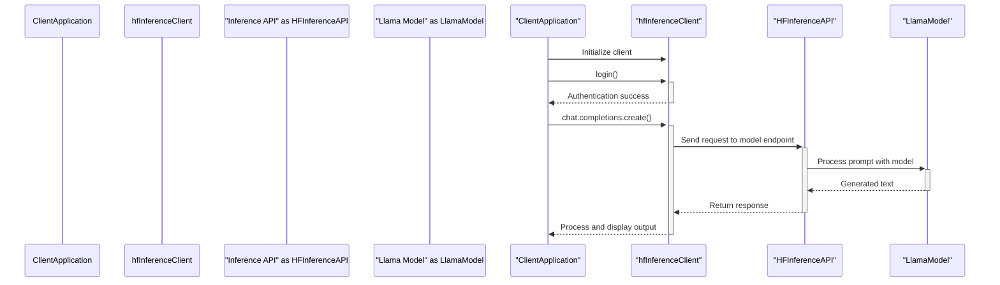
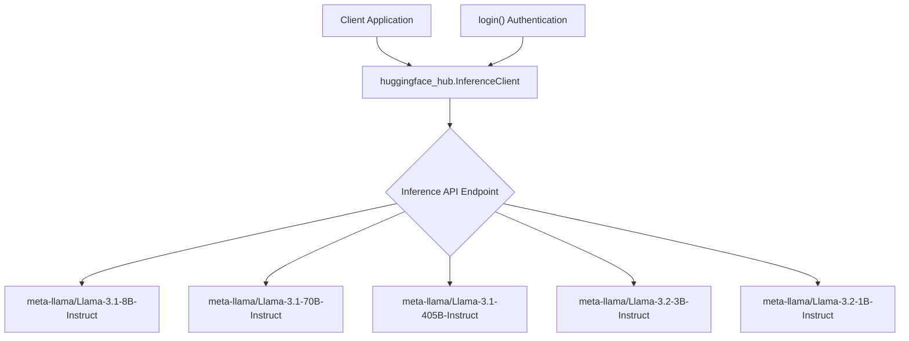
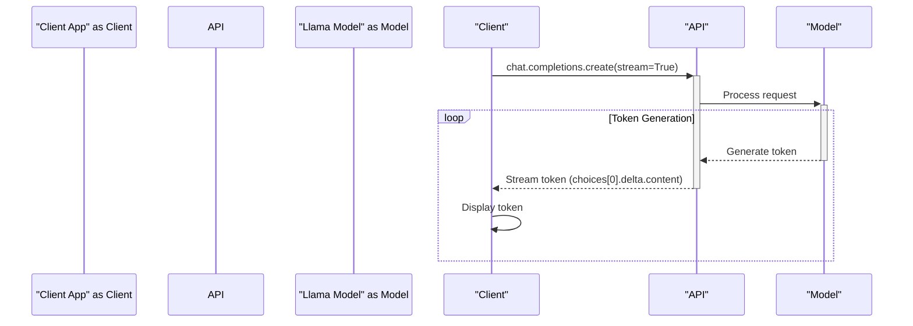
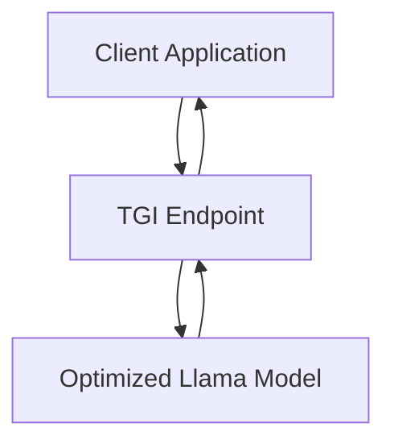

<!-- source: DeepWiki mcp.deepwiki.com · repo huggingface/huggingface-llama-recipes · page 7 API Integration · fetched 2026-10-26 -->

# API Integration

<details>
<summary>Relevant source files</summary>

The following files were used as context for generating this wiki page:

- [.github/README.md](.github/README.md)
- [api_inference/inference-api.ipynb](api_inference/inference-api.ipynb)
- [tool_calling/tool_calling.ipynb](tool_calling/tool_calling.ipynb)

</details>


## Purpose and Scope

This document explains how to use the Hugging Face Inference API with Llama models, focusing on accessing large models like Llama 3.1 70B that exceed typical consumer hardware capabilities. For information on running models locally on your own hardware, see [Local Inference](#2).

## Overview 

The Hugging Face Inference API provides serverless access to Llama models without requiring powerful local hardware. This is particularly useful for:

- Accessing large models (70B, 405B) that would be impractical to run locally
- Rapid prototyping before investing in local deployment infrastructure
- Production applications requiring consistent performance
- Scenarios where managing model weights and updates is undesirable

Sources: [.github/README.md:131-136]()

## API Integration Architecture

**API Integration Flow**


Sources: [api_inference/inference-api.ipynb:20-31](), [api_inference/inference-api.ipynb:66-94]()

**Component Interaction**


Sources: [api_inference/inference-api.ipynb:30](), [api_inference/inference-api.ipynb:48](), [.github/README.md:37-38]()

## Prerequisites

Before using the Hugging Face Inference API with Llama models:

1. **Create a Hugging Face account** if you don't already have one
2. **Request access to Llama models** by visiting the [Meta Llama repositories](https://huggingface.co/meta-llama) and submitting access requests
3. **Obtain an API token** from your Hugging Face account settings
4. **Install the required libraries**

**Access Request Workflow**


Sources: [.github/README.md:14-18]()

## Basic Usage

The core workflow for using the Inference API involves:

1. Installing the huggingface_hub library
2. Authenticating with your Hugging Face account
3. Creating an `InferenceClient`
4. Sending requests to the Llama model of your choice
5. Processing the responses

### Installation and Setup

```python
# Install required library
!pip install -q huggingface_hub

# Import necessary components
from huggingface_hub import InferenceClient, login

# Login to Hugging Face
login()
```

Sources: [api_inference/inference-api.ipynb:20](), [api_inference/inference-api.ipynb:30](), [api_inference/inference-api.ipynb:48]()

### Basic API Request

```python
# Initialize the client
client = InferenceClient()

# Send a request to the Llama model
chat_completion = client.chat.completions.create(
    model="meta-llama/Llama-3.1-70B-Instruct",
    messages=[
        {"role": "system", "content": "You are a helpful assistant."},
        {"role": "user", "content": "What is a large language model?"}
    ],
    max_tokens=500
)

# Process the response
print(chat_completion.choices[0].message.content)
```

Sources: [api_inference/inference-api.ipynb:66](), [api_inference/inference-api.ipynb:86-94]()

## Streaming Responses

For longer responses, streaming allows you to receive partial results incrementally as they're generated:

**Streaming Process Flow**


### Streaming Code Example

```python
chat_completion = client.chat.completions.create(
    model="meta-llama/Llama-3.1-70B-Instruct",
    messages=[
        {"role": "system", "content": "You are a helpful an honest programming assistant."},
        {"role": "user", "content": "Is Rust better than Python?"},
    ],
    stream=True,
    max_tokens=500,
)

# Process the streaming response
for message in chat_completion:
    print(message.choices[0].delta.content, end="")
```

Sources: [api_inference/inference-api.ipynb:86-94](), [api_inference/inference-api.ipynb:148-149]()

## Model Parameters

You can control the model's behavior by adjusting these parameters:

| Parameter | Description | Example Value |
|-----------|-------------|---------------|
| `model` | The specific Llama model to use | `"meta-llama/Llama-3.1-70B-Instruct"` |
| `messages` | Array of message objects with role and content | `[{"role": "user", "content": "Hello"}]` |
| `max_tokens` | Maximum number of tokens to generate | `500` |
| `stream` | Whether to stream responses incrementally | `True` or `False` |
| `temperature` | Controls randomness (higher = more random) | `1.0` |
| `top_p` | Controls diversity via nucleus sampling | `1` |
| `do_sample` | Whether to use sampling instead of greedy decoding | `False` |

Sources: [api_inference/inference-api.ipynb:86-94]()

## Comparison with Local Inference

When deciding between API and local inference, consider these factors:

| Factor | API Inference | Local Inference |
|--------|--------------|-----------------|
| Hardware Requirements | Minimal (internet connection) | Substantial (see memory table in [Local Inference](#2)) |
| Setup Complexity | Simple (API key + library) | More complex (model weights, quantization, etc.) |
| Cost | Usage-based pricing | One-time hardware cost |
| Latency | Network-dependent | Generally lower for local inference |
| Scalability | Automatically scales | Limited by local hardware |
| Model Size Access | All sizes accessible (8B to 405B) | Limited by local VRAM/RAM |

Sources: [.github/README.md:67-86]()

## Alternative API Approaches

### Text Generation Inference (TGI)

The repository also includes examples of using Text Generation Inference (TGI), which is a framework for efficient and scalable deployment of Llama models:



TGI provides additional features like:
- Optimized serving infrastructure
- Configurable parameters for throughput/latency tradeoffs
- Token streaming capabilities
- Containerized deployment options

Sources: [.github/README.md:157-160]()

## Integration Examples

### Chat Completion Example

The following example demonstrates how to use the Inference API to create a chatbot that responds to programming questions:

```python
chat_completion = client.chat.completions.create(
    model="meta-llama/Llama-3.1-70B-Instruct",
    messages=[
        {"role": "system", "content": "You are a helpful an honest programming assistant."},
        {"role": "user", "content": "Is Rust better than Python?"},
    ],
    stream=True,
    max_tokens=500,
)
```

The API will automatically format the messages using the appropriate chat template for the selected Llama model.

Sources: [api_inference/inference-api.ipynb:86-94]()

## Best Practices

When using the Inference API with Llama models:

1. **Store API keys securely**: Never hardcode API keys in your application
2. **Handle errors gracefully**: Implement proper error handling for network issues or API limits
3. **Consider latency**: For interactive applications, set appropriate timeouts
4. **Monitor usage**: Keep track of API calls to manage costs
5. **Use streaming**: For long responses, always use streaming to improve user experience

## Conclusion

The Hugging Face Inference API provides a convenient way to access the full range of Llama models without local hardware constraints. This approach is particularly valuable for accessing the larger models like Llama 3.1 70B and 405B. For more advanced deployment needs, consider exploring Text Generation Inference (TGI) or looking at the chatbot demos in the repository.

For building complete chat applications with the models accessed via API, see [Chatbot Interfaces](#6.2).

---

