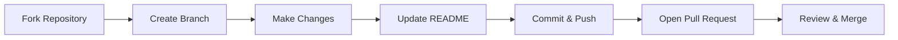
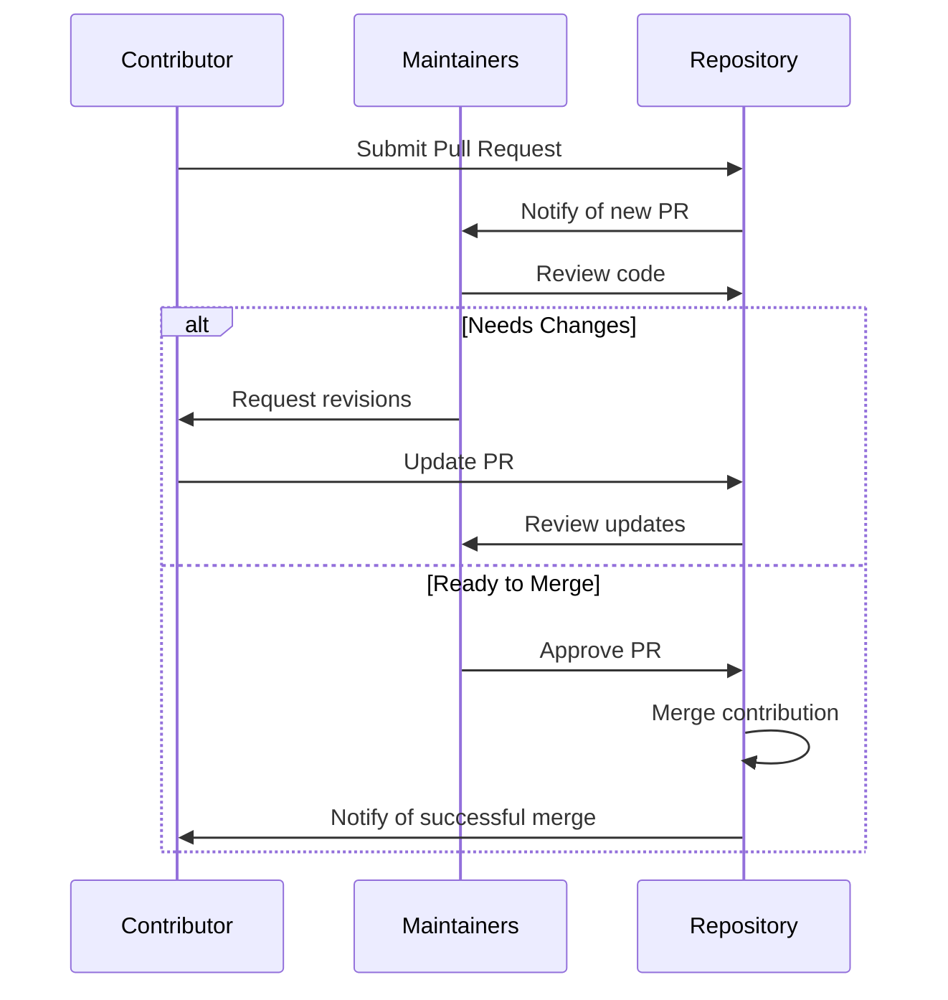

<!-- source: DeepWiki mcp.deepwiki.com · repo huggingface/huggingface-llama-recipes · page 8 Contributing · fetched 2026-10-26 -->

# Contributing

<details>
<summary>Relevant source files</summary>

The following files were used as context for generating this wiki page:

- [.github/CONTRIBUTING.md](.github/CONTRIBUTING.md)
- [.gitignore](.gitignore)
- [assets/Fork.png](assets/Fork.png)
- [assets/PR.png](assets/PR.png)

</details>


This page provides guidelines and instructions for contributing to the Hugging Face Llama Recipes repository. It explains the contribution process, types of contributions welcome, and best practices to follow when submitting your work to enhance the collection of recipes for working with Meta's Llama 3.x models.

## Contribution Process

Contributing to the Llama Recipes repository follows a standard GitHub workflow, as described in the repository's contributing guide:



### 1. Fork the Repository

Start by creating your own copy of the repository:

1. Navigate to the Hugging Face Llama Recipes repository
2. Click the "Fork" button in the top-right corner
3. Wait for GitHub to create your personal copy of the repository

### 2. Create a Branch

In your forked repository, create a new branch for your contribution:

```bash
git checkout -b feature/your-feature-name
```

Choose a descriptive branch name that reflects your contribution, such as:
- `feature/awq-quantization-example`
- `fix/vision-finetuning-bug`
- `docs/improve-rag-documentation`

### 3. Make Your Changes

Add your scripts, notebooks, or relevant files to the appropriate directory in the repository. Ensure your contribution:

- Is well-documented
- Follows existing patterns in the repository
- Includes clear instructions on how to use it

### 4. Update the README.md

An important step often overlooked: update the `README.md` to include information about your contribution. This helps others discover and use your recipe.

### 5. Commit and Push

Commit your changes with a meaningful commit message:

```bash
git commit -m "Add feature: your feature name"
```

Push the changes to your forked repository:

```bash
git push origin feature/your-feature-name
```

### 6. Open a Pull Request

Navigate to the original repository and:

1. Click on "New Pull Request"
2. Select "compare across forks" and choose your branch
3. Provide a clear description of your contribution
4. Submit the pull request

Sources: [.github/CONTRIBUTING.md:9-38]()

## Contribution Areas

The Llama Recipes repository is organized around different use cases and techniques for working with Llama models. Understanding this structure helps in placing your contribution appropriately:

```mermaid
flowchart TD
    A["Llama Recipes Repository"] --> B["Local Inference"]
    A --> C["Model Fine-tuning"]
    A --> D["Assisted/Speculative Decoding"]
    A --> E["Performance Optimization"]
    A --> F["Safety Systems"]
    A --> G["Advanced Applications"]
    A --> H["API Integration"]
    
    B --> B1["Quantization Methods"]
    B1 --> B1a["4-bit/8-bit BitsAndBytes"]
    B1 --> B1b["AWQ"]
    B1 --> B1c["GPTQ"]
    B1 --> B1d["FP8"]
    
    C --> C1["Vision Fine-tuning"]
    C --> C2["PEFT/QLoRA"]
    C --> C3["Distributed Training"]
    
    D --> D1["Small+Large Model Pairings"]
    D --> D2["Implementation Strategies"]
    
    E --> E1["torch.compile"]
    E --> E2["KV Cache Optimization"]
    E --> E3["DeepSpeed Integration"]
    
    F --> F1["Llama Guard"]
    F --> F2["Prompt Guard"]
    
    G --> G1["RAG Pipelines"]
    G --> G2["Tool Calling"]
    G --> G3["Chatbot Interfaces"]
    G --> G4["Synthetic Data Generation"]
    
    H --> H1["Inference API Usage"]
    H --> H2["API Deployment"]
```



The diagram above illustrates the main components of the repository, helping you identify where your contribution might fit best.

## Types of Contributions

The repository welcomes various types of contributions that help expand and improve the collection of Llama recipes:

| Type | Description | Examples |
|------|-------------|----------|
| New Recipes | Adding new techniques, approaches, or applications | Quantization techniques, fine-tuning methods, RAG implementations |
| Improvements | Enhancing existing recipes | Performance optimizations, code cleanup, expanding functionality |
| Bug Fixes | Addressing issues in existing code | Correcting errors, fixing compatibility problems |
| Documentation | Enhancing explanations and instructions | Improving comments, adding examples, clarifying usage |
| Model Support | Adding compatibility with new models | Support for new Llama versions or related architectures |

### 1. New Recipes

Examples of valuable new recipes include:

- Additional quantization techniques for local inference
- Novel fine-tuning approaches for specific tasks
- Alternative safety mechanisms or implementations
- New application patterns (RAG variations, tool calling examples)
- Integration with other tools or frameworks

### 2. Improvements to Existing Recipes

Enhancements to existing recipes could involve:

- Performance optimizations that make the code run faster
- Better error handling for more robust execution
- Expanded functionality to cover more use cases
- Simplified implementation for easier understanding

### 3. Bug Fixes

Bug fixes are always appreciated, including:

- Corrections to errors in existing code
- Fixes for compatibility issues with different environments
- Addressing edge cases not handled by current implementation
- Resolving environment-specific problems

### 4. Documentation Enhancements

Documentation improvements help all users:

- Clearer instructions for running recipes
- Additional examples of expected inputs and outputs
- Better explanations of underlying concepts
- More comprehensive comments in code

### 5. Support for New Models

As the Llama family evolves, contributions may include:

- Adding support for new Llama versions
- Compatibility with related model architectures
- Examples for different deployment environments

## Best Practices for Contributions

Following these best practices will help ensure your contribution can be reviewed and merged efficiently:

### Code Quality

- Write clear, readable code with descriptive variable names
- Include comments for complex sections
- Follow consistent formatting patterns
- Ensure your code handles errors gracefully

### Documentation

- Provide clear documentation for your contribution
- Include examples of inputs and expected outputs
- Document any prerequisites or dependencies
- Explain the purpose and benefits of your contribution

### Testing

- Test your code thoroughly before submitting
- Verify it works across different environments if possible
- Check for edge cases and special conditions
- Consider resource requirements (memory, computation)

## Getting Help

If you need assistance with your contribution:

- Open an issue for questions about implementation
- Create a draft pull request to discuss your approach
- Reach out via the repository's communication channels

As mentioned in the contributing guide:

> If you have any questions or need guidance, feel free to open an issue or draft PR. We're here to help!

Sources: [.github/CONTRIBUTING.md:43-45]()

## Contribution Review Process

After submitting your pull request, here's what happens:



The maintainers will review your contribution, looking at code quality, documentation, and alignment with the repository's purpose. They may request changes or clarifications before merging.

## Conclusion

Contributing to the Hugging Face Llama Recipes repository is a great way to share your knowledge and help build a valuable resource for the community working with Llama models. By following the guidelines outlined in this document, you can ensure your contributions are effective and can be smoothly integrated into the repository.

Remember that contributions of all sizes are welcome - from minor documentation improvements to complex new recipes. Every contribution helps make the repository more useful for everyone working with Llama models.