# Page: Overview

# Overview

<details>
<summary>Relevant source files</summary>

The following files were used as context for generating this wiki page:

- [.github/README.md](.github/README.md)
- [tool_calling/tool_calling.ipynb](tool_calling/tool_calling.ipynb)

</details>


## Purpose and Scope

The Hugging Face Llama Recipes repository provides minimal, practical examples to help users quickly get started with Meta's Llama 3.x family of models. This documentation covers the core capabilities, structure, and implementation patterns found in the repository, serving as a reference guide for developers looking to leverage these powerful language models in their applications.

This overview page introduces the repository's purpose and summarizes the available recipes. For specific implementation details, refer to the dedicated pages on [Local Inference](#2), [Model Fine-tuning](#3), [Safety Systems](#4), [Performance Optimization](#5), and [Advanced Applications](#6).

Sources: [.github/README.md:1-12]()

## About Llama 3.x Models

The repository focuses on the Llama 3.x family of models, including:

- **Llama 3.1** - Available in 8B, 70B, and 405B parameter sizes
- **Llama 3.2** - Available in 1B, 3B parameter sizes with vision capabilities
- **Llama 3.3** - Available in 70B parameter size

Each model comes in base and instruction-tuned variants, with the latter optimized for chat and instruction-following use cases.

> **Note:** To use Llama 3.x models, you need to accept the license and request permission to access them via the [Hugging Face Meta-Llama organization](https://huggingface.co/meta-llama).

Sources: [.github/README.md:5-6](), [.github/README.md:14-18]()

## Repository Structure

The Llama Recipes repository is organized around different use cases and optimization techniques, each demonstrated through Jupyter notebooks and Python scripts.

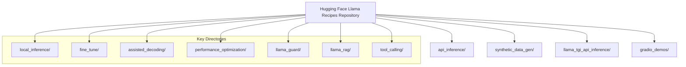

Sources: [.github/README.md:67-172]()

## Hardware Requirements and Model Variants

The Llama 3.x models come in various sizes with different memory requirements depending on the quantization technique used:

| Model Size | Llama Variant | BF16/FP16 | FP8 | INT4 (AWQ/GPTQ/bnb) |
|:----------:|:-------------:|:---------:|:---:|:-------------------:|
| 1B | 3.2 | 2.5 GB | 1.25 GB | 0.75 GB |
| 3B | 3.2 | 6.5 GB | 3.2 GB | 1.75 GB |
| 8B | 3.1 | 16 GB | 8 GB | 4 GB |
| 70B | 3.1 and 3.3 | 140 GB | 70 GB | 35 GB |
| 405B | 3.1 | 810 GB | 405 GB | 204 GB |

This table helps users determine which model and quantization method is appropriate for their hardware constraints.

Sources: [.github/README.md:72-85]()

## Core Features and Recipes

The repository provides recipes across several key categories:

```mermaid
graph TD
    A["Meta Llama 3.x Models"] --> B["Local Inference"]
    A --> C["Model Fine-tuning"]
    A --> D["Assisted Decoding"]
    A --> E["Performance Optimization"]
    A --> F["Safety Systems"]
    A --> G["Advanced Applications"]
    
    B --> B1["BitsAndBytes Quantization"]
    B --> B2["AWQ Quantization"]
    B --> B3["GPTQ Quantization"]
    B --> B4["FP8 Precision"]
    
    C --> C1["Vision Fine-tuning"]
    C --> C2["PEFT/QLoRA"]
    C --> C3["Distributed Training"]
    
    D --> D1["transformers.pipeline"]
    D --> D2["assisted_decoding_70B_3B"]
    D --> D3["assisted_decoding_8B_1B"]
    
    E --> E1["torch.compile"]
    E --> E2["KV Cache Quantization"]
    E --> E3["DeepSpeed Zero3"]
    
    F --> F1["LlamaGuard"]
    F --> F2["PromptGuard"]
    
    G --> G1["RAG Pipeline"]
    G --> G2["Chatbot Interfaces"]
    G --> G3["Tool Calling"]
    G --> G4["Synthetic Data Generation"]
```

Sources: [.github/README.md:67-172]()

## Getting Started

The simplest way to get started with Llama models is using the Hugging Face `transformers` library:

```python
import torch
from transformers import pipeline

device = "cuda" if torch.cuda.is_available() else "cpu"

llama_31 = "meta-llama/Llama-3.1-8B-Instruct"  # Llama 3.1
llama_32 = "meta-llama/Llama-3.2-3B-Instruct"  # Llama 3.2

prompt = [
    {"role": "system", "content": "You are a helpful assistant, that responds as a pirate."},
    {"role": "user", "content": "What's Deep Learning?"},
]

generator = pipeline(model=llama_32, device=device, torch_dtype=torch.bfloat16)
generation = generator(
    prompt,
    do_sample=False,
    temperature=1.0,
    top_p=1,
    max_new_tokens=50
)
```

This example demonstrates loading and running a Llama 3.2 3B model for a chat interaction.

Sources: [.github/README.md:20-65]()

## Model Deployment Workflow

A typical workflow for working with Llama models includes the following stages:

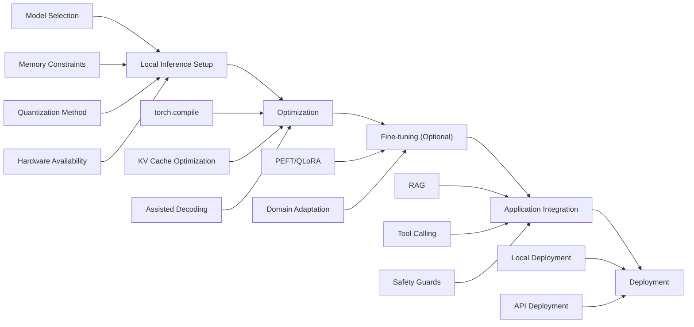

Sources: [.github/README.md:67-172]()

## Local Inference Options

The repository provides several recipes for running Llama models locally with different optimizations:

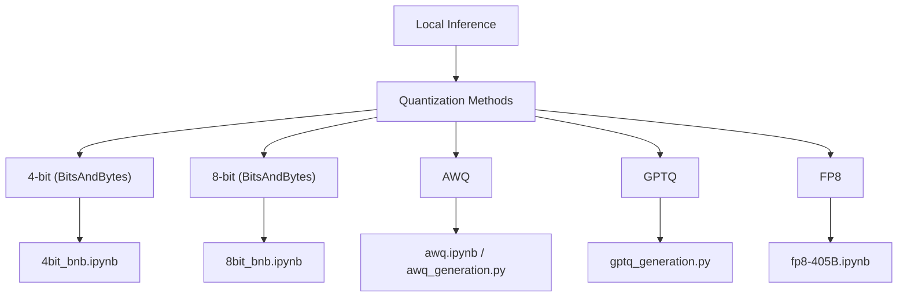

For more detailed information on each quantization method and its implementation, see [Quantization Methods](#2.1).

Sources: [.github/README.md:87-97]()

## Safety Systems Integration

Llama Recipes includes integration with two safety systems:

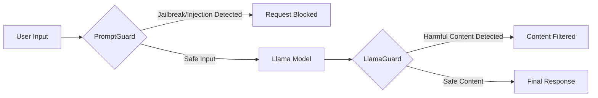

- **Prompt Guard**: A small classifier that detects jailbreaks and prompt injections before they reach the model
- **Llama Guard 3**: A specialized 3.1B parameter model that evaluates both inputs and outputs for harmful content

For detailed implementation guides, see [Safety Systems](#4).

Sources: [.github/README.md:138-142]()

## Advanced Applications

The repository demonstrates several advanced applications built with Llama models:

1. **RAG Pipeline**: Combining Llama models with document retrieval for knowledge-intensive tasks
2. **Chatbot Interfaces**: Building interactive chat experiences with Gradio
3. **Tool Calling**: Leveraging Llama models' ability to use external tools and APIs
4. **Synthetic Data Generation**: Creating training data with `distilabel`

These advanced applications showcase how Llama models can be integrated into larger systems and workflows. For detailed implementation guides, see [Advanced Applications](#6).

Sources: [.github/README.md:144-171]()

## Conclusion

The Hugging Face Llama Recipes repository provides a comprehensive set of examples for working with Meta's Llama 3.x models across a variety of use cases and hardware configurations. By following these recipes, developers can quickly implement efficient inference, fine-tuning, and deployment strategies for these powerful language models.

The following pages in this documentation provide more detailed information on specific aspects of working with Llama models.

Sources: [.github/README.md:1-12]()

---

# Page: Local Inference

# Local Inference

<details>
<summary>Relevant source files</summary>

The following files were used as context for generating this wiki page:

- [.github/README.md](.github/README.md)
- [llama.cpp/llama_cpp_python.ipynb](llama.cpp/llama_cpp_python.ipynb)
- [tool_calling/tool_calling.ipynb](tool_calling/tool_calling.ipynb)

</details>


## Purpose and Scope

This document explains how to run Llama 3.x models locally on your own hardware, focusing on various techniques to optimize memory usage and performance. It covers quantization methods and configuration options to make inference possible even on consumer-grade hardware with limited resources.

For information about fine-tuning these models, see [Model Fine-tuning](#3). For performance optimization techniques beyond quantization, see [Performance Optimization](#5).

## Memory Requirements

Running Llama models locally requires understanding their memory footprint, which varies based on model size and precision. Quantization techniques significantly reduce memory requirements while preserving most of the model's capabilities.

The following table shows approximate memory requirements for different Llama models and precision levels:

| Model Size | Llama Variant | BF16/FP16 | FP8 | INT4 (AWQ/GPTQ/BNB) |
| :--: | :--: | :--: | :--: | :--: |
| 1B | 3.2 | 2.5 GB | 1.25 GB | 0.75 GB |
| 3B | 3.2 | 6.5 GB | 3.2 GB | 1.75 GB |
| 8B | 3.1 | 16 GB | 8 GB | 4 GB |
| 70B | 3.1 and 3.3 | 140 GB | 70 GB | 35 GB |
| 405B | 3.1 | 810 GB | 405 GB | 204 GB |

As shown above, quantizing a model from 16-bit (BF16/FP16) to 4-bit precision (INT4) can reduce memory requirements by approximately 75%, making even large models accessible on consumer hardware.

Sources: [.github/README.md:69-86]()

## Local Inference Overview

### Inference Pipeline

The basic workflow for running local inference with Llama models involves loading the model with the appropriate quantization method, preparing inputs, generating outputs, and post-processing.

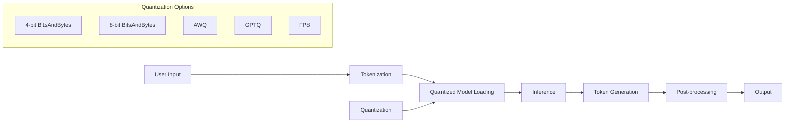

Sources: [.github/README.md:68-98]()

### Quantization Methods

The Llama Recipes repository supports several quantization methods that trade off between inference speed, memory usage, and output quality:

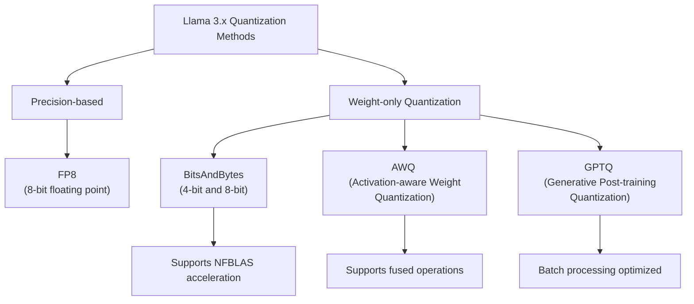

For detailed explanations of each quantization method and its trade-offs, see [Quantization Methods](#2.1).

Sources: [.github/README.md:87-97]()

## Running Llama 3.1 8B Models

Llama 3.1 8B is an excellent starting point for local inference as it balances capability and resource requirements. Here are three ways to run it locally:

### 4-bit Quantization with BitsAndBytes

This method provides the most memory-efficient option for running Llama 3.1 8B, requiring only about 4 GB of GPU memory. It's ideal for consumer GPUs with limited VRAM.

Key implementation components:
- Uses the `bitsandbytes` library for 4-bit quantization
- Employs `AutoModelForCausalLM.from_pretrained()` with appropriate quantization parameters
- Suitable for most consumer GPUs, including older models

Sources: [.github/README.md:89]()

### 8-bit Quantization with BitsAndBytes

The 8-bit quantization offers a balance between memory efficiency and model quality. It requires approximately 8 GB of GPU memory but generally provides better quality outputs than 4-bit quantization.

Key implementation components:
- Uses the `bitsandbytes` library for 8-bit quantization
- Requires a GPU with at least 8 GB of VRAM
- Provides better quality than 4-bit with modest memory increase

Sources: [.github/README.md:90]()

### AWQ with Fused Operations

AWQ (Activation-aware Weight Quantization) provides advanced quantization with optimized kernel operations, offering better inference speed while maintaining quality.

Key implementation components:
- Implements activation-aware quantization for preserving important weights
- Uses fused CUDA kernels for accelerated inference
- Requires compatible GPUs that support the necessary CUDA operations

Sources: [.github/README.md:91]()

## Running Llama 3.1 405B Models

The massive 405B parameter model requires special techniques to run locally, even with quantization. Here are three approaches:

### FP8 Precision

The FP8 method uses 8-bit floating-point precision to reduce memory requirements while maintaining higher numerical precision than integer quantization.

Key implementation components:
- Uses 8-bit floating-point representation
- Requires approximately 405 GB of memory (suitable for multi-GPU setups)
- Preserves more of the model's quality compared to INT4 quantization

Sources: [.github/README.md:95]()

### INT4 Quantization with AWQ

AWQ quantization reduces the 405B model to a more manageable size, requiring approximately 204 GB of memory.

Key implementation components:
- Uses a calibration dataset to determine optimal quantization parameters
- Preserves activations for important weights during quantization
- Significantly reduces memory requirements while maintaining reasonable quality

Sources: [.github/README.md:96]()

### INT4 Quantization with GPTQ

GPTQ (Generative Post-training Quantization) offers an alternative quantization method that works well for extremely large models.

Key implementation components:
- Uses post-training quantization technique optimized for generative models
- Supports batch processing for improved throughput
- Compatible with distributed inference across multiple GPUs

Sources: [.github/README.md:97]()

## Implementation Architecture

The following diagram illustrates how the quantization methods map to specific implementation files in the repository:

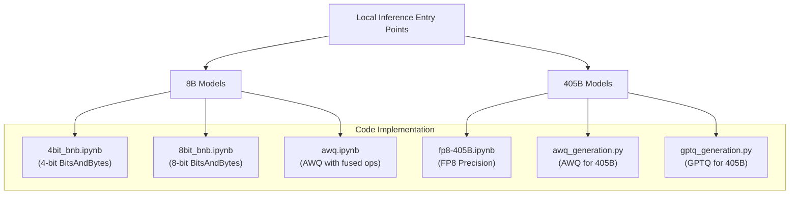

Sources: [.github/README.md:87-97]()

## Inference Example

Here's a basic example of running inference with a Llama model using the transformers library:

```python
import torch
from transformers import pipeline

device = "cuda" if torch.cuda.is_available() else "cpu"

# Choose a model
llama_31 = "meta-llama/Llama-3.1-8B-Instruct"  # Llama 3.1
llama_32 = "meta-llama/Llama-3.2-3B-Instruct"  # Llama 3.2

prompt = [
    {"role": "system", "content": "You are a helpful assistant."},
    {"role": "user", "content": "What's Deep Learning?"},
]

# Create the pipeline with appropriate dtype
generator = pipeline(model=llama_31, device=device, torch_dtype=torch.bfloat16)

# Generate response
generation = generator(
    prompt,
    do_sample=False,
    temperature=1.0,
    top_p=1,
    max_new_tokens=50
)

print(f"Generation: {generation[0]['generated_text']}")
```

Sources: [.github/README.md:25-65]()

## Method Comparison and Trade-offs

When choosing a quantization method for local inference, consider these trade-offs:

| Method | Memory Efficiency | Speed | Quality Preservation | GPU Requirements |
|--------|-------------------|-------|----------------------|------------------|
| FP16/BF16 | Low (Base) | High | Highest | High VRAM |
| FP8 | Medium (50% reduction) | High | Very Good | Medium-High VRAM |
| 8-bit BNB | Good (50% reduction) | Medium | Good | Medium VRAM |
| 4-bit BNB | Excellent (75% reduction) | Medium-Low | Acceptable | Low VRAM |
| AWQ | Excellent (75% reduction) | High | Good | Compatible GPU |
| GPTQ | Excellent (75% reduction) | High | Good | Compatible GPU |

Note that while quantization reduces memory requirements, it may affect model quality to varying degrees. 4-bit quantization generally shows more quality degradation than 8-bit or FP8, but the difference may be negligible for many applications.

Sources: [.github/README.md:69-86]()

## Conclusion

Local inference with Llama 3.x models is feasible across a range of hardware configurations thanks to various quantization techniques. For smaller models like Llama 3.2 1B or 3B, even standard consumer hardware is sufficient. For larger models like the 8B variant, quantization becomes essential, with 4-bit techniques enabling inference on GPUs with as little as 4 GB of VRAM. The largest models like 70B and 405B require either multiple GPUs or extreme quantization techniques.

For specific implementation details of each quantization method, refer to the corresponding notebooks and scripts in the repository.

---

# Page: Quantization Methods

# Quantization Methods

<details>
<summary>Relevant source files</summary>

The following files were used as context for generating this wiki page:

- [.github/README.md](.github/README.md)
- [tool_calling/tool_calling.ipynb](tool_calling/tool_calling.ipynb)

</details>


This page documents the various quantization techniques available in the Hugging Face Llama Recipes repository for running Llama 3.x models with reduced memory requirements. By using these quantization methods, you can run large language models on consumer hardware with limited VRAM. For information on other optimization techniques like torch.compile or KV cache quantization, see [Performance Optimization](#5).

## What is Quantization?

Quantization reduces the precision of model weights from their original 16-bit or 32-bit floating-point representation to lower precision formats (e.g., 8-bit, 4-bit, or custom formats). This significantly reduces memory requirements while aiming to preserve model quality.

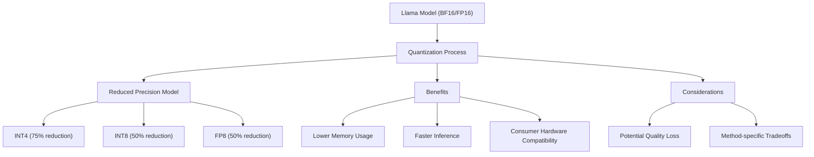

Sources: .github/README.md

## Memory Requirements by Quantization Method

The following table shows the approximate memory requirements for running Llama 3.x models with different quantization methods:

| Model Size | Llama Variant | BF16/FP16 | FP8 | INT4 (AWQ/GPTQ/BNB) |
|:----------:|:-------------:|:---------:|:---:|:-------------------:|
| 1B | 3.2 | 2.5 GB | 1.25 GB | 0.75 GB |
| 3B | 3.2 | 6.5 GB | 3.2 GB | 1.75 GB |
| 8B | 3.1 | 16 GB | 8 GB | 4 GB |
| 70B | 3.1 and 3.3 | 140 GB | 70 GB | 35 GB |
| 405B | 3.1 | 810 GB | 405 GB | 204 GB |

Sources: .github/README.md:74-80

## Quantization Methods Overview

The repository implements several quantization approaches, each with its own advantages and trade-offs:

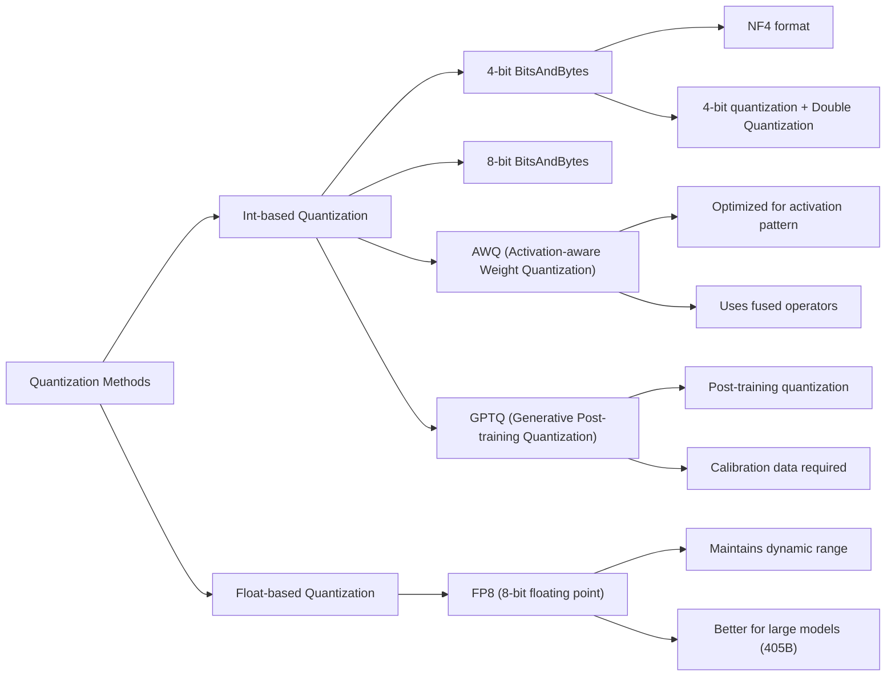

Sources: .github/README.md:86-97

## 4-bit Quantization with BitsAndBytes

This method uses the BitsAndBytes (BNB) library to quantize model weights to 4 bits, reducing memory usage by approximately 75% compared to FP16.

### Key Features:
- Uses NF4 (normalized float 4) format for better representation of weights
- Supports double quantization to further reduce memory usage
- Maintains most of the model's quality with significant memory savings
- Suitable for running 8B models on consumer GPUs with 8GB+ VRAM

### Implementation
The repository provides a notebook for running the Llama 3.1 8B model in 4-bit precision using BitsAndBytes.

Sources: .github/README.md:89

## 8-bit Quantization with BitsAndBytes

This method quantizes weights to 8 bits using the BitsAndBytes library, offering a good balance between memory reduction and output quality.

### Key Features:
- Reduces memory usage by approximately 50% compared to FP16
- Better preservation of model quality compared to 4-bit quantization
- Slightly higher memory requirements than 4-bit quantization
- Good option when quality is more important than maximum memory reduction

### Implementation
The repository includes a notebook demonstrating how to load and run the Llama 3.1 8B model with 8-bit quantization.

Sources: .github/README.md:90

## AWQ (Activation-aware Weight Quantization)

AWQ is an advanced quantization technique that considers activation patterns when determining how to quantize weights.

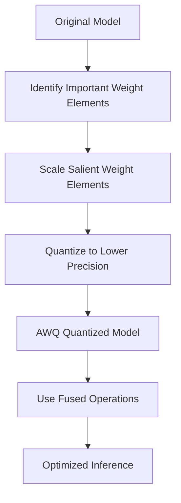

### Key Features:
- Optimizes quantization based on activation patterns during inference
- Uses group-wise quantization to preserve important weights
- Incorporates fused operations for faster inference
- Available for both 8B and 405B model variants
- Delivers better quality than standard quantization at the same bit width

### Implementation
The repository provides a notebook for running Llama 3.1 8B with AWQ and a script for applying AWQ to the 405B model.

Sources: .github/README.md:91, .github/README.md:96

## GPTQ (Generative Post-training Quantization)

GPTQ is a post-training quantization method specifically designed for generative models like Llama.

### Key Features:
- Uses calibration data to optimize quantization
- Employs layer-by-layer quantization with error correction
- Requires a one-time quantization process before inference
- Good quality preservation even at 4-bit precision
- Particularly useful for the 405B model

### Implementation
The repository includes a script for running the Llama 3.1 405B model quantized to INT4 with GPTQ.

Sources: .github/README.md:97

## FP8 (8-bit Floating Point)

FP8 quantization uses 8-bit floating-point representation instead of integer quantization, preserving more of the dynamic range important for language models.

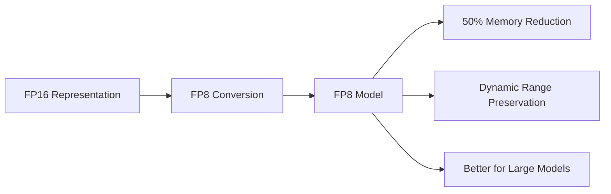

### Key Features:
- Maintains floating-point representation with reduced precision
- Better preserves dynamic range compared to integer quantization
- Especially useful for the largest models (405B)
- Reduces memory by approximately 50% compared to FP16
- Good balance of quality and efficiency

### Implementation
The repository provides a notebook for running the Llama 3.1 405B model with FP8 quantization.

Sources: .github/README.md:95

## Quantization Method Selection Guide

The following diagram provides guidance on selecting the appropriate quantization method based on your hardware constraints and quality requirements:

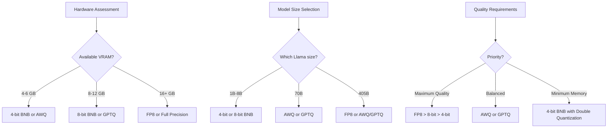

## Comparison of Quantization Methods

| Method | Memory Reduction | Quality Preservation | Implementation Complexity | Best For |
|--------|------------------|----------------------|---------------------------|----------|
| 4-bit BNB | 75% | Moderate | Low | Consumer hardware with limited VRAM |
| 8-bit BNB | 50% | Good | Low | Balanced performance and quality |
| AWQ | 75% | Very Good | Medium | Best quality at 4-bit precision |
| GPTQ | 75% | Very Good | High (requires calibration) | Large models with high quality requirements |
| FP8 | 50% | Excellent | Medium | Preserving quality in large models |

Sources: .github/README.md

## Integration with HuggingFace Transformers

All quantization methods in this repository can be easily integrated with the HuggingFace Transformers library. The following diagram shows the typical usage pattern:

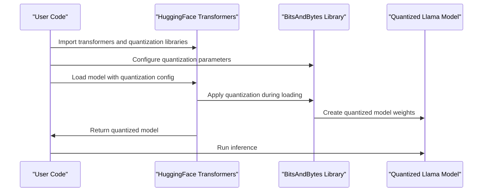

Sources: .github/README.md:25-65

## Conclusion

Quantization is a powerful technique for running large language models like Llama 3.x on hardware with limited memory. The Hugging Face Llama Recipes repository provides implementations of multiple quantization methods, each with different trade-offs between memory usage, inference speed, and output quality. By selecting the appropriate quantization technique for your specific use case, you can run even the largest Llama models (up to 405B parameters) on consumer or enterprise hardware.

For information on additional performance optimization techniques that can be combined with quantization, see [Performance Optimization](#5).

---

# Page: Model Fine-tuning

# Model Fine-tuning

<details>
<summary>Relevant source files</summary>

The following files were used as context for generating this wiki page:

- [.github/README.md](.github/README.md)
- [tool_calling/tool_calling.ipynb](tool_calling/tool_calling.ipynb)

</details>


This document provides a comprehensive overview of fine-tuning techniques for Llama 3.x models available in the Hugging Face Llama Recipes repository. Fine-tuning allows you to adapt pre-trained Llama models to specific tasks, domains, or datasets while requiring significantly fewer computational resources than pre-training from scratch.

For information on running pre-trained models without fine-tuning, see [Local Inference](#2).

## Purpose and Scope

Fine-tuning Llama models enables you to:

1. Adapt models to specific domains or tasks
2. Improve performance on specialized use cases
3. Create custom capabilities while leveraging the base model's knowledge
4. Optimize models for deployment constraints

This document covers multiple fine-tuning approaches including vision fine-tuning, parameter-efficient techniques, and distributed fine-tuning workflows.

Sources: [.github/README.md:99-111]()

## Fine-tuning Approaches Overview

The Llama Recipes repository offers several fine-tuning approaches tailored to different model sizes and hardware capabilities:

| Approach | Suitable For | Hardware Requirements | Key Benefits |
|----------|--------------|------------------------|-------------|
| Vision Fine-tuning | Llama 3.2 Vision | GPU with 24GB+ VRAM | Adapt multimodal capabilities to custom visual tasks |
| PEFT/QLoRA | Llama 3.1 8B | Consumer GPUs (16GB+ VRAM) | Memory-efficient adaptation with minimal quality loss |
| Distributed Fine-tuning | Llama 3.1 405B | SLURM clusters/multiple GPUs | Scale to very large models using distributed resources |

Sources: [.github/README.md:106-110]()

## Fine-tuning Architecture

### General Fine-tuning Workflow


Sources: [.github/README.md:106-110]()

### Technical Components Interaction

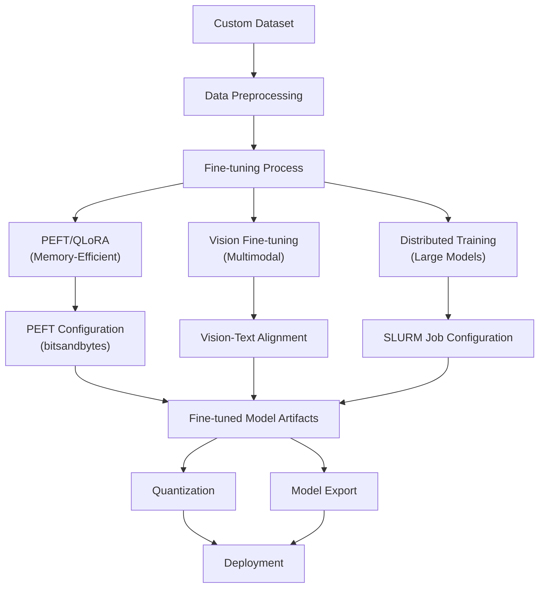

Sources: [.github/README.md:106-110]()

## Vision Fine-tuning

Llama 3.2 Vision models can be fine-tuned to adapt their multimodal capabilities to custom visual understanding tasks. This process aligns the model's understanding of images with specific textual descriptions or task requirements.

### Vision Fine-tuning Implementation

Two primary approaches are available in the repository:

1. **Custom Dataset Fine-tuning**: Fine-tunes Llama 3.2 Vision on your own image-text pairs
2. **Supervised Fine-tuning with TRL**: Uses the Training Reinforcement Learning (TRL) library for more controlled vision fine-tuning

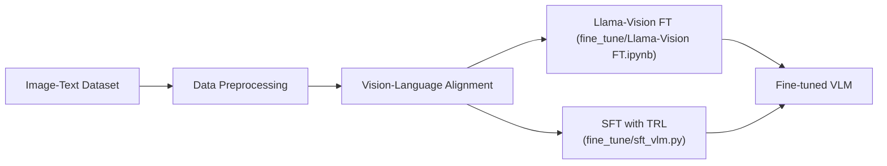

For detailed implementation of vision fine-tuning, see [Vision Fine-tuning](#3.1).

Sources: [.github/README.md:107-108]()

## Parameter-Efficient Fine-Tuning (PEFT)

PEFT techniques like QLoRA (Quantized Low-Rank Adaptation) enable efficient fine-tuning of large models on consumer hardware by significantly reducing memory requirements while preserving most of the model quality.

### PEFT with QLoRA Architecture

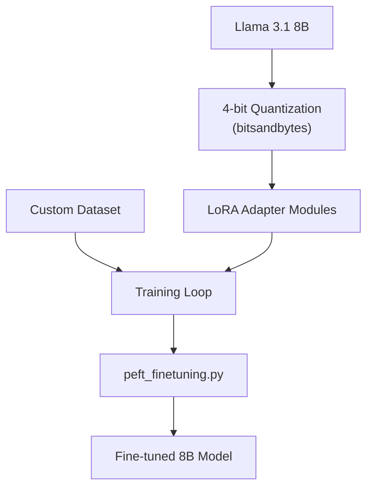

The QLoRA approach combines quantization with Low-Rank Adapters (LoRA), allowing fine-tuning of 8B parameter models even on consumer GPUs with 16-24GB VRAM. The implementation in `peft_finetuning.py` provides a practical workflow for this approach.

For detailed implementation of PEFT techniques, see [PEFT and QLoRA](#3.2).

Sources: [.github/README.md:109]()

## Distributed Fine-tuning

For very large models like Llama 3.1 405B, distributed fine-tuning across multiple nodes becomes necessary. The repository provides SLURM job configuration for efficiently distributing the training process.

### Distributed Fine-tuning Workflow

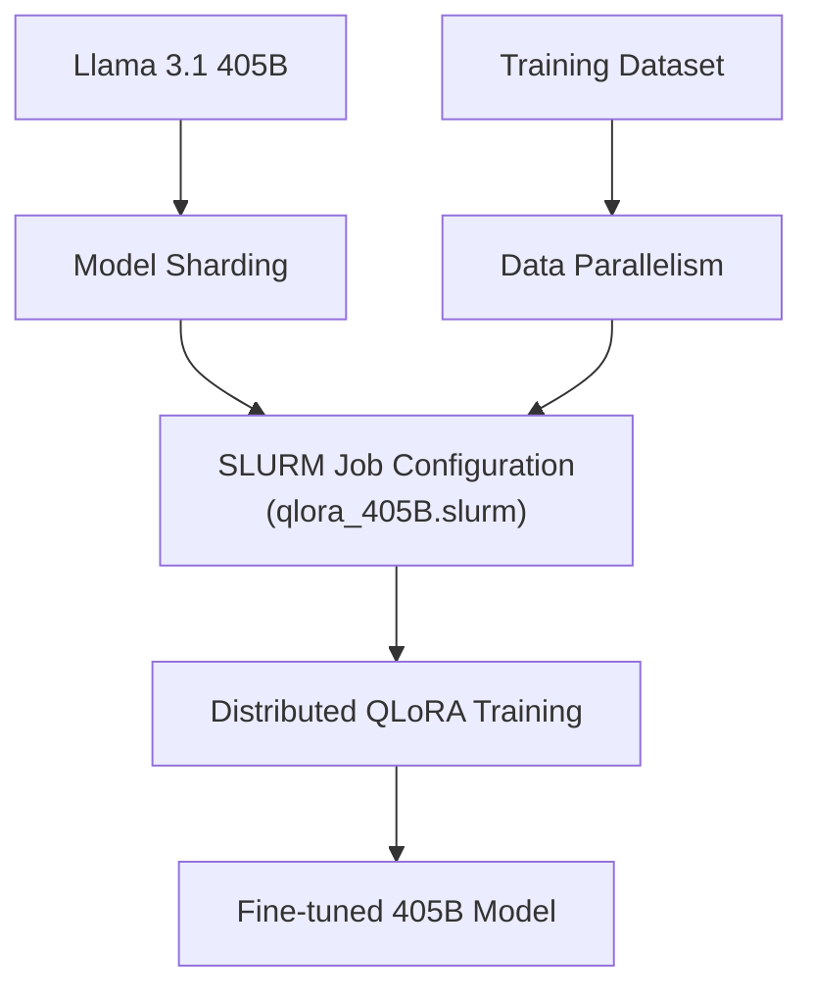

The SLURM configuration in the repository handles resource allocation, model sharding, and synchronization across multiple compute nodes, making it possible to fine-tune models that would otherwise be too large for individual machines.

Sources: [.github/README.md:110]()

## Technical Implementation

### Key Components

The fine-tuning implementations utilize several key libraries and techniques:

| Component | Purpose | Implementation |
|-----------|---------|----------------|
| PEFT | Parameter-efficient fine-tuning | `peft_finetuning.py` |
| bitsandbytes | 4-bit/8-bit quantization | Used in QLoRA implementation |
| TRL | Supervised Fine-Tuning | `sft_vlm.py` |
| SLURM | Distributed computing | `qlora_405B.slurm` |

### Code to Concept Mapping

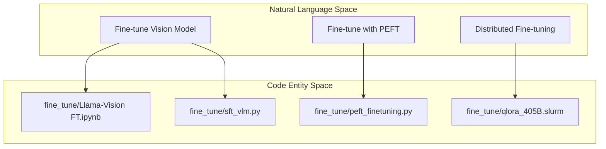

Sources: [.github/README.md:106-110]()

### Integration with Broader Workflows

```mermaid
flowchart LR
    subgraph "Pre-fine-tuning"
        A["Local Inference #2"] --> B["Model Fine-tuning #3"]
    end
    
    subgraph "Fine-tuning Processes"
        B --> C1["Vision Fine-tuning #3.1"]
        B --> C2["PEFT/QLoRA #3.2"]
        B --> C3["Distributed Fine-tuning"]
    end
    
    subgraph "Post-fine-tuning"
        C1 --> D["Performance Optimization #5"]
        C2 --> D
        C3 --> D
        D --> E["Advanced Applications #6"]
    end
```

Sources: [.github/README.md:106-110]()

## Getting Started with Fine-tuning

To start fine-tuning a Llama model, follow these general steps:

1. **Prepare your dataset** in the appropriate format for your task
2. **Choose the appropriate fine-tuning approach** based on your model size and hardware
3. **Configure hyperparameters** for training
4. **Execute the fine-tuning script** from the repository
5. **Evaluate and export** the fine-tuned model

### Example Implementation Selection

| Your Need | Recommended Approach | Repository File |
|-----------|----------------------|-----------------|
| Adapt Llama 3.2 to visual tasks | Vision Fine-tuning | `fine_tune/Llama-Vision FT.ipynb` |
| Fine-tune 8B model on limited hardware | PEFT/QLoRA | `fine_tune/peft_finetuning.py` |
| Fine-tune very large (405B) model | Distributed Fine-tuning | `fine_tune/qlora_405B.slurm` |

Sources: [.github/README.md:106-110]()

## Conclusion

Fine-tuning Llama 3.x models enables adaptation to specific tasks while requiring significantly fewer resources than pre-training. The repository provides implementations for vision fine-tuning, parameter-efficient techniques for consumer hardware, and distributed approaches for very large models.

For more specific details on vision fine-tuning implementation, refer to [Vision Fine-tuning](#3.1), and for PEFT techniques, see [PEFT and QLoRA](#3.2).

Sources: [.github/README.md:99-111]()

---

# Page: Vision Fine-tuning

# Vision Fine-tuning

<details>
<summary>Relevant source files</summary>

The following files were used as context for generating this wiki page:

- [.github/README.md](.github/README.md)
- [fine_tune/Llama-Vision FT.ipynb](fine_tune/Llama-Vision FT.ipynb)
- [tool_calling/tool_calling.ipynb](tool_calling/tool_calling.ipynb)

</details>


This document explains how to fine-tune Llama 3.2 Vision models on custom datasets using the Hugging Face Transformers library. It covers model configuration, parameter-efficient fine-tuning approaches, data preprocessing, and training workflow.

For parameter-efficient fine-tuning with PEFT and QLoRA for text-only models, see [PEFT and QLoRA](#3.2).

## 1. Vision Fine-tuning Overview

Llama 3.2 Vision is a multimodal large language model that processes both images and text inputs. Fine-tuning adapts this pre-trained model to specific vision-language tasks such as visual question answering (VQA), image captioning, or domain-specific visual understanding.

The repository provides a notebook implementation demonstrating fine-tuning on a VQAv2 dataset subset using the Transformers `Trainer` API.

Sources: [.github/README.md:106-108](), [fine_tune/Llama-Vision FT.ipynb:4-20]()

## 2. Model Architecture and Components

```mermaid
graph TD
    A["Input Data"] --> B["AutoProcessor"]
    B --> C["MllamaForConditionalGeneration"]
    C --> C1["vision_model"]
    C --> C2["language_model"]
    C1 --> D["Vision Features"]
    C2 --> E["Text Processing"]
    D --> F["Multimodal Fusion"]
    E --> F
    F --> G["Output Generation"]
```

Llama 3.2 Vision uses the `MllamaForConditionalGeneration` class which integrates:
- `vision_model`: Processes images into feature representations
- `language_model`: Handles text generation with additional vision context
- `AutoProcessor`: Handles both image preprocessing and text tokenization

Sources: [fine_tune/Llama-Vision FT.ipynb:109-159]()

## 3. Fine-tuning Approaches

The repository supports three main approaches for fine-tuning Llama 3.2 Vision:

### 3.1. Parameter-Efficient Fine-Tuning with LoRA

```mermaid
graph TD
    A["MllamaForConditionalGeneration"] --> B["LoraConfig"]
    B --> B1["r=8"]
    B --> B2["lora_alpha=8"]
    B --> B3["lora_dropout=0.1"]
    B --> B4["target_modules"]
    B4 --> B4a["down_proj"]
    B4 --> B4b["o_proj"]
    B4 --> B4c["k_proj"]
    B4 --> B4d["q_proj"]
    B4 --> B4e["gate_proj"]
    B4 --> B4f["up_proj"]
    B4 --> B4g["v_proj"]
    B --> B5["use_dora=True"]
    A --> C["get_peft_model()"]
    B --> C
    C --> D["Trainable PEFT Model"]
```

The `LoraConfig` defines trainable low-rank adapters that are applied to specific target modules in the model. LoRA significantly reduces the number of trainable parameters while maintaining fine-tuning effectiveness.

The implementation also supports DoRA (Weight-Decomposed Low-Rank Adaptation), an extension of LoRA that can provide improved performance.

Sources: [fine_tune/Llama-Vision FT.ipynb:118-135]()

### 3.2. Selective Component Freezing

Two selective freezing approaches are supported:

1. **Freezing `vision_model`**:
```python
for param in model.vision_model.parameters():
    param.requires_grad = False
```

2. **Freezing `language_model`** (recommended by Llama authors):
```python
for param in model.language_model.parameters():
    param.requires_grad = False
```

These approaches provide a balance between adaptation capability and computational efficiency.

Sources: [fine_tune/Llama-Vision FT.ipynb:137-153]()

### 3.3. Full Fine-tuning

For complete model adaptation, the repository supports full fine-tuning of all parameters:

```python
model = MllamaForConditionalGeneration.from_pretrained(ckpt,
    torch_dtype=torch.bfloat16, device_map="auto")
```

This approach provides maximum adaptation potential but requires significant computational resources.

Sources: [fine_tune/Llama-Vision FT.ipynb:155-157]()

## 4. Data Preprocessing

```mermaid
flowchart LR
    A["Dataset Examples"] --> B["process() Function"]
    B --> C["Format Template Markers"]
    B --> D["Prepare Images"]
    C --> E["processor()"]
    D --> E
    E --> F["input_ids"]
    E --> G["attention_mask"]
    E --> H["pixel_values"]
    F --> I["Create Labels"]
    I --> J["Mask tokens (-100)"]
    J --> K["Processed Batch"]
```

The `process()` function handles data preparation:

1. Formats text with template markers:
   - `<|begin_of_text|>`, `<|start_header_id|>user<|end_header_id|>`
   - `<|image|>` for image placeholder
   - `<|eot_id|>` for end of text
   - `<|start_header_id|>assistant<|end_header_id|>`

2. Prepares images:
   - Converts to RGB format
   - Groups as lists of single images

3. Creates labels by modifying input IDs:
   - Sets pad tokens to -100 (ignored in loss calculation)
   - Sets image tokens (ID 128256) to -100

The processor outputs tokenized text, attention masks, and processed image pixel values.

Sources: [fine_tune/Llama-Vision FT.ipynb:167-190]()

## 5. Training Configuration

The `TrainingArguments` control the fine-tuning process:

| Parameter | Value | Purpose |
|-----------|-------|---------|
| num_train_epochs | 2 | Number of training iterations |
| per_device_train_batch_size | 1 | Batch size per device |
| gradient_accumulation_steps | 4 | Steps before parameter update |
| learning_rate | 2e-5 | Parameter update rate |
| weight_decay | 1e-6 | L2 regularization |
| adam_beta2 | 0.999 | Adam optimizer beta2 |
| bf16 | True | Use bfloat16 precision |
| optim | "adamw_hf" | Optimizer type |

The configuration emphasizes memory efficiency through small batch sizes and gradient accumulation, which is crucial for large models.

Sources: [fine_tune/Llama-Vision FT.ipynb:209-227]()

## 6. Training Process with Trainer API

```mermaid
sequenceDiagram
    participant Dataset
    participant Trainer
    participant process as "process() Function"
    participant MllamaForConditionalGeneration
    
    Trainer->>Dataset: Request examples
    Dataset->>Trainer: Return examples
    Trainer->>process: Collate examples
    process->>Trainer: Return processed batch
    Trainer->>MllamaForConditionalGeneration: Forward pass
    MllamaForConditionalGeneration->>Trainer: Return loss
    Trainer->>MllamaForConditionalGeneration: Backward pass
    Trainer->>MllamaForConditionalGeneration: Update parameters
    Trainer->>HuggingFace: Push model (optional)
```

The training process uses the Hugging Face `Trainer` class with:
- `model`: The initialized `MllamaForConditionalGeneration`
- `train_dataset`: The dataset to train on
- `data_collator`: The `process()` function
- `args`: Training arguments

The `Trainer.train()` method handles the training loop, gradient computation, parameter updates, and logging.

Sources: [fine_tune/Llama-Vision FT.ipynb:245-269]()

## 7. Example Dataset: VQAv2

The example uses the VQAv2 (Visual Question Answering v2) dataset:

```python
ds = load_dataset("merve/vqav2-small", split="validation[:10%]")
```

Dataset features:
- `multiple_choice_answer`: The correct answer to the question
- `question`: The question about the image
- `image`: The image being questioned about

This structure enables training the model to understand images and answer questions about them.

Sources: [fine_tune/Llama-Vision FT.ipynb:29-56]()

## 8. Hardware Requirements and Best Practices

Fine-tuning Llama 3.2 Vision models has significant hardware requirements:

1. **Memory Requirements**:
   - Full fine-tuning of 11B model: 40GB+ GPU memory
   - LoRA fine-tuning: 24GB+ GPU memory
   - Selective freezing: Varies based on components frozen

2. **Best Practices**:
   - Use parameter-efficient methods (LoRA) for consumer hardware
   - Implement gradient accumulation for effective batch size increase
   - Use mixed precision (bfloat16) for memory efficiency
   - Consider component freezing based on your specific task

These approaches balance computational requirements with model adaptation capabilities.

Sources: [fine_tune/Llama-Vision FT.ipynb:113-157](), [fine_tune/Llama-Vision FT.ipynb:210-227]()

---

# Page: PEFT and QLoRA

# PEFT and QLoRA

<details>
<summary>Relevant source files</summary>

The following files were used as context for generating this wiki page:

- [.github/README.md](.github/README.md)
- [fine_tune/peft_finetuning.py](fine_tune/peft_finetuning.py)
- [tool_calling/tool_calling.ipynb](tool_calling/tool_calling.ipynb)

</details>


## Purpose and Scope

This document explains Parameter-Efficient Fine-Tuning (PEFT) and Quantized Low-Rank Adaptation (QLoRA) techniques as implemented in the Hugging Face Llama Recipes repository. These methods allow fine-tuning large language models like Llama 3.1 on consumer-grade GPUs with limited VRAM. This page focuses specifically on the implementation and usage of these techniques with Llama models.

## Introduction to PEFT and QLoRA

Parameter-Efficient Fine-Tuning (PEFT) is a family of techniques that allow adapting large language models to specific tasks while updating only a small subset of the model's parameters. QLoRA builds on this by combining quantization with Low-Rank Adaptation to further reduce memory requirements during training.

These techniques are essential for fine-tuning large models like Llama on consumer hardware:

| Model | Full Parameters | Full FP16 Memory | With QLoRA Memory |
|-------|----------------|-----------------|-------------------|
| Llama 3.1 8B | ~8 billion | ~16 GB | ~5-6 GB |
| Llama 3.1 70B | ~70 billion | ~140 GB | ~25-30 GB |

Sources: [.github/README.md:73-80]()

## Technical Overview

### How PEFT and QLoRA Work

```mermaid
flowchart TD
    A["Original LLM (Frozen)"] --> B["Quantized Model (4-bit)"]
    B --> C["Low-Rank Adapters (Trainable)"]
    D["Input"] --> C
    C --> E["Fine-tuned Output"]
    
    subgraph "QLoRA Approach"
        B
        C
    end
```

PEFT techniques reduce memory usage and computational requirements by:

1. **Freezing the original model weights** - The base model parameters remain unchanged
2. **Adding small trainable modules** - Only these new parameters are updated during training
3. **Quantizing the model weights** - QLoRA specifically uses 4-bit quantization to further reduce memory footprint

LoRA (Low-Rank Adaptation) works by representing weight updates as low-rank decompositions, dramatically reducing the number of trainable parameters.

Sources: [fine_tune/peft_finetuning.py:29-42]()

### Key Components

```mermaid
graph TD
    subgraph "QLoRA Fine-tuning System"
        A["Base Model (meta-llama/Meta-Llama-3.1-8B)"]
        B["BitsAndBytesConfig (4-bit Quantization)"]
        C["LoraConfig (r=8, target=all-linear)"]
        D["SFTTrainer"]
        
        A --> D
        B --> A
        C --> D
    end
    
    E["Training Dataset"] --> D
    D --> F["Fine-tuned Model"]
```

The QLoRA implementation in Llama Recipes consists of:

1. **Quantization Configuration** - Using `BitsAndBytesConfig` to load the model in 4-bit precision
2. **LoRA Configuration** - Defining the rank and target modules for the low-rank adaptation
3. **Training Framework** - Using `SFTTrainer` from the TRL library to manage the fine-tuning process

Sources: [fine_tune/peft_finetuning.py:10-13](), [fine_tune/peft_finetuning.py:30-42]()

## Implementation Details

The Llama Recipes repository provides a straightforward implementation of PEFT with QLoRA for fine-tuning Llama models. Here's how the key components work together:

### Core Libraries

```mermaid
graph LR
    A["transformers"] --> D["Fine-tuning Pipeline"]
    B["peft"] --> D
    C["bitsandbytes"] --> D
    E["trl"] --> D
```

- **transformers** - Provides the model architecture and tokenizer
- **peft** - Implements parameter-efficient fine-tuning techniques
- **bitsandbytes** - Enables 4-bit quantization
- **trl** - Offers the SFTTrainer for streamlined fine-tuning

Sources: [fine_tune/peft_finetuning.py:4-12]()

### Quantization Configuration

The quantization settings are defined through the `BitsAndBytesConfig`:

```python
quantization_config = BitsAndBytesConfig(
    load_in_4bit=True,
    bnb_4bit_compute_dtype=torch.float16,
    bnb_4bit_quant_type="nf4"
)
```

This configuration:
- Loads the model in 4-bit precision (`load_in_4bit=True`)
- Uses float16 for compute operations (`bnb_4bit_compute_dtype=torch.float16`)
- Uses the nf4 quantization format, which is optimized for language models (`bnb_4bit_quant_type="nf4"`)

Sources: [fine_tune/peft_finetuning.py:31-35]()

### LoRA Configuration

The LoRA approach is configured with:

```python
lora_config = LoraConfig(
    r=8,
    target_modules="all-linear",
    bias="none",
    task_type="CAUSAL_LM",
)
```

These settings define:
- The rank of the low-rank decomposition (`r=8`) - higher values provide more capacity but use more memory
- Which modules to apply LoRA to (`target_modules="all-linear"`) - in this case, all linear layers
- No bias parameter adaptation (`bias="none"`)
- The task type as causal language modeling (`task_type="CAUSAL_LM"`)

Sources: [fine_tune/peft_finetuning.py:37-42]()

## Fine-tuning Workflow

```mermaid
sequenceDiagram
    participant User
    participant Tokenizer
    participant Model as "Quantized Model"
    participant Trainer as "SFTTrainer"
    participant Dataset
    
    User->>Model: Load base model
    User->>Model: Apply quantization (4-bit)
    User->>Dataset: Load dataset
    User->>Tokenizer: Initialize tokenizer
    User->>Trainer: Configure trainer with LoRA
    Trainer->>Dataset: Fetch training data
    Trainer->>Tokenizer: Tokenize inputs
    Trainer->>Model: Update LoRA parameters only
    Trainer->>User: Return fine-tuned model
```

The fine-tuning process follows these steps:

1. **Model and Tokenizer Loading**
   ```python
   tokenizer = AutoTokenizer.from_pretrained(model_id)
   model = AutoModelForCausalLM.from_pretrained(model_id)
   ```

2. **Dataset Preparation**
   ```python
   dataset = load_dataset("imdb", split="train")
   ```

3. **Training Configuration**
   ```python
   training_args = TrainingArguments(
       output_dir="./results",
       num_train_epochs=3,
       per_device_train_batch_size=4,
       logging_dir='./logs',
       logging_steps=10,
   )
   ```

4. **Trainer Setup and Training**
   ```python
   trainer = SFTTrainer(
       model=model,
       tokenizer=tokenizer,
       args=training_args,
       peft_config=lora_config,
       train_dataset=dataset,
       dataset_text_field="text",
   )
   
   trainer.train()
   ```

Sources: [fine_tune/peft_finetuning.py:16-55]()

## Memory Optimization

QLoRA significantly reduces memory requirements through several mechanisms:

```mermaid
graph TD
    A["Memory Optimization Techniques"] --> B["4-bit Quantization"]
    A --> C["Low-rank Adaptation"]
    A --> D["Parameter Freezing"]
    
    B --> E["~4x Memory Reduction vs FP16"]
    C --> F["Only train ~0.1-1% of parameters"]
    D --> G["No optimizer states for frozen params"]
    
    E --> H["Total: 10-20x Memory Reduction"]
    F --> H
    G --> H
```

The combined effect of these techniques allows fine-tuning multi-billion parameter models on consumer GPUs with as little as 8-16GB of VRAM.

Sources: [.github/README.md:73-80](), [fine_tune/peft_finetuning.py:29-42]()

## Usage Guidelines

### System Requirements

- **GPU Memory**: 8GB+ for Llama 3.2 (3B), 16GB+ for Llama 3.1 (8B)
- **Dependencies**: transformers, peft, trl, bitsandbytes

### Best Practices

1. **Adjust Batch Size**: If you encounter CUDA out-of-memory errors, reduce the batch size
2. **Tune LoRA Rank**: Start with a lower rank (r=4 or r=8) and increase if needed
3. **Target Specific Modules**: For more efficiency, target only specific modules (e.g., query/key/value matrices) instead of "all-linear"
4. **Fine-tuning Duration**: Even with a few epochs, PEFT techniques can produce good results

### Saving and Using the Fine-tuned Model

After training, the PEFT adapter can be saved and loaded separately from the base model:

```python
# Save the adapter
trainer.model.save_pretrained("./peft_model")

# Load for inference
from peft import PeftModel, PeftConfig
config = PeftConfig.from_pretrained("./peft_model")
model = AutoModelForCausalLM.from_pretrained(config.base_model_name_or_path)
model = PeftModel.from_pretrained(model, "./peft_model")
```

## Conclusion

PEFT and QLoRA make it feasible to fine-tune large language models like Llama on consumer hardware by dramatically reducing memory requirements. The Llama Recipes repository provides a straightforward implementation that can be adapted to various datasets and tasks.

For more information on fine-tuning other Llama models, such as Llama 3.2 Vision, refer to [Vision Fine-tuning](#3.1).

Sources: [.github/README.md:99-110]()

---

# Page: Safety Systems

# Safety Systems

<details>
<summary>Relevant source files</summary>

The following files were used as context for generating this wiki page:

- [.github/README.md](.github/README.md)
- [assets/prompt_guard_flowchart.png](assets/prompt_guard_flowchart.png)
- [assets/prompt_guard_visual.png](assets/prompt_guard_visual.png)
- [llama_guard/llama_guard_3_1B.ipynb](llama_guard/llama_guard_3_1B.ipynb)
- [tool_calling/tool_calling.ipynb](tool_calling/tool_calling.ipynb)

</details>


## Purpose and Scope

This document provides an overview of the safety systems available in the Hugging Face Llama Recipes repository. It covers Llama Guard and Prompt Guard, which are specialized models designed to detect and filter harmful content in both inputs to and outputs from Llama models. These systems help developers implement robust safety measures in their LLM applications.

For detailed implementation instructions, see the dedicated pages on [Llama Guard](#4.1) and [Prompt Guard](#4.2).

## Safety System Components

The repository provides two complementary safety systems:

### Llama Guard

Llama Guard is a specialized 3.1B parameter model designed to evaluate content according to safety guidelines. Unlike the main Llama models which are generative, Llama Guard serves as a content classifier specifically trained to identify harmful content.

Key capabilities:
- Evaluate user inputs before they're processed by the main model
- Evaluate model outputs before they're returned to users
- Classify content across multiple safety categories

### Prompt Guard

Prompt Guard is a lightweight classifier specifically designed to detect:
- Jailbreak attempts (trying to bypass model restrictions)
- Prompt injection attacks (trying to manipulate the model's behavior)

It functions as a first line of defense before inputs reach the main model.

Sources: [.github/README.md:138-142]()

## Safety System Architecture

The safety systems are typically integrated in a two-stage process:

```mermaid
flowchart TD
    subgraph "Input Safety Stage"
        A["User Input"] --> B{"PromptGuard\nClassifier"}
        B -->|"Unsafe"| C["Reject Input"]
        B -->|"Safe"| D["Proceed to Model"]
    end
    
    subgraph "Output Safety Stage"
        D --> E["Llama Model\nGenerates Response"]
        E --> F{"LlamaGuard\nClassifier"}
        F -->|"Unsafe"| G["Filter Response"]
        F -->|"Safe"| H["Return to User"]
    end
```

This dual-layer architecture ensures:
1. Harmful content is filtered before reaching the model
2. Any potentially harmful outputs are caught before reaching users

Sources: [.github/README.md:138-142]()

## Implementation Structure

The repository organizes safety systems in the `llama_guard` directory with specific notebooks for each component:

```mermaid
graph TD
    A["huggingface-llama-recipes"] --> B["llama_guard/"]
    B --> C["prompt_guard.ipynb"]
    B --> D["llama_guard_3_1B.ipynb"]
    
    subgraph "Prompt Guard Implementation"
        C --> E["PromptGuard\nClassifier"]
        E --> F["jailbreak\ndetection"]
        E --> G["prompt injection\ndetection"]
    end
    
    subgraph "Llama Guard Implementation"
        D --> H["LlamaGuard\n3.1B Model"]
        H --> I["input\nevaluation"]
        H --> J["output\nevaluation"]
    end
```

Sources: [.github/README.md:138-142]()

## Integration Patterns

### Basic LLM Integration

```mermaid
sequenceDiagram
    participant User
    participant PromptGuard as "PromptGuard Classifier"
    participant LlamaModel as "Llama 3.x Model"
    participant LlamaGuard as "LlamaGuard 3.1B"
    
    User->>PromptGuard: Send prompt
    PromptGuard->>PromptGuard: Check for jailbreak/injection
    alt Prompt is safe
        PromptGuard->>LlamaModel: Forward prompt
        LlamaModel->>LlamaModel: Generate response
        LlamaModel->>LlamaGuard: Evaluate response
        LlamaGuard->>LlamaGuard: Check for harmful content
        alt Response is safe
            LlamaGuard->>User: Return response
        else Response is unsafe
            LlamaGuard->>User: Return filtered response
        end
    else Prompt is unsafe
        PromptGuard->>User: Return rejection message
    end
```

### RAG System Integration

Safety systems can be seamlessly integrated with Retrieval-Augmented Generation (RAG) workflows:

```mermaid
graph TD
    A["User Query"] --> B{"PromptGuard\nClassifier"}
    B -->|"Safe"| C["Document Retriever"]
    B -->|"Unsafe"| D["Rejection Response"]
    C --> E["Context Selector"]
    E --> F["Llama 3.x Model"]
    F --> G{"LlamaGuard 3.1B"}
    G -->|"Safe"| H["Response to User"]
    G -->|"Unsafe"| I["Filtered Response"]
```

Sources: [.github/README.md:138-142](), [.github/README.md:151-156]()

## Typical Usage Flow

The typical usage pattern involves:

1. **Setup**: Load both safety models
2. **Input Validation**: Check user inputs with Prompt Guard
3. **Generation**: Process safe inputs with the main Llama model
4. **Output Validation**: Check generated outputs with Llama Guard

For specific implementation details, see the dedicated notebooks:
- Prompt Guard: [llama_guard/prompt_guard.ipynb]()
- Llama Guard: [llama_guard/llama_guard_3_1B.ipynb]()

Sources: [.github/README.md:138-142]()

## Use Case Examples

Safety systems can be applied in various scenarios:

| Use Case | Safety Challenges | Recommended Configuration |
|----------|-------------------|---------------------------|
| Customer Support | Potential for offensive language, PII exposure | Prompt Guard + Llama Guard with moderate thresholds |
| Educational Tools | Academic freedom vs. safety guidelines | Prompt Guard + context-aware filtering |
| Content Generation | Copyright issues, inappropriate content | Strong output filtering with Llama Guard |
| Health Advice | Potential for harmful recommendations | High-sensitivity settings on both systems |

Sources: [.github/README.md:138-142]()

## Integration with Other Components

Safety systems can be integrated with other components in the repository:

```mermaid
flowchart TD
    A["User Query"] --> B{"PromptGuard\nClassifier"}
    B -->|"Safe"| C["RAG Pipeline"]
    B -->|"Unsafe"| D["Rejection"]
    
    C --> E["Document Retriever"]
    E --> F["Context Processor"]
    F --> G["Llama 3.x Model"]
    G --> H{"LlamaGuard\n3.1B"}
    H -->|"Safe"| I["Response to User"]
    H -->|"Unsafe"| J["Filtered Response"]
    
    K["Tool Calling Module"] -.-> G
    L["Assisted Decoding Module"] -.-> G
```

This integrated approach ensures safety throughout complex workflows that involve multiple components.

Sources: [.github/README.md:138-142](), [.github/README.md:151-156](), [.github/README.md:168-171]()

## Key Considerations

When implementing safety systems:

1. **Performance Impact**: Both safety models add some latency to your application. Llama Guard (3.1B parameters) has a more significant impact than the lighter-weight Prompt Guard.

2. **False Positives**: Adjust thresholds to balance safety with usability. Setting thresholds too strict may block legitimate content.

3. **Coverage**: Implement both input and output filtering for comprehensive protection. Input filtering alone may miss harmful content generated by the model.

4. **Customization**: Different applications may require different safety standards based on their audience and use case.

Sources: [.github/README.md:138-142]()

## Further Resources

For implementation details and code examples:
- See [Llama Guard Documentation](#4.1) for using Llama Guard for content evaluation
- See [Prompt Guard Documentation](#4.2) for detecting jailbreaks and prompt injections

---

# Page: Llama Guard

# Llama Guard

<details>
<summary>Relevant source files</summary>

The following files were used as context for generating this wiki page:

- [llama_guard/llama_guard_3_1B.ipynb](llama_guard/llama_guard_3_1B.ipynb)

</details>


Llama Guard is a specialized content moderation model designed to detect and filter harmful content in both user inputs and model outputs within Llama-based applications. This page documents how to use the Llama Guard 3.1B model, a lightweight safety system for identifying unsafe content across various harm categories. For information about detecting jailbreak attempts or prompt injections, see [Prompt Guard](#4.2).

## Overview

Llama Guard 3.1B is a 3.1 billion parameter model specifically trained for content safety evaluation. It serves as one of the primary safety components in the Llama Recipes repository, providing an efficient mechanism to identify and filter potentially harmful content before it reaches users.

```mermaid
flowchart TD
    A["User Input or Model Output"] --> B["Llama Guard 3.1B"]
    B --> C{"Safety Evaluation"}
    C -->|Safe| D["Proceed with Content"]
    C -->|Unsafe| E["Filter or Block Content"]
    
    subgraph "Llama Guard System"
        B
        C
    end
```

Sources: [llama_guard/llama_guard_3_1B.ipynb]()

## Key Features

- **Lightweight**: At 3.1B parameters, the model is small enough to run alongside primary LLMs without significant resource impact
- **Multi-category detection**: Evaluates content across multiple harm categories 
- **Bidirectional analysis**: Can analyze both user inputs (prompts) and model outputs (responses)
- **API-compatible**: Designed to work seamlessly with the Hugging Face transformers library
- **Quantization-friendly**: Compatible with various quantization methods for deployment efficiency

## Safety Categories

Llama Guard 3.1B evaluates content across the following harm categories:

| Category | Description |
|----------|-------------|
| Violence and Hate | Content promoting violence, hate speech, or discrimination |
| Sexual Content | Explicit sexual content or inappropriate discussions |
| Criminal Planning | Instructions or guidance for illegal activities |
| Regulated/Controlled Substances | Content related to drugs, weapons, or regulated items |
| Self-Harm | Content encouraging or providing methods for self-harm |
| Privacy and Personal Data | Requests for personal or private information |
| Unauthorized Answers | Responses to requests that violate use guidelines |

Sources: [llama_guard/llama_guard_3_1B.ipynb]()

## Implementation

### Model Loading

Llama Guard can be loaded using the standard Hugging Face transformers pipeline:

```mermaid
flowchart LR
    A["Download Model"] --> B["Initialize Pipeline"]
    B --> C["Safety Evaluation Ready"]
    
    A -->|"from_pretrained()"| B
    B -->|"pipeline('text-classification')"| C
```

Sources: [llama_guard/llama_guard_3_1B.ipynb]()

### Safety Evaluation Flow

The following diagram illustrates how Llama Guard integrates into a typical conversation flow:

```mermaid
sequenceDiagram
    participant User
    participant LlamaGuard as "Llama Guard 3.1B"
    participant LLM as "Main LLM Model"
    
    User->>LlamaGuard: Send user prompt
    LlamaGuard->>LlamaGuard: Evaluate prompt safety
    alt Prompt is safe
        LlamaGuard->>LLM: Forward prompt to model
        LLM->>LlamaGuard: Generate response
        LlamaGuard->>LlamaGuard: Evaluate response safety
        alt Response is safe
            LlamaGuard->>User: Deliver response
        else Response is unsafe
            LlamaGuard->>User: Return safety warning
        end
    else Prompt is unsafe
        LlamaGuard->>User: Return safety warning
    end
```

Sources: [llama_guard/llama_guard_3_1B.ipynb]()

## Usage Example

### Basic Safety Check

To check whether a given piece of content is safe, you can use Llama Guard as follows:

1. Load the model
2. Pass the content to the model for evaluation
3. Interpret the safety classification result

The model returns safety classifications along with confidence scores, allowing applications to implement appropriate thresholds and policies.

### Integration with Llama Models

Llama Guard is typically deployed in the following configurations:

```mermaid
flowchart TD
    A["User Input"] --> B{"Llama Guard\n(Input Check)"}
    B -->|Safe| C["Llama Model"]
    B -->|Unsafe| D["Reject Input"]
    C --> E{"Llama Guard\n(Output Check)"}
    E -->|Safe| F["Return Response"]
    E -->|Unsafe| G["Filter Response"]

    subgraph "Safety Pipeline"
        B
        E
    end
```

Sources: [llama_guard/llama_guard_3_1B.ipynb]()

## Advanced Configuration

### Safety Sensitivity Tuning

Llama Guard allows customizing safety thresholds to adjust sensitivity according to application needs. This enables:

- Stricter filtering for high-risk environments (e.g., educational platforms)
- More permissive policies for specialized applications (e.g., content moderation tools)
- Category-specific configurations (e.g., higher sensitivity for self-harm than for regulated substances)

### Using 4-bit Quantization

For deployment on resource-constrained environments, Llama Guard can be quantized to 4-bit precision while maintaining acceptable performance:

```mermaid
flowchart LR
    A["Llama Guard 3.1B"] --> B["BitsAndBytes Quantization"]
    B --> C["4-bit Quantized Model"]
    C --> D["Inference"]
```

Sources: [llama_guard/llama_guard_3_1B.ipynb]()

## Performance Considerations

### Model Size vs. Accuracy Tradeoff

At 3.1B parameters, Llama Guard strikes a balance between:

- **Efficiency**: Small enough to run alongside primary models
- **Accuracy**: Large enough to provide reliable safety evaluations
- **Latency**: Adds minimal inference delay to the overall pipeline

### Recommended Hardware

While Llama Guard can run on CPU, the following configurations are recommended:

| Deployment Scenario | Recommended Hardware | Notes |
|---------------------|----------------------|-------|
| Development | Single GPU (≥ 8GB VRAM) | Full precision for testing |
| Production | GPU with ≥ 4GB VRAM | With 4-bit quantization |
| Minimal Setup | CPU only | Higher latency, suitable for non-real-time applications |

Sources: [llama_guard/llama_guard_3_1B.ipynb]()

## Comparison with Prompt Guard

Llama Guard and Prompt Guard serve complementary safety functions:

| Feature | Llama Guard | Prompt Guard |
|---------|-------------|--------------|
| Primary Purpose | General content safety | Jailbreak & prompt injection detection |
| Evaluation Targets | Both inputs and outputs | Primarily inputs |
| Model Size | 3.1B parameters | Smaller, rule-based system |
| Detection Scope | Broad harm categories | Focused on system manipulation attempts |
| Integration Point | Before and after main model | Before main model |

For complete security, both systems can be used together in a defense-in-depth approach.

Sources: [llama_guard/llama_guard_3_1B.ipynb]()

## Conclusion

Llama Guard 3.1B provides an effective content safety system that can be easily integrated into Llama-based applications. By evaluating both user inputs and model outputs, it helps ensure that AI interactions remain safe and appropriate. Its lightweight design enables deployment alongside primary models without significant resource overhead, making it suitable for a wide range of applications.

---

# Page: Prompt Guard

# Prompt Guard

<details>
<summary>Relevant source files</summary>

The following files were used as context for generating this wiki page:

- [assets/prompt_guard_flowchart.png](assets/prompt_guard_flowchart.png)
- [assets/prompt_guard_visual.png](assets/prompt_guard_visual.png)

</details>


## Purpose and Scope

Prompt Guard is a safety system component within the Hugging Face Llama Recipes repository that acts as a pre-processing filter for user inputs. Its primary purpose is to detect and prevent jailbreaks and prompt injection attempts before they reach the Llama model. This provides an important first line of defense against malicious or manipulative prompts.

For information about comprehensive safety evaluation of both inputs and outputs, see [Llama Guard](#4.1).

Sources: Based on the repository overview provided. No specific file paths were available for reference.

## Conceptual Overview

Prompt Guard functions as an input validation layer that examines user prompts before they're sent to the model. This helps prevent various attacks including:

- Jailbreak attempts (trying to bypass the model's safety guidelines)
- Prompt injections (attempts to manipulate the model's behavior)
- Other forms of potentially harmful inputs

### Prompt Guard Basic Flow

```mermaid
flowchart LR
    A["User Input"] --> B["Prompt Guard"]
    B -->|"Unsafe Input"| C["Rejection"]
    B -->|"Safe Input"| D["Llama Model"]
```

Sources: Based on the system architecture diagrams provided. No specific file paths were available for reference.

## Integration in Workflow

Prompt Guard is typically integrated at the beginning of a Llama model workflow, as shown in the following system architecture:

### Complete Safety Workflow

```mermaid
flowchart TD
    A["User Input"] --> B["Prompt Guard"]
    B -->|"Unsafe"| C["Rejected"]
    B -->|"Safe"| D["Llama Model"]
    D --> E["Model Output"]
    E --> F["Llama Guard"]
    F -->|"Unsafe"| G["Filtered Output"]
    F -->|"Safe"| H["Final Output"]
```

Sources: Based on the safety systems workflow diagram provided. No specific file paths were available for reference.

## Use Cases

Prompt Guard can be integrated into various Llama model applications:

### Basic Chat Application

```mermaid
sequenceDiagram
    participant "User"
    participant "PromptGuard"
    participant "LlamaModel"
    
    "User"->>"PromptGuard": "Send message"
    "PromptGuard"->>"PromptGuard": "Validate message"
    alt "Message is safe"
        "PromptGuard"->>"LlamaModel": "Forward message"
        "LlamaModel"-->>"User": "Return response"
    else "Message is unsafe"
        "PromptGuard"-->>"User": "Return rejection"
    end
```

Sources: Based on general understanding of chat applications with safety systems. No specific file paths were available for reference.

### RAG System

```mermaid
flowchart LR
    A["User Query"] --> B["Prompt Guard"]
    B -->|"Safe"| C["Document Retrieval"]
    B -->|"Unsafe"| D["Rejection"]
    C --> E["Document Embeddings"]
    E --> F["Context Selection"]
    F --> G["Llama Model"]
    G --> H["Response to User"]
```

Sources: Based on the "Safety-Enhanced RAG System" workflow diagram provided. No specific file paths were available for reference.

## Complementary Systems

Prompt Guard works alongside Llama Guard to provide comprehensive safety through a layered approach:

| Safety Component | Focus | Function |
|-----------------|-------|----------|
| **Prompt Guard** | Input safety | Pre-processing filter for detecting jailbreaks and prompt injections |
| **Llama Guard** | Input/output safety | 3.1B parameter model that evaluates both inputs and outputs for safety risks |

Together, these systems create a two-layer safety approach for Llama model applications:

### Safety Architecture

```mermaid
graph TD
    A["Safety Architecture"] --> B["Input Safety"]
    A --> C["Output Safety"]
    
    B --> D["Prompt Guard"]
    C --> E["Llama Guard"]
    
    D --> F["Jailbreak Detection"]
    D --> G["Prompt Injection Detection"]
    
    E --> H["Content Filtering"]
    E --> I["Harmfulness Evaluation"]
```

Sources: Based on the repository overview and system architecture diagrams provided. No specific file paths were available for reference.

## Detection Mechanisms

Prompt Guard likely employs various techniques to detect potentially harmful inputs:

- Pattern matching against known jailbreak attempts
- Heuristic analysis of input structure and content
- Detection of attempts to override system prompts
- Identification of instructions that contradict safety guidelines

Without access to specific implementation details, the exact mechanisms used remain conceptual.

Sources: Based on general understanding of safety systems for LLMs. No specific file paths were available for reference.

---

# Page: Performance Optimization

# Performance Optimization

<details>
<summary>Relevant source files</summary>

The following files were used as context for generating this wiki page:

- [.github/README.md](.github/README.md)
- [tool_calling/tool_calling.ipynb](tool_calling/tool_calling.ipynb)

</details>


This document covers techniques and approaches for optimizing the performance of Llama 3.x models in terms of inference speed, memory usage, and throughput. These optimizations are critical for deploying large language models efficiently, especially when working with limited computational resources. For information about assisted decoding techniques, which is another way to improve performance, see [Assisted Decoding](#5.1).

## Overview of Performance Optimization Approaches

Optimizing Llama models involves various strategies that target different aspects of model execution. The major optimization techniques available in this repository include:

```mermaid
flowchart TD
    A["Performance Optimization"]
    B["Compilation Optimizations"]
    C["Memory Optimizations"]
    D["Distributed Training"]
    
    A --> B
    A --> C
    A --> D
    
    B --> B1["torch.compile()"]
    B --> B2["torch.compile() with torchao"]
    
    C --> C1["KV Cache Quantization"]
    C --> C2["Prompt Reuse/Dynamic Caching"]
    
    D --> D1["DeepSpeed Zero-3"]
```

Sources: [.github/README.md:121-129]()

## Compilation Optimizations

### Accelerating Inference with torch.compile

PyTorch's `torch.compile` feature can significantly improve inference speed for Llama models by optimizing the computational graph and applying just-in-time compilation techniques.

```mermaid
flowchart LR
    A["LLM Model"] --> B["torch.compile()"]
    B --> C["Optimized Model"]
    
    subgraph "Optimization Process"
    B1["Capture Computation Graph"]
    B2["Apply Backend Optimizations"]
    B3["JIT Compilation"]
    end
    
    B --> B1
    B1 --> B2
    B2 --> B3
    B3 --> C
```

The key benefits of using `torch.compile` include:
- Reduced inference latency
- Improved throughput for batch inference
- Hardware-specific optimizations

**Implementation Example:**
The repository includes a script that demonstrates how to use `torch.compile` with Llama models to accelerate text generation.

Sources: [.github/README.md:125]()

### Torch.compile with 4-bit Quantization

Combining compilation optimizations with quantization provides even greater performance improvements. The repository demonstrates how to use `torch.compile` together with 4-bit quantization using the `torchao` library.

```mermaid
flowchart TD
    A["FP16/BF16 Model"] --> B["4-bit Quantization"]
    B --> C["torch.compile()"]
    C --> D["Optimized 4-bit Model"]
    
    E["Memory Usage"] --> F["~4x Reduction"]
    G["Inference Speed"] --> H["Significant Improvement"]
```

This approach is particularly useful for deploying large models on hardware with limited memory while maintaining good performance characteristics.

Sources: [.github/README.md:126]()

## Memory Optimization Techniques

### KV Cache Quantization

The Key-Value (KV) cache is a significant memory bottleneck during inference, especially for long sequences. Quantizing the KV cache can substantially reduce memory requirements.

```mermaid
flowchart TD
    A["Input Tokens"] --> B["LLM Model"]
    B --> C["Generation Loop"]
    
    subgraph "Memory Optimization"
    D["Original KV Cache\n(FP16/BF16)"]
    E["Quantized KV Cache\n(INT8/FP8)"]
    D --> |"Quantize"| E
    end
    
    C --> D
    E --> C
```

KV cache quantization works by:
1. Computing the key-value pairs for each attention layer in FP16/BF16
2. Quantizing them to a lower precision format (INT8 or FP8)
3. Dequantizing when needed for computation
4. Significantly reducing the memory footprint during generation

Sources: [.github/README.md:127]()

### Prompt Reuse with Dynamic Caching

For applications that process similar prompts repeatedly, dynamically caching and reusing computations can significantly improve efficiency.

```mermaid
flowchart LR
    A["User Prompt"] --> B{"Cache Hit?"}
    B -->|"Yes"| C["Reuse KV Cache"]
    B -->|"No"| D["Compute New KV Cache"]
    C --> E["Generate Response"]
    D --> F["Store in Cache"]
    F --> E
```

This technique is especially valuable for:
- Chatbot applications where context is incrementally extended
- Batch processing with overlapping prompts
- API services handling similar requests

Sources: [.github/README.md:128]()

## Distributed Training

### DeepSpeed Zero-3 Optimization

For fine-tuning large Llama models, distributed training becomes essential. The repository includes configuration for DeepSpeed with Zero Redundancy Optimizer (Zero-3), which enables efficient training across multiple GPUs or nodes.

```mermaid
flowchart TD
    A["Model Parameters"] --> B["DeepSpeed Zero-3"]
    
    subgraph "Distributed Optimization"
    B --> C["Parameter Partitioning"]
    B --> D["Gradient Partitioning"]
    B --> E["Optimizer State Partitioning"]
    end
    
    F["GPU 1"] --> |"Partial Model"| G["Collective Communication"]
    H["GPU 2"] --> |"Partial Model"| G
    I["GPU N"] --> |"Partial Model"| G
    
    G --> J["Complete Model Update"]
```

Key features of the DeepSpeed Zero-3 configuration:
- Partitions model parameters, gradients, and optimizer states across GPUs
- Minimizes memory redundancy
- Supports mixed-precision training
- Enables training of models that would otherwise not fit on available hardware

Sources: [.github/README.md:129]()

## Performance Benchmarks and Configuration Guidelines

When optimizing Llama models, the choice of technique depends on your hardware constraints and specific use case. The following table summarizes approximate memory requirements for different model sizes and optimization techniques:

| Model Size | Llama Variant | BF16/FP16 | FP8 | INT4 (AWQ/GPTQ/bnb) |
| :--: | :--: | :--: | :--: | :--: |
| 1B | 3.2 | 2.5 GB | 1.25 GB | 0.75 GB |
| 3B | 3.2 | 6.5 GB | 3.2 GB | 1.75 GB |
| 8B | 3.1 | 16 GB | 8 GB | 4 GB |
| 70B | 3.1 and 3.3 | 140 GB | 70 GB | 35 GB |
| 405B | 3.1 | 810 GB | 405 GB | 204 GB |

Sources: [.github/README.md:68-85]()

## Integration of Optimization Techniques

Multiple optimization techniques can be combined for maximum efficiency. The following diagram illustrates a comprehensive optimization pipeline that leverages several techniques simultaneously:

```mermaid
flowchart TD
    A["Llama Model"] --> B["4-bit Quantization"]
    B --> C["torch.compile()"]
    C --> D["KV Cache Quantization"]
    D --> E["Optimized Inference"]
    
    subgraph "Memory Footprint"
    F["Original: 100%"] --> G["With 4-bit: ~25%"]
    G --> H["With KV Cache Quant: ~15%"]
    end
    
    subgraph "Performance Gain"
    I["Original Speed: 1x"] --> J["With torch.compile: 1.5-2x"]
    end
```

For the most efficient deployment, consider:
1. Quantizing the model weights to reduce memory footprint
2. Applying `torch.compile` to the quantized model
3. Implementing KV cache quantization for long sequence generation
4. Using prompt reuse when processing similar inputs
5. For large-scale training, employing DeepSpeed Zero-3

Sources: [.github/README.md:121-129]()

## Conclusion

Optimizing the performance of Llama models is essential for practical deployment scenarios, especially when working with limited computational resources. The techniques covered in this document provide various approaches to improve inference speed, reduce memory requirements, and enhance training efficiency. By selectively applying these optimizations based on your specific constraints and requirements, you can significantly improve the performance of Llama models in production environments.

---

# Page: Assisted Decoding

# Assisted Decoding

<details>
<summary>Relevant source files</summary>

The following files were used as context for generating this wiki page:

- [.github/README.md](.github/README.md)
- [assets/hf-llama-recepies.png](assets/hf-llama-recepies.png)
- [assisted_decoding/assisted_decoding.py](assisted_decoding/assisted_decoding.py)
- [assisted_decoding/assisted_decoding_8B_1B.ipynb](assisted_decoding/assisted_decoding_8B_1B.ipynb)
- [tool_calling/tool_calling.ipynb](tool_calling/tool_calling.ipynb)

</details>


This wiki page documents the Assisted Decoding technique available in the Hugging Face Llama Recipes repository. Assisted Decoding (also called Speculative Decoding) is a performance optimization technique that uses a smaller language model to accelerate text generation with a larger language model, providing up to 2x speedup while maintaining output quality.

For information about other performance optimization techniques like torch.compile and KV cache quantization, see [Performance Optimization](#5).

## What is Assisted Decoding?

Assisted Decoding is a technique that accelerates text generation by leveraging a smaller, faster "assistant" model to generate candidate tokens, which a larger, more capable "target" model then verifies. This approach significantly reduces generation time while maintaining the output quality of the larger model.

The key insight behind Assisted Decoding is that smaller models, while less capable overall, can still make reasonable token predictions for many common patterns in text. By using these predictions as a starting point and validating them with the larger model, the system avoids having to compute the full forward pass of the larger model for every token.

```mermaid
flowchart TD
    subgraph "Text Generation Process"
        A["User Prompt"] --> B["Small Assistant Model"]
        B -->|"Generate candidate tokens"| C["Large Target Model"]
        C -->|"Verify tokens"| D["Final Output"]
    end
```

Sources: [.github/README.md:112-119](), [assisted_decoding/assisted_decoding.py:1-14]()

## How Assisted Decoding Works

The Assisted Decoding process involves several steps:

```mermaid
sequenceDiagram
    participant User
    participant Small as "Small Assistant Model"
    participant Large as "Large Target Model"
    
    User->>Small: Send prompt
    Small->>Small: Process prompt
    Small->>Small: Generate N candidate tokens
    Small->>Large: Send prompt + candidate tokens
    Large->>Large: Compute probabilities for candidates
    Large->>Large: Accept verified tokens
    Large->>Large: Generate new tokens if needed
    Large->>User: Return final generation
```

1. A prompt is passed to both the assistant model (small) and the target model (large).
2. The assistant model speculatively generates N tokens.
3. The target model computes probabilities for the tokens generated by the assistant.
4. The target model accepts tokens up to the first token it would have generated differently.
5. For any remaining tokens, the target model generates them using its regular generation process.
6. The final output is returned to the user.

This process significantly reduces the computational load because the larger model often only needs to validate tokens rather than generate them from scratch. The larger model retains full control over the final output, ensuring that quality is not compromised.

Sources: [.github/README.md:112-119](), [assisted_decoding/assisted_decoding.py:1-14]()

## Implementations in Llama Recipes

The Llama Recipes repository provides several implementations of Assisted Decoding with different model combinations:

| Target Model | Assistant Model | Implementation |
|--------------|----------------|----------------|
| Llama 3.1 70B | Llama 3.2 3B | Jupyter notebook |
| Llama 3.1 8B | Llama 3.2 1B | Jupyter notebook |
| Llama 3.1 405B | Llama 3.1 8B | Python script |

### Basic Implementation Pattern

All implementations follow a similar pattern, leveraging the built-in assisted generation capabilities of the Hugging Face Transformers library:

```python
from transformers import AutoModelForCausalLM, AutoTokenizer

# Load models
target_model = AutoModelForCausalLM.from_pretrained("target-model-path")
assistant_model = AutoModelForCausalLM.from_pretrained("assistant-model-path")

# Prepare input
tokenizer = AutoTokenizer.from_pretrained("target-model-path")
inputs = tokenizer(prompt, return_tensors="pt").to(target_model.device)

# Generate with assisted decoding
outputs = target_model.generate(**inputs, assistant_model=assistant_model)

# Decode the output
generated_text = tokenizer.batch_decode(outputs, skip_special_tokens=True)
```

This simple pattern enables assisted decoding by simply passing the assistant model as a parameter to the generate method.

Sources: [assisted_decoding/assisted_decoding.py:16-44]()

## Memory Requirements and Performance

```mermaid
graph TD
    A["Memory Requirements for Model Combinations"]
    A --> B["70B + 3B: ~145GB total"]
    A --> C["8B + 1B: ~18GB total"]
    A --> D["405B + 8B: ~818GB total"]
    
    E["Performance Improvement Factors"]
    E --> F["Model Size Ratio"]
    E --> G["Text Complexity"]
    E --> H["Number of Generated Tokens"]
    E --> I["Hardware Configuration"]
```

### Memory Requirements

Using Assisted Decoding requires loading both the target and assistant models into memory simultaneously. The approximate memory requirements for different model combinations are:

| Target Model | Assistant Model | Approximate Memory (FP16/BF16) |
|--------------|----------------|-----------------------------|
| Llama 3.1 70B | Llama 3.2 3B | ~143 GB |
| Llama 3.1 8B | Llama 3.2 1B | ~18 GB |
| Llama 3.1 405B | Llama 3.1 8B | ~813 GB |

These estimates assume FP16/BF16 precision. Using quantization techniques can significantly reduce these requirements.

### Performance Gains

The speedup from Assisted Decoding varies based on several factors:

1. **Size difference between models**: Larger differences typically yield greater speedups
2. **Text complexity**: The assistant model may be more successful at predicting common patterns
3. **Number of generated tokens**: Longer generations typically see better overall speedup
4. **Hardware configuration**: GPU memory bandwidth can affect performance

In practice, users can expect up to 2x speedup in text generation when using Assisted Decoding, with the exact improvement depending on the specific use case and configuration.

Sources: [.github/README.md:70-81](), [.github/README.md:112-119]()

## Caveats and Limitations

There are some important considerations when using Assisted Decoding:

1. **Sampling disrupts output matching**: When using sampling (non-greedy decoding), the assisted generation may not match what the target model would have generated on its own, even with seeding.

2. **Tiny logit fluctuations**: Due to the nature of floating-point operations, there may be small differences in outputs between assisted and non-assisted generation, although the quality should remain consistent.

3. **Memory constraints**: Both models must fit in memory simultaneously, which may be challenging for very large models without quantization.

4. **API limitations**: Some model access APIs may not support assisted decoding.

Sources: [assisted_decoding/assisted_decoding.py:11-14]()

## Example Usage

Here's an example of how to implement Assisted Decoding with Llama 3.1 8B and Llama 3.2 1B:

```python
# Load models
model = AutoModelForCausalLM.from_pretrained("meta-llama/Llama-3.1-8B", device_map="auto", torch_dtype=torch.bfloat16)
assistant_model = AutoModelForCausalLM.from_pretrained("meta-llama/Llama-3.2-1B", device_map="auto", torch_dtype=torch.bfloat16)
tokenizer = AutoTokenizer.from_pretrained("meta-llama/Llama-3.1-8B")

# Prepare input
prompt = "Write a short poem about artificial intelligence."
inputs = tokenizer(prompt, return_tensors="pt").to(model.device)

# Generate with and without assisted decoding to compare
import time

# Without assisted decoding
start = time.time()
standard_outputs = model.generate(**inputs, max_new_tokens=100)
end = time.time()
standard_time = end - start
standard_text = tokenizer.batch_decode(standard_outputs, skip_special_tokens=True)[0]

# With assisted decoding
start = time.time()
assisted_outputs = model.generate(**inputs, assistant_model=assistant_model, max_new_tokens=100)
end = time.time()
assisted_time = end - start
assisted_text = tokenizer.batch_decode(assisted_outputs, skip_special_tokens=True)[0]

print(f"Standard generation time: {standard_time:.2f}s")
print(f"Assisted generation time: {assisted_time:.2f}s")
print(f"Speedup: {standard_time/assisted_time:.2f}x")
```

Sources: [assisted_decoding/assisted_decoding.py:16-44]()

## When to Use Assisted Decoding

```mermaid
graph TD
    A["When to Use Assisted Decoding?"]
    A --> B["High throughput needed"]
    A --> C["Long text generations"]
    A --> D["Hardware constraints"]
    A --> E["Same quality required"]
    A --> F["Have smaller models available"]
```

Assisted Decoding is most beneficial in the following scenarios:

1. **High throughput requirements**: When you need to generate text quickly for multiple requests.
2. **Long text generations**: The benefits compound when generating many tokens.
3. **Hardware constraints**: When you want to use a large model but face inference speed limitations.
4. **Quality-sensitive applications**: When you cannot compromise on the quality of the larger model.
5. **Available model pairs**: When you have access to both a large model and a suitable smaller model.

For very short generations or when using heavily quantized models, the setup overhead might outweigh the benefits.

Sources: [.github/README.md:112-119]()

## Conclusion

Assisted Decoding is a powerful technique for accelerating text generation with large language models without sacrificing output quality. By leveraging a smaller assistant model to propose tokens that a larger model then verifies, this approach can achieve up to 2x speedup in generation time.

The Hugging Face Llama Recipes repository provides implementations of this technique with various Llama model combinations, making it accessible for different hardware configurations and use cases. While there are some caveats and limitations to be aware of, Assisted Decoding represents a valuable optimization for many text generation applications.

---

# Page: Compilation and Caching

# Compilation and Caching

<details>
<summary>Relevant source files</summary>

The following files were used as context for generating this wiki page:

- [.github/README.md](.github/README.md)
- [tool_calling/tool_calling.ipynb](tool_calling/tool_calling.ipynb)

</details>


This page documents the compilation and caching optimization techniques available for Llama models in the huggingface-llama-recipes repository. These techniques significantly improve inference speed and memory efficiency without sacrificing model quality, enabling more effective deployment of Llama models on resource-constrained hardware.

For information about assisted decoding optimization techniques, see [Assisted Decoding](#5.1).

## Overview of Compilation and Caching Techniques

The repository provides several key optimization methods for Llama models:

1. **Torch Compile**: Accelerates inference through PyTorch's just-in-time (JIT) compilation
2. **KV Cache Quantization**: Reduces memory requirements by quantizing the key-value cache
3. **Dynamic Prompt Caching**: Optimizes repeated execution with similar prompts
4. **Combined Optimizations**: Integrating multiple techniques for maximum performance

```mermaid
flowchart TD
    A["Llama Model"] --> B["Performance Bottlenecks"]
    B --> C["Computation Speed"]
    B --> D["Memory Usage"]
    
    C --> E["torch.compile"]
    C --> F["torch.compile + 4-bit quantization"]
    
    D --> G["KV Cache Quantization"]
    D --> H["Dynamic Prompt Caching"]
    
    E --> I["Faster Inference"]
    F --> I
    G --> J["Reduced Memory Footprint"]
    H --> J
    
    I --> K["Optimized Llama Model"]
    J --> K
```

Sources: performance_optimization/torch_compile.py, performance_optimization/torch_compile_with_torchao.ipynb, performance_optimization/quantized_cache.py, performance_optimization/prompt_reuse.py

## Torch Compile

`torch.compile` is a PyTorch feature that applies just-in-time (JIT) compilation to optimize model execution. For Llama models, this technique can significantly accelerate inference without requiring model architecture changes.

### How Torch Compile Works

```mermaid
flowchart LR
    A["Model Definition"] --> B["torch.compile()"]
    B --> C["Graph Capture"]
    C --> D["Optimization Passes"]
    D --> E["Code Generation"]
    E --> F["Compiled Model"]
    F --> G["Faster Inference"]
    
    style A fill:white
    style B fill:white
    style C fill:white
    style D fill:white
    style E fill:white
    style F fill:white
    style G fill:white
```

When applying `torch.compile` to a Llama model:

1. PyTorch captures the computational graph of the model
2. It optimizes this graph through various passes (fusion, dead code elimination, etc.)
3. It generates optimized code for the target hardware
4. The compiled model runs more efficiently during inference

### Basic Implementation

The implementation is straightforward and requires minimal code changes:

```python
import torch
from transformers import AutoModelForCausalLM

# Load model
model = AutoModelForCausalLM.from_pretrained("meta-llama/Llama-3.1-8B")
model = model.to(torch.bfloat16).cuda()

# Apply torch.compile to the model
compiled_model = torch.compile(model, mode="reduce-overhead")

# Use the compiled model for inference
```

Key parameters for `torch.compile`:
- `mode`: Options include "default", "reduce-overhead", and "max-autotune"
- `fullgraph`: Boolean indicating whether to compile the full model graph
- `backend`: Compilation backend ("inductor" is default and recommended for Llama)

Sources: performance_optimization/torch_compile.py

## Torch Compile with 4-bit Quantization

For even greater performance gains, `torch.compile` can be combined with 4-bit quantization using the torchao library. This combination reduces memory usage while maintaining the speed advantages of compilation.

### Integration with Torchao

```mermaid
flowchart TD
    A["Llama Model"] --> B["4-bit Quantization\nvia torchao"]
    B --> C["torch.compile()"]
    C --> D["Optimized 4-bit Model"]
    
    E["4-bit Weight Storage"] --> B
    F["Dequantization during\nForward Pass"] --> B
    
    D --> G["Faster Inference"]
    D --> H["Reduced Memory Usage"]
```

The process involves:
1. Quantizing the model weights to 4-bit precision using torchao
2. Applying `torch.compile` to the quantized model
3. Benefiting from both memory savings and computational speedups

### Implementation Example

```python
import torch
import torchao
from transformers import AutoModelForCausalLM

# Load model
model = AutoModelForCausalLM.from_pretrained("meta-llama/Llama-3.1-8B")

# Apply 4-bit quantization
quantized_model = torchao.quantize(model, weights_dtype=torch.int4)

# Apply torch.compile
compiled_quantized_model = torch.compile(
    quantized_model, 
    mode="reduce-overhead",
    fullgraph=True
)
```

This approach can reduce memory requirements by up to 75% compared to FP16/BF16 while still providing significant speedups from compilation.

Sources: performance_optimization/torch_compile_with_torchao.ipynb

## KV Cache Quantization

The Key-Value (KV) cache is a significant memory consumer during LLM inference, especially for long sequences. The repository provides techniques to quantize this cache, substantially reducing memory requirements.

### Understanding KV Cache

```mermaid
flowchart LR
    A["Input Tokens"] --> B["Self-Attention"]
    B --> C["K (Key)"]
    B --> D["V (Value)"]
    B --> E["Q (Query)"]
    
    C --> F["KV Cache"]
    D --> F
    
    F --> G["Memory\nConsumption"]
    
    H["KV Cache\nQuantization"] --> I["Reduced Precision\nKV Storage"]
    I --> J["Lower Memory\nRequirements"]
    
    style A fill:white
    style B fill:white
    style C fill:white
    style D fill:white
    style E fill:white
    style F fill:white
    style G fill:white
    style H fill:white
    style I fill:white
    style J fill:white
```

KV cache memory usage scales with:
- Batch size
- Sequence length
- Model hidden dimension
- Number of layers
- Data precision (FP16/BF16 vs. quantized formats)

### Quantization Techniques

The repository implements KV cache quantization by:
1. Converting the cache from FP16/BF16 to INT8 or FP8 format
2. Applying dynamic quantization during inference
3. Dequantizing values only when needed for computation

The quantized cache offers:
- Up to 2x memory reduction compared to FP16/BF16
- Minimal impact on generation quality
- Compatibility with other optimization techniques

Sources: performance_optimization/quantized_cache.py

## Dynamic Prompt Caching

For applications where similar prompts are processed repeatedly, dynamic prompt caching provides significant efficiency gains by reusing computational results.

### How Prompt Reuse Works

```mermaid
flowchart TD
    A["Initial Prompt"] --> B["Generate KV Cache"]
    B --> C["Store KV Cache"]
    
    D["Similar Prompt"] --> E["Identify Common\nPrefix"]
    E --> F["Reuse Cached KV\nfor Common Part"]
    F --> G["Only Process\nNew Tokens"]
    
    C --> F
    
    G --> H["Faster Response"]
    
    style A fill:white
    style B fill:white
    style C fill:white
    style D fill:white
    style E fill:white
    style F fill:white
    style G fill:white
    style H fill:white
```

The process involves:
1. Caching the KV states from previous prompt processing
2. For new prompts, identifying common prefixes with previously processed prompts
3. Reusing the cached KV states for the common parts
4. Only computing new KV states for the unique portion of the prompt

This approach is particularly valuable for:
- Chatbot applications where context remains similar
- Iterative prompt refinement scenarios
- API services handling similar requests

Sources: performance_optimization/prompt_reuse.py

## Performance Benchmarks and Use Cases

Different optimization techniques yield different benefits depending on the use case. This section provides guidance on choosing the right approach.

### Technique Comparison

| Optimization Technique | Memory Reduction | Speed Improvement | Implementation Complexity | Best For |
|------------------------|------------------|-------------------|--------------------------|----------|
| torch.compile | Minimal | High (1.5-3x) | Low | Compute-bound scenarios |
| torch.compile + 4-bit | High (75%) | Moderate-High | Medium | Memory-constrained devices |
| KV Cache Quantization | Medium (50%) | Minimal | Medium | Long-sequence generation |
| Dynamic Prompt Caching | Variable | High for similar prompts | Medium | Chatbots, iterative prompting |
| Combined Approaches | Very High | High | High | Production deployments |

### Combining Optimization Techniques

For maximum performance, these techniques can be combined in a complementary fashion:

```mermaid
flowchart TD
    A["Llama Model"] --> B["Weight Quantization\n(4-bit with torchao)"]
    B --> C["Apply torch.compile"]
    C --> D["KV Cache Quantization"]
    D --> E["Dynamic Prompt Caching"]
    
    E --> F["Optimized Inference System"]
    
    F --> G["Lower Memory Usage"]
    F --> H["Faster Inference"]
    F --> I["Longer Context Support"]
    
    style A fill:white
    style B fill:white
    style C fill:white
    style D fill:white
    style E fill:white
    style F fill:white
    style G fill:white
    style H fill:white
    style I fill:white
```

## Integration with Other Performance Techniques

The compilation and caching techniques documented here work well with other optimization approaches in the repository.

### Complementary Optimizations

- **Assisted Decoding**: Can be combined with KV cache quantization for efficient speculative decoding
- **DeepSpeed Zero-3**: For training scenarios, compilation techniques can be integrated with distributed training
- **Quantization Methods**: The various quantization approaches (AWQ, GPTQ, BNB) can be combined with torch.compile

### Implementation Architecture

```mermaid
flowchart LR
    A["Llama Model"] --> B["Model Quantization\n(AWQ/GPTQ/BNB)"]
    B --> C["torch.compile\nOptimization"]
    C --> D["KV Cache\nQuantization"]
    D --> E["Dynamic Caching"]
    
    F["Inference Request"] --> G["Tokenization"]
    G --> H["Check Cache\nfor Reuse"]
    H --> I["Forward Pass\nthrough Optimized Model"]
    I --> J["Generate Response"]
    
    E --> H
    
    style A fill:white
    style B fill:white
    style C fill:white
    style D fill:white
    style E fill:white
    style F fill:white
    style G fill:white
    style H fill:white
    style I fill:white
    style J fill:white
```

## Practical Considerations and Limitations

When implementing these optimization techniques, consider the following:

1. **Warmup Time**: torch.compile has an initial compilation overhead which is amortized over multiple runs
2. **Memory-Speed Tradeoff**: Each technique offers different balances between memory usage and speed
3. **Hardware Dependencies**: Some optimizations work better on specific hardware (CUDA vs. CPU)
4. **Model Size Considerations**: Larger models (70B, 405B) benefit more dramatically from these optimizations than smaller ones

Sources: performance_optimization/torch_compile.py, performance_optimization/torch_compile_with_torchao.ipynb, performance_optimization/quantized_cache.py, performance_optimization/prompt_reuse.py

## Conclusion

Compilation and caching techniques provide essential optimizations for deploying Llama models efficiently. By leveraging torch.compile, KV cache quantization, and dynamic prompt caching, you can significantly improve inference speed and reduce memory requirements. These techniques can be combined for maximum efficiency, enabling more effective deployment of even the largest Llama models on limited hardware resources.

For more advanced performance optimization topics, consider exploring assisted decoding techniques in [Assisted Decoding](#5.1).

---

# Page: Advanced Applications

# Advanced Applications

<details>
<summary>Relevant source files</summary>

The following files were used as context for generating this wiki page:

- [.github/README.md](.github/README.md)
- [tool_calling/tool_calling.ipynb](tool_calling/tool_calling.ipynb)

</details>


## Purpose and Scope

This document provides an overview of advanced applications built using Llama 3.x models in the huggingface-llama-recipes repository. These applications combine multiple capabilities of Llama models to create more complex and powerful systems that address real-world use cases. For information about basic inference techniques, see [Local Inference](#2), and for fine-tuning approaches, see [Model Fine-tuning](#3).

The main advanced applications covered in this repository include:
1. Retrieval-Augmented Generation (RAG) Pipelines
2. Interactive Chatbot Interfaces 
3. Tool Calling Capabilities
4. Synthetic Data Generation

Sources: [.github/README.md:150-171]()

## RAG Pipelines

Retrieval-Augmented Generation (RAG) enhances Llama models with external knowledge by retrieving relevant information from a document corpus and incorporating it into the generation process. This enables Llama models to access up-to-date or domain-specific information not present in their training data.

### RAG Architecture

```mermaid
flowchart LR
    A["User Query"] --> B["retriever.get_relevant_documents()"]
    B --> C["llama_rag_pipeline"]
    D["Document Collection"] --> B
    C --> E["llm(augmented_prompt)"]
    E --> F["Enhanced Response"]
    
    subgraph "llama_rag_pipeline.ipynb"
        B
        C
        E
    end
```

The RAG implementation in the repository demonstrates a streamlined approach to:
1. Index documents for efficient retrieval
2. Retrieve relevant context based on user queries
3. Augment Llama model prompts with this context
4. Generate informed and accurate responses

### Key Components and Workflow

```mermaid
sequenceDiagram
    participant User
    participant Retriever as "Document Retriever"
    participant RAG as "RAG Pipeline"
    participant Llama as "Llama Model"
    
    User->>Retriever: Submit query
    Retriever->>Retriever: Compute query embedding
    Retriever->>Retriever: Search vector store
    Retriever->>RAG: Return relevant documents
    RAG->>RAG: Construct augmented prompt
    RAG->>Llama: Send prompt with context
    Llama->>User: Generate knowledge-enhanced response
```

The simple RAG pipeline implementation uses Hugging Face components to create a knowledge-based question answering system with minimal code. The pipeline retrieves relevant documents, incorporates them into the prompt context, and leverages Llama's reasoning capabilities to generate accurate responses based on the provided information.

Sources: [.github/README.md:151-154]()

## Chatbot Interfaces

Building interactive chatbot interfaces is a common advanced application for Llama models. The repository includes examples of how to create user-friendly chat interfaces using Gradio.

### Chatbot Architecture

```mermaid
flowchart TD
    A["gradio.Chatbot()"] <--> B["chat_history"]
    B --> C["format_prompt()"]
    C --> D["llm_pipeline()"]
    D --> E["process_response()"]
    E --> B
    
    subgraph "chatbot_demo.ipynb"
        A["UI Components"]
        B["State Management"]
        C["Prompt Formatting"]
        D["Llama Inference"]
        E["Response Processing"]
    end
```

The chatbot implementation demonstrates how to:
1. Create an intuitive user interface for chat interactions
2. Manage conversation history across turns
3. Format prompts according to Llama's chat template
4. Generate context-aware responses
5. Display and update the conversation in real-time

### Interactive User Experience

```mermaid
sequenceDiagram
    participant User
    participant Interface as "Gradio Interface"
    participant History as "Chat History Manager"
    participant Formatter as "Prompt Formatter"
    participant Model as "Llama Model"
    
    User->>Interface: Enter message
    Interface->>History: Update history
    History->>Formatter: Format conversation
    Formatter->>Model: Send formatted prompt
    Model->>Interface: Generate response
    Interface->>History: Update history
    Interface->>User: Display response
```

The chatbot demo provides a foundation for building more sophisticated conversational applications with customizable interfaces and extensible functionality.

Sources: [.github/README.md:162-165]()

## Tool Calling

Tool calling enables Llama models to interact with external tools and APIs, extending their capabilities beyond text generation. This feature allows models to perform actions such as retrieving real-time information, executing computations, or interacting with external systems.

### Tool Calling Architecture

```mermaid
flowchart LR
    A["User Request"] --> B["tool_calling_system"]
    B --> C["llama_model.generate()"]
    C --> D["parse_tool_calls()"]
    D --> E["execute_tools()"]
    E --> F["format_tool_results()"]
    F --> C
    C --> G["Final Response"]
    
    subgraph "tool_calling.ipynb"
        B["Tool Definition"]
        C["LLM Generation"]
        D["Response Parsing"]
        E["Tool Execution"]
        F["Result Formatting"]
    end
```

The tool calling implementation demonstrates how to:
1. Define tools with parameters and descriptions
2. Format prompts to enable tool calling
3. Parse Llama's responses to extract tool calls
4. Execute the tools with the provided parameters
5. Provide tool results back to Llama
6. Generate final responses incorporating tool outputs

### Tool Calling Workflow

```mermaid
sequenceDiagram
    participant User
    participant System as "Tool Calling System"
    participant Llama as "Llama Model"
    participant Tools as "External Tools"
    
    User->>System: Submit request
    System->>Llama: Format prompt with tool definitions
    Llama->>System: Generate response with tool calls
    System->>Tools: Execute tool calls
    Tools->>System: Return tool results
    System->>Llama: Provide tool results
    Llama->>System: Generate final response
    System->>User: Deliver complete response
```

The implementation integrates with the Llama chat template functionality to provide a standardized approach to tool calling, making it easier to develop applications that leverage external capabilities.

Sources: [.github/README.md:167-171]()

## Synthetic Data Generation

Synthetic data generation allows for creating custom datasets using Llama models. This is particularly valuable for augmenting training data, creating test scenarios, or simulating user interactions in various domains.

### Synthetic Data Generation Architecture

```mermaid
flowchart LR
    A["Data Specifications"] --> B["distilabel_pipeline"]
    B --> C["llama_generator"]
    C --> D["raw_synthetic_data"]
    D --> E["post_processor"]
    E --> F["final_dataset"]
    
    subgraph "synthetic-data-with-llama.ipynb"
        B["Prompt Engineering"]
        C["LLM Generation"]
        D["Raw Data Collection"]
        E["Validation & Formatting"]
    end
```

The synthetic data generation implementation demonstrates how to:
1. Design effective prompts for generating specific types of data
2. Leverage `distilabel` for structured data generation
3. Process and validate the generated data
4. Create datasets ready for use in training or evaluation

### Data Generation Workflow

```mermaid
sequenceDiagram
    participant Designer as "Data Designer"
    participant Generator as "distilabel.Generator"
    participant Llama as "Llama Model"
    participant Processor as "Data Processor"
    participant Dataset as "Final Dataset"
    
    Designer->>Generator: Define data requirements
    Generator->>Llama: Create generation prompts
    Llama->>Generator: Generate raw data samples
    Generator->>Processor: Pass raw data
    Processor->>Processor: Validate and format
    Processor->>Dataset: Save processed data
```

This implementation enables the creation of custom datasets for various purposes, from fine-tuning specialized models to evaluating model performance across different scenarios.

Sources: [.github/README.md:144-148]()

## Integration Patterns

The advanced applications described above can be combined to create even more powerful systems. Here are some common integration patterns:

### RAG + Tool Calling Integration

```mermaid
flowchart TD
    A["User Query"] --> B["query_analyzer"]
    B --> C{"requires_knowledge?"}
    C -->|Yes| D["rag_pipeline"]
    C -->|No| E{"requires_tools?"}
    E -->|Yes| F["tool_calling_system"]
    E -->|No| G["direct_llm_response"]
    D --> H["knowledge_enhanced_prompt"]
    F --> I["tool_enhanced_response"]
    H --> J["response_integrator"]
    I --> J
    G --> J
```

This pattern combines knowledge retrieval with tool execution capabilities, allowing the system to both answer questions based on a knowledge base and perform actions when needed.

### Safety-Enhanced RAG System

```mermaid
flowchart LR
    A["User Query"] --> B{"prompt_guard"}
    B -->|Safe| C["rag_pipeline"]
    B -->|Unsafe| D["rejection_handler"]
    C --> E["document_retriever"]
    E --> F["context_selector"]
    F --> G["llama_model"]
    G --> H{"llama_guard"}
    H -->|Safe| I["Response to User"]
    H -->|Unsafe| J["filtered_response_handler"]
```

This integration pattern adds safety layers both before and after the RAG pipeline, ensuring that both inputs and outputs adhere to content policies.

### Comprehensive Chatbot System

```mermaid
flowchart LR
    A["gradio_interface"] <--> B["chat_manager"]
    B --> C["request_router"]
    C --> D["rag_pipeline"]
    C --> E["tool_calling_system"]
    C --> F["direct_llm"]
    D --> G["response_integrator"]
    E --> G
    F --> G
    G --> B
```

This pattern creates a complete chatbot system that can handle knowledge-based queries through RAG, perform actions through tool calling, and provide direct responses when appropriate.

Sources: [.github/README.md:150-171]()

## Implementation Examples

The repository provides complete implementation examples for each of these advanced applications:

| Application | Implementation | Description |
|-------------|---------------|-------------|
| RAG Pipeline | [llama_rag/llama_rag_pipeline.ipynb]() | Simple RAG implementation for knowledge-based QA |
| Chatbot Interface | [gradio_demos/chatbot_demo.ipynb]() | Interactive chat interface using Gradio |
| Tool Calling | [tool_calling/tool_calling.ipynb]() | Implementation of tool calling capabilities |
| Synthetic Data Generation | [synthetic_data_gen/synthetic-data-with-llama.ipynb]() | Data generation using distilabel |
| TGI & API Inference | [llama_tgi_api_inference/tgi_api_inference_recipe.ipynb]() | Text Generation Inference integration |

These implementations serve as starting points for building more complex applications tailored to specific use cases. They demonstrate best practices for working with Llama models in advanced scenarios and can be extended or combined to create more sophisticated systems.

Sources: [.github/README.md:150-171]()

---

# Page: RAG Pipelines

# RAG Pipelines

<details>
<summary>Relevant source files</summary>

The following files were used as context for generating this wiki page:

- [.github/README.md](.github/README.md)
- [llama_rag/llama_rag_pipeline.ipynb](llama_rag/llama_rag_pipeline.ipynb)
- [tool_calling/tool_calling.ipynb](tool_calling/tool_calling.ipynb)

</details>


This document describes Retrieval-Augmented Generation (RAG) pipelines as implemented in the Hugging Face Llama Recipes repository. It focuses on the simple, minimal implementation provided in the repository, which demonstrates how to enhance Llama models with external knowledge retrieval capabilities.

## Introduction to RAG

Retrieval-Augmented Generation is a technique that enhances large language models by providing them with relevant information retrieved from an external knowledge base at inference time. This approach addresses one of the key limitations of LLMs: their reliance on information learned during training, which may be outdated or incomplete.

The core idea behind RAG is to:
1. Convert a user query into a semantic representation (embedding)
2. Retrieve relevant text from a document corpus
3. Incorporate the retrieved information into the prompt for the LLM
4. Generate a response based on both the query and the retrieved context

This approach significantly improves the factuality, accuracy, and relevance of LLM responses for knowledge-intensive tasks.

Sources: [llama_rag/llama_rag_pipeline.ipynb](), [.github/README.md:151-155]()

## RAG Pipeline Components

The simple RAG implementation in Llama Recipes consists of the following key components:

### RAG Pipeline Architecture

```mermaid
graph TD
    A["User Query"] --> B["Embedding Model"]
    C["Document Corpus"] --> D["Document Embeddings"]
    B --> E["Query Embedding"]
    D --> F["Similarity Calculation"]
    E --> F
    F --> G["Retrieved Context"]
    G --> H["Context-Enhanced Prompt"]
    A --> H
    H --> I["Llama Model"]
    I --> J["Generated Response"]
```

Sources: [llama_rag/llama_rag_pipeline.ipynb:367-368](), [llama_rag/llama_rag_pipeline.ipynb:386-390](), [llama_rag/llama_rag_pipeline.ipynb:410-428]()

### 1. Document Corpus

In the Llama Recipes implementation, the document corpus is a simple in-memory list of text snippets. In a real-world application, this would typically be a larger collection of documents, potentially stored in a vector database.

```python
text_snippets = [
    "Fiona thanked Ethan for his unwavering support and promised to cherish their friendship.",
    "As they ventured deeper into the forest, they encountered a wide array of obstacles.",
    # ... more snippets ...
]
```

Sources: [llama_rag/llama_rag_pipeline.ipynb:215-221]()

### 2. Embedding Model

The implementation uses SentenceTransformer's `all-MiniLM-L6-v2` model to convert text to dense vector representations (embeddings). These embeddings capture the semantic meaning of the text and enable similarity-based retrieval.

Sources: [llama_rag/llama_rag_pipeline.ipynb:367-368]()

### 3. Retrieval Mechanism

A custom `retrieve_snippet` function implements the retrieval logic:
1. Encode the user query into an embedding
2. Calculate similarity between the query embedding and document embeddings
3. Return the text snippet with the highest similarity score

Sources: [llama_rag/llama_rag_pipeline.ipynb:386-390]()

### 4. Language Model

The implementation uses the Llama 3.2 3B Instruct model for text generation, loaded using the HuggingFace Transformers library.

Sources: [llama_rag/llama_rag_pipeline.ipynb:193-197]()

## Code Components to Implementation Mapping

```mermaid
graph LR
    subgraph "RAG Pipeline Components"
        A["Document Corpus"] 
        B["Embedding Generation"]
        C["Retrieval Mechanism"]
        D["Context Integration"]
        E["Text Generation"]
    end
    
    subgraph "Llama Recipes Implementation"
        A1["text_snippets list"]
        B1["SentenceTransformer model"]
        B2["model.encode() method"]
        C1["retrieve_snippet() function"]
        C2["model.similarity() method"]
        D1["messages with system prompt"]
        E1["generator pipeline"]
        E2["ask_query() function"]
    end
    
    A --> A1
    B --> B1
    B --> B2
    C --> C1
    C --> C2
    D --> D1
    E --> E1
    E --> E2
```

Sources: [llama_rag/llama_rag_pipeline.ipynb:215-221](), [llama_rag/llama_rag_pipeline.ipynb:367-368](), [llama_rag/llama_rag_pipeline.ipynb:386-390](), [llama_rag/llama_rag_pipeline.ipynb:410-428]()

## Detailed RAG Process Flow

The following diagram shows the detailed flow of information through the RAG pipeline:

```mermaid
sequenceDiagram
    participant User
    participant RetrievalFunction as "retrieve_snippet()"
    participant EmbeddingModel as "SentenceTransformer"
    participant DocumentStore as "text_snippets[]"
    participant Generator as "ask_query()"
    participant LlamaModel as "Llama 3.2 Pipeline"
    
    User->>Generator: query
    Generator->>RetrievalFunction: query
    RetrievalFunction->>EmbeddingModel: Encode query
    EmbeddingModel->>RetrievalFunction: query_embedded
    RetrievalFunction->>DocumentStore: Compare with document embeddings
    DocumentStore->>RetrievalFunction: Most similar text
    RetrievalFunction->>Generator: retrieved_texts
    Generator->>Generator: Construct messages with context
    Generator->>LlamaModel: Send messages
    LlamaModel->>Generator: Generated response
    Generator->>User: Display query, context, and answer
```

Sources: [llama_rag/llama_rag_pipeline.ipynb:410-428]()

## Implementation Details

### Model and Tokenizer Setup

The implementation first initializes the Llama model and tokenizer:

```python
chechpoint = "meta-llama/Llama-3.2-3B-Instruct"
tokenizer = AutoTokenizer.from_pretrained(chechpoint)
llama_model = AutoModelForCausalLM.from_pretrained(chechpoint, torch_dtype=torch.bfloat16)
generator = pipeline("text-generation", model=llama_model, tokenizer=tokenizer, device="cuda")
```

Sources: [llama_rag/llama_rag_pipeline.ipynb:193-197]()

### Document Embedding

The text snippets are converted to embeddings during initialization:

```python
model = SentenceTransformer("all-MiniLM-L6-v2")
embeddings_text_snippets = model.encode(text_snippets)
```

Sources: [llama_rag/llama_rag_pipeline.ipynb:367-368]()

### Retrieval Function

The `retrieve_snippet` function handles retrieval of the most relevant document:

```python
def retrieve_snippet(query):
    query_embedded = model.encode([query])
    similarities = model.similarity(embeddings_text_snippets, query_embedded)
    retrieved_texts = text_snippets[similarities.argmax().item()]
    return retrieved_texts
```

Sources: [llama_rag/llama_rag_pipeline.ipynb:386-390]()

### Question Answering with RAG

The `ask_query` function combines retrieval and text generation:

```python
def ask_query(query):
    retrieved_texts = retrieve_snippet(query)
    
    messages = [
        {"role": "system", "content": "You are a helpful AI assistant."
                "Provide one Answer ONLY the following query based on the context provided below. "
                "Do not generate or answer any other questions. "
                "Do not make up or infer any information that is not directly stated in the context. "
                "Provide a concise answer."
                f"{retrieved_texts}"},
        {"role": "user", "content": query}
    ]
    
    response = generator(messages, max_new_tokens=128)[-1]["generated_text"][-1]["content"]
    print(f"Query: \n\t{query}")
    print(f"Context: \n\t{retrieved_texts}")
    print(f"Answer: \n\t{response}")
```

Sources: [llama_rag/llama_rag_pipeline.ipynb:410-428]()

## Example Usage

The notebook demonstrates the RAG pipeline with a simple query:

```python
query = "Why did Fiona thank Ethan?"
ask_query(query)

# Output:
# Query: 
#	Why did Fiona thank Ethan?
# Context: 
#	Fiona thanked Ethan for his unwavering support and promised to cherish their friendship.
# Answer: 
#	Fiona thanked Ethan for his unwavering support.
```

Sources: [llama_rag/llama_rag_pipeline.ipynb:470-471]()

## Limitations and Potential Enhancements

This implementation provides a minimal example of RAG, but has several limitations:

| Limitation | Potential Enhancement |
|------------|----------------------|
| In-memory document storage | Use a vector database like FAISS, Pinecone, or Chroma |
| Single document retrieval | Implement multi-document retrieval and aggregation |
| No document chunking | Add chunking for longer documents |
| Simple similarity search | Implement advanced retrieval with re-ranking |
| Fixed system prompt | Adapt instructions based on query type |

Sources: [llama_rag/llama_rag_pipeline.ipynb]()

## Conclusion

The RAG pipeline implementation in the Llama Recipes repository demonstrates a simple yet effective approach to enhancing LLMs with external knowledge. By combining the powerful text generation capabilities of Llama models with retrieval mechanisms, it enables more accurate and contextually appropriate responses.

This minimal implementation serves as a starting point for building more sophisticated RAG systems that could include vector databases, advanced retrieval techniques, and more complex document processing workflows.

Sources: [llama_rag/llama_rag_pipeline.ipynb](), [.github/README.md:151-155]()

---

# Page: Chatbot Interfaces

# Chatbot Interfaces

<details>
<summary>Relevant source files</summary>

The following files were used as context for generating this wiki page:

- [.github/README.md](.github/README.md)
- [assets/gradio_chatbot_demo.png](assets/gradio_chatbot_demo.png)
- [gradio_demos/chatbot_demo.ipynb](gradio_demos/chatbot_demo.ipynb)
- [gradio_demos/chatbot_demo.py](gradio_demos/chatbot_demo.py)
- [tool_calling/tool_calling.ipynb](tool_calling/tool_calling.ipynb)

</details>


This document describes the chatbot interfaces provided in the Hugging Face Llama Recipes repository. These interfaces allow users to interact with Llama models through a web-based UI, providing an accessible way to test and demonstrate different Llama model variants without needing to write code.

For information about tool calling capabilities in Llama models, see [Tool Calling](#6.3). For Retrieval-Augmented Generation pipelines, see [RAG Pipelines](#6.1).

## Overview

The chatbot interfaces in this repository provide:

1. A simple web-based UI for interacting with Llama models
2. Support for multiple Llama model variants (3.x series)
3. Efficient model caching to avoid reloading
4. Customizable conversation formats

The implementation consists of both a Jupyter notebook and a standalone Python script, allowing for flexible deployment options.

Sources: [gradio_demos/chatbot_demo.ipynb:1-17](), [gradio_demos/chatbot_demo.py:1-20]()

## System Architecture

### Chatbot System Flow

```mermaid
flowchart TD
    U["User"] -- "Text Input" --> UI["Gradio UI"]
    UI -- "User Message" --> P["Process Input"]
    P -- "Formatted History" --> M["Llama Model"]
    M -- "Generated Text" --> F["Format Response"]
    F -- "Assistant Message" --> UI
    UI -- "Display Response" --> U
    
    subgraph "Model Management"
        S["Model Selection"] --> C{"In Cache?"}
        C -- "No" --> L["Load Model"]
        C -- "Yes" --> G["Get Cached Model"]
        L --> G
    end
    
    P --> S
    G --> M
```

Sources: [gradio_demos/chatbot_demo.py:22-62](), [gradio_demos/chatbot_demo.ipynb:169-206]()

### Component Interaction

```mermaid
sequenceDiagram
    participant User
    participant Gradio as "Gradio Interface"
    participant Handler as "respond() Handler"
    participant Generator as "generate_chat()"
    participant Cache as "Model Cache"
    participant HF as "Hugging Face Hub"
    
    User->>Gradio: Select model & input text
    Gradio->>Handler: Call respond() with input
    Handler->>Generator: Process input and history
    Generator->>Cache: Check if model exists in cache
    
    alt Model not in cache
        Cache->>HF: Request model
        HF->>Cache: Return model and tokenizer
        Cache->>Generator: Store model in cache
    else Model in cache
        Cache->>Generator: Return cached model
    end
    
    Generator->>Generator: Format conversation history
    Generator->>HF: Generate text with model
    HF->>Generator: Return generated response
    Generator->>Handler: Return updated history
    Handler->>Gradio: Update chat interface
    Gradio->>User: Display response
```

Sources: [gradio_demos/chatbot_demo.py:32-62](), [gradio_demos/chatbot_demo.py:76-80]()

## Key Components

### Model Registry

The system maintains a registry of supported Llama models with their corresponding Hugging Face model IDs:

```python
llama_models = {
    "Llama 3 70B Instruct": "meta-llama/Meta-Llama-3-70B-Instruct",
    "Llama 3 8B Instruct": "meta-llama/Meta-Llama-3-8B-Instruct",
    "Llama 3.1 70B Instruct": "meta-llama/Llama-3.1-70B-Instruct",
    "Llama 3.1 8B Instruct": "meta-llama/Llama-3.1-8B-Instruct",
    "Llama 3.2 3B Instruct": "meta-llama/Llama-3.2-3B-Instruct",
    "Llama 3.2 1B Instruct": "meta-llama/Llama-3.2-1B-Instruct",
}
```

This allows users to select from different Llama model variants through a dropdown menu in the interface.

Sources: [gradio_demos/chatbot_demo.py:13-20](), [gradio_demos/chatbot_demo.ipynb:148-155]()

### Model Loading and Caching

The system includes a model caching mechanism to avoid reloading models multiple times, which significantly improves the user experience by reducing wait times after the initial load.

```python
# Cache to store loaded models
model_cache = {}

# Function to load the model and tokenizer
def load_model(model_name):
    tokenizer = AutoTokenizer.from_pretrained(model_name)
    model = AutoModelForCausalLM.from_pretrained(model_name)
    generator = pipeline('text-generation', model=model, tokenizer=tokenizer, device=device)
    return generator
```

When a user selects a model, the system first checks if it's already loaded in the cache before initiating a new load operation.

Sources: [gradio_demos/chatbot_demo.py:22-30](), [gradio_demos/chatbot_demo.ipynb:171-205]()

### Chat Generation Pipeline

The core functionality is implemented in the `generate_chat` function, which:

1. Retrieves the appropriate model based on user selection
2. Formats the conversation history with system, user, and assistant messages
3. Generates a response using the model
4. Updates the conversation history with the new response

```python
def generate_chat(user_input, history, model_choice):
    # Load the model if not already cached
    if model_choice not in model_cache:
        model_cache[model_choice] = load_model(llama_models[model_choice])
    generator = model_cache[model_choice]

    # Initial system prompt
    system_prompt = {"role": "system", "content": "You are a helpful assistant"}

    # Initialize history if it's None
    if history is None:
        history = [system_prompt]
    
    # Append user input to history
    history.append({"role": "user", "content": user_input})

    # Generate response using the model
    response = generator(
        history,
        max_length=512,
        pad_token_id=generator.tokenizer.eos_token_id,
        do_sample=True,
        temperature=0.7,
        top_p=0.9
    )[-1]["generated_text"][-1]["content"]

    # Append model response to history
    history.append({"role": "assistant", "content": response})
    
    return history
```

The generation parameters such as `temperature` and `top_p` control the randomness and diversity of model responses.

Sources: [gradio_demos/chatbot_demo.py:32-62](), [gradio_demos/chatbot_demo.ipynb:219-258]()

### Gradio User Interface

The user interface is built using Gradio, providing a clean and intuitive way to interact with the models:

```mermaid
graph LR
    subgraph "Gradio Interface"
        A["Model Dropdown"] --> B["Chatbot Display"]
        C["Text Input Field"] --> D["Submit Button"]
        D --> E["respond() Handler"]
        C -- "Enter Key" --> E
        E --> B
    end
```

The interface consists of:
- A dropdown menu for model selection
- A chatbot display for conversation history
- A text input field for user messages
- A submit button to send messages

Sources: [gradio_demos/chatbot_demo.py:65-86](), [gradio_demos/chatbot_demo.ipynb:270-338]()

## Code Structure and Components

### Code Organization

The chatbot interface is available in two equivalent forms:

| File | Description |
|------|-------------|
| `gradio_demos/chatbot_demo.py` | Standalone Python script implementation |
| `gradio_demos/chatbot_demo.ipynb` | Jupyter notebook implementation with the same functionality |

Both files implement the same functionality, with the notebook version providing additional explanations and the ability to run interactively in environments like Colab.

Sources: [gradio_demos/chatbot_demo.py](), [gradio_demos/chatbot_demo.ipynb]()

### Key Functions

| Function | Purpose |
|----------|---------|
| `load_model(model_name)` | Loads a model and tokenizer and creates a text generation pipeline |
| `generate_chat(user_input, history, model_choice)` | Processes user input and generates model responses |
| `respond(user_input, chat_history, model_choice)` | Handles UI interaction between Gradio and the generation function |

Sources: [gradio_demos/chatbot_demo.py:23-27, 33-62, 76-80]()

### Message Format

The chatbot uses a structured message format that is compatible with Llama's chat template:

| Role | Purpose | Example |
|------|---------|---------|
| system | Sets the assistant's behavior | `{"role": "system", "content": "You are a helpful assistant"}` |
| user | Contains user messages | `{"role": "user", "content": "What is deep learning?"}` |
| assistant | Contains model responses | `{"role": "assistant", "content": "Deep learning is..."}` |

Sources: [gradio_demos/chatbot_demo.py:40-47](), [gradio_demos/chatbot_demo.ipynb:230-237]()

## Usage

### Running the Interface

To run the chatbot interface, you can either:

1. Execute the Python script:
   ```bash
   python gradio_demos/chatbot_demo.py
   ```

2. Or run the Jupyter notebook:
   ```bash
   jupyter notebook gradio_demos/chatbot_demo.ipynb
   ```

Both methods will start a Gradio web server that you can access in your browser.

### Authentication Requirements

Before using the chatbot, you need to:

1. Have an account on the Hugging Face Hub
2. Request access to the Llama models you want to use
3. Authenticate using either the login prompt or an API token

Sources: [gradio_demos/chatbot_demo.py:6-7](), [gradio_demos/chatbot_demo.ipynb:31-34]()

### Customization Options

The chatbot can be customized in various ways:

1. **System Prompt**: Modify the `system_prompt` variable to change the assistant's behavior
   ```python
   system_prompt = {"role": "system", "content": "You are a helpful assistant that answers in rhyming verse"}
   ```

2. **Generation Parameters**: Adjust parameters like `temperature` and `top_p` to control response characteristics
   ```python
   response = generator(
       history,
       max_length=512,
       temperature=0.5,  # Lower for more focused responses
       top_p=0.95        # Higher for more diverse outputs
   )
   ```

3. **Model Selection**: Add or remove models from the `llama_models` dictionary
   ```python
   llama_models["Custom Fine-tuned Model"] = "path/to/your/model"
   ```

Sources: [gradio_demos/chatbot_demo.py:40, 50-57](), [gradio_demos/chatbot_demo.ipynb:230, 240-247]()

## UI Demonstration

The Gradio interface presents a clean, user-friendly chatbot experience that resembles popular chat applications:


Key UI elements include:
1. A dropdown menu at the top for model selection
2. A central area displaying the conversation history
3. A text input box at the bottom for entering messages
4. A submit button to send messages

Sources: [assets/gradio_chatbot_demo.png]()

## Integration with Other Components

The chatbot interfaces can be integrated with other components in the Llama Recipes repository:

```mermaid
graph TD
    subgraph "Chatbot Demo"
        A["Gradio Interface"] --> B["Chat Generation"]
        B --> C["Model Loading"]
    end
    
    subgraph "Other Llama Recipes Components"
        D["RAG Pipeline"] -.-> B
        E["Tool Calling"] -.-> B
        F["Local Inference"] -.-> C
        G["Safety Systems"] -.-> B
    end
    
    style A stroke-width:2px
    style B stroke-width:2px
    style C stroke-width:2px
```

Potential integrations include:
- Adding RAG capabilities to improve factual responses
- Incorporating tool calling to enable actions beyond text generation
- Implementing safety measures using Llama Guard or Prompt Guard
- Using quantized models for improved performance on consumer hardware

Sources: [.github/README.md:162-166]()

## Performance Considerations

When using the chatbot interface, consider the following performance factors:

1. **Model Size**: Larger models (70B) require more memory and time to load than smaller ones (1B, 3B, 8B)
2. **Hardware Requirements**: GPU acceleration significantly improves response time
3. **Caching**: The first response after selecting a model will be slower due to model loading
4. **Input Length**: Very long conversations may exceed context limits and require truncation

Sources: [gradio_demos/chatbot_demo.py:10](), [gradio_demos/chatbot_demo.ipynb:126]()

## Summary

The chatbot interfaces in the Llama Recipes repository provide an accessible way to interact with various Llama models through a web-based UI. The implementation features model caching for efficiency, a structured message format for conversations, and customizable generation parameters.

By using Gradio, the interface offers a user-friendly experience that can be deployed either as a standalone script or through a Jupyter notebook, making it versatile for different use cases from quick demos to interactive tutorials.

---

# Page: Tool Calling

# Tool Calling

<details>
<summary>Relevant source files</summary>

The following files were used as context for generating this wiki page:

- [.github/README.md](.github/README.md)
- [tool_calling/tool_calling.ipynb](tool_calling/tool_calling.ipynb)

</details>


This document explains how to leverage the tool-calling capabilities of Llama models, which enable them to interact with external tools, APIs, and functions to perform tasks beyond text generation. For information about building chatbot interfaces without tool calling, see [Chatbot Interfaces](#6.2). For information about knowledge-based question answering, see [RAG Pipelines](#6.1).

## Introduction to Tool Calling

Tool calling enables Llama models to:

1. Recognize when a task requires an external tool
2. Generate structured function calls with appropriate parameters
3. Process tool execution results and incorporate them into responses

This functionality allows Llama models to perform actions such as calculations, database queries, API interactions, or retrieving real-time information.

```mermaid
graph TD
    A["User Query"] --> B["Llama Model"]
    B --> C{"Requires Tool?"}
    C -->|"No"| D["Direct Text Response"]
    C -->|"Yes"| E["Tool Call Generation"]
    E --> F["Tool Execution System"]
    F --> G["Tool Result"]
    G --> H["Result Processing"]
    H --> I["Final Response"]
```

Sources: [.github/README.md:167-171]()

## Tool Calling Implementation

The Llama Recipes repository demonstrates tool calling implementation in the notebook `tool_calling/tool_calling.ipynb`. This notebook integrates with the `chat_template` functionality to properly format tool-related interactions.

### Tool Definition Structure

Tools are defined with specific attributes that help the model understand their purpose and parameters:

```mermaid
graph TD
    A["Tool Definition"] --> B["Name"]
    A --> C["Description"]
    A --> D["Parameters"]
    D --> E["Parameter Name"]
    D --> F["Parameter Type"]
    D --> G["Parameter Description"]
    D --> H["Required Flag"]
```

A typical tool definition includes:
- **Name**: A unique identifier for the tool
- **Description**: A clear explanation of what the tool does
- **Parameters**: The inputs the tool requires
  - Type (string, number, boolean, etc.)
  - Description for each parameter
  - Required vs. optional status

Sources: [.github/README.md:167-171]()

## Workflow Components

The tool calling implementation consists of several components that work together:

```mermaid
sequenceDiagram
    participant User
    participant ChatTemplate as "ChatTemplateFormatter"
    participant LlamaModel as "Llama Model"
    participant Parser as "ToolResponseParser"
    participant Executor as "ToolExecutor"
    
    User->>ChatTemplate: Send query
    ChatTemplate->>ChatTemplate: Format with tool definitions
    ChatTemplate->>LlamaModel: Formatted prompt
    LlamaModel->>Parser: Generate response
    Parser->>Parser: Parse for tool calls
    alt Tool call detected
        Parser->>Executor: Extract tool name & parameters
        Executor->>Executor: Execute tool
        Executor->>ChatTemplate: Tool results
        ChatTemplate->>LlamaModel: Format with results
        LlamaModel->>User: Final response with tool info
    else No tool call
        Parser->>User: Direct text response
    end
```

1. **ChatTemplateFormatter**: Structures the conversation format including tool definitions
2. **Llama Model**: Generates responses that may include tool calls
3. **ToolResponseParser**: Extracts tool calls from model output
4. **ToolExecutor**: Runs the requested tools with provided parameters
5. **Result Formatter**: Prepares tool results for the model

Sources: [.github/README.md:167-171]()

## Example Use Cases

Tool calling with Llama models enables various practical applications:

| Tool Type | Description | Example Use |
|-----------|-------------|-------------|
| Calculator | Performs mathematical operations | Complex calculations beyond model capabilities |
| Weather API | Retrieves current weather data | Providing up-to-date weather information |
| Search Tool | Queries databases or search engines | Finding specific information not in training data |
| Calendar API | Manages appointments | Scheduling and event management |
| Code Executor | Runs code in various languages | Testing, debugging, or generating sample outputs |
| Database Query | Retrieves or stores structured data | Managing and analyzing data |

## Implementation Guide

To implement tool calling with Llama models:

1. **Define Tools**: Create structured definitions of available tools
2. **Prepare Prompts**: Include tool definitions in your system prompt
3. **Generate Responses**: Have the model generate responses that may include tool calls
4. **Parse Tool Calls**: Extract tool names and parameters from the model's output
5. **Execute Tools**: Run the requested tools with the provided parameters
6. **Format Results**: Present tool results back to the model
7. **Generate Final Response**: Have the model incorporate tool results into its response

### Example Tool Definition Format

```
{
  "name": "get_weather",
  "description": "Get the current weather for a specific location",
  "parameters": {
    "type": "object",
    "properties": {
      "location": {
        "type": "string",
        "description": "The city and state/country"
      },
      "unit": {
        "type": "string",
        "enum": ["celsius", "fahrenheit"],
        "description": "Temperature unit"
      }
    },
    "required": ["location"]
  }
}
```

## Technical Considerations

When implementing tool calling:

1. **Input Validation**: Validate parameters before executing tools
2. **Error Handling**: Manage cases where tools fail or return unexpected results
3. **Security**: Implement appropriate permissions and limitations
4. **Context Management**: Ensure the model has sufficient context about available tools
5. **Prompt Design**: Craft effective prompts that guide the model to use tools appropriately

## Resources

For a complete implementation example, see the tool calling notebook:
[tool_calling/tool_calling.ipynb]()

Sources: [.github/README.md:167-171]()

---

# Page: API Integration

# API Integration

<details>
<summary>Relevant source files</summary>

The following files were used as context for generating this wiki page:

- [.github/README.md](.github/README.md)
- [api_inference/inference-api.ipynb](api_inference/inference-api.ipynb)
- [tool_calling/tool_calling.ipynb](tool_calling/tool_calling.ipynb)

</details>


## Purpose and Scope

This document explains how to use the Hugging Face Inference API with Llama models, focusing on accessing large models like Llama 3.1 70B that exceed typical consumer hardware capabilities. For information on running models locally on your own hardware, see [Local Inference](#2).

## Overview 

The Hugging Face Inference API provides serverless access to Llama models without requiring powerful local hardware. This is particularly useful for:

- Accessing large models (70B, 405B) that would be impractical to run locally
- Rapid prototyping before investing in local deployment infrastructure
- Production applications requiring consistent performance
- Scenarios where managing model weights and updates is undesirable

Sources: [.github/README.md:131-136]()

## API Integration Architecture

**API Integration Flow**
```mermaid
sequenceDiagram
    participant "Client" as ClientApplication
    participant "InferenceClient" as hfInferenceClient
    participant "Inference API" as HFInferenceAPI
    participant "Llama Model" as LlamaModel
    
    "ClientApplication"->>+"hfInferenceClient": Initialize client
    "ClientApplication"->>+"hfInferenceClient": login()
    "hfInferenceClient"-->>-"ClientApplication": Authentication success
    "ClientApplication"->>+"hfInferenceClient": chat.completions.create()
    "hfInferenceClient"->>+"HFInferenceAPI": Send request to model endpoint
    "HFInferenceAPI"->>+"LlamaModel": Process prompt with model
    "LlamaModel"-->>-"HFInferenceAPI": Generated text
    "HFInferenceAPI"-->>-"hfInferenceClient": Return response
    "hfInferenceClient"-->>-"ClientApplication": Process and display output
```

Sources: [api_inference/inference-api.ipynb:20-31](), [api_inference/inference-api.ipynb:66-94]()

**Component Interaction**
```mermaid
graph TD
    A["Client Application"] --> B["huggingface_hub.InferenceClient"]
    B --> C{"Inference API Endpoint"}
    C --> D["meta-llama/Llama-3.1-8B-Instruct"]
    C --> E["meta-llama/Llama-3.1-70B-Instruct"]
    C --> F["meta-llama/Llama-3.1-405B-Instruct"]
    C --> G["meta-llama/Llama-3.2-3B-Instruct"]
    C --> H["meta-llama/Llama-3.2-1B-Instruct"]
    
    I["login() Authentication"] --> B
```

Sources: [api_inference/inference-api.ipynb:30](), [api_inference/inference-api.ipynb:48](), [.github/README.md:37-38]()

## Prerequisites

Before using the Hugging Face Inference API with Llama models:

1. **Create a Hugging Face account** if you don't already have one
2. **Request access to Llama models** by visiting the [Meta Llama repositories](https://huggingface.co/meta-llama) and submitting access requests
3. **Obtain an API token** from your Hugging Face account settings
4. **Install the required libraries**

**Access Request Workflow**
```mermaid
flowchart LR
    A["Create HF Account"] --> B["Submit License Request"]
    B --> C["Generate API Token"]
    C --> D["Install huggingface_hub"]
    D --> E["Initialize InferenceClient"]
```

Sources: [.github/README.md:14-18]()

## Basic Usage

The core workflow for using the Inference API involves:

1. Installing the huggingface_hub library
2. Authenticating with your Hugging Face account
3. Creating an `InferenceClient`
4. Sending requests to the Llama model of your choice
5. Processing the responses

### Installation and Setup

```python
# Install required library
!pip install -q huggingface_hub

# Import necessary components
from huggingface_hub import InferenceClient, login

# Login to Hugging Face
login()
```

Sources: [api_inference/inference-api.ipynb:20](), [api_inference/inference-api.ipynb:30](), [api_inference/inference-api.ipynb:48]()

### Basic API Request

```python
# Initialize the client
client = InferenceClient()

# Send a request to the Llama model
chat_completion = client.chat.completions.create(
    model="meta-llama/Llama-3.1-70B-Instruct",
    messages=[
        {"role": "system", "content": "You are a helpful assistant."},
        {"role": "user", "content": "What is a large language model?"}
    ],
    max_tokens=500
)

# Process the response
print(chat_completion.choices[0].message.content)
```

Sources: [api_inference/inference-api.ipynb:66](), [api_inference/inference-api.ipynb:86-94]()

## Streaming Responses

For longer responses, streaming allows you to receive partial results incrementally as they're generated:

**Streaming Process Flow**
```mermaid
sequenceDiagram
    participant "Client App" as Client
    participant "InferenceClient" as API
    participant "Llama Model" as Model
    
    "Client"->>+"API": chat.completions.create(stream=True)
    "API"->>+"Model": Process request
    loop Token Generation
        "Model"-->>-"API": Generate token
        "API"-->>-"Client": Stream token (choices[0].delta.content)
        "Client"->>+"Client": Display token
    end
```

### Streaming Code Example

```python
chat_completion = client.chat.completions.create(
    model="meta-llama/Llama-3.1-70B-Instruct",
    messages=[
        {"role": "system", "content": "You are a helpful an honest programming assistant."},
        {"role": "user", "content": "Is Rust better than Python?"},
    ],
    stream=True,
    max_tokens=500,
)

# Process the streaming response
for message in chat_completion:
    print(message.choices[0].delta.content, end="")
```

Sources: [api_inference/inference-api.ipynb:86-94](), [api_inference/inference-api.ipynb:148-149]()

## Model Parameters

You can control the model's behavior by adjusting these parameters:

| Parameter | Description | Example Value |
|-----------|-------------|---------------|
| `model` | The specific Llama model to use | `"meta-llama/Llama-3.1-70B-Instruct"` |
| `messages` | Array of message objects with role and content | `[{"role": "user", "content": "Hello"}]` |
| `max_tokens` | Maximum number of tokens to generate | `500` |
| `stream` | Whether to stream responses incrementally | `True` or `False` |
| `temperature` | Controls randomness (higher = more random) | `1.0` |
| `top_p` | Controls diversity via nucleus sampling | `1` |
| `do_sample` | Whether to use sampling instead of greedy decoding | `False` |

Sources: [api_inference/inference-api.ipynb:86-94]()

## Comparison with Local Inference

When deciding between API and local inference, consider these factors:

| Factor | API Inference | Local Inference |
|--------|--------------|-----------------|
| Hardware Requirements | Minimal (internet connection) | Substantial (see memory table in [Local Inference](#2)) |
| Setup Complexity | Simple (API key + library) | More complex (model weights, quantization, etc.) |
| Cost | Usage-based pricing | One-time hardware cost |
| Latency | Network-dependent | Generally lower for local inference |
| Scalability | Automatically scales | Limited by local hardware |
| Model Size Access | All sizes accessible (8B to 405B) | Limited by local VRAM/RAM |

Sources: [.github/README.md:67-86]()

## Alternative API Approaches

### Text Generation Inference (TGI)

The repository also includes examples of using Text Generation Inference (TGI), which is a framework for efficient and scalable deployment of Llama models:

```mermaid
graph TD
    A["Client Application"] --> B["TGI Endpoint"]
    B --> C["Optimized Llama Model"]
    C --> B
    B --> A
```

TGI provides additional features like:
- Optimized serving infrastructure
- Configurable parameters for throughput/latency tradeoffs
- Token streaming capabilities
- Containerized deployment options

Sources: [.github/README.md:157-160]()

## Integration Examples

### Chat Completion Example

The following example demonstrates how to use the Inference API to create a chatbot that responds to programming questions:

```python
chat_completion = client.chat.completions.create(
    model="meta-llama/Llama-3.1-70B-Instruct",
    messages=[
        {"role": "system", "content": "You are a helpful an honest programming assistant."},
        {"role": "user", "content": "Is Rust better than Python?"},
    ],
    stream=True,
    max_tokens=500,
)
```

The API will automatically format the messages using the appropriate chat template for the selected Llama model.

Sources: [api_inference/inference-api.ipynb:86-94]()

## Best Practices

When using the Inference API with Llama models:

1. **Store API keys securely**: Never hardcode API keys in your application
2. **Handle errors gracefully**: Implement proper error handling for network issues or API limits
3. **Consider latency**: For interactive applications, set appropriate timeouts
4. **Monitor usage**: Keep track of API calls to manage costs
5. **Use streaming**: For long responses, always use streaming to improve user experience

## Conclusion

The Hugging Face Inference API provides a convenient way to access the full range of Llama models without local hardware constraints. This approach is particularly valuable for accessing the larger models like Llama 3.1 70B and 405B. For more advanced deployment needs, consider exploring Text Generation Inference (TGI) or looking at the chatbot demos in the repository.

For building complete chat applications with the models accessed via API, see [Chatbot Interfaces](#6.2).

---

# Page: Contributing

# Contributing

<details>
<summary>Relevant source files</summary>

The following files were used as context for generating this wiki page:

- [.github/CONTRIBUTING.md](.github/CONTRIBUTING.md)
- [.gitignore](.gitignore)
- [assets/Fork.png](assets/Fork.png)
- [assets/PR.png](assets/PR.png)

</details>


This page provides guidelines and instructions for contributing to the Hugging Face Llama Recipes repository. It explains the contribution process, types of contributions welcome, and best practices to follow when submitting your work to enhance the collection of recipes for working with Meta's Llama 3.x models.

## Contribution Process

Contributing to the Llama Recipes repository follows a standard GitHub workflow, as described in the repository's contributing guide:

```mermaid
flowchart LR
    A["Fork Repository"] --> B["Create Branch"]
    B --> C["Make Changes"]
    C --> D["Update README"]
    D --> E["Commit & Push"]
    E --> F["Open Pull Request"]
    F --> G["Review & Merge"]
```

### 1. Fork the Repository

Start by creating your own copy of the repository:

1. Navigate to the Hugging Face Llama Recipes repository
2. Click the "Fork" button in the top-right corner
3. Wait for GitHub to create your personal copy of the repository

### 2. Create a Branch

In your forked repository, create a new branch for your contribution:

```bash
git checkout -b feature/your-feature-name
```

Choose a descriptive branch name that reflects your contribution, such as:
- `feature/awq-quantization-example`
- `fix/vision-finetuning-bug`
- `docs/improve-rag-documentation`

### 3. Make Your Changes

Add your scripts, notebooks, or relevant files to the appropriate directory in the repository. Ensure your contribution:

- Is well-documented
- Follows existing patterns in the repository
- Includes clear instructions on how to use it

### 4. Update the README.md

An important step often overlooked: update the `README.md` to include information about your contribution. This helps others discover and use your recipe.

### 5. Commit and Push

Commit your changes with a meaningful commit message:

```bash
git commit -m "Add feature: your feature name"
```

Push the changes to your forked repository:

```bash
git push origin feature/your-feature-name
```

### 6. Open a Pull Request

Navigate to the original repository and:

1. Click on "New Pull Request"
2. Select "compare across forks" and choose your branch
3. Provide a clear description of your contribution
4. Submit the pull request

Sources: [.github/CONTRIBUTING.md:9-38]()

## Contribution Areas

The Llama Recipes repository is organized around different use cases and techniques for working with Llama models. Understanding this structure helps in placing your contribution appropriately:

```mermaid
flowchart TD
    A["Llama Recipes Repository"] --> B["Local Inference"]
    A --> C["Model Fine-tuning"]
    A --> D["Assisted/Speculative Decoding"]
    A --> E["Performance Optimization"]
    A --> F["Safety Systems"]
    A --> G["Advanced Applications"]
    A --> H["API Integration"]
    
    B --> B1["Quantization Methods"]
    B1 --> B1a["4-bit/8-bit BitsAndBytes"]
    B1 --> B1b["AWQ"]
    B1 --> B1c["GPTQ"]
    B1 --> B1d["FP8"]
    
    C --> C1["Vision Fine-tuning"]
    C --> C2["PEFT/QLoRA"]
    C --> C3["Distributed Training"]
    
    D --> D1["Small+Large Model Pairings"]
    D --> D2["Implementation Strategies"]
    
    E --> E1["torch.compile"]
    E --> E2["KV Cache Optimization"]
    E --> E3["DeepSpeed Integration"]
    
    F --> F1["Llama Guard"]
    F --> F2["Prompt Guard"]
    
    G --> G1["RAG Pipelines"]
    G --> G2["Tool Calling"]
    G --> G3["Chatbot Interfaces"]
    G --> G4["Synthetic Data Generation"]
    
    H --> H1["Inference API Usage"]
    H --> H2["API Deployment"]
```

The diagram above illustrates the main components of the repository, helping you identify where your contribution might fit best.

## Types of Contributions

The repository welcomes various types of contributions that help expand and improve the collection of Llama recipes:

| Type | Description | Examples |
|------|-------------|----------|
| New Recipes | Adding new techniques, approaches, or applications | Quantization techniques, fine-tuning methods, RAG implementations |
| Improvements | Enhancing existing recipes | Performance optimizations, code cleanup, expanding functionality |
| Bug Fixes | Addressing issues in existing code | Correcting errors, fixing compatibility problems |
| Documentation | Enhancing explanations and instructions | Improving comments, adding examples, clarifying usage |
| Model Support | Adding compatibility with new models | Support for new Llama versions or related architectures |

### 1. New Recipes

Examples of valuable new recipes include:

- Additional quantization techniques for local inference
- Novel fine-tuning approaches for specific tasks
- Alternative safety mechanisms or implementations
- New application patterns (RAG variations, tool calling examples)
- Integration with other tools or frameworks

### 2. Improvements to Existing Recipes

Enhancements to existing recipes could involve:

- Performance optimizations that make the code run faster
- Better error handling for more robust execution
- Expanded functionality to cover more use cases
- Simplified implementation for easier understanding

### 3. Bug Fixes

Bug fixes are always appreciated, including:

- Corrections to errors in existing code
- Fixes for compatibility issues with different environments
- Addressing edge cases not handled by current implementation
- Resolving environment-specific problems

### 4. Documentation Enhancements

Documentation improvements help all users:

- Clearer instructions for running recipes
- Additional examples of expected inputs and outputs
- Better explanations of underlying concepts
- More comprehensive comments in code

### 5. Support for New Models

As the Llama family evolves, contributions may include:

- Adding support for new Llama versions
- Compatibility with related model architectures
- Examples for different deployment environments

## Best Practices for Contributions

Following these best practices will help ensure your contribution can be reviewed and merged efficiently:

### Code Quality

- Write clear, readable code with descriptive variable names
- Include comments for complex sections
- Follow consistent formatting patterns
- Ensure your code handles errors gracefully

### Documentation

- Provide clear documentation for your contribution
- Include examples of inputs and expected outputs
- Document any prerequisites or dependencies
- Explain the purpose and benefits of your contribution

### Testing

- Test your code thoroughly before submitting
- Verify it works across different environments if possible
- Check for edge cases and special conditions
- Consider resource requirements (memory, computation)

## Getting Help

If you need assistance with your contribution:

- Open an issue for questions about implementation
- Create a draft pull request to discuss your approach
- Reach out via the repository's communication channels

As mentioned in the contributing guide:

> If you have any questions or need guidance, feel free to open an issue or draft PR. We're here to help!

Sources: [.github/CONTRIBUTING.md:43-45]()

## Contribution Review Process

After submitting your pull request, here's what happens:

```mermaid
sequenceDiagram
    participant Contributor
    participant Maintainers
    participant Repository
    
    Contributor->>Repository: Submit Pull Request
    Repository->>Maintainers: Notify of new PR
    Maintainers->>Repository: Review code
    
    alt Needs Changes
        Maintainers->>Contributor: Request revisions
        Contributor->>Repository: Update PR
        Repository->>Maintainers: Review updates
    else Ready to Merge
        Maintainers->>Repository: Approve PR
        Repository->>Repository: Merge contribution
        Repository->>Contributor: Notify of successful merge
    end
```

The maintainers will review your contribution, looking at code quality, documentation, and alignment with the repository's purpose. They may request changes or clarifications before merging.

## Conclusion

Contributing to the Hugging Face Llama Recipes repository is a great way to share your knowledge and help build a valuable resource for the community working with Llama models. By following the guidelines outlined in this document, you can ensure your contributions are effective and can be smoothly integrated into the repository.

Remember that contributions of all sizes are welcome - from minor documentation improvements to complex new recipes. Every contribution helps make the repository more useful for everyone working with Llama models.