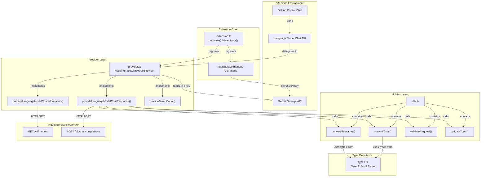
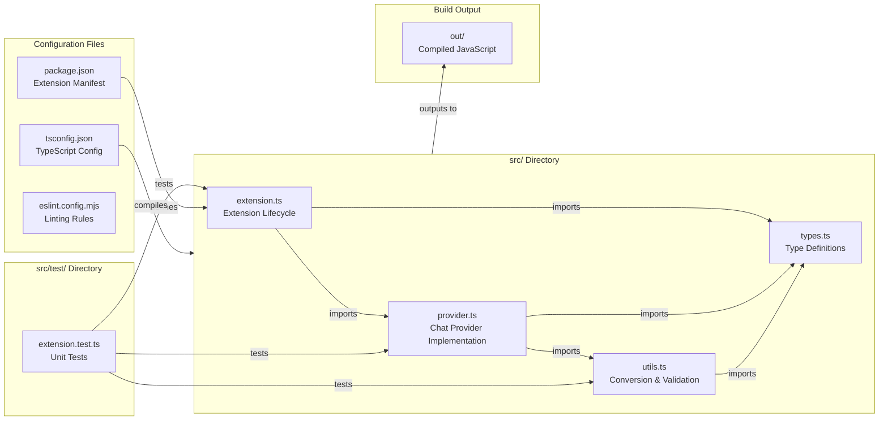
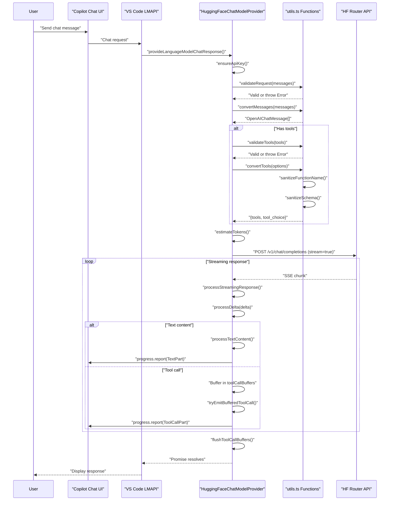
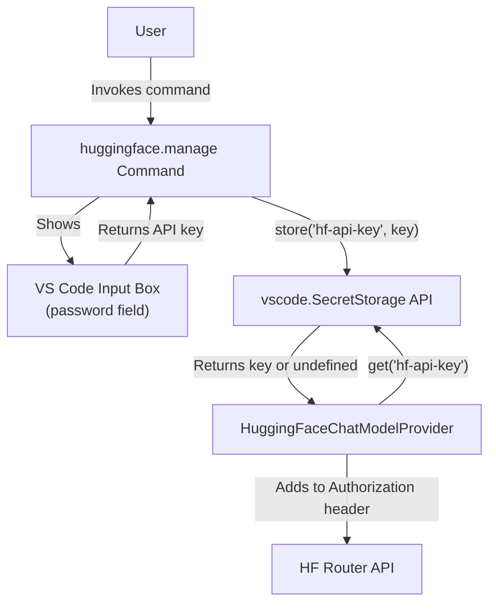

<!-- source: DeepWiki mcp.deepwiki.com · repo huggingface/huggingface-vscode-chat · page 1 Home · fetched 2026-10-26 -->

# Home

<details>
<summary>Relevant source files</summary>

The following files were used as context for generating this wiki page:

- [README.md](README.md)
- [package.json](package.json)

</details>


## Purpose and Scope

This wiki provides comprehensive technical documentation for the **Hugging Face Provider for GitHub Copilot Chat** VS Code extension. The extension bridges GitHub Copilot Chat with Hugging Face Inference Providers, enabling users to access state-of-the-art open-source language models directly within VS Code's chat interface.

This page provides a high-level overview of the extension's architecture, core components, and system design. For detailed setup instructions, see [Getting Started](#2). For architectural deep-dives, see [Architecture](#3). For development workflows, see [Development Guide](#5).

**Sources:** [README.md:1-57](), [package.json:1-83]()

## What This Extension Does

The extension implements a VS Code language model chat provider that:

1. **Integrates with GitHub Copilot Chat** - Registers as a chat provider vendor named `huggingface` in VS Code's Language Model Chat API
2. **Connects to Hugging Face Inference Providers** - Routes chat requests to `router.huggingface.co/v1` API endpoints
3. **Provides Model Discovery** - Fetches and displays available models from multiple inference providers (Cerebras, Cohere, Fireworks AI, Groq, Hyperbolic, Nebius, Novita, Nscale, SambaNova, Together AI, etc.)
4. **Handles Message Conversion** - Transforms VS Code message formats to OpenAI-compatible formats required by the Hugging Face Router API
5. **Supports Tool Calling** - Enables function/tool calling capabilities with proper validation and streaming support
6. **Manages Secure Authentication** - Stores Hugging Face API tokens securely using VS Code's Secret Storage API

**Sources:** [README.md:1-23](), [package.json:40-53]()

## System Architecture Overview

The extension follows a layered architecture pattern, with clear separation between VS Code integration, business logic, and external API communication:



**Sources:** [package.json:40-53](), [README.md:10-15]()

## Core Components and File Structure

The extension codebase is organized into distinct modules, each with specific responsibilities:



### Key Files

| File Path | Primary Classes/Functions | Responsibility |
|-----------|---------------------------|----------------|
| `src/extension.ts` | `activate()`, `deactivate()` | Extension lifecycle management, provider registration |
| `src/provider.ts` | `HuggingFaceChatModelProvider` | Core chat provider implementation, API communication |
| `src/utils.ts` | `convertMessages()`, `convertTools()`, `validateRequest()` | Message/tool conversion, validation logic |
| `src/types.ts` | `OpenAIChatMessage`, `HFModelsResponse`, `ToolCallBuffer` | Type definitions for OpenAI and HF API contracts |
| `package.json` | N/A | Extension manifest, contributions, metadata |

**Sources:** [package.json:1-83](), [README.md:31-44]()

## Request Processing Flow

The following diagram shows the complete request flow with actual function names and data transformations:



**Sources:** [package.json:40-46](), [README.md:10-15]()

## Key Architectural Patterns

### 1. Provider Pattern
The extension implements VS Code's `LanguageModelChatProvider` interface through the `HuggingFaceChatModelProvider` class. This class is registered with the VS Code API during extension activation in `activate()` and provides three core methods:
- `prepareLanguageModelChatInformation()` - Fetches available models
- `provideLanguageModelChatResponse()` - Handles chat completions
- `provideTokenCount()` - Estimates token usage

### 2. Adapter Pattern
The conversion utilities in `utils.ts` act as adapters between VS Code's message format (`vscode.LanguageModelChatMessage`) and OpenAI-compatible formats (`OpenAIChatMessage`). Key conversion functions:
- `convertMessages()` - Maps VS Code messages to OpenAI chat messages
- `convertTools()` - Transforms VS Code tool definitions to OpenAI function schemas
- Schema sanitization functions ensure compatibility with the HF Router API

### 3. Streaming Parser Pattern
The provider implements a streaming response parser that handles:
- Server-Sent Events (SSE) parsing
- Tool call buffering across multiple chunks
- Progressive text emission
- Both SSE-formatted and text-embedded tool calls (using `<|tool_call|>` control tokens)

**Sources:** [README.md:31-44](), [package.json:40-53]()

## Security and Configuration

### API Key Management
The extension uses VS Code's Secret Storage API for secure credential management:



- API keys are stored encrypted in the OS keychain
- Never exposed in logs or error messages
- The `huggingface.manage` command provides a user-friendly input interface
- The `ensureApiKey()` method in the provider handles key retrieval with optional silent mode

### User-Agent Construction
The extension constructs a User-Agent header for telemetry and debugging:
```
HuggingFaceVSCode/<extension-version> VSCode/<vscode-version>
```

**Sources:** [package.json:48-53](), [README.md:14-15]()

## Extension Contributions

The extension registers the following contributions to VS Code (defined in `package.json`):

| Contribution Type | Identifier | Description |
|------------------|------------|-------------|
| `languageModelChatProviders` | `vendor: "huggingface"` | Registers the HF chat provider with display name "Hugging Face" |
| `commands` | `huggingface.manage` | Command to manage API keys and model selection |

**Sources:** [package.json:40-53]()

## Quick Navigation

- **New to this extension?** Start with [Getting Started](#2) for installation and setup
- **Want to understand the architecture?** See [Architecture](#3) for detailed system design
- **Looking to contribute?** Check the [Development Guide](#5) for dev environment setup
- **Need API reference?** Browse the [API Reference](#7) for complete function documentation
- **Configuration details?** Visit [Configuration Reference](#6) for all config files

## Requirements

| Requirement | Version/Details |
|-------------|-----------------|
| VS Code | ^1.104.0 or higher |
| Hugging Face Token | Access token with `inference.serverless` permissions |
| Node.js | (for development only) |
| pnpm | 8.15.4+ (for development only) |

**Sources:** [README.md:27-29](), [package.json:12-14]()

## Technology Stack

The extension is built with:

- **Language:** TypeScript 5.9.2
- **Runtime:** VS Code Extension Host (no runtime dependencies)
- **Build System:** TypeScript Compiler
- **Testing:** Mocha + VS Code Test Runner
- **Code Quality:** ESLint, Prettier
- **Package Manager:** pnpm 8.15.4

All dependencies are development-only (`devDependencies`). The compiled extension has zero runtime dependencies, making it lightweight and fast to load.

**Sources:** [package.json:67-82](), [README.md:31-37]()

## External Dependencies

The extension communicates with the following external services:

| Service | Base URL | Purpose |
|---------|----------|---------|
| HF Router API | `https://router.huggingface.co/v1` | Model discovery and chat completions |
| Models Endpoint | `GET /v1/models` | Fetch available models with provider info |
| Chat Endpoint | `POST /v1/chat/completions` | Stream chat responses with tool calling support |

**Sources:** [README.md:18-21](), [package.json:35]()

---

