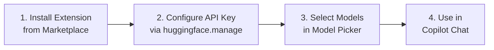
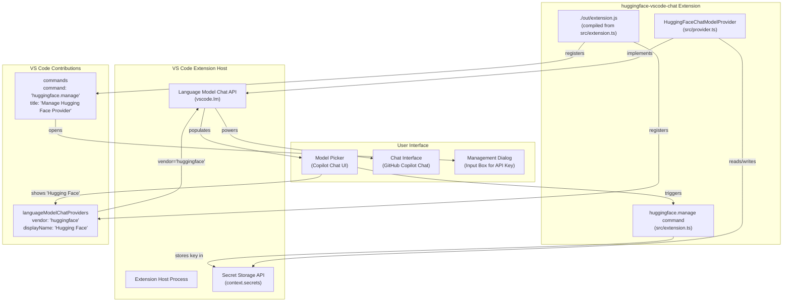
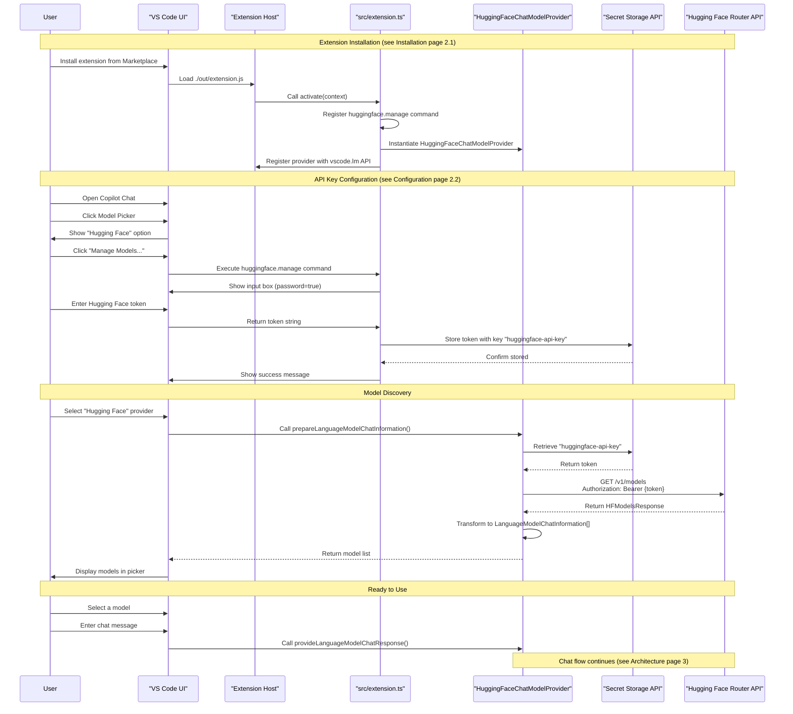
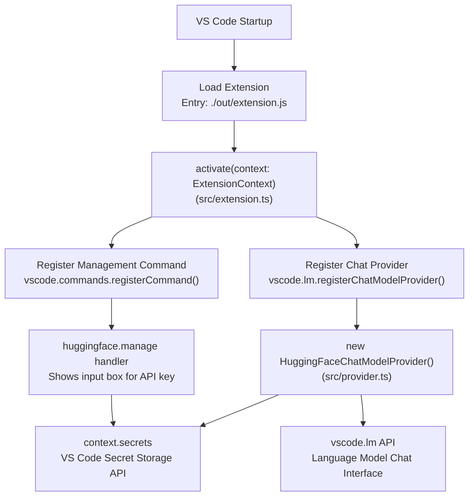

<!-- source: DeepWiki mcp.deepwiki.com · repo huggingface/huggingface-vscode-chat · page 2 Getting Started · fetched 2026-10-26 -->

# Getting Started

Relevant source files

The following files were used as context for generating this wiki page:

- [README.md](README.md)
- [package.json](package.json)

This page provides an overview of how to get started with the Hugging Face Provider for GitHub Copilot Chat extension. It covers the prerequisites, initial setup process, and how the extension integrates into VS Code. For detailed installation steps, see [Installation](#2.1). For configuration details including API key management and model selection, see [Configuration](#2.2).

## Purpose and Scope

This document introduces the Hugging Face VS Code extension and guides you through the initial setup process. It explains what you need before installing, provides a high-level overview of the setup flow, and maps the user-facing setup experience to the underlying code architecture. Detailed procedures for each setup step are covered in the child pages.

## Prerequisites

Before installing the extension, ensure you have the following:

| Requirement | Specification | Location |
|-------------|--------------|----------|
| **VS Code Version** | 1.104.0 or higher | [package.json:12-14]() |
| **Hugging Face Account** | Free or PRO/Enterprise tier | https://huggingface.co |
| **Access Token** | Fine-grained token with `inference.serverless.write` permission | https://huggingface.co/settings/tokens |

The extension requires VS Code's Language Model Chat API, which is only available in version 1.104.0 and above. The Hugging Face access token is used to authenticate requests to the Hugging Face Router API for model discovery and chat completions.

**Sources:** [README.md:27-29](), [package.json:12-14]()

## Quick Start Overview

The setup process consists of four main steps:

**Detailed Steps:**

1. **Install the Extension** - Install from VS Code Marketplace or build from source. See [Installation](#2.1) for detailed instructions.

2. **Configure API Key** - Provide your Hugging Face token through the management interface. The token is securely stored using VS Code's Secret Storage API. See [Configuration](#2.2) for details.

3. **Select Models** - Choose which Hugging Face models appear in your model picker. The extension fetches available models from the Hugging Face Router API.

4. **Start Using** - Access selected models through GitHub Copilot Chat interface with full tool calling support.

**Sources:** [README.md:9-15](), [package.json:40-53]()

## Extension Integration Architecture

The extension integrates with VS Code through two main contribution points defined in [package.json:40-53]():

The extension makes two contributions to VS Code:

1. **Language Model Chat Provider** ([package.json:41-46]())
   - Vendor identifier: `huggingface`
   - Display name: `Hugging Face`
   - Management command: `huggingface.manage`
   - Implementation: `HuggingFaceChatModelProvider` class in [src/provider.ts]()

2. **Management Command** ([package.json:48-52]())
   - Command ID: `huggingface.manage`
   - Handles API key configuration
   - Registered in [src/extension.ts]()

**Sources:** [package.json:40-53](), [package.json:55]()

## First-Time Setup Flow

The following sequence diagram shows what happens during the initial setup, mapping user actions to code execution:

**Key Code Entities:**

- **Extension Activation**: [src/extension.ts]() - `activate()` function registers the provider and command
- **Provider Registration**: Uses `vscode.lm.registerChatModelProvider()` with vendor `"huggingface"`
- **Command Handler**: `huggingface.manage` command shows input box and stores token
- **Secret Storage**: Uses `context.secrets.store("huggingface-api-key", token)` for secure persistence
- **Model Discovery**: `prepareLanguageModelChatInformation()` in `HuggingFaceChatModelProvider` fetches models
- **API Endpoint**: `https://router.huggingface.co/v1/models` for model listing

**Sources:** [package.json:40-53](), [package.json:55](), [README.md:9-15]()

## Extension Activation and Registration

When VS Code loads the extension, the following initialization occurs:

The `activate()` function in [src/extension.ts]() is the entry point that:

1. **Instantiates the Provider** - Creates a `HuggingFaceChatModelProvider` instance
2. **Registers with Language Model API** - Calls `vscode.lm.registerChatModelProvider("huggingface", provider)`
3. **Registers Management Command** - Sets up `huggingface.manage` command handler for API key configuration
4. **Returns Disposables** - Returns cleanup functions for proper deactivation

The provider is now available in the VS Code model picker with the display name "Hugging Face" as configured in [package.json:44]().

**Sources:** [package.json:40-53](), [package.json:55]()

## What Happens After Setup

Once configured, the extension operates as follows:

1. **Model Selection**: User selects a Hugging Face model from the Copilot Chat model picker
2. **Chat Requests**: User sends messages through the Copilot Chat interface
3. **Request Processing**: `HuggingFaceChatModelProvider.provideLanguageModelChatResponse()` handles requests
4. **API Communication**: Provider forwards requests to Hugging Face Router API
5. **Streaming Response**: Server-sent events are parsed and streamed back to VS Code
6. **Tool Calling**: Function calls are buffered, validated, and executed (see [Tool Call System](#3.6))

For architectural details on how chat requests flow through the system, see [Architecture](#3). For information on the streaming response mechanism, see [Streaming Response Handling](#3.5).

**Sources:** [README.md:1-23]()

## Next Steps

After completing the setup:

- **[Installation](#2.1)** - Detailed installation instructions including building from source
- **[Configuration](#2.2)** - In-depth configuration guide covering API key management and model selection
- **[Features](#4)** - Learn about all available features including tool calling and model discovery
- **[Development Guide](#5)** - If you want to contribute or modify the extension

**Sources:** [README.md:9-50]()

---

