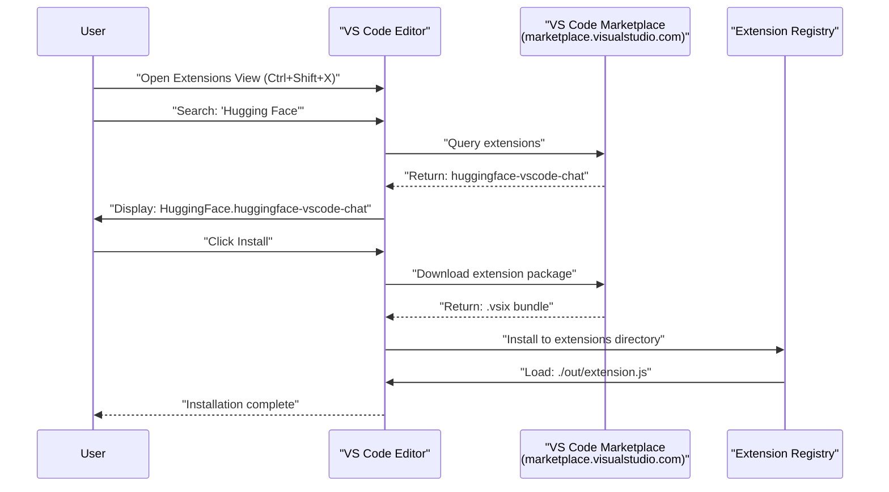
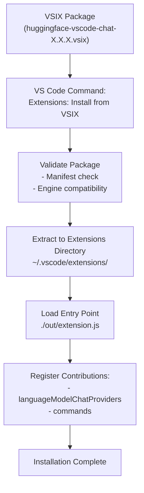
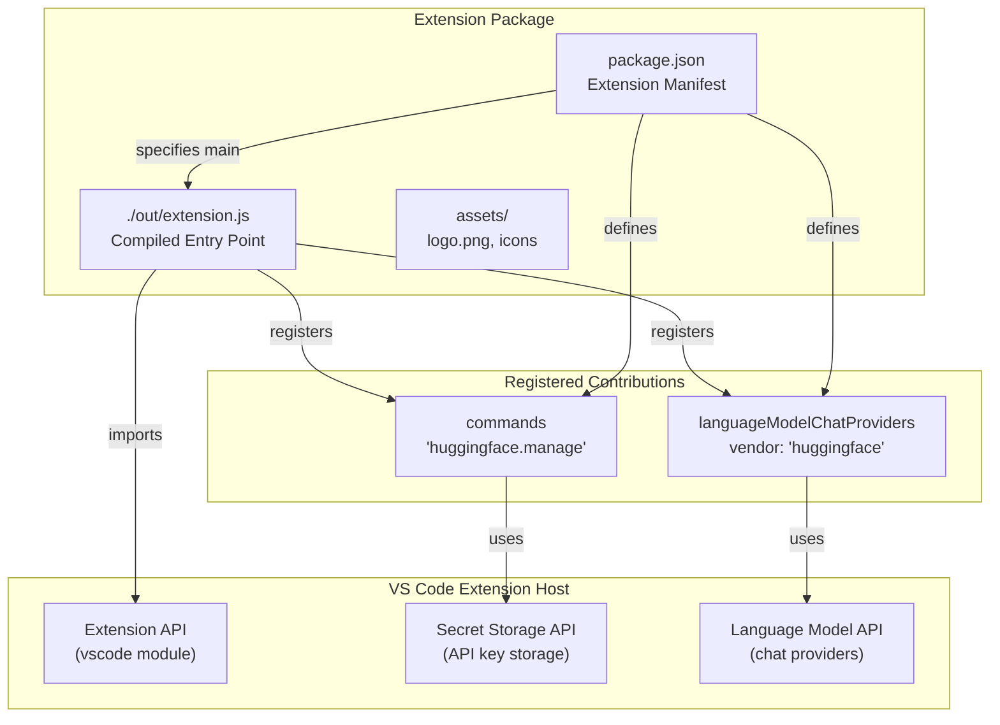
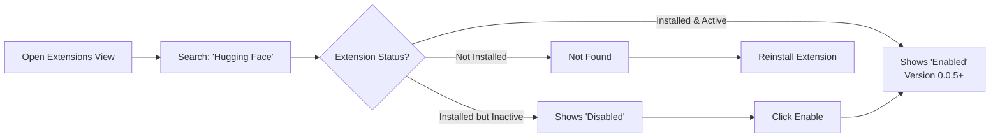
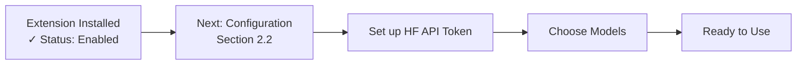

<!-- source: DeepWiki mcp.deepwiki.com · repo huggingface/huggingface-vscode-chat · page 2.1 Installation · fetched 2026-10-26 -->

# Installation

Relevant source files

The following files were used as context for generating this wiki page:

- [README.md](README.md)
- [package.json](package.json)

This document provides instructions for installing the Hugging Face Provider for GitHub Copilot Chat extension. It covers system requirements, installation methods, and verification steps. For information about configuring the extension after installation, see [Configuration](#2.2).

## Prerequisites

Before installing the extension, ensure your environment meets the following requirements:

| Requirement | Specification | Notes |
|-------------|---------------|-------|
| **VS Code Version** | 1.104.0 or higher | Specified in [package.json:12-14]() |
| **GitHub Copilot** | Active subscription | Extension integrates with Copilot Chat interface |
| **Hugging Face Account** | Free or paid tier | Required for API token generation |
| **Hugging Face API Token** | `inference.serverless` permissions | Can be created at https://huggingface.co/settings/tokens/new |

The extension has zero runtime dependencies - all `devDependencies` in [package.json:68-81]() are used only for development and are not bundled with the distributed extension.

**Sources:** [package.json:12-14](), [package.json:67-81](), [README.md:27-29]()

## Installation Methods

### From VS Code Marketplace

The recommended installation method is through the Visual Studio Code Marketplace:

**Installation Steps:**

1. Open Visual Studio Code
2. Open the Extensions view (`Ctrl+Shift+X` or `Cmd+Shift+X` on macOS)
3. Search for `Hugging Face` or `huggingface-vscode-chat`
4. Locate the extension published by `HuggingFace` [package.json:3]()
5. Click the **Install** button
6. Wait for installation to complete (no reload required for modern VS Code versions)

**Direct Marketplace Link:** The extension can also be installed directly from https://marketplace.visualstudio.com/items?itemName=HuggingFace.huggingface-vscode-chat as referenced in [README.md:10]()

**Sources:** [README.md:10](), [package.json:2-4](), [package.json:55]()

### From VSIX Package

For offline installation or testing pre-release versions, install from a `.vsix` package file:

**Installation Steps:**

1. Obtain the `.vsix` file from GitHub releases or build from source
2. Open VS Code Command Palette (`Ctrl+Shift+P` or `Cmd+Shift+P`)
3. Run command: `Extensions: Install from VSIX...`
4. Select the downloaded `.vsix` file
5. Wait for installation confirmation

**Sources:** [package.json:55](), [package.json:40-53]()

## Extension Package Structure

Once installed, the extension's package structure maps to VS Code's extension model:

**Key Package Components:**

| Component | Location | Purpose |
|-----------|----------|---------|
| **Extension Manifest** | `package.json` | Defines metadata, contributions, and requirements |
| **Main Entry Point** | `./out/extension.js` | Compiled activation logic from [src/extension.ts]() |
| **Chat Provider** | Registered as `vendor: huggingface` | Implements `vscode.lm.registerChatModelProvider` API |
| **Management Command** | `huggingface.manage` | Command for API key configuration |
| **Extension Icon** | `assets/logo.png` | Displayed in Extensions view |

**Sources:** [package.json:40-53](), [package.json:55](), [package.json:6]()

## Verifying Installation

After installation, verify the extension is properly loaded:

### Check Extension Status

**Verification Steps:**

1. **Extensions View Check:**
   - Open Extensions view (`Ctrl+Shift+X`)
   - Search for "Hugging Face"
   - Verify extension shows as "Enabled"
   - Check version matches expected release (e.g., `0.0.5` from [package.json:11]())

2. **Chat Provider Check:**
   - Open GitHub Copilot Chat panel
   - Click the model picker dropdown
   - Verify "Hugging Face" appears as a provider option
   - This confirms the `languageModelChatProviders` contribution from [package.json:41-46]() is registered

3. **Command Availability:**
   - Open Command Palette (`Ctrl+Shift+P`)
   - Type "Manage Hugging Face"
   - Verify command `Hugging Face: Manage Hugging Face Provider` appears
   - This confirms the command from [package.json:48-52]() is registered

**Sources:** [package.json:11](), [package.json:41-46](), [package.json:48-52]()

### Troubleshooting Installation Issues

| Issue | Likely Cause | Resolution |
|-------|--------------|------------|
| Extension not found in Marketplace | Network connectivity | Check internet connection; try direct URL |
| Installation fails with version error | VS Code too old | Update VS Code to 1.104.0+ |
| Extension installed but not active | Extension disabled by user | Enable in Extensions view |
| Command not available | Extension activation failed | Check Output panel > Extension Host logs |
| Provider not in model picker | GitHub Copilot not installed | Install GitHub Copilot extension first |

**Sources:** [package.json:12-14](), [README.md:27-29]()

## Post-Installation

After successful installation, the extension is ready for configuration:

The extension will not function until configured with a valid Hugging Face API token. Proceed to [Configuration](#2.2) to:

- Set up your Hugging Face API token via the `huggingface.manage` command
- Select which Hugging Face models to use in Copilot Chat
- Configure model-specific settings

The configuration process uses VS Code's Secret Storage API to securely store your API token, ensuring credentials are never exposed in plaintext.

**Sources:** [README.md:9-15](), [package.json:45]()

## Alternative: Development Installation

For contributors or developers who want to run the extension from source, see [Development Environment Setup](#5.1) for instructions on:

- Cloning the repository from https://github.com/huggingface/huggingface-vscode-chat
- Installing development dependencies with `npm install` or `pnpm install`
- Compiling TypeScript source with `npm run compile`
- Launching the Extension Development Host with F5

Development installation is not recommended for end users. Use the Marketplace installation method described above for production use.

**Sources:** [README.md:31-44](), [package.json:56-65]()

---

