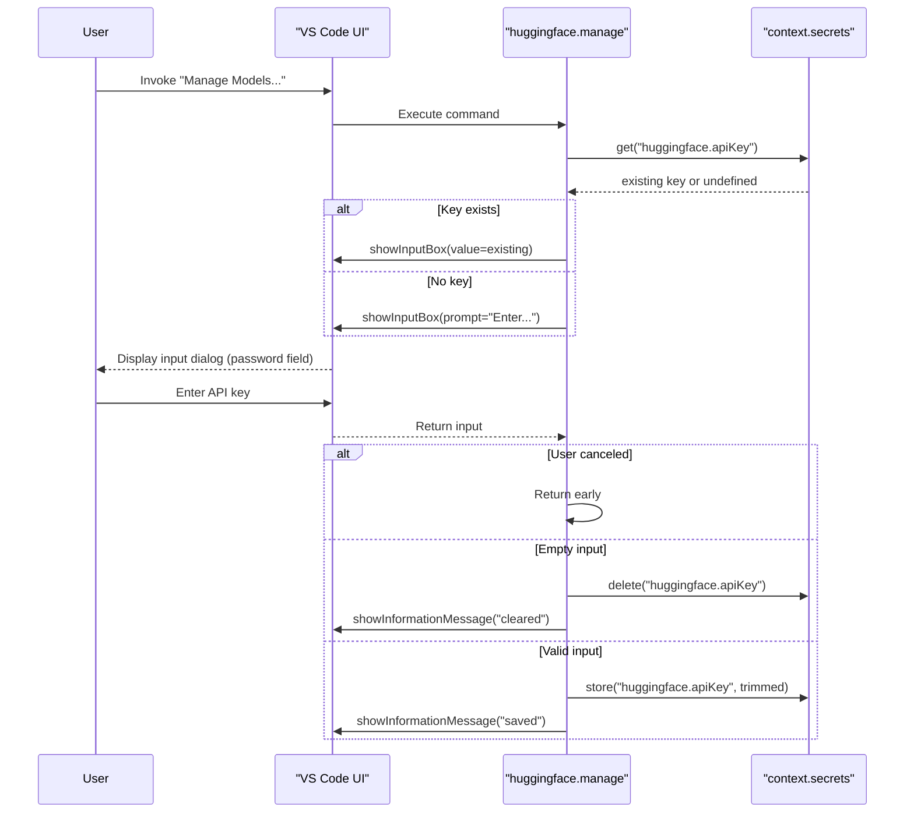
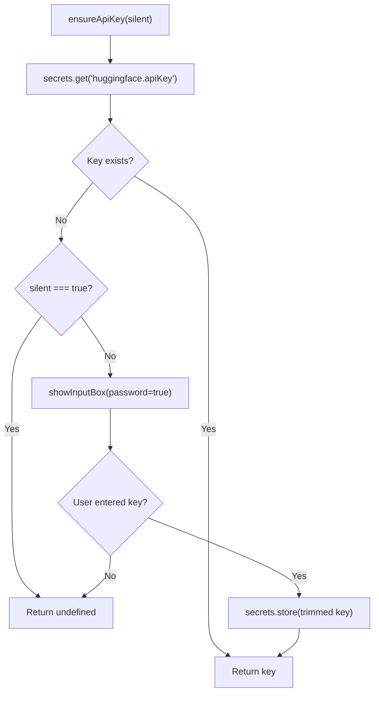
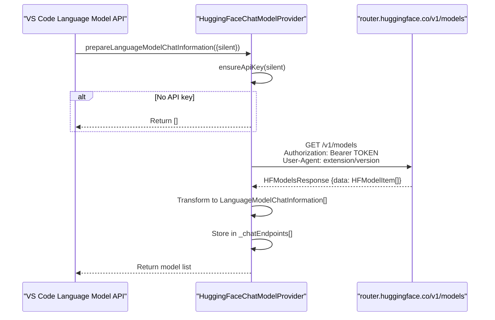
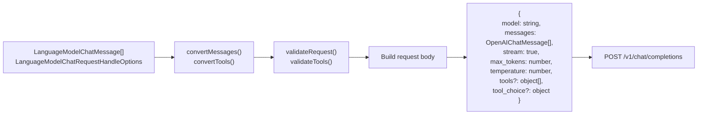
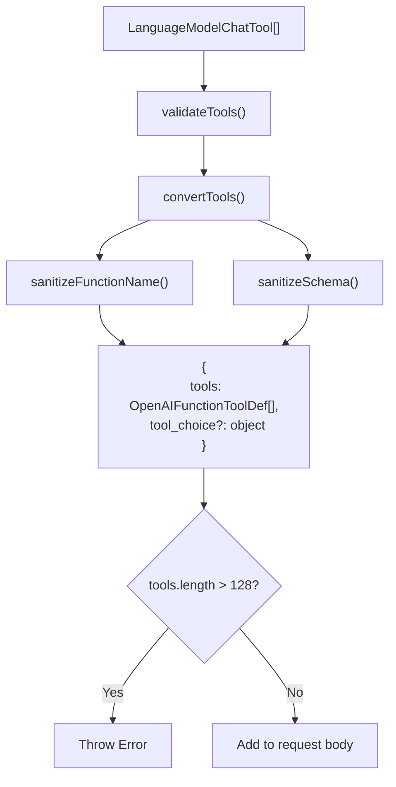
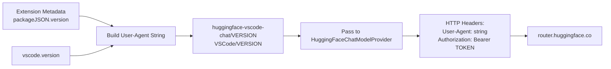

<!-- source: DeepWiki mcp.deepwiki.com · repo huggingface/huggingface-vscode-chat · page 2.2 Configuration · fetched 2026-10-26 -->

# Configuration

<details>
<summary>Relevant source files</summary>

The following files were used as context for generating this wiki page:

- [README.md](README.md)
- [src/extension.ts](src/extension.ts)
- [src/provider.ts](src/provider.ts)

</details>


## Purpose and Scope

This document covers the configuration requirements and options for the Hugging Face VS Code Chat extension. It details API key setup, model discovery and selection, and request-level configuration parameters. For installation instructions, see [Installation](#2.1). For information on the underlying provider implementation, see [Chat Provider Implementation](#3.3).

## API Key Setup

### Obtaining an API Key

The extension requires a Hugging Face API key with `inference.serverless.write` permissions to authenticate with the Hugging Face Router API at `https://router.huggingface.co/v1`. 

To obtain a key:
1. Navigate to https://huggingface.co/settings/tokens/new
2. Select "Fine-grained" token type
3. Enable the `inference.serverless.write` permission
4. Generate and copy the token (format: `hf_***`)

**Sources:** [README.md:14](), [README.md:29](), [src/provider.ts:16]()

### Configuring the API Key

The extension provides the `huggingface.manage` command to configure the API key securely. This command is registered during extension activation and interacts with VS Code's Secret Storage API.



**Diagram: API Key Configuration Flow**

The management command implementation demonstrates several key behaviors:
- **Password field masking**: The input box uses `password: true` to hide the API key
- **Pre-population**: Existing keys are loaded as the default value for updates
- **Deletion support**: Empty input deletes the stored key
- **Trimming**: Input is trimmed before storage to prevent whitespace issues

**Sources:** [src/extension.ts:17-38](), [src/provider.ts:358-373]()

### API Key Retrieval and Validation

The provider's `ensureApiKey` method handles key retrieval with optional user prompting:



**Diagram: API Key Retrieval Logic**

The `silent` parameter controls prompting behavior:
- `silent=true`: Used during model list fetching to avoid interrupting the user
- `silent=false`: Used during chat requests to ensure a key is available

**Sources:** [src/provider.ts:358-373]()

## Model Discovery and Selection

### Model List Endpoint

The extension fetches available models from the Hugging Face Router API's `/v1/models` endpoint. This occurs during the `prepareLanguageModelChatInformation` phase, which is invoked when VS Code queries for available language models.



**Diagram: Model Discovery Process**

**Sources:** [src/provider.ts:89-157](), [src/provider.ts:170-202]()

### Model Metadata and Capabilities

Each model in the response contains provider-specific metadata that determines the available configurations:

| Model Field | Type | Usage |
|------------|------|-------|
| `id` | `string` | Model identifier (e.g., `"meta-llama/Llama-3.3-70B-Instruct"`) |
| `providers` | `HFProvider[]` | List of inference providers supporting this model |
| `architecture.input_modalities` | `string[]` | Supported input types (e.g., `["text", "image"]`) |

Each `HFProvider` object contains:

| Provider Field | Type | Usage |
|---------------|------|-------|
| `provider` | `string` | Provider name (e.g., `"cerebras"`, `"together"`) |
| `supports_tools` | `boolean` | Whether tool calling is supported |
| `context_length` | `number` | Maximum context window size |

**Sources:** [src/types.ts:1-22](), [src/provider.ts:100-149]()

### Model Information Construction

The provider builds `LanguageModelChatInformation` objects for each model-provider combination:

```typescript
// For providers with tool support
{
    id: `${m.id}:${p.provider}`,           // "model:provider" format
    name: `${m.id} via ${p.provider}`,      // Display name
    family: "huggingface",
    maxInputTokens: contextLength - DEFAULT_MAX_OUTPUT_TOKENS,
    maxOutputTokens: DEFAULT_MAX_OUTPUT_TOKENS,
    capabilities: {
        toolCalling: true,
        imageInput: vision
    }
}
```

Models without tool-supporting providers fall back to a base configuration with `toolCalling: false`.

**Constants:**
- `DEFAULT_MAX_OUTPUT_TOKENS = 16000`
- `DEFAULT_CONTEXT_LENGTH = 128000`

**Sources:** [src/provider.ts:17-18](), [src/provider.ts:109-126](), [src/provider.ts:128-146]()

## Request Configuration

### Request Body Structure

When `provideLanguageModelChatResponse` is invoked, the provider constructs an OpenAI-compatible request body:



**Diagram: Request Construction Pipeline**

**Sources:** [src/provider.ts:214-327](), [src/provider.ts:269-296]()

### Model Options

The extension supports a subset of OpenAI-compatible model options via the `options.modelOptions` parameter:

| Option | Type | Default | Constraint |
|--------|------|---------|------------|
| `max_tokens` | `number` | `4096` | Capped at `model.maxOutputTokens` |
| `temperature` | `number` | `0.7` | - |
| `stop` | `string \| string[]` | - | Allow-listed |
| `frequency_penalty` | `number` | - | Allow-listed |
| `presence_penalty` | `number` | - | Allow-listed |

The allow-list mechanism ensures only supported parameters are forwarded:

```typescript
if (options.modelOptions) {
    const mo = options.modelOptions as Record<string, unknown>;
    if (typeof mo.stop === "string" || Array.isArray(mo.stop)) {
        requestBody.stop = mo.stop;
    }
    if (typeof mo.frequency_penalty === "number") {
        requestBody.frequency_penalty = mo.frequency_penalty;
    }
    if (typeof mo.presence_penalty === "number") {
        requestBody.presence_penalty = mo.presence_penalty;
    }
}
```

**Sources:** [src/provider.ts:273-289]()

### Tool Configuration

Tools are converted from VS Code's `LanguageModelChatTool` format to OpenAI's function tool format via `convertTools`:



**Diagram: Tool Configuration Pipeline**

The tool conversion process:
1. Validates tool definitions
2. Sanitizes function names (removes invalid characters)
3. Cleans JSON schemas (removes `$schema`, `additionalProperties: false`)
4. Enforces a maximum of 128 tools per request

**Sources:** [src/provider.ts:255](), [src/provider.ts:257-259](), [src/provider.ts:291-296](), [src/utils.ts:98-133]()

### Token Limit Validation

The provider estimates token usage to prevent exceeding model limits:

```typescript
const inputTokenCount = this.estimateMessagesTokens(messages);
const toolTokenCount = this.estimateToolTokens(toolConfig.tools);
const tokenLimit = Math.max(1, model.maxInputTokens);

if (inputTokenCount + toolTokenCount > tokenLimit) {
    throw new Error("Message exceeds token limit.");
}
```

Token estimation uses a simple heuristic: **1 token ≈ 4 characters**

**Sources:** [src/provider.ts:60-81](), [src/provider.ts:261-267]()

## Configuration Storage and Security

### Secret Storage API

The extension uses VS Code's Secret Storage API, which provides:
- **OS-level encryption**: Keys are stored in the system keychain (Keychain on macOS, Credential Manager on Windows, Secret Service on Linux)
- **Workspace isolation**: Secrets are scoped to the extension
- **Async access**: All operations return promises

The storage key is `"huggingface.apiKey"` and is accessed via `context.secrets`:

```typescript
// Store
await context.secrets.store("huggingface.apiKey", apiKey);

// Retrieve
const apiKey = await context.secrets.get("huggingface.apiKey");

// Delete
await context.secrets.delete("huggingface.apiKey");
```

**Sources:** [src/extension.ts:19](), [src/extension.ts:31](), [src/extension.ts:35](), [src/provider.ts:359]()

### User-Agent Construction

The extension constructs a descriptive User-Agent header for API telemetry:



**Diagram: User-Agent and Authentication Header Construction**

The User-Agent format is: `huggingface-vscode-chat/{extensionVersion} VSCode/{vscodeVersion}`

This enables Hugging Face to track API usage by extension version and VS Code version.

**Sources:** [src/extension.ts:5-10](), [src/extension.ts:12](), [src/provider.ts:176](), [src/provider.ts:302]()

### Authentication Headers

All API requests include authentication and identification headers:

| Header | Value | Purpose |
|--------|-------|---------|
| `Authorization` | `Bearer {apiKey}` | API authentication |
| `User-Agent` | `huggingface-vscode-chat/{version} VSCode/{version}` | Telemetry |
| `Content-Type` | `application/json` | Request body format (POST only) |

**Sources:** [src/provider.ts:176](), [src/provider.ts:300-302]()

---

