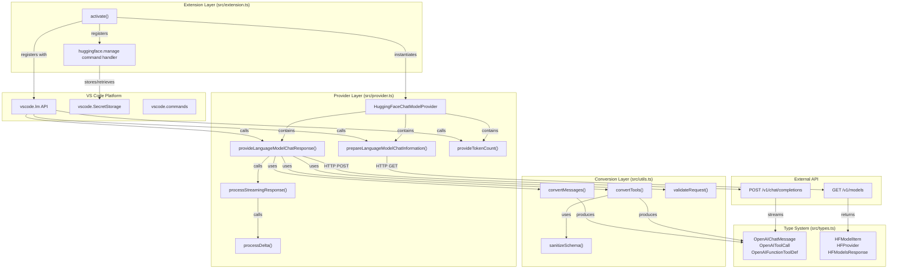
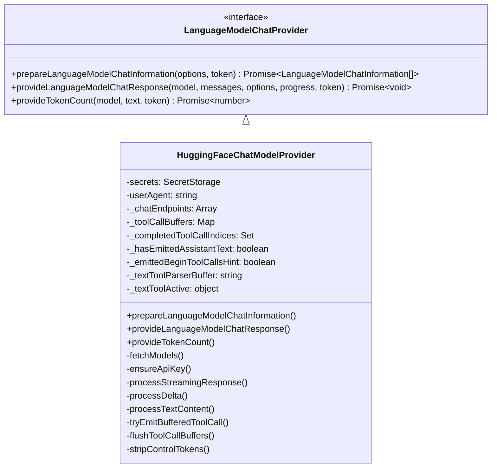
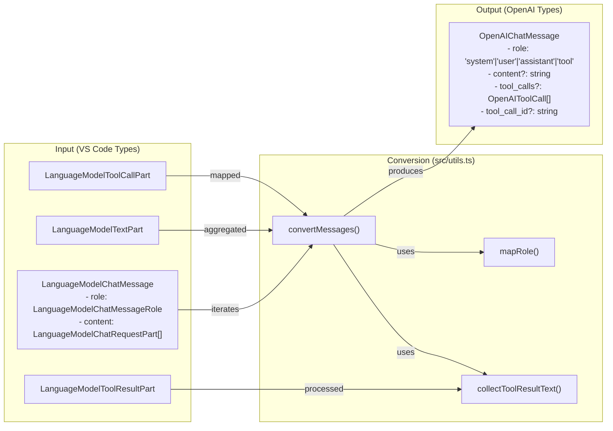
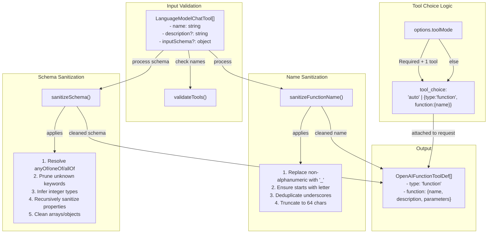
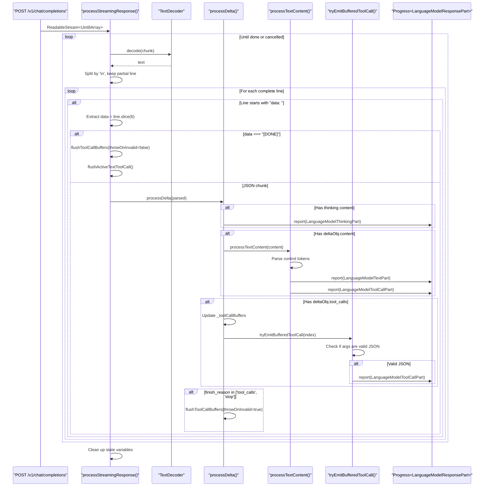
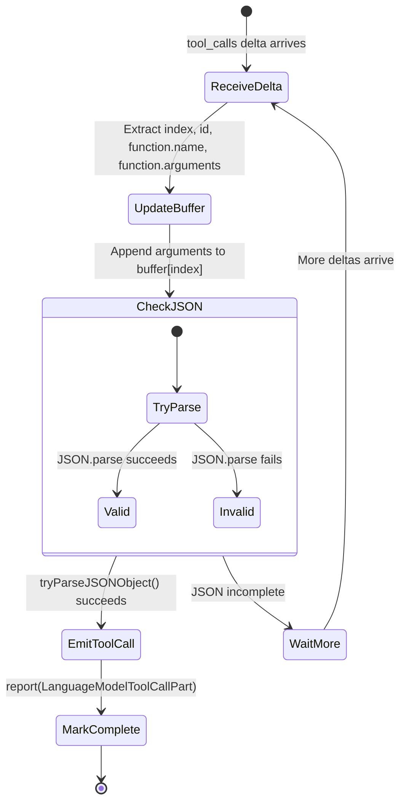
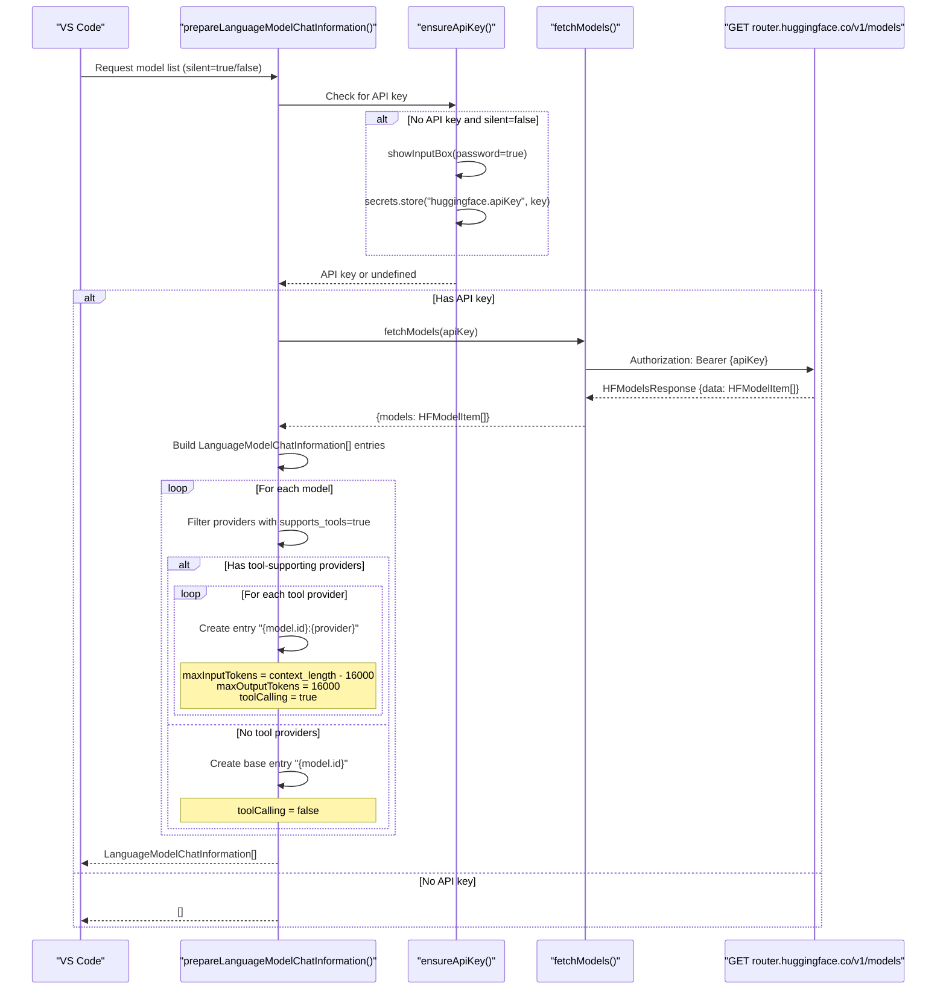
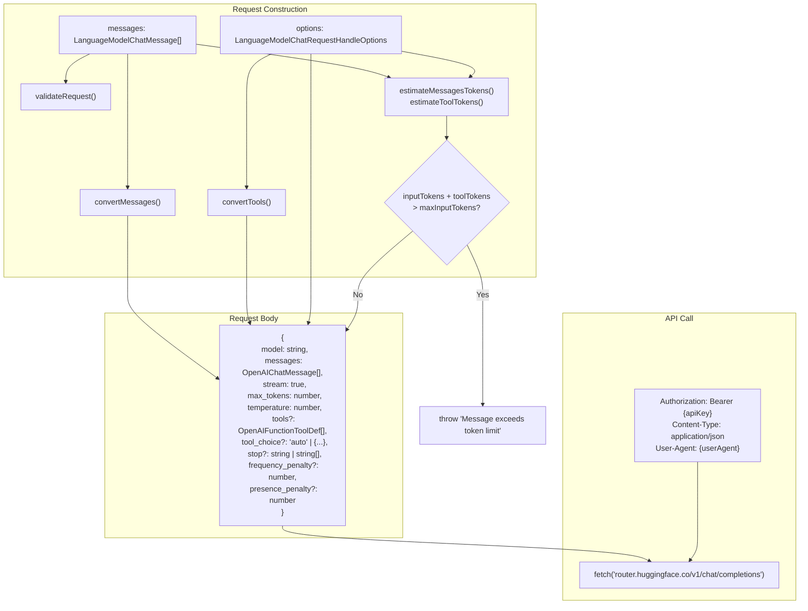
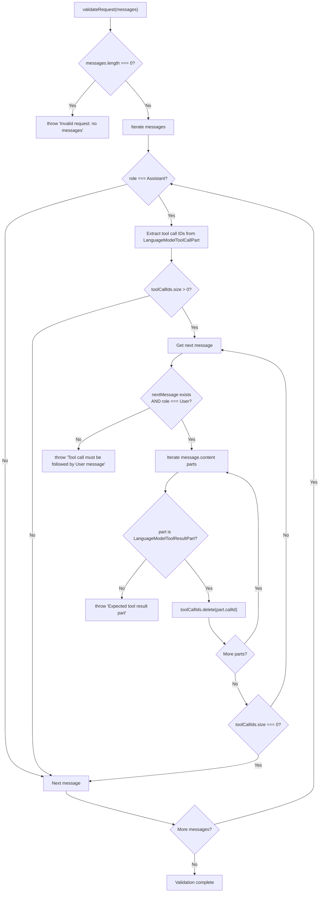
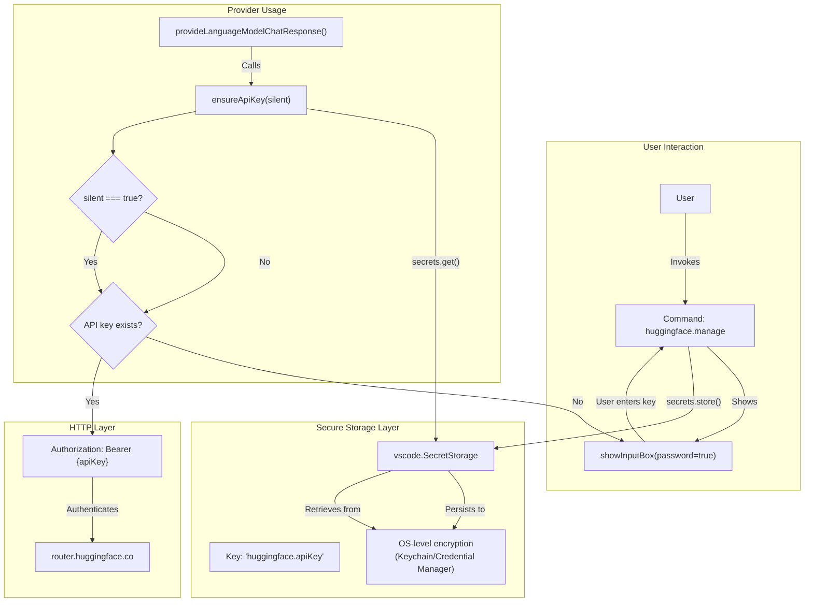

<!-- source: DeepWiki mcp.deepwiki.com · repo huggingface/huggingface-vscode-chat · page 3 Architecture · fetched 2026-10-26 -->

# Architecture

<details>
<summary>Relevant source files</summary>

The following files were used as context for generating this wiki page:

- [src/extension.ts](src/extension.ts)
- [src/provider.ts](src/provider.ts)
- [src/types.ts](src/types.ts)
- [src/utils.ts](src/utils.ts)

</details>


## Purpose and Scope

This document provides a comprehensive overview of the extension's internal architecture, design patterns, and component interactions. It describes how the extension bridges VS Code's Language Model Chat API with Hugging Face's inference router, focusing on the core technical implementation.

For user-facing feature documentation, see [Features](#4). For detailed API method signatures, see [API Reference](#7). For extension activation and lifecycle hooks, see [Extension Lifecycle](#3.2).

## System Overview

The extension implements a language model chat provider that adapts VS Code's chat interface to work with Hugging Face's inference API. The architecture follows a layered design with clear separation of concerns:



**Sources:** [src/extension.ts:1-42](), [src/provider.ts:1-782](), [src/utils.ts:1-364](), [src/types.ts:1-85]()

### Component Responsibilities

| Component | File | Primary Responsibilities |
|-----------|------|-------------------------|
| `activate()` | [src/extension.ts:4-39]() | Extension registration, command setup, provider instantiation |
| `HuggingFaceChatModelProvider` | [src/provider.ts:23-781]() | Implements VS Code's `LanguageModelChatProvider` interface |
| `convertMessages()` | [src/utils.ts:143-186]() | Transforms VS Code messages to OpenAI format |
| `convertTools()` | [src/utils.ts:192-227]() | Transforms VS Code tools to OpenAI function definitions |
| `validateRequest()` | [src/utils.ts:248-290]() | Validates message sequences and tool call/result pairing |
| `sanitizeSchema()` | [src/utils.ts:68-136]() | Cleans JSON schemas for API compatibility |

**Sources:** [src/extension.ts:4-39](), [src/provider.ts:23-781](), [src/utils.ts:143-290]()

## Extension Activation and Registration

The extension activates through the `activate()` function, which orchestrates provider registration and command setup:

```mermaid
sequenceDiagram
    participant VSCode as "VS Code Extension Host"
    participant activate as "activate()"
    participant HFProvider as "HuggingFaceChatModelProvider"
    participant LMAPI as "vscode.lm"
    participant Commands as "vscode.commands"
    
    VSCode->>activate: activate(context)
    activate->>activate: Build User-Agent string
    Note over activate: UA: huggingface-vscode-chat/{version}<br/>VSCode/{vscodeVersion}
    
    activate->>HFProvider: new HuggingFaceChatModelProvider(secrets, ua)
    activate->>LMAPI: registerLanguageModelChatProvider("huggingface", provider)
    
    activate->>Commands: registerCommand("huggingface.manage", handler)
    Note over Commands: Command allows users to<br/>configure API key
    
    activate-->>VSCode: Registration complete
```

The `activate()` function performs three critical operations:

1. **User-Agent Construction** ([src/extension.ts:6-10]()): Builds a tracking string combining extension version and VS Code version
2. **Provider Instantiation** ([src/extension.ts:12]()): Creates `HuggingFaceChatModelProvider` with secret storage access
3. **Registration** ([src/extension.ts:14]()): Registers the provider under vendor ID `"huggingface"` matching [package.json]()

**Sources:** [src/extension.ts:4-39]()

## Provider Implementation

### LanguageModelChatProvider Interface

The `HuggingFaceChatModelProvider` class implements the required VS Code interface:



**Sources:** [src/provider.ts:23-781]()

### State Management

The provider maintains several internal state variables for streaming response handling:

| State Variable | Type | Purpose |
|---------------|------|---------|
| `_toolCallBuffers` | `Map<number, {id?, name?, args}>` | Accumulates streamed tool call fragments by index |
| `_completedToolCallIndices` | `Set<number>` | Tracks which tool call indices have been emitted |
| `_hasEmittedAssistantText` | `boolean` | Flags whether assistant text preceded tool calls |
| `_emittedBeginToolCallsHint` | `boolean` | Tracks whitespace flush for UI buffer clearing |
| `_textToolParserBuffer` | `string` | Buffer for parsing control-token-embedded tool calls |
| `_textToolActive` | `object` | Current in-progress text-embedded tool call state |
| `_emittedTextToolCallKeys` | `Set<string>` | Deduplication set for tool call content |
| `_emittedTextToolCallIds` | `Set<string>` | Deduplication set for tool call identities |

State is reset at the beginning of each request ([src/provider.ts:222-229]()) and cleaned up after streaming completes ([src/provider.ts:422-430]()).

**Sources:** [src/provider.ts:24-51](), [src/provider.ts:222-230](), [src/provider.ts:422-430]()

## Message Conversion Pipeline

The conversion layer transforms VS Code's message format to OpenAI-compatible structures:



The `convertMessages()` function ([src/utils.ts:143-186]()) processes each message part:

1. **Text Parts** ([src/utils.ts:152-153]()): Concatenated into message content
2. **Tool Call Parts** ([src/utils.ts:154-162]()): Converted to `OpenAIToolCall` objects with serialized arguments
3. **Tool Result Parts** ([src/utils.ts:163-167]()): Extracted into separate `role: "tool"` messages

Role mapping ([src/utils.ts:310-321]()) converts enum values to string literals:
- `LanguageModelChatMessageRole.User` → `"user"`
- `LanguageModelChatMessageRole.Assistant` → `"assistant"`
- Default → `"system"`

**Sources:** [src/utils.ts:143-186](), [src/utils.ts:310-343]()

## Tool Definition Conversion

Tool conversion sanitizes and formats tool definitions for API compatibility:



### Schema Sanitization Rules

The `sanitizeSchema()` function ([src/utils.ts:68-136]()) applies several transformations:

1. **Composite Schema Resolution** ([src/utils.ts:75-88]()): Flattens `anyOf`/`oneOf`/`allOf`, preferring `type: "string"` variants
2. **Keyword Pruning** ([src/utils.ts:39-66]()): Allows only recognized JSON Schema keywords
3. **Integer Type Inference** ([src/utils.ts:98-101]()): Converts `number` to `integer` for properties matching patterns like `*_id`, `limit`, `count`
4. **Recursive Property Cleaning** ([src/utils.ts:103-111]()): Applies sanitization to nested object properties
5. **Array Item Normalization** ([src/utils.ts:124-133]()): Ensures `items` is a single schema, not tuple validation

**Sources:** [src/utils.ts:27-136](), [src/utils.ts:192-227](), [src/utils.ts:233-242]()

## Streaming Response Handling

The streaming pipeline processes Server-Sent Events from Hugging Face's chat completion endpoint:



**Sources:** [src/provider.ts:381-431](), [src/provider.ts:438-528]()

### Tool Call Buffering System

The provider supports two tool call formats:

1. **SSE Tool Calls** ([src/provider.ts:488-520]()): Standard OpenAI streaming format with `tool_calls` array
2. **Text-Embedded Tool Calls** ([src/provider.ts:534-657]()): Control token format used by some providers

#### SSE Tool Call Processing



Buffer entries ([src/provider.ts:26-29]()) accumulate:
- `id`: Tool call identifier from SSE
- `name`: Function name from `function.name`
- `args`: Concatenated `function.arguments` strings

The `tryEmitBufferedToolCall()` method ([src/provider.ts:709-733]()) attempts emission when `args` becomes valid JSON, marking the index complete to ignore subsequent deltas.

**Sources:** [src/provider.ts:488-520](), [src/provider.ts:709-733]()

#### Text-Embedded Tool Call Parsing

Some providers embed tool calls in text using control tokens:

```
<|tool_call_begin|>function_name:0<|tool_call_argument_begin|>{"key":"value"}<|tool_call_end|>
```

The `processTextContent()` method ([src/provider.ts:534-657]()) implements a state machine parser:

| State | Trigger | Action |
|-------|---------|--------|
| Not active | `<|tool_call_begin|>` found | Extract name/index, enter active state |
| Active, no args | `<|tool_call_argument_begin|>` | Begin accumulating arguments |
| Active, no args | `<|tool_call_end|>` | Emit with empty args `"{}"` |
| Active, accumulating | Characters | Append to `argBuffer` |
| Active, accumulating | Valid JSON detected | Emit tool call early (don't wait for end) |
| Active, accumulating | `<|tool_call_end|>` | Final emission attempt, reset state |

Deduplication ([src/provider.ts:669-682]()) uses:
- **Identity-based**: `name:index` for indexed calls
- **Content-based**: `name:canonicalJSON` otherwise

**Sources:** [src/provider.ts:534-657](), [src/provider.ts:659-702]()

## API Integration

### Model Discovery

The `prepareLanguageModelChatInformation()` method ([src/provider.ts:89-157]()) fetches available models:



Model entries include capabilities derived from provider metadata:
- **Tool Calling** ([src/provider.ts:106-126]()): `supports_tools === true` on provider
- **Vision** ([src/provider.ts:102-103]()): `input_modalities` includes `"image"`
- **Token Limits** ([src/provider.ts:110-112]()): Context length from provider, output fixed at 16000

**Sources:** [src/provider.ts:89-157](), [src/provider.ts:170-202](), [src/provider.ts:358-373]()

### Chat Completion Request

The `provideLanguageModelChatResponse()` method ([src/provider.ts:214-327]()) constructs and sends requests:



Request body assembly ([src/provider.ts:269-296]()):
1. **Required Fields**: `model`, `messages`, `stream: true`, `max_tokens`, `temperature`
2. **Optional Tools**: Added when `options.tools` present
3. **Model Options Allowlist** ([src/provider.ts:278-289]()): `stop`, `frequency_penalty`, `presence_penalty`

Token limit validation ([src/provider.ts:261-267]()) prevents oversized requests by estimating tokens using character count divided by 4.

**Sources:** [src/provider.ts:214-327](), [src/provider.ts:59-81]()

## Request Validation

The `validateRequest()` function ([src/utils.ts:248-290]()) ensures tool call/result pairing:



This validation enforces the conversation protocol:
1. Every `LanguageModelToolCallPart` in an assistant message must have a corresponding `LanguageModelToolResultPart` in a subsequent user message
2. The `callId` values must match exactly
3. Tool results must appear in user messages immediately following the assistant tool call message

**Sources:** [src/utils.ts:248-290]()

## Type System

The extension defines type hierarchies for both VS Code and OpenAI formats:

### OpenAI Type Definitions

```typescript
// From src/types.ts:4-27

interface OpenAIToolCall {
  id: string;
  type: "function";
  function: { name: string; arguments: string };
}

interface OpenAIFunctionToolDef {
  type: "function";
  function: { 
    name: string; 
    description?: string; 
    parameters?: object;
  };
}

interface OpenAIChatMessage {
  role: "system" | "user" | "assistant" | "tool";
  content?: string;
  name?: string;
  tool_calls?: OpenAIToolCall[];
  tool_call_id?: string;
}
```

### Hugging Face Response Types

```typescript
// From src/types.ts:32-72

interface HFProvider {
  provider: string;
  status: string;
  supports_tools?: boolean;
  supports_structured_output?: boolean;
  context_length?: number;
}

interface HFArchitecture {
  input_modalities?: string[];
  output_modalities?: string[];
}

interface HFModelItem {
  id: string;
  object: string;
  created: number;
  owned_by: string;
  providers: HFProvider[];
  architecture?: HFArchitecture;
}

interface HFModelsResponse {
  object: string;
  data: HFModelItem[];
}
```

**Sources:** [src/types.ts:1-85]()

## Security Architecture

API key management uses VS Code's secure storage:



The `ensureApiKey()` method ([src/provider.ts:358-373]()) implements conditional prompting:
- **Silent Mode** (`silent: true`): Returns `undefined` if no key exists, never prompts
- **Interactive Mode** (`silent: false`): Shows input dialog when key missing

The management command ([src/extension.ts:16-38]()) supports:
- **Setting**: Store trimmed API key
- **Updating**: Pre-populate with existing value
- **Clearing**: Delete key when empty string submitted

**Sources:** [src/extension.ts:16-38](), [src/provider.ts:358-373]()

---

