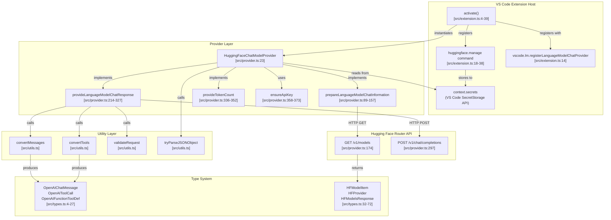
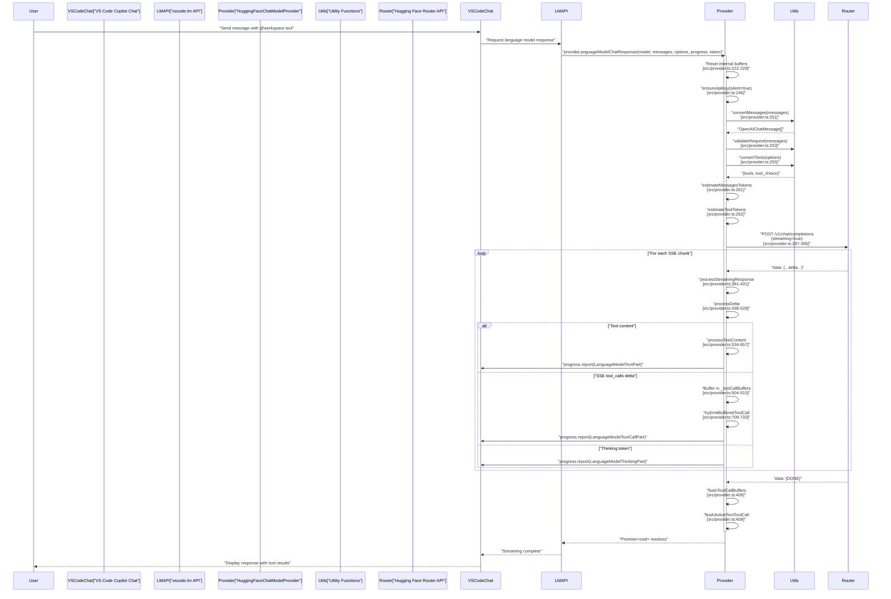
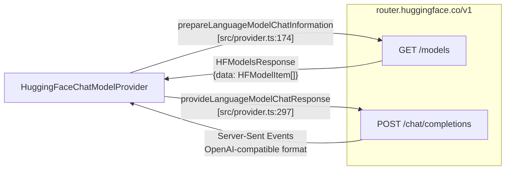
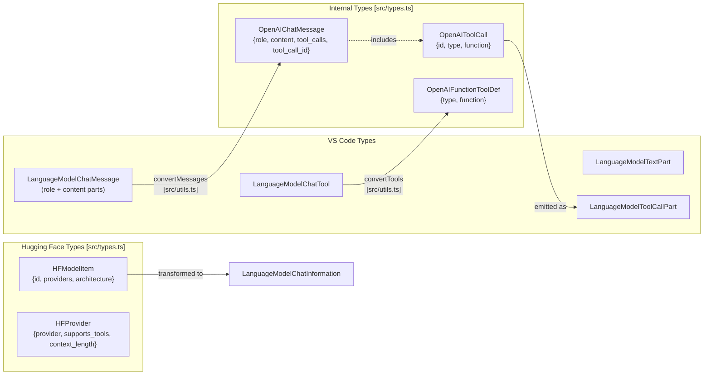
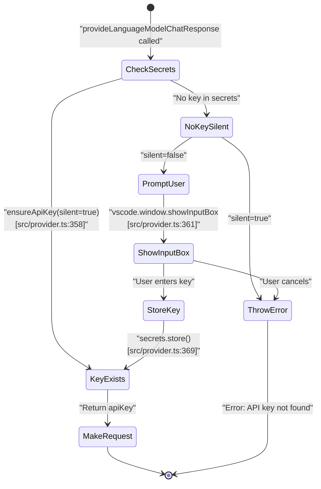

<!-- source: DeepWiki mcp.deepwiki.com · repo huggingface/huggingface-vscode-chat · page 3.1 System Overview · fetched 2026-10-26 -->

# System Overview

Relevant source files

The following files were used as context for generating this wiki page:

- [src/extension.ts](src/extension.ts)
- [src/provider.ts](src/provider.ts)
- [src/types.ts](src/types.ts)

## Purpose and Scope

This document provides a high-level architectural overview of the huggingface-vscode-chat extension, describing how its core components interact to bridge VS Code's Language Model Chat API with Hugging Face's Router API. This page focuses on the system's structure, component relationships, and primary data flows.

For detailed information about specific subsystems, see:
- Extension initialization and lifecycle: [Extension Lifecycle](#3.2)
- Provider implementation details: [Chat Provider Implementation](#3.3)
- Message format conversion: [Message Conversion Layer](#3.4)
- Streaming response processing: [Streaming Response Handling](#3.5)
- Tool call handling specifics: [Tool Call System](#3.6)

## Core Architecture

The extension implements a three-layer architecture that adapts VS Code's Language Model Chat API to communicate with the Hugging Face Router API.

### Component Overview

**Sources:** [src/extension.ts:1-42](), [src/provider.ts:1-782](), [src/types.ts:1-85]()

### Entry Points and Command Registration

The extension defines two primary entry points that are registered with VS Code during activation:

| Entry Point | Registration | Purpose |
|-------------|-------------|---------|
| `HuggingFaceChatModelProvider` | `vscode.lm.registerLanguageModelChatProvider("huggingface", provider)` | Provides language model chat capabilities to VS Code's Chat API |
| `huggingface.manage` | `vscode.commands.registerCommand("huggingface.manage", ...)` | User-facing command to configure the Hugging Face API key |

The `activate` function [src/extension.ts:4-39]() constructs a User-Agent string from the extension version and VS Code version, then instantiates `HuggingFaceChatModelProvider` with the secret storage and User-Agent.

**Sources:** [src/extension.ts:4-39]()

## Primary Data Flow

### Chat Request Processing

The following diagram illustrates the complete data flow for a chat request with tool calling support:

**Sources:** [src/provider.ts:214-327](), [src/provider.ts:381-431](), [src/provider.ts:438-528]()

### State Management During Streaming

The `HuggingFaceChatModelProvider` maintains several pieces of state to handle streaming responses correctly:

| State Field | Type | Purpose | Reset Location |
|-------------|------|---------|----------------|
| `_toolCallBuffers` | `Map<number, {id?, name?, args}>` | Accumulates SSE tool call deltas by index | [src/provider.ts:222]() |
| `_completedToolCallIndices` | `Set<number>` | Tracks which SSE tool calls have been emitted | [src/provider.ts:223]() |
| `_hasEmittedAssistantText` | `boolean` | Flags if text was emitted before tool calls | [src/provider.ts:224]() |
| `_emittedBeginToolCallsHint` | `boolean` | Tracks whitespace flush for tool call transition | [src/provider.ts:225]() |
| `_textToolParserBuffer` | `string` | Buffers partial control tokens from text stream | [src/provider.ts:226]() |
| `_textToolActive` | `{name?, index?, argBuffer, emitted?}` | Tracks in-progress text-embedded tool call | [src/provider.ts:227]() |
| `_emittedTextToolCallKeys` | `Set<string>` | Deduplicates tool calls by `name:args` signature | [src/provider.ts:228]() |
| `_emittedTextToolCallIds` | `Set<string>` | Deduplicates tool calls by `name:index` identity | [src/provider.ts:229]() |

All state is reset at the beginning of each `provideLanguageModelChatResponse` call [src/provider.ts:222-229]() and cleaned up in the `finally` block [src/provider.ts:420-430]().

**Sources:** [src/provider.ts:26-51](), [src/provider.ts:222-229](), [src/provider.ts:420-430]()

## External Dependencies

### Hugging Face Router API

The extension communicates with two endpoints on the Hugging Face Router API (`https://router.huggingface.co/v1`):

**Authentication:** All requests include `Authorization: Bearer ${apiKey}` and `User-Agent: huggingface-vscode-chat/{version} VSCode/{version}` headers [src/provider.ts:176](), [src/provider.ts:300-302]().

**Sources:** [src/provider.ts:16](), [src/provider.ts:170-202](), [src/provider.ts:297-305]()

### VS Code APIs

The extension relies on several VS Code Extension APIs:

| API | Usage | Location |
|-----|-------|----------|
| `vscode.lm.registerLanguageModelChatProvider` | Registers the provider under vendor ID `"huggingface"` | [src/extension.ts:14]() |
| `vscode.SecretStorage` | Stores encrypted API key at `"huggingface.apiKey"` | [src/extension.ts:12](), [src/provider.ts:359]() |
| `vscode.commands.registerCommand` | Registers `"huggingface.manage"` command | [src/extension.ts:18]() |
| `vscode.window.showInputBox` | Prompts user for API key input | [src/extension.ts:20-26](), [src/provider.ts:361-366]() |
| `vscode.LanguageModelTextPart` | Emits text chunks to chat UI | [src/provider.ts:648]() |
| `vscode.LanguageModelToolCallPart` | Emits tool call requests to chat UI | [src/provider.ts:684](), [src/provider.ts:730]() |

**Sources:** [src/extension.ts:1-42](), [src/provider.ts:1-782]()

## Type System and Data Transformation

The extension acts as an adapter between VS Code's type system and the OpenAI-compatible format expected by Hugging Face Router:

**Key Transformations:**
- **Message Conversion:** [src/utils.ts]() maps VS Code roles (`user`, `assistant`, `tool`) to OpenAI roles and extracts content parts into `content` strings and `tool_calls` arrays
- **Tool Conversion:** [src/utils.ts]() sanitizes function names (replacing invalid characters with underscores) and cleans JSON schemas by removing `$schema` and `additionalProperties` fields
- **Model Discovery:** [src/provider.ts:89-157]() transforms `HFModelItem` entries into `LanguageModelChatInformation` objects with `toolCalling` capability flags

**Sources:** [src/types.ts:1-85](), [src/provider.ts:89-157]()

## Configuration and Secrets Management

API key management follows a secure, user-friendly flow:

The `huggingface.manage` command [src/extension.ts:18-38]() provides an alternative path for users to explicitly configure or clear their API key through the Command Palette.

**Sources:** [src/extension.ts:18-38](), [src/provider.ts:358-373]()

---

