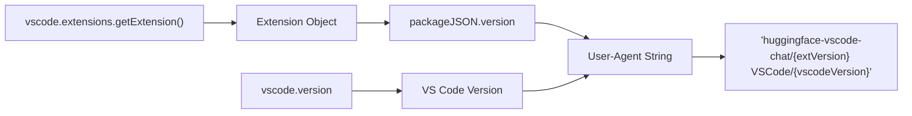
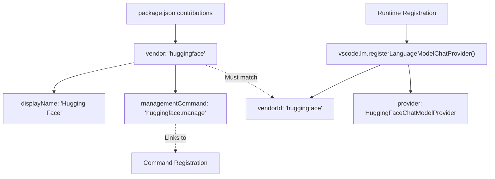
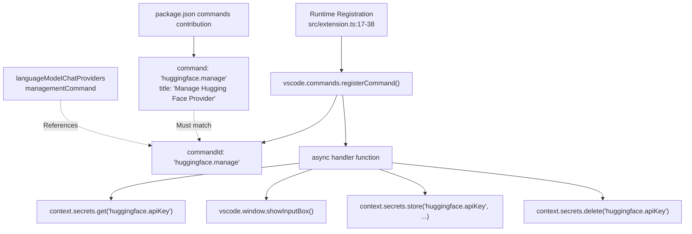
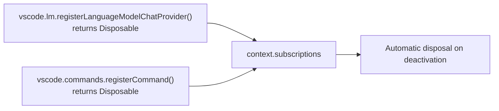
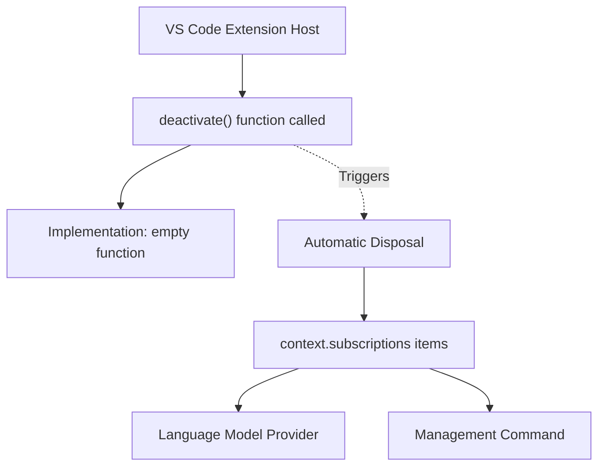
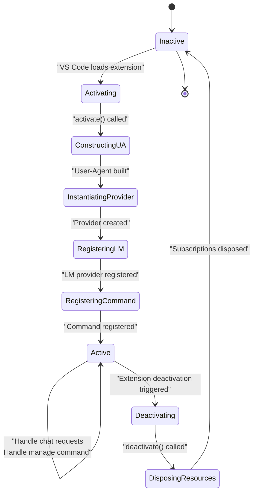

<!-- source: DeepWiki mcp.deepwiki.com · repo huggingface/huggingface-vscode-chat · page 3.2 Extension Lifecycle · fetched 2026-10-26 -->

# Extension Lifecycle

<details>
<summary>Relevant source files</summary>

The following files were used as context for generating this wiki page:

- [package.json](package.json)
- [src/extension.ts](src/extension.ts)

</details>


## Purpose and Scope

This page documents the lifecycle of the huggingface-vscode-chat extension, covering the activation process, component registration, and deactivation sequence. It explains how the extension initializes, registers with VS Code's APIs, and prepares for user interaction.

For details about the chat provider's internal implementation, see [Chat Provider Implementation](#3.3). For information about the overall system architecture, see [System Overview](#3.1).

## Extension Entry Point

The extension follows the standard VS Code extension pattern with an entry module specified in `package.json`:

| Configuration | Value |
|---------------|-------|
| Main entry | `./out/extension.js` |
| Source file | `src/extension.ts` |
| Activation events | Automatic (via contributions) |

The compiled JavaScript output at `./out/extension.js` is loaded by VS Code's extension host when the extension activates.

**Sources:** [package.json:55](), [src/extension.ts:1-42]()

## Activation Sequence

```mermaid
sequenceDiagram
    participant VSCode as "VS Code Extension Host"
    participant activate as "activate(context)"
    participant ExtAPI as "vscode.extensions API"
    participant Provider as "HuggingFaceChatModelProvider"
    participant LMAPI as "vscode.lm API"
    participant CmdAPI as "vscode.commands API"
    participant Secrets as "context.secrets"
    
    VSCode->>activate: "Call activate() on extension load"
    activate activate
    
    activate->>ExtAPI: "getExtension('HuggingFace.huggingface-vscode-chat')"
    ExtAPI-->>activate: "Extension object with packageJSON"
    
    activate->>activate: "Extract version from packageJSON"
    activate->>activate: "Get vscode.version"
    activate->>activate: "Construct User-Agent string"
    
    activate->>Provider: "new HuggingFaceChatModelProvider(secrets, ua)"
    Provider-->>activate: "provider instance"
    
    activate->>LMAPI: "registerLanguageModelChatProvider('huggingface', provider)"
    LMAPI-->>activate: "Disposable"
    
    activate->>CmdAPI: "registerCommand('huggingface.manage', handler)"
    CmdAPI-->>activate: "Disposable"
    
    activate->>activate: "Add disposables to context.subscriptions"
    
    deactivate activate
    activate-->>VSCode: "Activation complete"
```

**Activation Function Breakdown**

The `activate` function in [src/extension.ts:4-39]() executes the following steps:

**Sources:** [src/extension.ts:4-39]()

### User-Agent Construction

The extension constructs a descriptive User-Agent string to identify API requests:



The User-Agent format is: `huggingface-vscode-chat/{extVersion} VSCode/{vscodeVersion}`

**Sources:** [src/extension.ts:5-10]()

### Provider Instantiation

The `HuggingFaceChatModelProvider` is instantiated with two dependencies:

| Parameter | Type | Source | Purpose |
|-----------|------|--------|---------|
| `secrets` | `vscode.SecretStorage` | `context.secrets` | Secure API key storage |
| `ua` | `string` | Constructed User-Agent | API request identification |

**Sources:** [src/extension.ts:12]()

## Registration Process

### Language Model Provider Registration

The provider is registered with VS Code's language model API using a vendor identifier:



**Registration Code Mapping:**

- **Package Contribution:** [package.json:41-46]()
- **Runtime Registration:** [src/extension.ts:14]()

The vendor ID `"huggingface"` must match between the package.json contribution and the runtime registration call. This identifier is used by VS Code to route language model requests to the correct provider.

**Sources:** [package.json:41-46](), [src/extension.ts:14]()

### Command Registration

The `huggingface.manage` command handles API key configuration:



**Command Handler Flow:**

1. Retrieves existing API key from `context.secrets`
2. Shows password input box with existing value (if any)
3. Handles three cases:
   - User cancels → No action
   - Empty input → Deletes stored key
   - Valid input → Stores trimmed key

**Sources:** [package.json:48-53](), [src/extension.ts:17-38]()

## Subscription Management

All disposables are added to `context.subscriptions` to ensure proper cleanup:



The `context.subscriptions` array automatically disposes all registered items when the extension deactivates, preventing resource leaks.

**Sources:** [src/extension.ts:17]()

## Deactivation Process

The extension exports a `deactivate` function that VS Code calls when the extension is deactivated:



The `deactivate` function at [src/extension.ts:41]() is currently empty. VS Code automatically handles disposal of all items in `context.subscriptions`, including:

- The language model provider registration
- The management command registration

No manual cleanup is required because all resources are properly registered as disposables.

**Sources:** [src/extension.ts:41]()

## Lifecycle State Diagram



**State Descriptions:**

| State | Description | Code Location |
|-------|-------------|---------------|
| **Inactive** | Extension not loaded | N/A |
| **Activating** | VS Code invoking activate function | [src/extension.ts:4]() |
| **ConstructingUA** | Building User-Agent string from metadata | [src/extension.ts:6-10]() |
| **InstantiatingProvider** | Creating provider with dependencies | [src/extension.ts:12]() |
| **RegisteringLM** | Registering with language model API | [src/extension.ts:14]() |
| **RegisteringCommand** | Registering management command | [src/extension.ts:17-38]() |
| **Active** | Ready to handle requests | N/A |
| **Deactivating** | Cleanup initiated | [src/extension.ts:41]() |
| **DisposingResources** | Automatic disposal of subscriptions | Handled by VS Code |

**Sources:** [src/extension.ts:1-42](), [package.json:40-54]()

## Extension Metadata and Version Management

The extension's identity and version information flows from package.json through the activation process:

| Metadata Field | Value | Usage |
|----------------|-------|-------|
| `name` | `"huggingface-vscode-chat"` | Extension identifier |
| `publisher` | `"HuggingFace"` | Publisher namespace |
| `version` | `"0.0.5"` | Used in User-Agent construction |
| `engines.vscode` | `"^1.104.0"` | Minimum VS Code version required |

The full extension ID is constructed as `{publisher}.{name}`, resulting in `"HuggingFace.huggingface-vscode-chat"`, which is used in [src/extension.ts:6]() to retrieve the extension object.

**Sources:** [package.json:2-14](), [src/extension.ts:6]()

## Security Considerations

The extension lifecycle includes security-conscious design:

- **API Key Storage:** Uses `vscode.SecretStorage` API instead of workspace settings
- **No Key Exposure:** API key never logged or exposed in telemetry
- **Password Input:** Management command uses password-masked input field
- **Secure Secrets:** [src/extension.ts:19]() retrieves, [src/extension.ts:35]() stores, [src/extension.ts:31]() deletes

For detailed security architecture, see [Security and Configuration Management](#6).

**Sources:** [src/extension.ts:19-36]()

---

