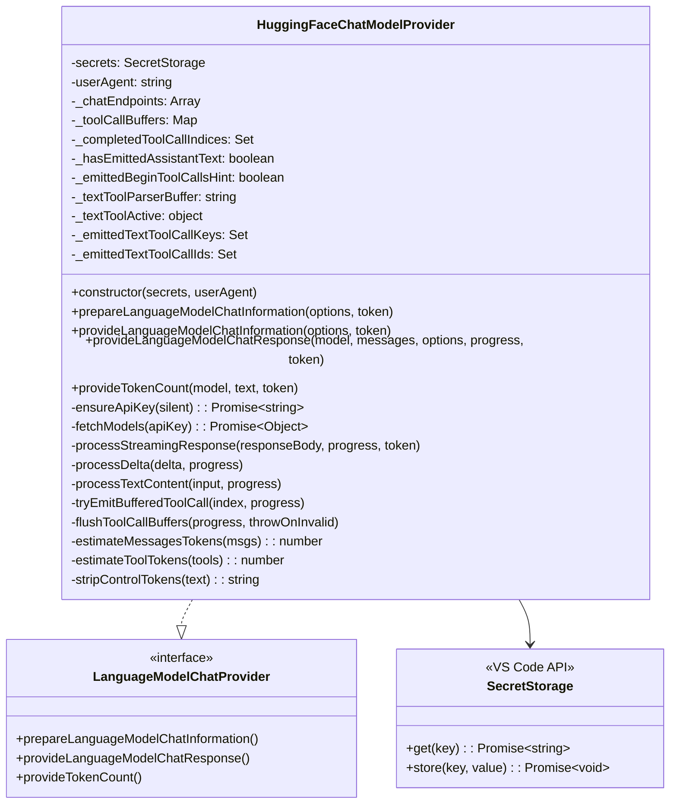
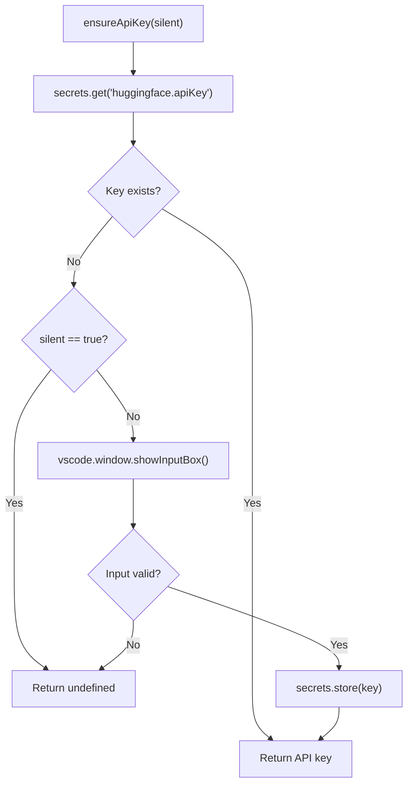
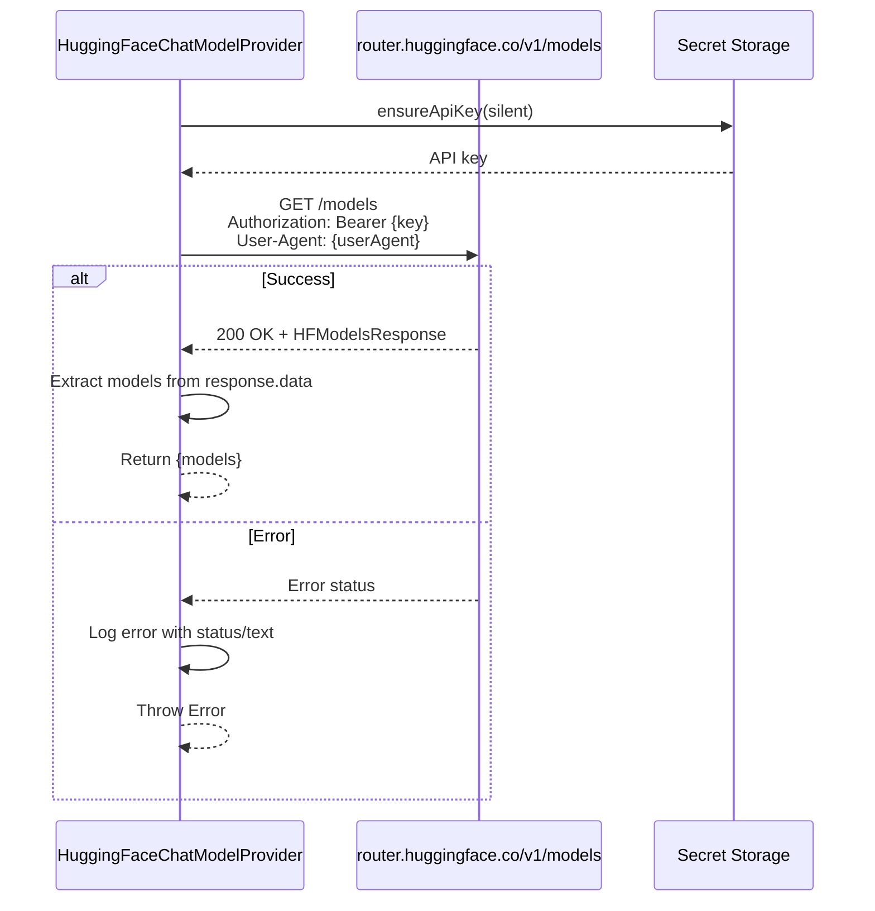
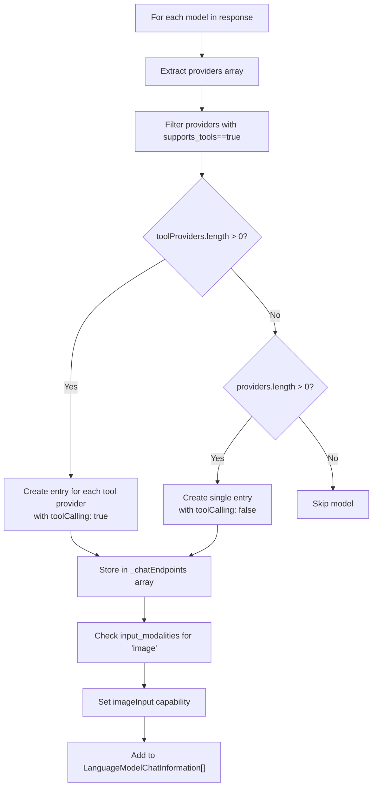
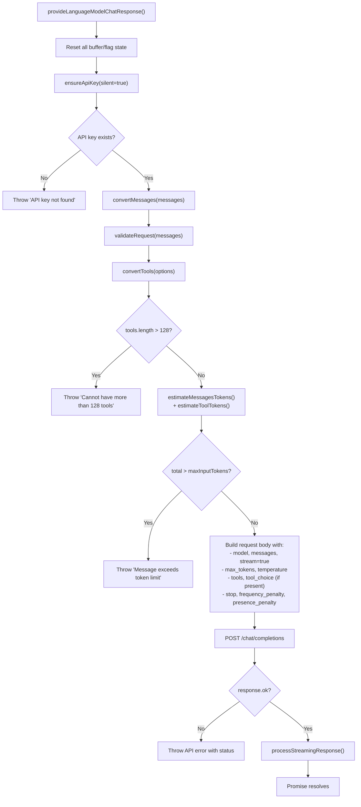
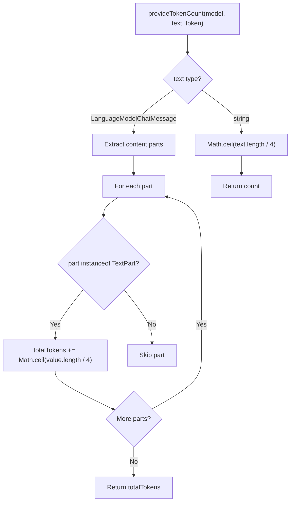
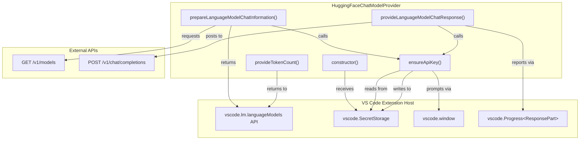

<!-- source: DeepWiki mcp.deepwiki.com · repo huggingface/huggingface-vscode-chat · page 3.3 Chat Provider Implementation · fetched 2026-10-26 -->

# Chat Provider Implementation

<details>
<summary>Relevant source files</summary>

The following files were used as context for generating this wiki page:

- [src/provider.ts](src/provider.ts)
- [src/types.ts](src/types.ts)

</details>


This document provides detailed documentation of the `HuggingFaceChatModelProvider` class, which serves as the core implementation of VS Code's `LanguageModelChatProvider` interface for Hugging Face models. This provider is responsible for managing API authentication, discovering available models, handling chat requests, and processing streaming responses.

For information about message format conversion, see [Message Conversion Layer](#3.4). For streaming response parsing details, see [Streaming Response Handling](#3.5). For tool calling architecture, see [Tool Call System](#3.6).

## Provider Class Overview

The `HuggingFaceChatModelProvider` class is defined in [src/provider.ts:23-781]() and implements the `LanguageModelChatProvider` interface from VS Code's Language Model API. This class acts as the bridge between VS Code's chat interface and the Hugging Face Router API.



**Sources:** [src/provider.ts:23-57](), [src/provider.ts:89-781]()

### Constructor and Dependencies

The provider is instantiated with two dependencies:

| Parameter | Type | Purpose |
|-----------|------|---------|
| `secrets` | `vscode.SecretStorage` | Secure storage for the Hugging Face API key |
| `userAgent` | `string` | User-Agent header for API requests, includes extension version |

The constructor initializes the provider instance and sets up empty state containers for streaming response management. The actual state initialization happens at the start of each request.

**Sources:** [src/provider.ts:57]()

## API Key Management

The provider uses VS Code's encrypted secret storage to securely persist the Hugging Face API key. The key is stored with the identifier `"huggingface.apiKey"`.

### ensureApiKey Method

The `ensureApiKey` method [src/provider.ts:358-373]() implements a lazy authentication flow:



**Authentication Flow:**

1. **Retrieve:** Attempts to get the API key from secret storage
2. **Silent Mode:** If `silent=true` and no key exists, returns `undefined` without prompting
3. **Interactive Mode:** If `silent=false`, shows an input box with password masking
4. **Validation:** Trims and validates the entered key
5. **Persistence:** Stores the validated key in secret storage for future use

**Sources:** [src/provider.ts:358-373]()

## Model Discovery

The provider discovers available Hugging Face models through the Router API's `/v1/models` endpoint. This process is handled by two coordinating methods.

### fetchModels Method

The private `fetchModels` method [src/provider.ts:170-202]() performs the actual HTTP request:



The request includes:
- **Authorization:** Bearer token with the API key
- **User-Agent:** Extension version information for telemetry

**Sources:** [src/provider.ts:170-202]()

### prepareLanguageModelChatInformation Method

The `prepareLanguageModelChatInformation` method [src/provider.ts:89-157]() transforms the raw model data into VS Code's `LanguageModelChatInformation` format:

| Field | Source | Purpose |
|-------|--------|---------|
| `id` | `{model.id}:{provider.provider}` or `{model.id}` | Unique identifier for the model-provider combination |
| `name` | `{model.id} via {provider.provider}` or `{model.id}` | Display name in UI |
| `family` | `"huggingface"` | Groups models in VS Code UI |
| `maxInputTokens` | `context_length - DEFAULT_MAX_OUTPUT_TOKENS` | Calculated input limit |
| `maxOutputTokens` | `DEFAULT_MAX_OUTPUT_TOKENS` (16000) | Fixed output limit |
| `capabilities.toolCalling` | `provider.supports_tools === true` | Enables tool use features |
| `capabilities.imageInput` | `"image" in input_modalities` | Enables vision features |

**Model Entry Logic:**



The method also caches model information in the `_chatEndpoints` array for internal use.

**Sources:** [src/provider.ts:89-157]()

## Chat Request Handling

The `provideLanguageModelChatResponse` method [src/provider.ts:214-327]() is the core handler for chat requests. It orchestrates message conversion, validation, token estimation, API communication, and response streaming.

### Request Processing Flow



**Sources:** [src/provider.ts:214-327]()

### State Initialization

At the start of each request, the provider resets all streaming state [src/provider.ts:222-229]():

| State Variable | Type | Initial Value | Purpose |
|----------------|------|---------------|---------|
| `_toolCallBuffers` | `Map<number, ToolCallBuffer>` | Empty map | Accumulates SSE tool call deltas |
| `_completedToolCallIndices` | `Set<number>` | Empty set | Tracks emitted tool calls |
| `_hasEmittedAssistantText` | `boolean` | `false` | Detects text before tool calls |
| `_emittedBeginToolCallsHint` | `boolean` | `false` | Whitespace flush flag |
| `_textToolParserBuffer` | `string` | `""` | Buffer for control token parsing |
| `_textToolActive` | `object \| undefined` | `undefined` | Active text-embedded tool call |
| `_emittedTextToolCallKeys` | `Set<string>` | Empty set | Deduplication for tool calls |
| `_emittedTextToolCallIds` | `Set<string>` | Empty set | Identity-based deduplication |

**Sources:** [src/provider.ts:26-51](), [src/provider.ts:222-229]()

### Request Body Construction

The request body is constructed with the following structure [src/provider.ts:269-296]():

```typescript
{
  model: string,              // Model ID from LanguageModelChatInformation
  messages: OpenAIChatMessage[], // Converted from VS Code format
  stream: true,               // Always streaming
  max_tokens: number,         // Min of options or maxOutputTokens
  temperature: number,        // Default 0.7
  
  // Optional fields:
  tools?: OpenAIFunctionToolDef[],
  tool_choice?: string | object,
  stop?: string | string[],
  frequency_penalty?: number,
  presence_penalty?: number
}
```

**Sources:** [src/provider.ts:269-296]()

### Token Estimation

The provider implements simple token estimation for quota checking:

**Message Tokens** [src/provider.ts:59-70]():
- Extracts text from `LanguageModelTextPart` instances
- Estimates 1 token per 4 characters
- Ignores non-text parts

**Tool Tokens** [src/provider.ts:72-81]():
- Serializes tools array to JSON
- Estimates 1 token per 4 characters
- Returns 0 if no tools or serialization fails

**Sources:** [src/provider.ts:59-81](), [src/provider.ts:261-267]()

## Token Counting

The `provideTokenCount` method [src/provider.ts:336-352]() implements VS Code's token counting interface using the same character-based estimation:



**Sources:** [src/provider.ts:336-352]()

## State Management

The provider maintains complex state across the streaming response lifecycle to handle both SSE-formatted tool calls and text-embedded tool calls with control tokens.

### Tool Call Buffer System

**SSE Tool Call Buffers** [src/provider.ts:26-32]():

The `_toolCallBuffers` map accumulates streaming deltas by index:

```typescript
Map<number, {
  id?: string,      // Tool call ID from SSE
  name?: string,    // Function name
  args: string      // Accumulated JSON arguments
}>
```

The `_completedToolCallIndices` set prevents re-emission of already completed tool calls when subsequent deltas arrive for the same index.

**Text Tool Call State** [src/provider.ts:41-51]():

For text-embedded tool calls using control tokens like `<|tool_call_begin|>`:

```typescript
_textToolActive: undefined | {
  name?: string,      // Extracted from header
  index?: number,     // Extracted from header (optional)
  argBuffer: string,  // Accumulated arguments
  emitted?: boolean   // Prevents double emission
}
```

Deduplication uses two sets:
- `_emittedTextToolCallKeys`: Content-based deduplication using `"name:canonicalJSON"`
- `_emittedTextToolCallIds`: Identity-based deduplication using `"name:index"` when index is present

**Sources:** [src/provider.ts:26-51](), [src/provider.ts:504-516](), [src/provider.ts:659-686]()

### Emission Control Flags

**Text Emission Tracking** [src/provider.ts:34-38]():

- `_hasEmittedAssistantText`: Set to `true` when any text content is emitted
- `_emittedBeginToolCallsHint`: Set to `true` when whitespace flush is emitted

When the first SSE tool call appears after text has been emitted, the provider emits a single space character [src/provider.ts:493-496](). This ensures UI buffers and linkifiers are flushed without adding visible noise.

**Sources:** [src/provider.ts:34-38](), [src/provider.ts:477-486](), [src/provider.ts:488-496]()

## Integration Points

The provider integrates with multiple VS Code and external APIs:

### VS Code API Integration



**Sources:** [src/provider.ts:1-10](), [src/provider.ts:57](), [src/provider.ts:89-157](), [src/provider.ts:214-327]()

### External API Configuration

| Constant | Value | Usage |
|----------|-------|-------|
| `BASE_URL` | `"https://router.huggingface.co/v1"` | Base URL for all API requests |
| `DEFAULT_MAX_OUTPUT_TOKENS` | `16000` | Default output token limit |
| `DEFAULT_CONTEXT_LENGTH` | `128000` | Fallback context length |

**Headers:**
- **Authorization:** `Bearer {apiKey}` for authentication
- **Content-Type:** `application/json` for POST requests  
- **User-Agent:** `{userAgent}` for telemetry and debugging

**Sources:** [src/provider.ts:16-18](), [src/provider.ts:176](), [src/provider.ts:299-302]()

## Error Handling

The provider implements comprehensive error handling across multiple failure points:

### API Key Errors

- **Missing Key (Silent):** Returns empty model list or throws depending on context
- **Missing Key (Interactive):** Prompts user with input box
- **Invalid Entry:** Returns `undefined` and doesn't store

**Sources:** [src/provider.ts:93-96](), [src/provider.ts:246-249](), [src/provider.ts:358-373]()

### Model Fetch Errors

- **HTTP Error:** Logs error with status/response text and throws
- **Parse Error:** Propagates JSON parsing exceptions
- **Network Error:** Logs and re-throws with context

**Sources:** [src/provider.ts:178-190](), [src/provider.ts:195-201]()

### Chat Request Errors

- **Tool Limit:** Throws if more than 128 tools provided
- **Token Limit:** Throws if input + tools exceed `maxInputTokens`
- **API Error:** Logs response text and throws with status
- **Stream Error:** Logs with model ID and error details

**Sources:** [src/provider.ts:257-259](), [src/provider.ts:264-267](), [src/provider.ts:307-313](), [src/provider.ts:319-326]()

### Progress Reporting Errors

The provider wraps the progress reporter to catch and log reporting failures without disrupting the stream:

```typescript
const trackingProgress = {
  report: (part) => {
    try {
      progress.report(part);
    } catch (e) {
      console.error("[Hugging Face Model Provider] Progress.report failed", {
        modelId: model.id,
        error: e instanceof Error ? { name: e.name, message: e.message } : String(e)
      });
    }
  }
};
```

**Sources:** [src/provider.ts:233-244]()

## Control Token Support

The provider supports text-embedded tool calls using special control tokens for backends that stream tool calls as text rather than SSE:

| Token | Purpose |
|-------|---------|
| `<|tool_call_begin|>` | Marks start of tool call, followed by `name:index` header |
| `<|tool_call_argument_begin|>` | Marks start of JSON arguments |
| `<|tool_call_end|>` | Marks end of tool call |

**Stripping Logic** [src/provider.ts:770-779]():
- Removes section markers: `<|*_section_begin|>`, `<|*_section_end|>`
- Removes tool call markers when not in parsing mode
- Preserves text content between/outside markers

**Sources:** [src/provider.ts:538-541](), [src/provider.ts:534-657](), [src/provider.ts:770-779]()

---

