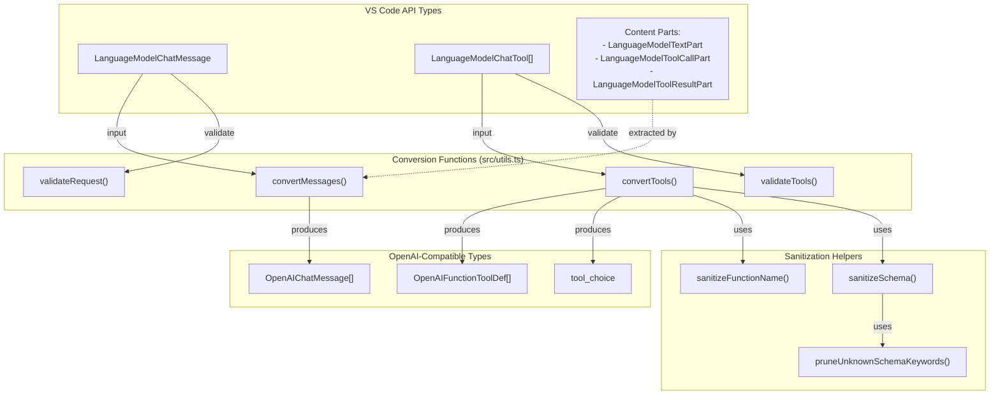
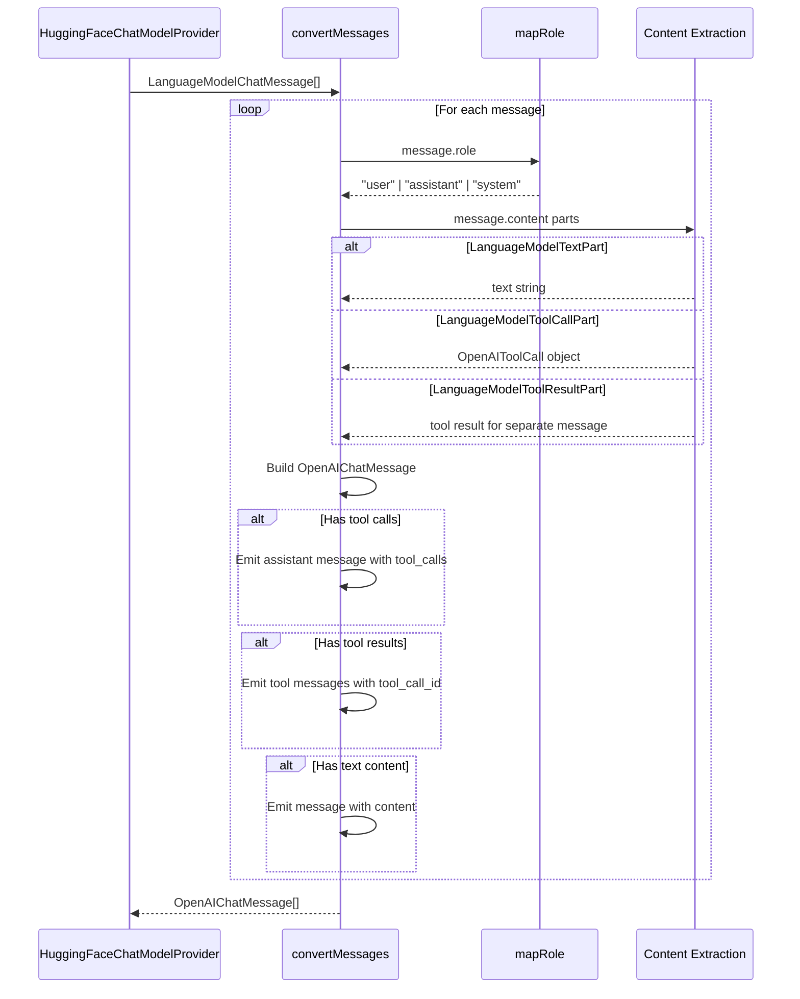
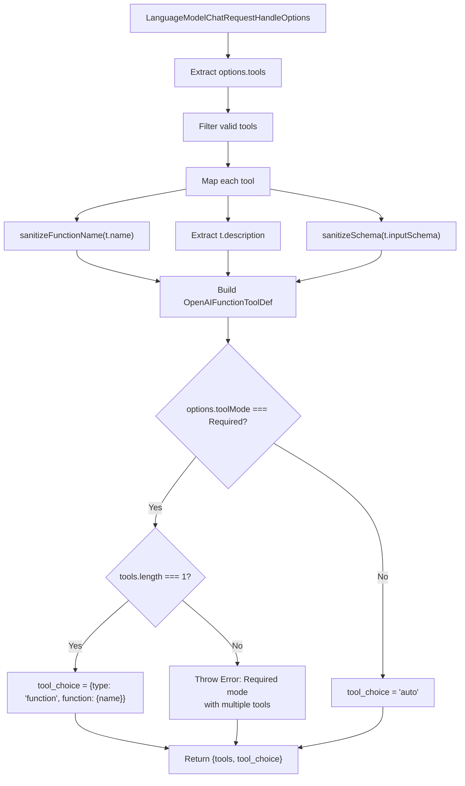
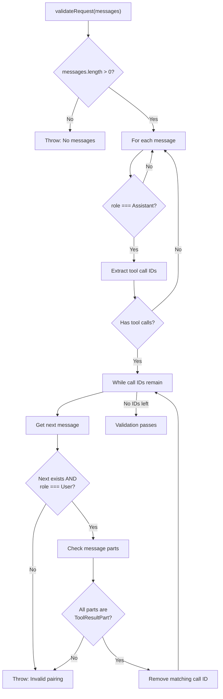

<!-- source: DeepWiki mcp.deepwiki.com · repo huggingface/huggingface-vscode-chat · page 3.4 Message Conversion Layer · fetched 2026-10-26 -->

# Message Conversion Layer

<details>
<summary>Relevant source files</summary>

The following files were used as context for generating this wiki page:

- [src/provider.ts](src/provider.ts)
- [src/types.ts](src/types.ts)
- [src/utils.ts](src/utils.ts)

</details>


## Purpose and Scope

The Message Conversion Layer is the adapter system that transforms VS Code's Language Model API data structures into OpenAI-compatible formats consumed by the Hugging Face Router API. This layer ensures bidirectional compatibility between VS Code's chat interface and Hugging Face's inference endpoints.

For information about how the provider uses these conversions during chat requests, see [Chat Provider Implementation](#3.3). For details on how converted messages flow through the streaming response parser, see [Streaming Response Handling](#3.5).

## Conversion Architecture

The conversion layer consists of utility functions in [src/utils.ts]() that transform messages, tools, and schemas between VS Code and OpenAI formats. The provider calls these functions during request preparation to ensure API compatibility.



**Sources:** [src/utils.ts:1-364](), [src/types.ts:1-85]()

## Message Conversion Flow

### convertMessages Function

The `convertMessages` function transforms VS Code's `LanguageModelChatMessage` array into OpenAI-compatible `OpenAIChatMessage` structures. This is the primary entry point for message transformation.



**Sources:** [src/utils.ts:143-186](), [src/provider.ts:251]()

### Role Mapping

The `mapRole` function converts VS Code's enumerated role types to OpenAI role strings:

| VS Code Role | OpenAI Role | Description |
|--------------|-------------|-------------|
| `LanguageModelChatMessageRole.User` | `"user"` | User-generated messages |
| `LanguageModelChatMessageRole.Assistant` | `"assistant"` | Model-generated responses |
| Any other role | `"system"` | System instructions and context |

The mapping uses numeric comparison to avoid dependency on specific enum values [src/utils.ts:310-321]().

**Sources:** [src/utils.ts:310-321]()

### Content Part Processing

The conversion function processes three types of content parts:

#### Text Parts
`LanguageModelTextPart` instances are collected into an array and joined into a single content string [src/utils.ts:152-153]().

#### Tool Call Parts
`LanguageModelToolCallPart` instances are transformed into `OpenAIToolCall` objects with the structure:
```typescript
{
  id: string,              // from part.callId or generated
  type: "function",
  function: {
    name: string,          // from part.name
    arguments: string      // JSON.stringify(part.input)
  }
}
```

**Sources:** [src/utils.ts:154-162]()

#### Tool Result Parts
Tool result parts are extracted using the `isToolResultPart` type guard and converted to separate OpenAI `tool` role messages:
```typescript
{
  role: "tool",
  tool_call_id: string,    // from part.callId
  content: string          // collected from part.content
}
```

**Sources:** [src/utils.ts:163-178](), [src/utils.ts:296-304](), [src/utils.ts:327-343]()

### Message Assembly Logic

The conversion follows this message emission pattern:

1. **If tool calls present:** Emit assistant message with `tool_calls` array [src/utils.ts:171-174]()
2. **For each tool result:** Emit separate `tool` role message [src/utils.ts:176-178]()
3. **If text content exists and not already emitted:** Emit message with role and content [src/utils.ts:180-183]()

This ensures proper OpenAI message structure where tool calls and results are separate messages in the conversation.

**Sources:** [src/utils.ts:170-184]()

## Tool Definition Conversion

### convertTools Function

The `convertTools` function transforms VS Code tool definitions into OpenAI function tool definitions and determines the `tool_choice` parameter.



**Sources:** [src/utils.ts:192-227](), [src/provider.ts:255]()

### Function Name Sanitization

The `sanitizeFunctionName` function ensures tool names comply with OpenAI's naming constraints:

1. **Replace invalid characters:** All non-alphanumeric characters (except `_` and `-`) become `_` [src/utils.ts:31]()
2. **Ensure alphabetic start:** Prefix with `tool_` if name doesn't start with a letter [src/utils.ts:32-34]()
3. **Collapse underscores:** Replace multiple consecutive underscores with single `_` [src/utils.ts:35]()
4. **Truncate:** Limit to 64 characters [src/utils.ts:36]()

**Sources:** [src/utils.ts:27-37]()

### Schema Sanitization

The `sanitizeSchema` function recursively processes JSON schemas to ensure compatibility with Hugging Face providers:

#### Composite Schema Resolution

Handles `anyOf`, `oneOf`, and `allOf` by selecting a preferred branch:
- Prefers branches with `type: "string"` [src/utils.ts:79-82]()
- Falls back to first branch if no string type found [src/utils.ts:85]()

**Sources:** [src/utils.ts:75-88]()

#### Keyword Pruning

Only allows these JSON Schema keywords:
- Type constraints: `type`, `enum`, `default`
- Object properties: `properties`, `required`, `additionalProperties`
- String constraints: `minLength`, `maxLength`, `pattern`, `format`
- Number constraints: `minimum`, `maximum`
- Array constraints: `items`
- Documentation: `description`

All other keywords are removed [src/utils.ts:39-66]().

**Sources:** [src/utils.ts:39-66]()

#### Type Inference and Correction

1. **Default to object:** If no type specified, set to `"object"` [src/utils.ts:92-96]()
2. **Number to integer conversion:** Properties with integer-like names (id, count, limit, etc.) are converted from `"number"` to `"integer"` [src/utils.ts:98-101]()
3. **Recursive property sanitization:** Object properties are recursively sanitized [src/utils.ts:103-111]()
4. **Array items handling:** Ensures array schemas have properly sanitized items [src/utils.ts:124-133]()

**Sources:** [src/utils.ts:68-136](), [src/utils.ts:6-25]()

## Validation Functions

### Request Validation

The `validateRequest` function ensures proper tool call/result pairing in the message sequence:



The validation enforces this pattern:
1. Assistant messages with tool calls must be followed by user messages
2. User messages must contain only `LanguageModelToolResultPart` instances
3. Each tool call ID must have a matching tool result

**Sources:** [src/utils.ts:248-290](), [src/provider.ts:253]()

### Tool Validation

The `validateTools` function ensures tool names match the pattern `[\w-]+` (alphanumeric, underscores, and hyphens only). This validation happens before the provider processes tools [src/utils.ts:233-242]().

**Sources:** [src/utils.ts:233-242]()

## Type Mapping Reference

### Message Types

| VS Code Type | OpenAI Type | Field Mapping |
|--------------|-------------|---------------|
| `LanguageModelChatMessage` | `OpenAIChatMessage` | role → role (mapped)<br/>content parts → content/tool_calls/tool_call_id |
| `LanguageModelTextPart` | `content: string` | value → content |
| `LanguageModelToolCallPart` | `tool_calls: OpenAIToolCall[]` | callId → id<br/>name → function.name<br/>input → function.arguments (JSON) |
| `LanguageModelToolResultPart` | `role: "tool"` message | callId → tool_call_id<br/>content → content (collected text) |

**Sources:** [src/types.ts:4-27](), [src/utils.ts:143-186]()

### Tool Definition Types

| VS Code Type | OpenAI Type | Field Mapping |
|--------------|-------------|---------------|
| `LanguageModelChatTool` | `OpenAIFunctionToolDef` | name → function.name (sanitized)<br/>description → function.description<br/>inputSchema → function.parameters (sanitized) |
| `LanguageModelChatToolMode.Required` | `tool_choice: {type: "function", function: {name}}` | Single tool name |
| `LanguageModelChatToolMode` (default) | `tool_choice: "auto"` | Auto selection |

**Sources:** [src/types.ts:10-16](), [src/utils.ts:192-227]()

## Utility Functions

### JSON Parsing

The `tryParseJSONObject` function safely parses JSON with validation:
- Returns `{ok: true, value}` for valid JSON objects
- Returns `{ok: false}` for invalid/non-object JSON
- Used for tool call argument validation during streaming [src/utils.ts:350-363]()

**Sources:** [src/utils.ts:350-363]()

### Tool Result Collection

The `collectToolResultText` function concatenates mixed content arrays from tool results:
- Extracts text from `LanguageModelTextPart` instances
- Concatenates raw strings
- Serializes objects to JSON
- Used when building tool role messages [src/utils.ts:327-343]()

**Sources:** [src/utils.ts:327-343]()

### Type Guards

The `isToolResultPart` function provides runtime type checking for tool result parts:
- Validates presence of `callId` string property
- Validates presence of `content` property
- Enables safe extraction of tool results from unknown part types [src/utils.ts:296-304]()

**Sources:** [src/utils.ts:296-304]()

---

