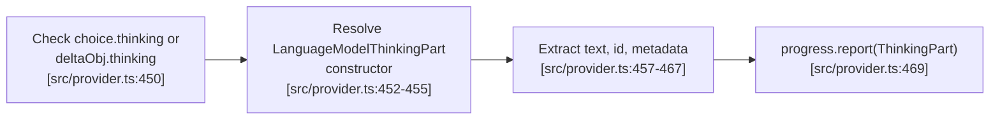
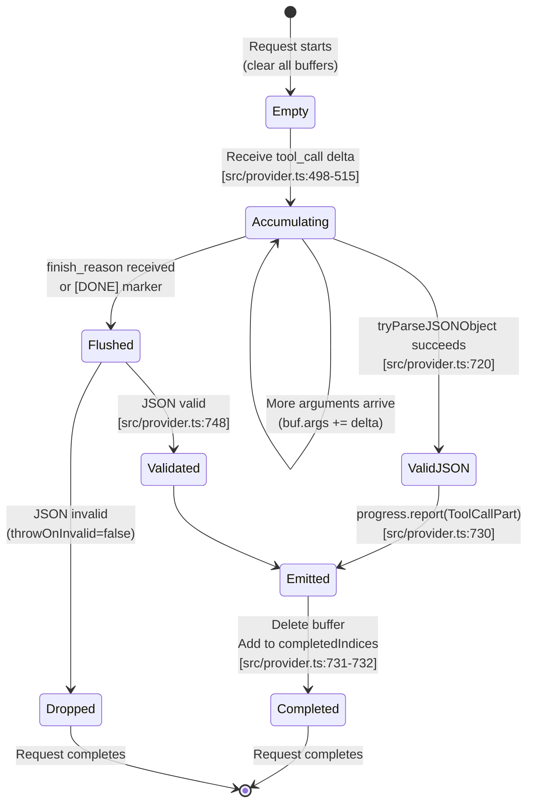
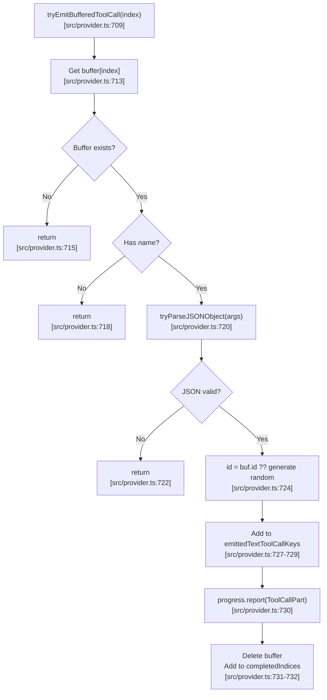
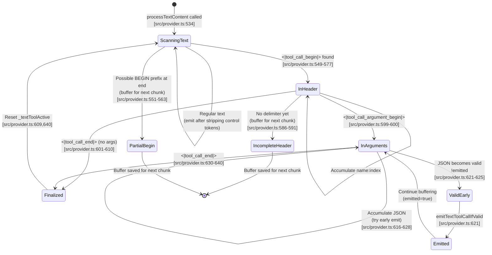
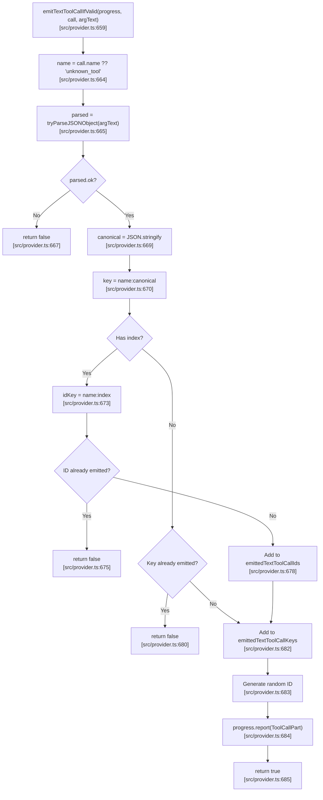
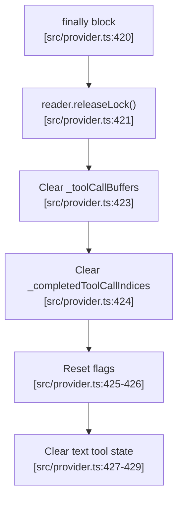

<!-- source: DeepWiki mcp.deepwiki.com · repo huggingface/huggingface-vscode-chat · page 3.5 Streaming Response Handling · fetched 2026-10-26 -->

# Streaming Response Handling

<details>
<summary>Relevant source files</summary>

The following files were used as context for generating this wiki page:

- [src/provider.ts](src/provider.ts)
- [src/types.ts](src/types.ts)

</details>


## Purpose and Scope

This document details the streaming response handling system within the HuggingFaceChatModelProvider. The system processes Server-Sent Events (SSE) from the Hugging Face Router API, progressively emits text and tool call parts to VS Code's chat interface, and manages two distinct tool call formats: SSE-structured tool calls and text-embedded tool calls with control tokens.

For information about how messages are converted before being sent to the API, see [Message Conversion Layer](#3.4). For details on tool call validation and conversion, see [Tool Call System](#3.6).

## SSE Stream Processing Architecture

The streaming response system implements a robust SSE parser that reads chunks from the Hugging Face Router API and extracts structured data from each event.

```mermaid
flowchart TD
    Entry["provideLanguageModelChatResponse<br/>[src/provider.ts:214]"] --> Reset["Reset State<br/>Clear buffers, flags<br/>[src/provider.ts:222-229]"]
    Reset --> Fetch["HTTP POST to<br/>router.huggingface.co/v1/chat/completions<br/>[src/provider.ts:297-305]"]
    Fetch --> Check{Response OK?}
    Check -->|No| Error["Throw Error<br/>[src/provider.ts:307-313]"]
    Check -->|Yes| Stream["processStreamingResponse<br/>[src/provider.ts:318]"]
    
    Stream --> Reader["responseBody.getReader()<br/>[src/provider.ts:386]"]
    Reader --> Decoder["TextDecoder instance<br/>[src/provider.ts:387]"]
    Decoder --> Loop{Token cancelled?}
    
    Loop -->|Yes| Cleanup["Clean up state<br/>[src/provider.ts:422-430]"]
    Loop -->|No| Read["reader.read()<br/>[src/provider.ts:392]"]
    
    Read --> Done{done?}
    Done -->|Yes| Cleanup
    Done -->|No| Decode["decoder.decode(value)<br/>[src/provider.ts:395]"]
    
    Decode --> Buffer["Append to buffer<br/>[src/provider.ts:395]"]
    Buffer --> Split["Split by newline<br/>[src/provider.ts:396]"]
    Split --> Lines["Process each line<br/>[src/provider.ts:399-418]"]
    
    Lines --> DataCheck{Starts with<br/>'data: '?}
    DataCheck -->|No| Loop
    DataCheck -->|Yes| Extract["Extract data.slice(6)<br/>[src/provider.ts:403]"]
    
    Extract --> DoneCheck{data === '[DONE]'?}
    DoneCheck -->|Yes| Flush["flushToolCallBuffers(false)<br/>flushActiveTextToolCall()<br/>[src/provider.ts:406-408]"]
    DoneCheck -->|No| Parse["JSON.parse(data)<br/>[src/provider.ts:413]"]
    
    Parse --> Delta["processDelta(parsed)<br/>[src/provider.ts:414]"]
    Delta --> Loop
    Flush --> Loop
```

**Sources:** [src/provider.ts:214-220](), [src/provider.ts:381-431]()

The stream processing follows this protocol:

| Stage | Implementation | Purpose |
|-------|---------------|---------|
| Reader Initialization | `responseBody.getReader()` | Obtain readable stream reader |
| Text Decoding | `TextDecoder` with `{stream: true}` | Convert Uint8Array chunks to UTF-8 strings |
| Line Buffering | `buffer.split("\n")` with remainder tracking | Handle partial SSE events across chunks |
| SSE Parsing | `line.startsWith("data: ")` check | Extract SSE data payload |
| Termination Detection | `data === "[DONE]"` | Identify stream completion |
| Delta Processing | `processDelta(parsed)` | Handle individual response chunks |

**Sources:** [src/provider.ts:386-418]()

## Response Delta Processing

Each parsed SSE chunk is processed through `processDelta`, which handles multiple response types: text content, SSE-structured tool calls, and thinking annotations.

```mermaid
flowchart TD
    Delta["processDelta(delta, progress)<br/>[src/provider.ts:438]"] --> Extract["Extract choice[0]<br/>[src/provider.ts:443-444]"]
    Extract --> Check{choice exists?}
    Check -->|No| Return["return false<br/>[src/provider.ts:444]"]
    
    Check -->|Yes| GetDelta["deltaObj = choice.delta<br/>[src/provider.ts:446]"]
    
    GetDelta --> ThinkCheck{Has thinking field?}
    ThinkCheck -->|Yes| ThinkEmit["LanguageModelThinkingPart<br/>[src/provider.ts:449-476]"]
    ThinkEmit --> ContentCheck
    ThinkCheck -->|No| ContentCheck
    
    ContentCheck{Has content?} -->|Yes| TextProcess["processTextContent(content)<br/>[src/provider.ts:477-486]"]
    TextProcess --> ToolCheck
    ContentCheck -->|No| ToolCheck
    
    ToolCheck{Has tool_calls?} -->|Yes| HintCheck{First tool after text?}
    HintCheck -->|Yes| WhiteSpace["Emit whitespace hint<br/>_emittedBeginToolCallsHint=true<br/>[src/provider.ts:493-496]"]
    HintCheck -->|No| ToolLoop
    WhiteSpace --> ToolLoop
    
    ToolLoop["For each tool_call<br/>[src/provider.ts:498]"] --> IdxCheck{Index completed?}
    IdxCheck -->|Yes| Skip["Skip<br/>[src/provider.ts:501-503]"]
    IdxCheck -->|No| BufferGet["Get/create buffer<br/>[src/provider.ts:504]"]
    
    BufferGet --> UpdateId{Has id?}
    UpdateId -->|Yes| SetId["buf.id = tc.id<br/>[src/provider.ts:505-507]"]
    UpdateId -->|No| UpdateName
    SetId --> UpdateName
    
    UpdateName{Has function.name?} -->|Yes| SetName["buf.name = func.name<br/>[src/provider.ts:509-511]"]
    UpdateName -->|No| UpdateArgs
    SetName --> UpdateArgs
    
    UpdateArgs{Has arguments?} -->|Yes| AppendArgs["buf.args += arguments<br/>[src/provider.ts:512-514]"]
    UpdateArgs -->|No| Store
    AppendArgs --> Store
    
    Store["Store buffer<br/>[src/provider.ts:515]"] --> TryEmit["tryEmitBufferedToolCall<br/>[src/provider.ts:518]"]
    TryEmit --> FinishCheck
    ToolCheck -->|No| FinishCheck
    Skip --> ToolLoop
    
    FinishCheck{finish_reason?} -->|tool_calls or stop| FlushAll["flushToolCallBuffers(true)<br/>[src/provider.ts:525]"]
    FlushAll --> End["return emitted<br/>[src/provider.ts:527]"]
    FinishCheck -->|None| End
```



**Sources:** [src/provider.ts:438-528]()

### Thinking Part Support

The system detects and emits thinking annotations when the backend provides them and VS Code supports the experimental `LanguageModelThinkingPart` API:



**Sources:** [src/provider.ts:449-476]()

## Tool Call Buffer Management

The system maintains a stateful buffer system to assemble tool calls from fragmented SSE chunks. Tool calls are emitted progressively as soon as their JSON arguments become valid.

### Buffer State Variables

| Variable | Type | Purpose |
|----------|------|---------|
| `_toolCallBuffers` | `Map<number, {id?, name?, args: string}>` | Accumulate tool call fragments by index |
| `_completedToolCallIndices` | `Set<number>` | Track fully emitted tool calls |
| `_hasEmittedAssistantText` | `boolean` | Detect if text was emitted before tool calls |
| `_emittedBeginToolCallsHint` | `boolean` | Track whitespace hint emission |
| `_emittedTextToolCallKeys` | `Set<string>` | Deduplication for text-embedded tool calls |
| `_emittedTextToolCallIds` | `Set<string>` | Identity-based deduplication |

**Sources:** [src/provider.ts:25-51]()

### Buffer Lifecycle



**Sources:** [src/provider.ts:709-767]()

### Progressive Emission Strategy

The `tryEmitBufferedToolCall` method implements a progressive emission strategy to minimize perceived latency:



**Sources:** [src/provider.ts:709-733]()

This approach ensures:
- Tool calls appear as soon as arguments are complete JSON (no waiting for `finish_reason`)
- Subsequent deltas for completed indices are ignored
- Invalid JSON is silently buffered until valid or stream ends

## Text-Embedded Tool Call Parsing

Some Hugging Face models emit tool calls inline within text content using control tokens. The system parses these using a state machine that handles partial tokens across stream chunks.

### Control Token Protocol

| Token | Purpose | Example |
|-------|---------|---------|
| `<|tool_call_begin|>` | Start tool call | `<|tool_call_begin|>calculate:0` |
| `<|tool_call_argument_begin|>` | Separate header from arguments | `calculate:0<|tool_call_argument_begin|>{"x":5}` |
| `<|tool_call_end|>` | End tool call | `{"x":5}<|tool_call_end|>` |

**Sources:** [src/provider.ts:538-540]()

### Text Parsing State Machine



**Sources:** [src/provider.ts:534-657]()

### Text Tool Call Emission Logic

The `emitTextToolCallIfValid` method handles deduplication and validation:



**Sources:** [src/provider.ts:659-686]()

### Control Token Stripping

Regular text content has control tokens removed before emission:

```javascript
// Pattern: <|section_begin|>, <|tool_call_begin|>, etc.
text.replace(/<\|[a-zA-Z0-9_-]+_section_(?:begin|end)\|>/g, "")
    .replace(/<\|tool_call_(?:argument_)?(?:begin|end)\|>/g, "")
```

**Sources:** [src/provider.ts:769-779]()

## State Lifecycle and Cleanup

All streaming state is reset at request start and cleaned up on completion to prevent cross-contamination between requests.

### State Initialization

```mermaid
flowchart LR
    Start["provideLanguageModelChatResponse<br/>[src/provider.ts:214]"] --> Clear1["_toolCallBuffers.clear()<br/>[src/provider.ts:222]"]
    Clear1 --> Clear2["_completedToolCallIndices.clear()<br/>[src/provider.ts:223]"]
    Clear2 --> Clear3["_hasEmittedAssistantText = false<br/>[src/provider.ts:224]"]
    Clear3 --> Clear4["_emittedBeginToolCallsHint = false<br/>[src/provider.ts:225]"]
    Clear4 --> Clear5["_textToolParserBuffer = ''<br/>[src/provider.ts:226]"]
    Clear5 --> Clear6["_textToolActive = undefined<br/>[src/provider.ts:227]"]
    Clear6 --> Clear7["_emittedTextToolCallKeys.clear()<br/>[src/provider.ts:228]"]
    Clear7 --> Clear8["_emittedTextToolCallIds.clear()<br/>[src/provider.ts:229]"]
```



**Sources:** [src/provider.ts:222-229]()

### Cleanup on Completion

The `finally` block ensures proper cleanup regardless of success or failure:



**Sources:** [src/provider.ts:420-430]()

## Error Handling and Edge Cases

The streaming system handles various error conditions gracefully:

| Condition | Handling | Location |
|-----------|----------|----------|
| Malformed SSE line | Silent ignore (catch block) | [src/provider.ts:415-417]() |
| Invalid JSON in buffer | Throw on `finish_reason`, silent on `[DONE]` | [src/provider.ts:749-755]() |
| Missing tool call name | Buffer without emitting | [src/provider.ts:717-719]() |
| Incomplete control token | Buffer for next chunk | [src/provider.ts:551-563]() |
| Cancellation | Exit loop, run cleanup | [src/provider.ts:391-393]() |
| HTTP error | Throw with status and body | [src/provider.ts:307-313]() |
| Missing response body | Throw error | [src/provider.ts:315-317]() |

**Sources:** [src/provider.ts:307-431]()

### Flush Behavior on Stream End

The `[DONE]` marker triggers a non-throwing flush to gracefully handle incomplete tool calls:

```javascript
if (data === "[DONE]") {
    await this.flushToolCallBuffers(progress, /*throwOnInvalid*/ false);
    await this.flushActiveTextToolCall(progress);
    continue;
}
```

**Sources:** [src/provider.ts:404-410]()

This ensures that:
- Valid buffered tool calls are emitted
- Invalid JSON is silently dropped (reducing noise)
- Text-embedded tool calls in progress are finalized if valid

---

