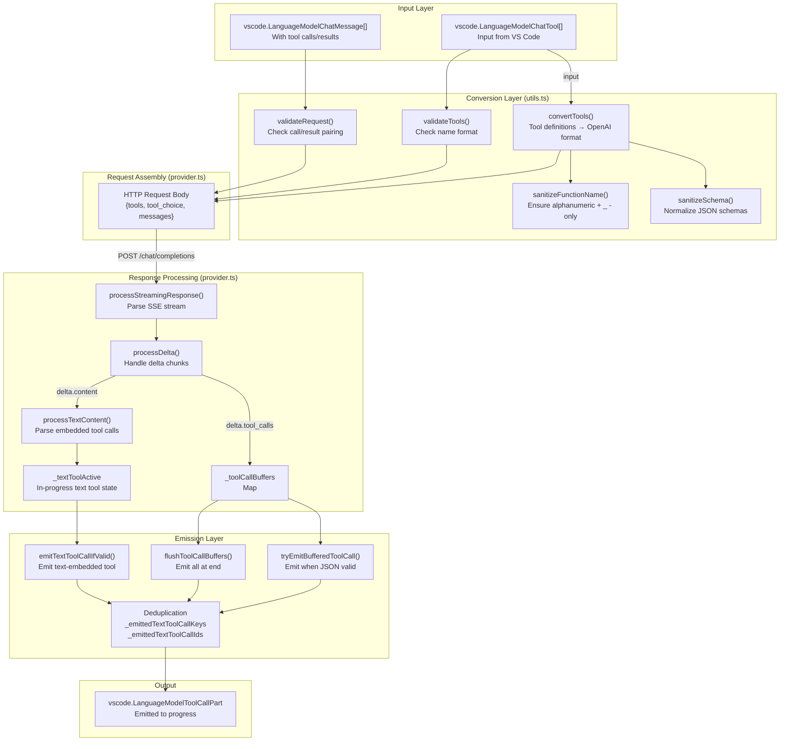
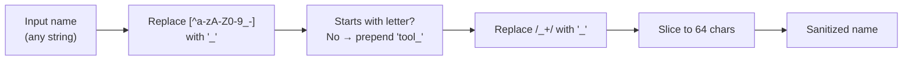
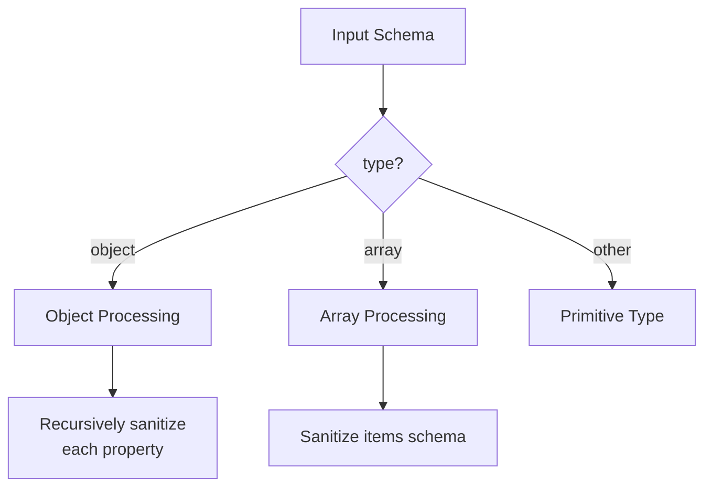
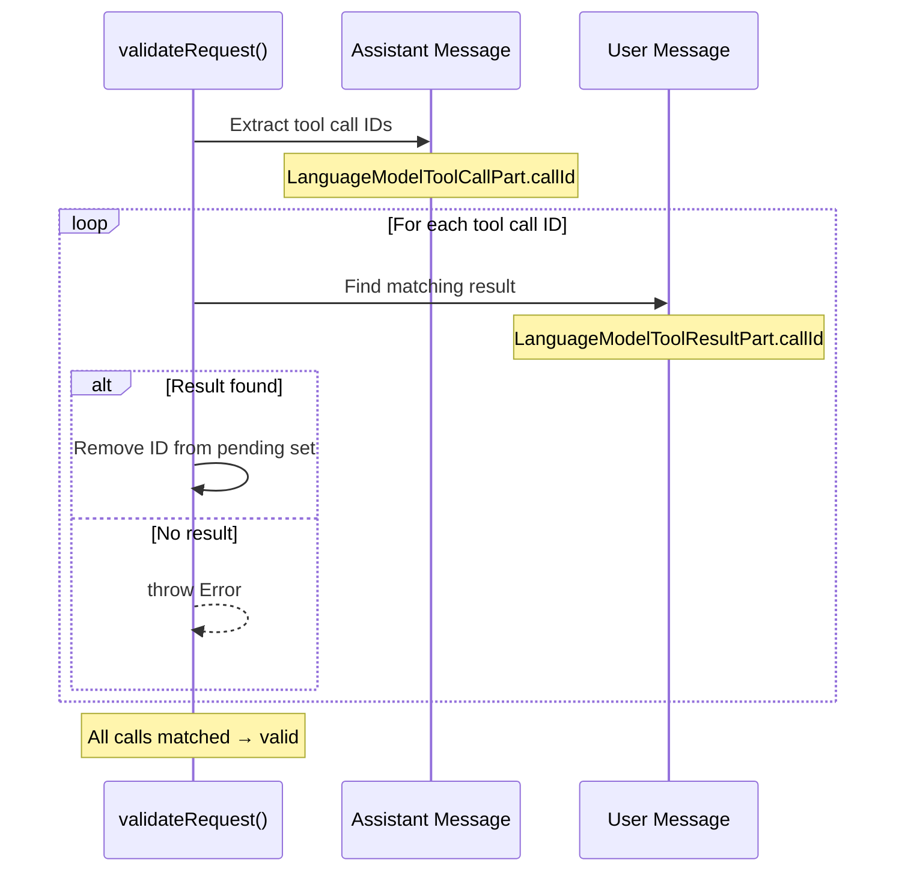
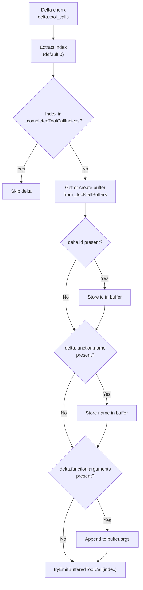
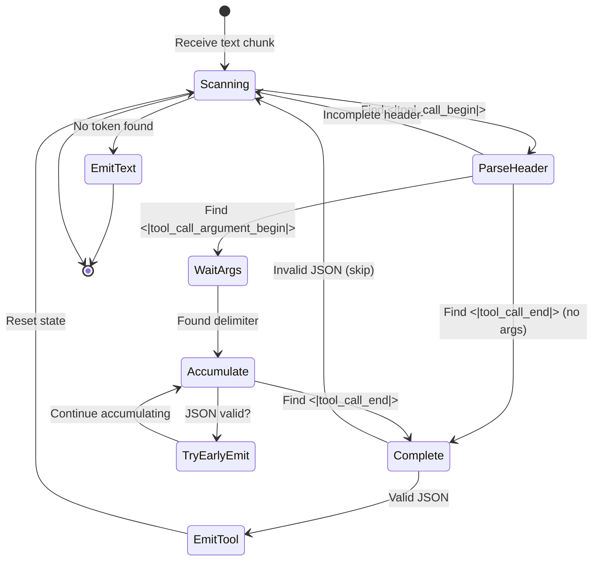
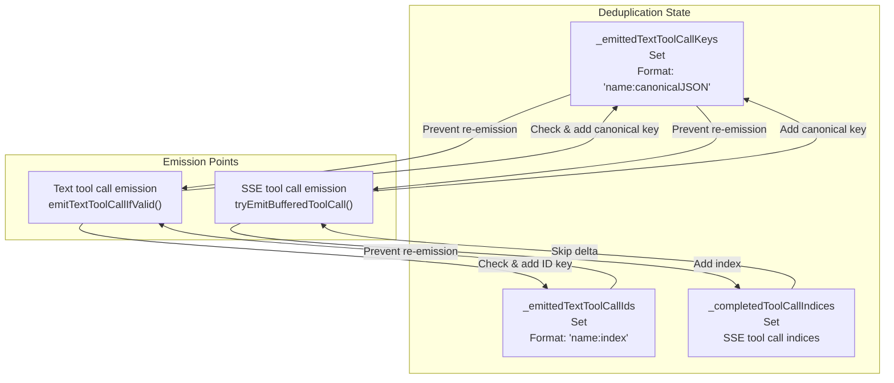

<!-- source: DeepWiki mcp.deepwiki.com · repo huggingface/huggingface-vscode-chat · page 3.6 Tool Call System · fetched 2026-10-26 -->

# Tool Call System

<details>
<summary>Relevant source files</summary>

The following files were used as context for generating this wiki page:

- [src/provider.ts](src/provider.ts)
- [src/types.ts](src/types.ts)
- [src/utils.ts](src/utils.ts)

</details>


This document describes the tool calling architecture in the Hugging Face VS Code chat extension, including tool definition conversion, validation, buffering, and emission during streaming responses. For message conversion outside of tool calls, see [Message Conversion Layer](#3.4). For general streaming response handling, see [Streaming Response Handling](#3.5). For user-facing tool calling features, see [Tool Calling Capabilities](#4.3).

## Overview

The tool call system bridges VS Code's Language Model API tool calling interface with the Hugging Face Router API's OpenAI-compatible tool calling format. It handles two distinct tool call formats in streaming responses:

1. **SSE-formatted tool calls**: Tool calls embedded in delta chunks with `tool_calls` arrays
2. **Text-embedded tool calls**: Tool calls encoded in streamed text using control tokens like `<|tool_call_begin|>`

The system performs schema sanitization, name validation, incremental buffering during streaming, and deduplication to ensure complete, valid tool calls are emitted to VS Code.

**Sources**: [src/provider.ts:1-782](), [src/utils.ts:1-364]()

## Architecture Overview



**Sources**: [src/utils.ts:27-227](), [src/provider.ts:214-327](), [src/provider.ts:381-431]()

## Tool Definition Conversion

### VS Code to OpenAI Format Mapping

The `convertTools()` function transforms VS Code tool definitions into OpenAI-compatible function tool definitions:

| VS Code Type | Field | OpenAI Equivalent | Transformation |
|--------------|-------|-------------------|----------------|
| `LanguageModelChatTool` | `name` | `function.name` | Sanitized via `sanitizeFunctionName()` |
| `LanguageModelChatTool` | `description` | `function.description` | Passed through as string |
| `LanguageModelChatTool` | `inputSchema` | `function.parameters` | Sanitized via `sanitizeSchema()` |
| `LanguageModelChatToolMode.Required` | N/A | `tool_choice` | Maps to `{type: "function", function: {name}}` |

**Sources**: [src/utils.ts:192-227]()

### Function Name Sanitization

Tool names must conform to OpenAI's requirements (alphanumeric, hyphens, underscores only). The `sanitizeFunctionName()` function at [src/utils.ts:27-37]() applies these rules:

1. Replace non-conforming characters with underscores: `/[^a-zA-Z0-9_-]/g` → `_`
2. Ensure name starts with letter: prepend `tool_` if necessary
3. Collapse consecutive underscores: `/_+/g` → `_`
4. Truncate to 64 characters maximum



**Sources**: [src/utils.ts:27-37]()

### Schema Sanitization

The `sanitizeSchema()` function at [src/utils.ts:68-136]() normalizes JSON schemas to ensure compatibility with LLM inference providers:

#### Composite Schema Handling

When a schema contains `anyOf`, `oneOf`, or `allOf` branches, the system selects a single preferred branch:

1. Prefer the first branch with `type: "string"`
2. Fallback to the first branch if no string type found

```typescript
// Example: anyOf with multiple types
// Input: { anyOf: [{ type: "number" }, { type: "string" }] }
// Output: { type: "string" }  // String type preferred
```

**Sources**: [src/utils.ts:75-88]()

#### Type Inference and Correction

The schema sanitizer performs automatic type corrections:

- **Missing type**: Default to `"object"`
- **Integer detection**: Properties with names matching `isIntegerLikePropertyName()` convert `type: "number"` to `type: "integer"`

Integer-like property names include: `id`, `limit`, `count`, `index`, `size`, `offset`, `length`, or any property ending in `_id`.

**Sources**: [src/utils.ts:6-25](), [src/utils.ts:98-101]()

#### Schema Keyword Allowlist

Only specific JSON Schema keywords are preserved by `pruneUnknownSchemaKeywords()`:

| Allowed Keywords | Purpose |
|------------------|---------|
| `type`, `properties`, `required`, `additionalProperties` | Structure |
| `description`, `enum`, `default` | Metadata |
| `items` | Array items |
| `minLength`, `maxLength`, `minimum`, `maximum`, `pattern`, `format` | Validation constraints |

**Sources**: [src/utils.ts:39-66]()

#### Recursive Processing

For `type: "object"`, properties are recursively sanitized. For `type: "array"`, items are sanitized:



**Sources**: [src/utils.ts:103-133]()

## Tool Call Validation

### Tool Name Validation

The `validateTools()` function at [src/utils.ts:233-242]() ensures tool names match the pattern `/^[\w-]+$/` before conversion. This catches invalid names early and provides clear error messages.

**Sources**: [src/utils.ts:233-242]()

### Request Sequence Validation

The `validateRequest()` function at [src/utils.ts:248-290]() verifies that every tool call in an assistant message is followed by a corresponding tool result in a user message:



Validation enforces:
- Each `LanguageModelToolCallPart` must have a matching `LanguageModelToolResultPart` with the same `callId`
- Tool results must appear in a subsequent user message
- All parts in tool result messages must be `LanguageModelToolResultPart` instances

**Sources**: [src/utils.ts:248-290]()

## SSE-Formatted Tool Call Processing

### Buffering System

The provider maintains a `Map<number, ToolCallBuffer>` at [src/provider.ts:26-29]() to accumulate streamed tool call fragments indexed by their position in the `tool_calls` array:

```typescript
interface ToolCallBuffer {
    id?: string;      // Tool call identifier from delta
    name?: string;    // Function name from delta.function.name
    args: string;     // Accumulated JSON arguments
}
```

**Sources**: [src/types.ts:77-81](), [src/provider.ts:26-29]()

### Delta Processing Flow

When `processDelta()` at [src/provider.ts:438-528]() encounters a delta with `tool_calls`:



**Sources**: [src/provider.ts:488-520]()

### Early Emission on Valid JSON

The `tryEmitBufferedToolCall()` function at [src/provider.ts:709-733]() attempts to emit a tool call as soon as the buffered arguments become valid JSON, avoiding perceived latency:

1. Check if buffer has a name
2. Parse `buffer.args` using `tryParseJSONObject()`
3. If valid JSON, emit `LanguageModelToolCallPart`
4. Add index to `_completedToolCallIndices` to ignore future deltas
5. Add to deduplication tracking

**Sources**: [src/provider.ts:709-733](), [src/utils.ts:350-363]()

### Final Flush

When `finish_reason` is `"tool_calls"` or `"stop"`, `flushToolCallBuffers()` at [src/provider.ts:740-767]() emits all remaining buffered tool calls, throwing an error if any have invalid JSON (when `throwOnInvalid=true`).

**Sources**: [src/provider.ts:522-526](), [src/provider.ts:740-767]()

## Text-Embedded Tool Call Processing

### Control Token Format

Some models embed tool calls directly in streamed text using control tokens:

| Token | Purpose | Example |
|-------|---------|---------|
| `<|tool_call_begin|>` | Start of tool call | `<|tool_call_begin|>get_weather:0` |
| `<|tool_call_argument_begin|>` | Start of arguments | `<|tool_call_argument_begin|>{"city": "SF"}` |
| `<|tool_call_end|>` | End of tool call | `<|tool_call_end|>` |

The format is: `<|tool_call_begin|>name:index<|tool_call_argument_begin|>json_args<|tool_call_end|>`

**Sources**: [src/provider.ts:534-657]()

### Parsing State Machine

The `processTextContent()` function at [src/provider.ts:534-657]() implements a state machine that accumulates text in `_textToolParserBuffer` and maintains active tool state in `_textToolActive`:

```typescript
_textToolActive?: {
    name?: string;     // Extracted from header
    index?: number;    // Extracted from header (optional)
    argBuffer: string; // Accumulated argument JSON
    emitted?: boolean; // Whether already emitted
}
```

**Sources**: [src/provider.ts:42-49]()

### Parsing Flow



**Sources**: [src/provider.ts:534-657]()

### Header Parsing

When `<|tool_call_begin|>` is found, the system parses the header using regex `/^([A-Za-z0-9_\-.]+)(?::(\d+))?/`:

- **Group 1**: Function name
- **Group 2**: Optional index (numeric)

Example: `get_weather:0` → `name="get_weather"`, `index=0`

**Sources**: [src/provider.ts:593-596]()

### Early Emission for Text Tools

Similar to SSE tool calls, text-embedded tool calls are emitted as soon as arguments become valid JSON via `emitTextToolCallIfValid()` at [src/provider.ts:659-686](), even if `<|tool_call_end|>` hasn't been received yet.

**Sources**: [src/provider.ts:617-626](), [src/provider.ts:659-686]()

## Deduplication System

To prevent duplicate tool calls from being emitted when both SSE and text formats are present, or when early emission occurs, the provider maintains deduplication tracking:

### Deduplication Structures



**Sources**: [src/provider.ts:32-51](), [src/provider.ts:672-682](), [src/provider.ts:727-729]()

### Canonical Key Format

Both SSE and text-embedded tool calls generate a canonical key for deduplication:

```typescript
const canonical = JSON.stringify(parameters);  // Normalized JSON
const key = `${functionName}:${canonical}`;
```

This ensures that identical tool calls (same name and parameters) are only emitted once, regardless of format.

**Sources**: [src/provider.ts:727-729](), [src/provider.ts:669-682](), [src/provider.ts:759-762]()

### Identity-Based Deduplication

For text-embedded tool calls with an explicit index, identity-based deduplication is used:

```typescript
if (typeof call.index === "number") {
    const idKey = `${name}:${call.index}`;
    if (this._emittedTextToolCallIds.has(idKey)) {
        return false;  // Already emitted
    }
    this._emittedTextToolCallIds.add(idKey);
}
```

This prevents the same indexed tool call from being emitted multiple times during incremental streaming.

**Sources**: [src/provider.ts:672-678]()

## State Management and Cleanup

### Request-Level State Reset

At the beginning of each `provideLanguageModelChatResponse()` call at [src/provider.ts:222-229](), all tool call state is reset:

```typescript
this._toolCallBuffers.clear();
this._completedToolCallIndices.clear();
this._hasEmittedAssistantText = false;
this._emittedBeginToolCallsHint = false;
this._textToolParserBuffer = "";
this._textToolActive = undefined;
this._emittedTextToolCallKeys.clear();
this._emittedTextToolCallIds.clear();
```

**Sources**: [src/provider.ts:222-229]()

### Stream Completion Cleanup

When the stream completes, the `processStreamingResponse()` finally block at [src/provider.ts:420-430]() cleans up all remaining state to prevent memory leaks between requests.

**Sources**: [src/provider.ts:420-430]()

## Tool Choice Handling

The `tool_choice` parameter controls LLM tool selection behavior:

| VS Code ToolMode | OpenAI tool_choice | Behavior |
|------------------|-------------------|----------|
| `undefined` (default) | `"auto"` | Model decides whether to call tools |
| `LanguageModelChatToolMode.Required` | `{type: "function", function: {name}}` | Model must call the specified tool |

**Constraint**: `ToolMode.Required` is only supported when exactly one tool is provided. Multiple tools with required mode throw an error at [src/utils.ts:218-222]().

**Sources**: [src/utils.ts:217-224](), [src/provider.ts:291-296]()

## Error Handling

### Tool Call Validation Errors

| Error Condition | Validation Point | Error Message |
|----------------|------------------|---------------|
| Invalid tool name characters | `validateTools()` | `"Invalid tool name ... only alphanumeric characters, hyphens, and underscores are allowed"` |
| Tool call without matching result | `validateRequest()` | `"Tool call part must be followed by a User message with a LanguageModelToolResultPart"` |
| Required mode with multiple tools | `convertTools()` | `"LanguageModelChatToolMode.Required is not supported with more than one tool"` |
| More than 128 tools | `provideLanguageModelChatResponse()` | `"Cannot have more than 128 tools per request"` |

**Sources**: [src/utils.ts:237-239](), [src/utils.ts:268-273](), [src/utils.ts:218-222](), [src/provider.ts:257-259]()

### Tool Call JSON Parsing Errors

When `finish_reason` is `"tool_calls"` or `"stop"`, invalid JSON in buffered tool calls throws an error from `flushToolCallBuffers()` with `throwOnInvalid=true`:

```typescript
if (!parsed.ok) {
    if (throwOnInvalid) {
        console.error("[...] Invalid JSON for tool call", { idx, snippet });
        throw new Error("Invalid JSON for tool call");
    }
}
```

When `[DONE]` is received, `flushToolCallBuffers()` is called with `throwOnInvalid=false` to silently drop incomplete tool calls.

**Sources**: [src/provider.ts:747-755](), [src/provider.ts:404-409]()

---

