<!-- source: DeepWiki mcp.deepwiki.com · repo huggingface/huggingface-vscode-chat · page 4 Features · fetched 2026-10-26 -->

# Features

<details>
<summary>Relevant source files</summary>

The following files were used as context for generating this wiki page:

- [README.md](README.md)
- [src/provider.ts](src/provider.ts)

</details>


This document describes the user-facing capabilities of the huggingface-vscode-chat extension and how they are implemented. It covers model discovery, chat interface integration, tool calling, and streaming response handling from a feature perspective.

For architectural details of these systems, see [Architecture](#3). For setup instructions, see [Getting Started](#2).

---

## Model Discovery and Selection

The extension dynamically discovers available Hugging Face models and their capabilities through the Hugging Face Router API. Models are presented to users through VS Code's model picker with provider-specific metadata.

### Model Discovery Process

The `HuggingFaceChatModelProvider` fetches available models from the `/v1/models` endpoint and transforms them into VS Code's `LanguageModelChatInformation` format.

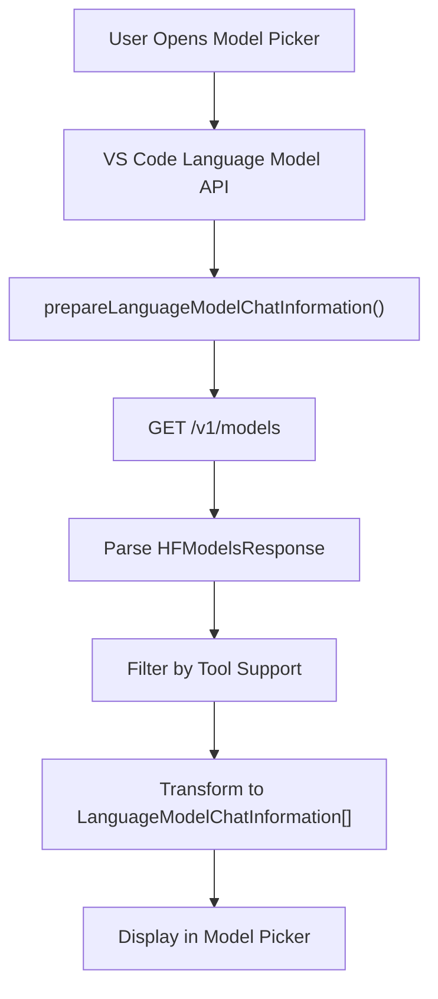

**Sources:** [src/provider.ts:89-157]()

### Model Information Structure

Each model entry includes:

| Property | Description | Source |
|----------|-------------|--------|
| `id` | Model identifier with provider suffix (e.g., `model:provider`) | [src/provider.ts:114]() |
| `name` | Human-readable name | [src/provider.ts:115]() |
| `family` | Always `"huggingface"` | [src/provider.ts:117]() |
| `maxInputTokens` | Context length minus output budget | [src/provider.ts:119]() |
| `maxOutputTokens` | Maximum tokens for completion | [src/provider.ts:120]() |
| `capabilities.toolCalling` | Whether model supports function calling | [src/provider.ts:122]() |
| `capabilities.imageInput` | Whether model supports vision | [src/provider.ts:123]() |

### Provider-Specific Model Entries

The extension creates separate model entries for each provider that supports a given model with tool calling enabled. This allows users to select specific providers (e.g., Cerebras, Groq, Together AI) from the model picker.

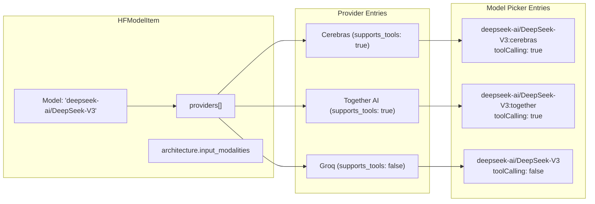

**Sources:** [src/provider.ts:100-149](), [src/types.ts:10-25]()

### Vision Capability Detection

Vision support is detected from the model's `architecture.input_modalities` array. If `"image"` is present, the model is marked with `imageInput: true`.

```typescript
// Example from provider logic
const modalities = m.architecture?.input_modalities ?? [];
const vision = Array.isArray(modalities) && modalities.includes("image");
```

**Sources:** [src/provider.ts:102-103]()

### Context Length Management

The extension calculates input token limits by reserving a fixed output budget:

- Default context length: 128,000 tokens ([src/provider.ts:18]())
- Default output budget: 16,000 tokens ([src/provider.ts:17]())
- Calculated max input: `contextLength - maxOutputTokens`

**Sources:** [src/provider.ts:17-18](), [src/provider.ts:110-132]()

---

## Chat Interface Integration

The extension integrates with VS Code's Language Model Chat API and GitHub Copilot Chat through the `LanguageModelChatProvider` interface.

### Chat Request Flow

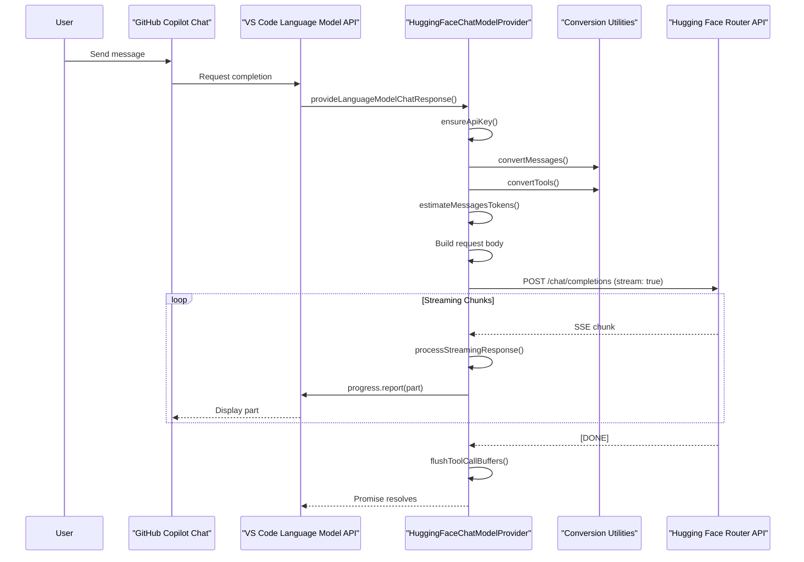

**Sources:** [src/provider.ts:214-327]()

### Message Format Conversion

The extension converts VS Code's `LanguageModelChatMessage` format to OpenAI-compatible messages using `convertMessages()`.

**VS Code Message Structure:**
```typescript
{
  role: LanguageModelChatMessageRole,
  content: LanguageModelChatMessagePart[], // TextPart or ToolResultPart
  name?: string
}
```

**Converted OpenAI Format:**
```typescript
{
  role: "user" | "assistant" | "system",
  content: string | Array<{type: "text", text: string} | {type: "image_url", image_url: {url: string}}>,
  tool_calls?: Array<{id: string, type: "function", function: {name: string, arguments: string}}>
}
```

**Sources:** [src/utils.ts:1-107](), [src/provider.ts:251]()

### Token Estimation

The extension provides token count estimates for context management through `provideTokenCount()`, using a simple heuristic of 4 characters per token.

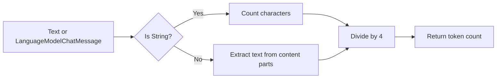

**Sources:** [src/provider.ts:336-352](), [src/provider.ts:59-82]()

### Request Validation

Before sending requests, the extension validates:
- Message array is not empty ([src/utils.ts:127-129]())
- No more than 128 tools per request ([src/provider.ts:257-259]())
- Total tokens (messages + tools) within context limit ([src/provider.ts:261-267]())

**Sources:** [src/provider.ts:253-267](), [src/utils.ts:125-139]()

---

## Tool Calling Capabilities

The extension supports function/tool calling through two distinct formats: SSE-based streaming tool calls and text-embedded tool calls with control tokens.

### Tool Definition Conversion

VS Code's `LanguageModelChatTool` definitions are converted to OpenAI-compatible function schemas using `convertTools()`.

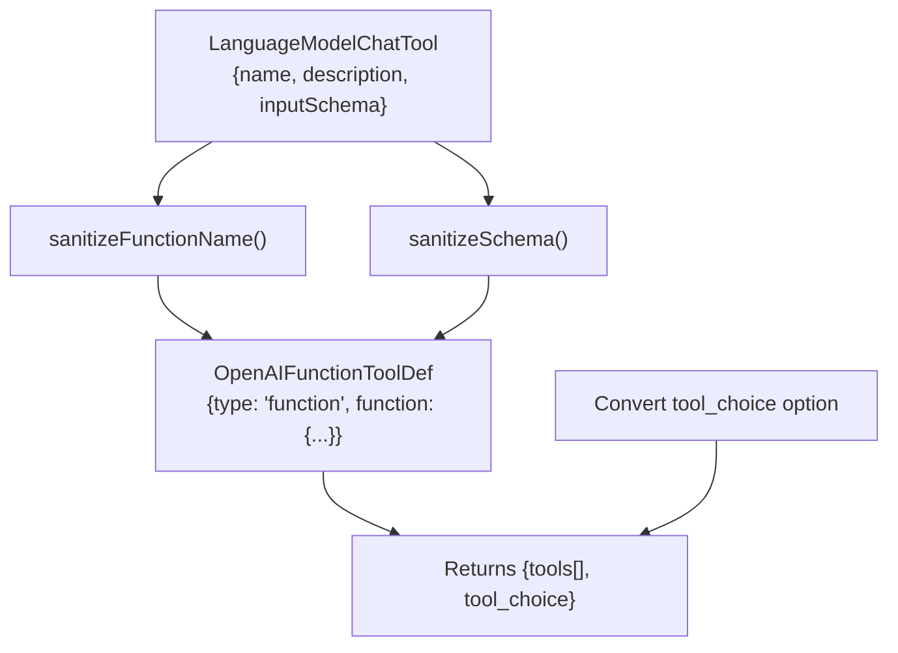

**Sources:** [src/utils.ts:156-230]()

### Schema Sanitization

The `sanitizeSchema()` function removes VS Code-specific and incompatible fields from JSON schemas:

**Removed Fields:**
- `$schema`
- `default`
- `defaultSnippets`
- `errorMessage`
- `patternErrorMessage`
- `deprecationMessage`
- `markdownDeprecationMessage`
- `enumDescriptions`
- `markdownEnumDescriptions`
- `markdownDescription`
- `doNotSuggest`
- `allowComments`
- `allowTrailingCommas`

**Sources:** [src/utils.ts:46-123]()

### Tool Call Buffering System

The extension buffers streaming tool call deltas until complete, valid JSON is available before emitting to VS Code.

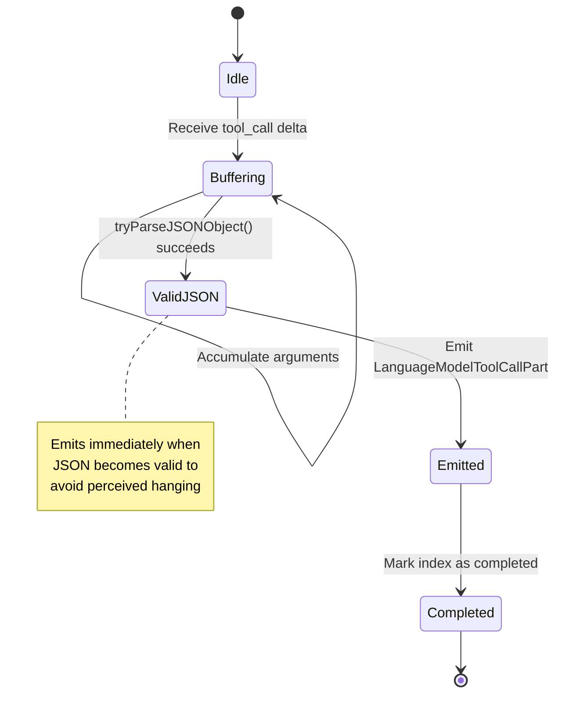

**Data Structures:**

| Structure | Purpose | Location |
|-----------|---------|----------|
| `_toolCallBuffers` | Map of index → `{id?, name?, args: string}` | [src/provider.ts:26-29]() |
| `_completedToolCallIndices` | Set of indices already emitted | [src/provider.ts:32]() |
| `_emittedTextToolCallKeys` | Dedupe set for text-embedded tool calls | [src/provider.ts:50]() |

**Sources:** [src/provider.ts:709-733](), [src/provider.ts:740-767]()

### SSE-Based Tool Calls

Tool calls streamed in the standard OpenAI SSE format are buffered by index and emitted when valid JSON is detected.

**Example SSE Chunk:**
```json
{
  "choices": [{
    "delta": {
      "tool_calls": [{
        "index": 0,
        "id": "call_abc123",
        "function": {
          "name": "get_weather",
          "arguments": "{\"loc"
        }
      }]
    }
  }]
}
```

**Sources:** [src/provider.ts:488-520]()

### Text-Embedded Tool Calls

Some models emit tool calls as text with special control tokens. The extension parses these in real-time.

**Control Tokens:**
- `<|tool_call_begin|>` - Starts a tool call
- `<|tool_call_argument_begin|>` - Starts argument section
- `<|tool_call_end|>` - Ends a tool call

**Example:**
```
Here's the weather: <|tool_call_begin|>get_weather:0<|tool_call_argument_begin|>{"location": "NYC"}<|tool_call_end|>
```

**Parsing State Machine:**

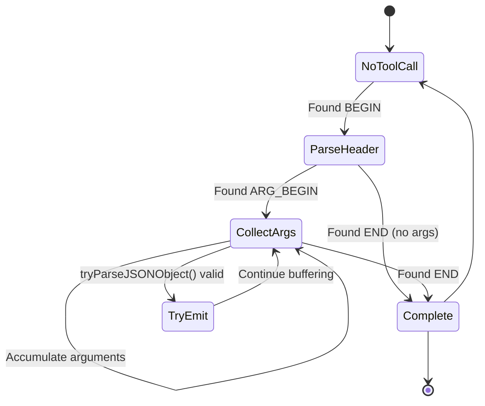

**Sources:** [src/provider.ts:534-657](), [src/provider.ts:659-702]()

### Tool Call Deduplication

The extension prevents duplicate tool call emissions using two strategies:

1. **Identity-based:** For tool calls with explicit indices, track `{name}:{index}`
2. **Content-based:** For tool calls without indices, track `{name}:{canonicalJSON}`

**Sources:** [src/provider.ts:671-682](), [src/provider.ts:727-729]()

---

## Streaming Response Handling

The extension processes Server-Sent Events (SSE) from the Hugging Face Router API and reports progress in real-time.

### Response Part Types

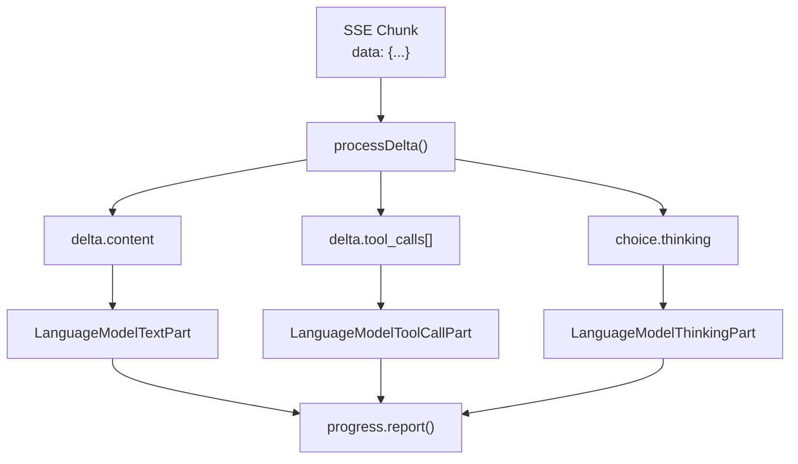

**Sources:** [src/provider.ts:438-528]()

### Thinking Progress Support

The extension supports the experimental `LanguageModelThinkingPart` API when available in the VS Code version.

**Detection and Emission:**
```typescript
const ThinkingCtor = vscode["LanguageModelThinkingPart"];
if (ThinkingCtor) {
  progress.report(new ThinkingCtor(text, id, metadata));
}
```

**Sources:** [src/provider.ts:449-476]()

### Stream Processing Pipeline

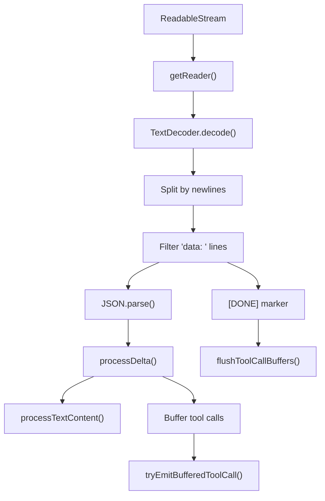

**Sources:** [src/provider.ts:381-431]()

### Control Token Stripping

Text content has provider-specific control tokens removed before emission:

**Stripped Patterns:**
- `<|*_section_begin|>` and `<|*_section_end|>`
- `<|tool_call_begin|>`, `<|tool_call_argument_begin|>`, `<|tool_call_end|>`

**Sources:** [src/provider.ts:770-779]()

### Early Emission Optimization

To avoid perceived hanging, the extension emits tool calls as soon as their arguments become valid JSON, rather than waiting for the stream to complete.

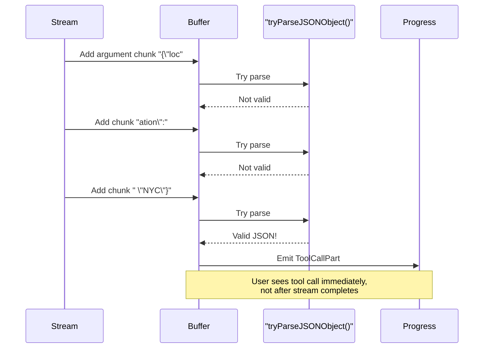

**Sources:** [src/provider.ts:518-519](), [src/provider.ts:709-733]()

---

## API Key Management

The extension securely stores and manages Hugging Face API keys using VS Code's Secret Storage API.

### Storage and Retrieval

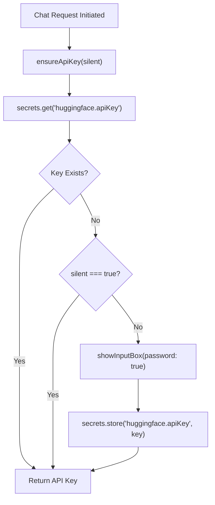

**Sources:** [src/provider.ts:358-373](), [src/extension.ts:25-42]()

### Management Command

Users can update their API key using the `huggingface.manage` command, which is registered in the extension manifest.

**Command Registration:**
```json
{
  "command": "huggingface.manage",
  "title": "Manage Hugging Face API Key"
}
```

**Sources:** [package.json:38-41](), [src/extension.ts:25-42]()

### Authentication Headers

Each API request includes:
- `Authorization: Bearer {apiKey}`
- `User-Agent: HuggingFaceVSCode/{version} VSCode/{vscodeVersion}`

**Sources:** [src/provider.ts:176](), [src/provider.ts:300-302](), [src/extension.ts:20]()

---

## Error Handling

The extension provides detailed error messages and logging for troubleshooting.

### Validation Errors

| Error Condition | Error Message | Source |
|----------------|---------------|--------|
| Empty message array | "Messages cannot be empty" | [src/utils.ts:127-129]() |
| Too many tools | "Cannot have more than 128 tools per request." | [src/provider.ts:258]() |
| Token limit exceeded | "Message exceeds token limit." | [src/provider.ts:266]() |
| Invalid tool call JSON | "Invalid JSON for tool call" | [src/provider.ts:751-752]() |

### API Error Responses

HTTP errors from the Hugging Face Router API include:
- Status code and status text
- Response body content
- Request model ID and message count in logs

**Sources:** [src/provider.ts:307-313](), [src/provider.ts:319-325]()

### Logging Strategy

All errors are logged to the console with structured context:

```typescript
console.error("[Hugging Face Model Provider] {operation} failed", {
  modelId: model.id,
  messageCount: messages.length,
  error: err instanceof Error ? { name: err.name, message: err.message } : String(err)
});
```

**Sources:** [src/provider.ts:238-242](), [src/provider.ts:320-324]()

---

