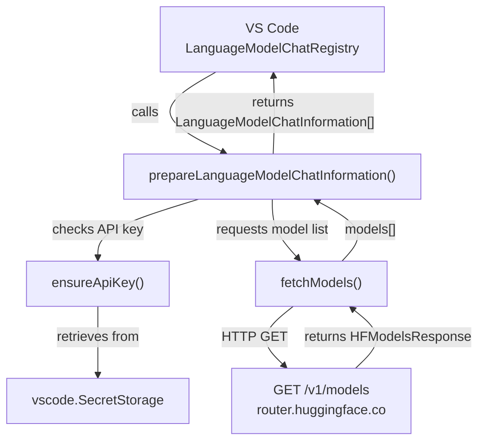
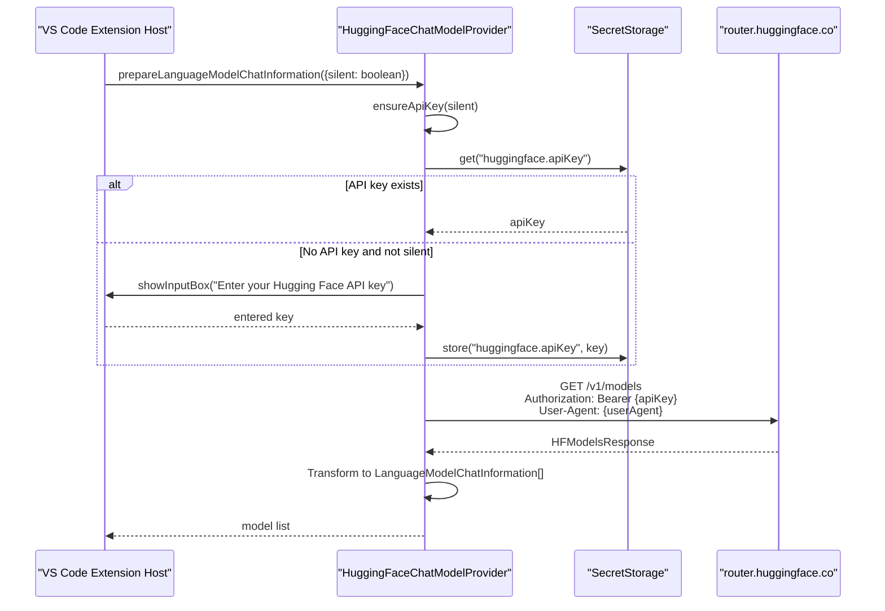
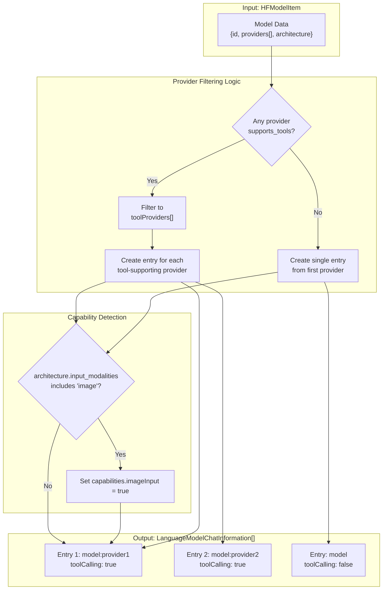
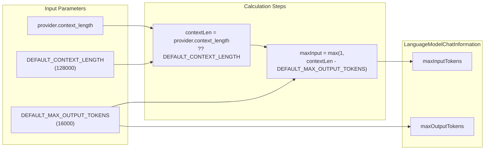
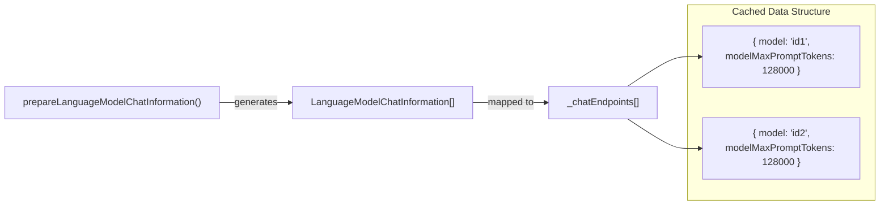
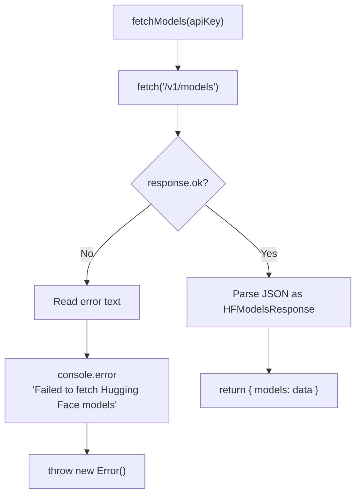

<!-- source: DeepWiki mcp.deepwiki.com · repo huggingface/huggingface-vscode-chat · page 4.1 Model Discovery and Selection · fetched 2026-10-26 -->

# Model Discovery and Selection

<details>
<summary>Relevant source files</summary>

The following files were used as context for generating this wiki page:

- [README.md](README.md)
- [src/provider.ts](src/provider.ts)
- [src/types.ts](src/types.ts)

</details>


## Purpose and Scope

This document describes how the Hugging Face extension discovers available language models from the Hugging Face Router API and presents them to users in VS Code's model picker interface. It covers the API integration for model listing, capability detection, and the filtering logic that determines which models appear in the selection UI.

For information about the actual chat provider implementation that uses these models, see [Chat Provider Implementation](#3.3). For details on the API key management required for model discovery, see [Configuration](#2.2).

## Model Discovery Architecture

The extension discovers models through a dedicated API endpoint exposed by the Hugging Face Router. The discovery process is triggered when VS Code requests available language models from the provider, typically when a user opens the model picker or the extension activates.



**Sources:** [src/provider.ts:89-157](), [src/provider.ts:170-202]()

## API Request Flow

Model discovery begins when VS Code invokes the `prepareLanguageModelChatInformation` method on the provider. This method orchestrates the authentication and API request process.



The `ensureApiKey` method [src/provider.ts:358-373]() handles authentication by retrieving the stored API key or prompting the user if necessary. The `silent` parameter controls whether user prompts are shown.

**Sources:** [src/provider.ts:89-157](), [src/provider.ts:358-373]()

## Model Response Structure

The Hugging Face Router API returns a structured response containing detailed information about available models, their providers, and capabilities.

### HFModelsResponse Type Structure

| Field | Type | Description |
|-------|------|-------------|
| `object` | `string` | Response type identifier |
| `data` | `HFModelItem[]` | Array of available models |

### HFModelItem Type Structure

| Field | Type | Description |
|-------|------|-------------|
| `id` | `string` | Model identifier (e.g., `"meta-llama/Llama-3.3-70B-Instruct"`) |
| `object` | `string` | Object type |
| `created` | `number` | Creation timestamp |
| `owned_by` | `string` | Model owner |
| `providers` | `HFProvider[]` | Available inference providers |
| `architecture` | `HFArchitecture` | Model architecture metadata |

### HFProvider Type Structure

| Field | Type | Description |
|-------|------|-------------|
| `provider` | `string` | Provider name (e.g., `"together"`, `"groq"`, `"fireworks"`) |
| `status` | `string` | Provider status |
| `supports_tools` | `boolean?` | Tool calling capability flag |
| `supports_structured_output` | `boolean?` | Structured output capability flag |
| `context_length` | `number?` | Maximum context window in tokens |

**Sources:** [src/types.ts:29-72]()

## Model Filtering and Capability Detection

The provider transforms raw model data into VS Code-compatible `LanguageModelChatInformation` objects, filtering and organizing models based on their capabilities.



The filtering logic [src/provider.ts:100-149]() prioritizes tool-calling capable providers. For models with multiple providers supporting tools, separate entries are created for each provider combination using the ID format `{model.id}:{provider.provider}`.

**Sources:** [src/provider.ts:100-149]()

## Token Limit Calculation

Each model entry includes token limits that determine the maximum input and output sizes for chat requests. The calculation follows a conservative strategy to ensure requests stay within model constraints.



The token limit calculation [src/provider.ts:110-112](), [src/provider.ts:130-132]() ensures a consistent maximum output token budget of 16,000 tokens, with the remaining context window allocated to input. Constants are defined at [src/provider.ts:17-18]().

**Example Calculation:**

```
Given: provider.context_length = 128000
       DEFAULT_MAX_OUTPUT_TOKENS = 16000

Result: maxInputTokens = max(1, 128000 - 16000) = 112000
        maxOutputTokens = 16000
```

**Sources:** [src/provider.ts:17-18](), [src/provider.ts:110-112](), [src/provider.ts:130-132]()

## Model Information Construction

The provider constructs `LanguageModelChatInformation` objects that VS Code uses to present models in the picker UI. The construction differs based on whether the model supports tool calling.

### Tool-Calling Model Entry

For providers that support tool calling (`supports_tools === true`), the extension creates entries with provider-specific identifiers:

| Property | Value | Example |
|----------|-------|---------|
| `id` | `{model.id}:{provider.provider}` | `"meta-llama/Llama-3.3-70B-Instruct:together"` |
| `name` | `{model.id} via {provider.provider}` | `"meta-llama/Llama-3.3-70B-Instruct via together"` |
| `tooltip` | `Hugging Face via {provider.provider}` | `"Hugging Face via together"` |
| `family` | `"huggingface"` | `"huggingface"` |
| `capabilities.toolCalling` | `true` | `true` |
| `capabilities.imageInput` | Based on `input_modalities` | `true` if `"image"` in modalities |

Code reference: [src/provider.ts:113-125]()

### Non-Tool-Calling Model Entry

For models without tool-calling support, a single entry is created using the base model ID:

| Property | Value | Example |
|----------|-------|---------|
| `id` | `{model.id}` | `"meta-llama/Llama-3.3-70B-Instruct"` |
| `name` | `{model.id}` | `"meta-llama/Llama-3.3-70B-Instruct"` |
| `tooltip` | `"Hugging Face"` | `"Hugging Face"` |
| `family` | `"huggingface"` | `"huggingface"` |
| `capabilities.toolCalling` | `false` | `false` |
| `capabilities.imageInput` | Based on `input_modalities` | `true` if `"image"` in modalities |

Code reference: [src/provider.ts:133-145]()

**Sources:** [src/provider.ts:100-149]()

## Vision Capability Detection

The extension detects multimodal (vision) capabilities by examining the model's architecture metadata. A model is marked as vision-capable if its `input_modalities` array includes the string `"image"`.

```typescript
// Detection logic
const modalities = m.architecture?.input_modalities ?? [];
const vision = Array.isArray(modalities) && modalities.includes("image");
```

This boolean value is then assigned to `capabilities.imageInput` in the model information [src/provider.ts:102-103](), [src/provider.ts:123](), [src/provider.ts:143]().

**Sources:** [src/provider.ts:102-103](), [src/provider.ts:123](), [src/provider.ts:143]()

## Model Registry Caching

After successfully fetching and transforming the model list, the provider caches model metadata in the `_chatEndpoints` array for use during chat requests:



The caching logic [src/provider.ts:151-154]() stores the model ID and total token capacity (`maxInputTokens + maxOutputTokens`) for validation during chat requests.

**Sources:** [src/provider.ts:24](), [src/provider.ts:151-154]()

## Error Handling

The model discovery process includes robust error handling for API failures:



Error handling occurs at [src/provider.ts:178-190]() for HTTP errors and [src/provider.ts:195-201]() for exception catching, ensuring users receive informative error messages when model discovery fails.

**Sources:** [src/provider.ts:170-202]()

## Integration with VS Code UI

Once model information is prepared, VS Code presents the models in its standard model picker interface. Users interact with the picker through the following steps:

1. **Open Model Picker**: Click the model selector in the Copilot Chat interface
2. **View Available Models**: See the list of models returned by `prepareLanguageModelChatInformation`
3. **Select Model**: Choose a model from the list
4. **Model ID Usage**: The selected model's `id` property is passed to `provideLanguageModelChatResponse` during chat requests

The model selection persists across sessions, and the selected model ID determines which Hugging Face model and provider combination handles subsequent chat requests.

**Sources:** [src/provider.ts:89-157](), [README.md:10-16]()

---

