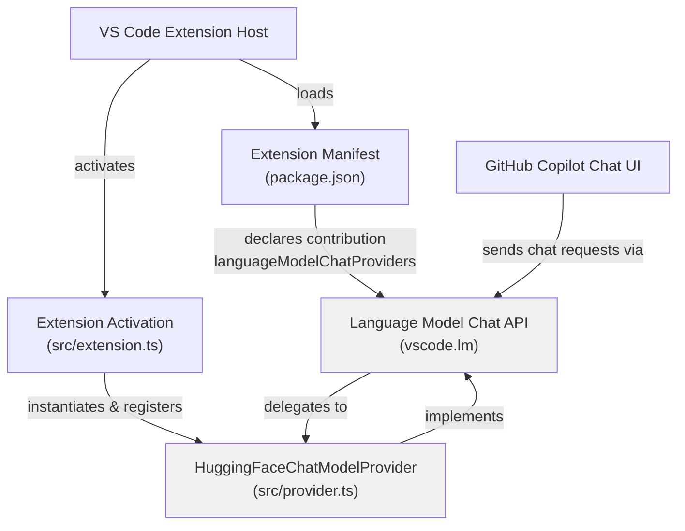
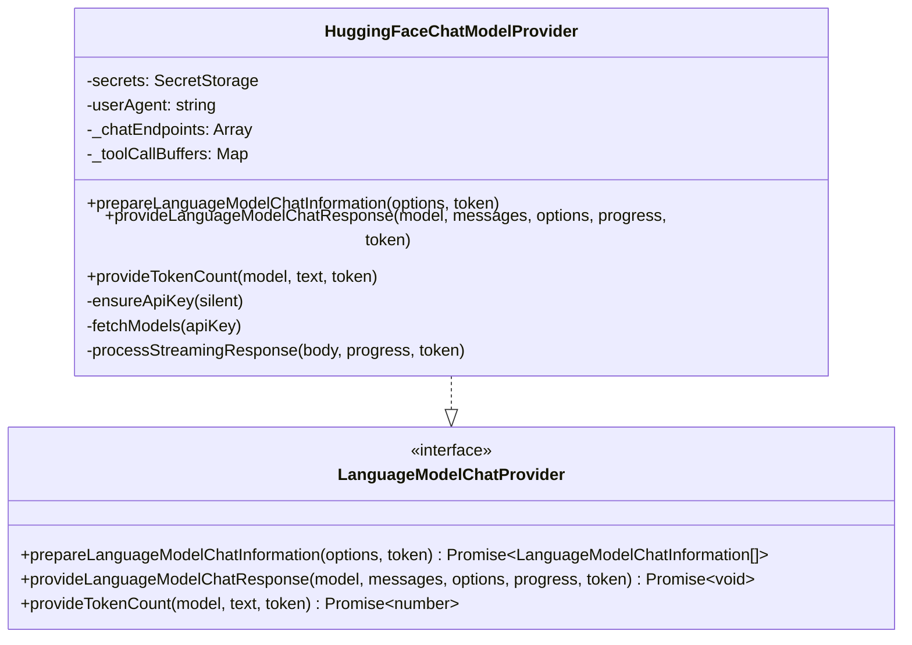
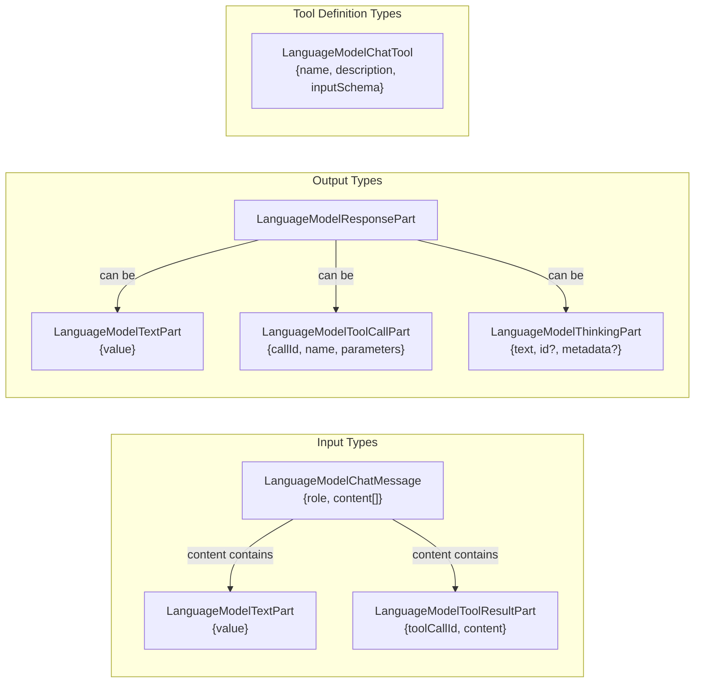
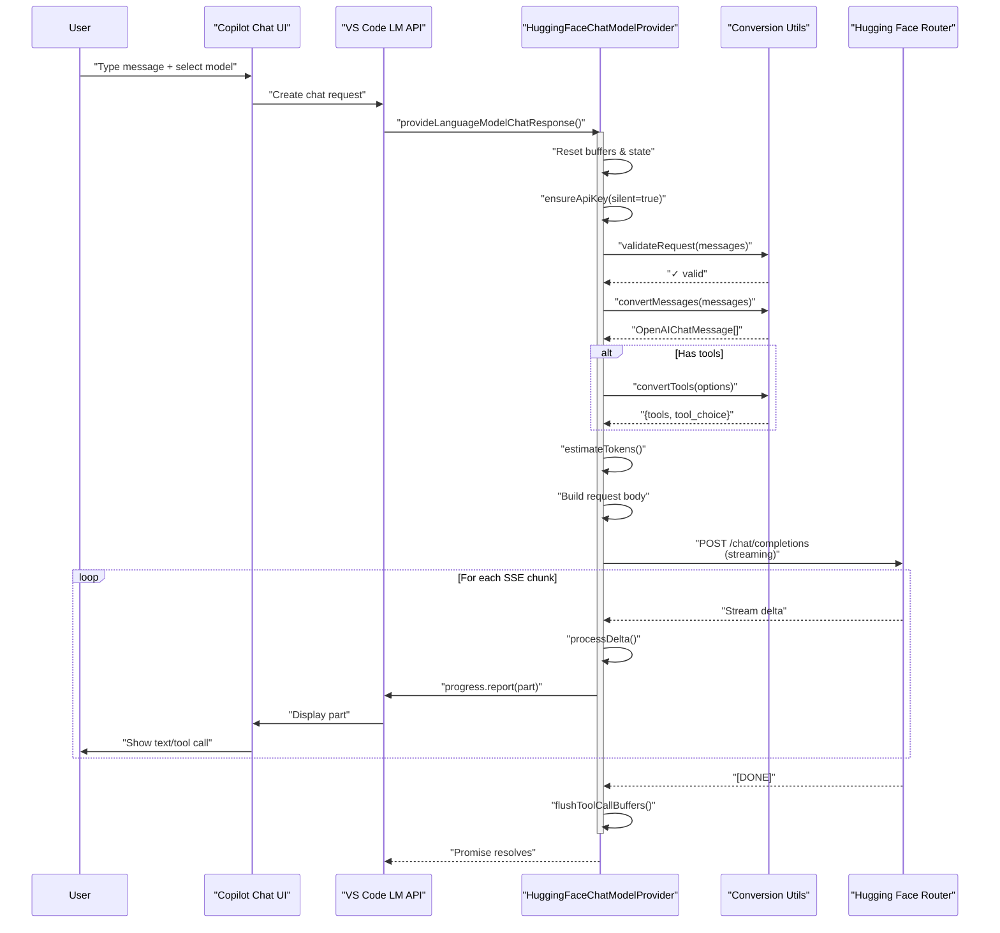
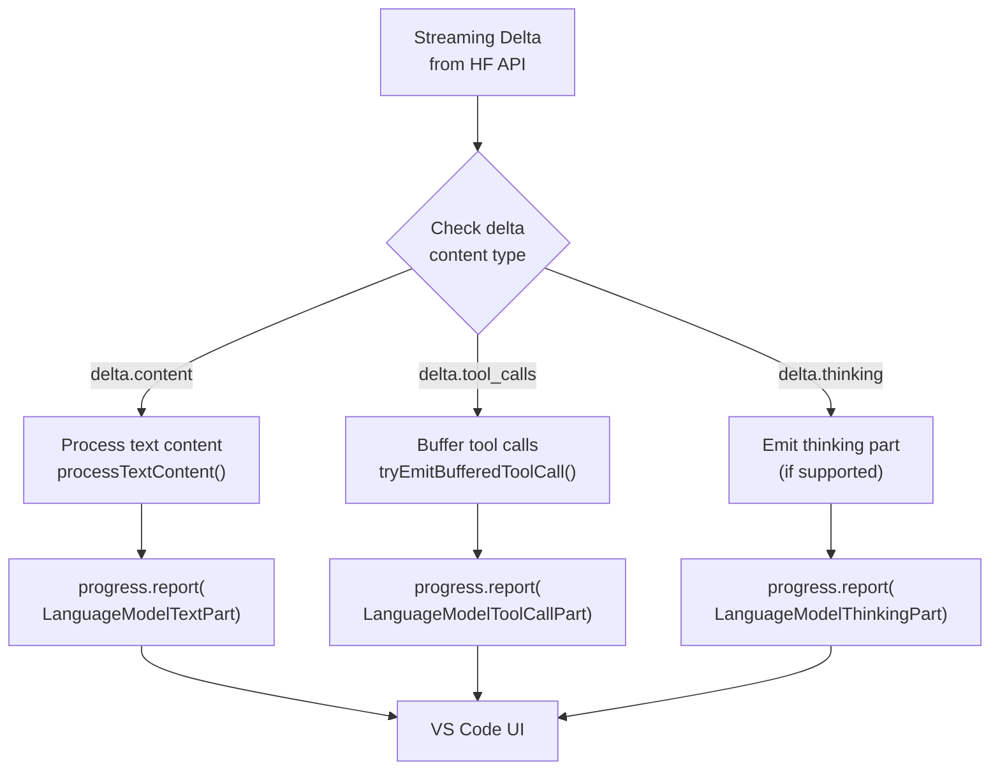
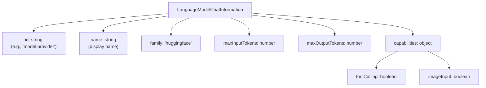
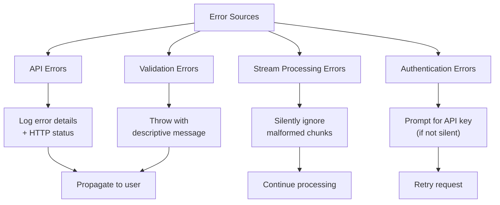

<!-- source: DeepWiki mcp.deepwiki.com · repo huggingface/huggingface-vscode-chat · page 4.2 Chat Interface Integration · fetched 2026-10-26 -->

# Chat Interface Integration

<details>
<summary>Relevant source files</summary>

The following files were used as context for generating this wiki page:

- [README.md](README.md)
- [package.json](package.json)
- [src/provider.ts](src/provider.ts)

</details>


## Purpose and Scope

This document describes how the Hugging Face extension integrates with GitHub Copilot Chat through VS Code's Language Model Chat API. It covers the integration points, API contracts, and communication protocols that enable the extension to function as a chat provider within the VS Code environment.

For details about the internal provider implementation, see [Chat Provider Implementation](#3.3). For information about streaming response handling, see [Streaming Response Handling](#3.5). For message format conversion, see [Message Conversion Layer](#3.4).

**Sources:** [README.md:1-57](), [package.json:40-54]()

---

## Integration Architecture

The extension integrates with VS Code through two primary mechanisms: a contribution point declared in the extension manifest and an implementation of the `LanguageModelChatProvider` interface. This dual integration allows the extension to appear as a selectable provider in the GitHub Copilot Chat model picker while handling chat requests through VS Code's standardized API.



**Sources:** [package.json:40-54](), [src/provider.ts:23-57]()

---

## Contribution Point Declaration

The extension declares its language model chat provider through the `languageModelChatProviders` contribution point in `package.json`. This contribution makes the provider discoverable to VS Code's language model system.

### Manifest Configuration

| Property | Value | Description |
|----------|-------|-------------|
| `vendor` | `"huggingface"` | Unique identifier for the provider vendor |
| `displayName` | `"Hugging Face"` | Human-readable name shown in UI |
| `managementCommand` | `"huggingface.manage"` | Command ID for provider configuration |

The contribution is defined in [package.json:40-46]():

```json
"languageModelChatProviders": [
  {
    "vendor": "huggingface",
    "displayName": "Hugging Face",
    "managementCommand": "huggingface.manage"
  }
]
```

The `managementCommand` links to a command that allows users to configure their API key through a secure input dialog. This command is implemented in the extension activation code and registered separately in [package.json:48-53]().

**Sources:** [package.json:40-54]()

---

## Language Model Chat Provider Interface

The `HuggingFaceChatModelProvider` class implements the `vscode.LanguageModelChatProvider` interface, which defines three required methods for provider functionality.



### Interface Methods

#### prepareLanguageModelChatInformation

Returns the list of available language models that the provider can offer. This method is called when VS Code needs to populate the model picker or when users manage their model selections.

**Signature:** [src/provider.ts:89-92]()

```typescript
async prepareLanguageModelChatInformation(
  options: { silent: boolean },
  token: CancellationToken
): Promise<LanguageModelChatInformation[]>
```

**Parameters:**
- `options.silent`: If `true`, the provider should not prompt the user for credentials
- `token`: Cancellation token for the request

**Returns:** Array of `LanguageModelChatInformation` objects, each describing a model variant

The implementation fetches available models from Hugging Face and transforms them into VS Code's expected format. Models with tool-calling support create separate entries per provider (e.g., "model-name via cerebras", "model-name via fireworks"). See [src/provider.ts:89-157]() for the complete implementation.

#### provideLanguageModelChatResponse

Handles chat requests and streams responses back to VS Code through a progress reporter. This is the core method for all chat interactions.

**Signature:** [src/provider.ts:214-220]()

```typescript
async provideLanguageModelChatResponse(
  model: LanguageModelChatInformation,
  messages: readonly LanguageModelChatMessage[],
  options: LanguageModelChatRequestHandleOptions,
  progress: Progress<LanguageModelResponsePart>,
  token: CancellationToken
): Promise<void>
```

**Parameters:**
- `model`: The selected model information
- `messages`: The conversation history
- `options`: Request options including tools, model parameters
- `progress`: Progress reporter for streaming response parts
- `token`: Cancellation token for the request

**Returns:** Promise that resolves when the response is complete

The method converts VS Code messages to OpenAI format, validates the request, sends it to Hugging Face, and streams the response back through the `progress` reporter. See [src/provider.ts:214-327]() for the full implementation.

#### provideTokenCount

Returns an estimated token count for text or messages, used by VS Code for token budget management.

**Signature:** [src/provider.ts:336-340]()

```typescript
async provideTokenCount(
  model: LanguageModelChatInformation,
  text: string | LanguageModelChatMessage,
  token: CancellationToken
): Promise<number>
```

The implementation uses a simple heuristic of approximately 4 characters per token. See [src/provider.ts:336-352]() for the implementation.

**Sources:** [src/provider.ts:23-57](), [src/provider.ts:89-352]()

---

## VS Code API Type System

The integration uses several key types from VS Code's Language Model Chat API. Understanding these types is essential for comprehending the message exchange protocol.

### Core Message Types



### Message Structure

**LanguageModelChatMessage** represents a single message in the conversation:
- `role`: One of `"user"`, `"assistant"`, or `"system"`
- `content`: Array of message parts (text or tool results)

The provider receives these from VS Code and must convert them to OpenAI-compatible format before sending to Hugging Face. See [Message Conversion Layer](#3.4) for conversion details.

### Response Part Types

The provider emits response parts through the `Progress<LanguageModelResponsePart>` reporter:

| Type | Purpose | Properties |
|------|---------|------------|
| `LanguageModelTextPart` | Text content from the model | `value: string` |
| `LanguageModelToolCallPart` | Function/tool call request | `callId: string, name: string, parameters: object` |
| `LanguageModelThinkingPart` | Model reasoning/thinking content | `text: string, id?: string, metadata?: unknown` |

The provider implementation emits these parts incrementally as the streaming response arrives from Hugging Face. See [src/provider.ts:381-431]() for streaming logic.

**Sources:** [src/provider.ts:1-10](), [src/provider.ts:214-220]()

---

## Request Flow

The complete flow from user input to response involves multiple transformations and validations.



### Request Validation

Before sending requests to Hugging Face, the provider validates:
1. Messages array is not empty - [src/utils.ts:125-127]()
2. Tool definitions are valid if provided - [src/utils.ts:136-189]()
3. Token count does not exceed model limits - [src/provider.ts:261-267]()

### Token Budget Management

The provider estimates token usage using simple heuristics:
- **Message tokens**: `Math.ceil(text.length / 4)` - [src/provider.ts:59-70]()
- **Tool tokens**: `Math.ceil(JSON.stringify(tools).length / 4)` - [src/provider.ts:72-81]()

Total usage is compared against `model.maxInputTokens` and an error is thrown if exceeded. See [src/provider.ts:261-267]().

**Sources:** [src/provider.ts:214-327](), [src/utils.ts:125-189]()

---

## Progress Reporting

The provider uses the `Progress<LanguageModelResponsePart>` callback to stream response chunks back to VS Code in real-time. This enables incremental UI updates as the model generates content.

### Progress Reporter Pattern

The provider wraps the progress reporter to handle errors gracefully:

[src/provider.ts:233-244]()
```typescript
const trackingProgress: Progress<LanguageModelResponsePart> = {
  report: (part) => {
    try {
      progress.report(part);
    } catch (e) {
      console.error("[...] Progress.report failed", {
        modelId: model.id,
        error: e instanceof Error ? { name: e.name, message: e.message } : String(e),
      });
    }
  },
};
```

### Response Part Emission

The provider emits different response parts based on the streaming content:



### Text Content Processing

Text content may contain inline tool call control tokens. The provider parses these tokens and emits either text or tool call parts accordingly:
- Visible text is emitted immediately via `LanguageModelTextPart` - [src/provider.ts:646-651]()
- Tool calls enclosed in control tokens are parsed and emitted via `LanguageModelToolCallPart` - [src/provider.ts:659-686]()

### Tool Call Buffering

Tool calls may arrive fragmented across multiple stream chunks. The provider maintains a buffer system to accumulate fragments until complete:
- Partial tool calls are buffered by index - [src/provider.ts:26-29]()
- Complete tool calls are emitted immediately when JSON becomes valid - [src/provider.ts:709-733]()
- Remaining buffers are flushed at stream end - [src/provider.ts:740-767]()

### Thinking Part Support

Some models provide reasoning/thinking content. The provider detects and emits these if the VS Code API version supports it:

[src/provider.ts:449-476]()
```typescript
const vsAny = (vscode as unknown as Record<string, unknown>);
const ThinkingCtor = vsAny["LanguageModelThinkingPart"] as
  | (new (text: string, id?: string, metadata?: unknown) => unknown)
  | undefined;
if (ThinkingCtor) {
  // Extract and emit thinking content
  progress.report(new ThinkingCtor(text, id, metadata) as LanguageModelResponsePart);
}
```

This dynamic detection ensures compatibility with older VS Code versions that don't support thinking parts.

**Sources:** [src/provider.ts:233-244](), [src/provider.ts:381-431](), [src/provider.ts:438-528](), [src/provider.ts:534-657](), [src/provider.ts:709-767]()

---

## Cancellation Support

The provider respects cancellation tokens to allow users to abort in-flight requests. The cancellation token is checked during stream processing:

[src/provider.ts:391-393]()
```typescript
while (!token.isCancellationRequested) {
  const { done, value } = await reader.read();
  if (done) { break; }
  // ... process chunk
}
```

When cancellation is detected:
1. The stream reading loop exits immediately
2. The reader lock is released in the `finally` block - [src/provider.ts:420-430]()
3. All buffered state is cleaned up
4. The promise rejects, signaling VS Code to stop waiting for the response

This ensures responsive cancellation when users stop a request or switch to a different conversation.

**Sources:** [src/provider.ts:381-431]()

---

## Model Information Protocol

The provider communicates available models to VS Code through the `LanguageModelChatInformation` interface, which describes each model's capabilities and constraints.

### Model Information Structure



### Model ID Format

The provider uses a composite ID format for models with multiple provider backends:
- **With tool support:** `{model_id}:{provider_name}` (e.g., `"meta-llama/Llama-3.3-70B-Instruct:cerebras"`)
- **Without tool support:** `{model_id}` only

This allows the same base model to appear multiple times in the picker with different infrastructure providers, each potentially having different capabilities. See [src/provider.ts:100-149]().

### Capability Declaration

The `capabilities` field informs VS Code what the model supports:

| Capability | Type | Description |
|------------|------|-------------|
| `toolCalling` | `boolean` | Whether the model supports function/tool calling |
| `imageInput` | `boolean` | Whether the model can process image inputs (vision) |

Tool calling is determined by the provider's `supports_tools` flag from the HF API response. Image support is derived from the model's `architecture.input_modalities` array. See [src/provider.ts:101-125]().

### Token Limits

Token limits are calculated from the model's context length:
- **maxInputTokens:** `contextLength - maxOutputTokens`
- **maxOutputTokens:** Fixed at 16,000 tokens (see [src/provider.ts:17]())

The total context length defaults to 128,000 if not provided by the API. See [src/provider.ts:110-120]() and [src/provider.ts:130-140]().

**Sources:** [src/provider.ts:89-157](), [src/provider.ts:17-18](), [src/types.ts:1-21]()

---

## Error Handling

The provider implements comprehensive error handling to ensure graceful failures and informative error messages.

### Error Categories



### API Error Handling

When HTTP requests to Hugging Face fail, the provider extracts and logs the error response:

[src/provider.ts:178-190]()
```typescript
if (!resp.ok) {
  let text = "";
  try {
    text = await resp.text();
  } catch (error) {
    console.error("[...] Failed to read response text", error);
  }
  const err = new Error(
    `Failed to fetch Hugging Face models: ${resp.status} ${resp.statusText}${text ? `\n${text}` : ""}`
  );
  console.error("[...] Failed to fetch Hugging Face models", err);
  throw err;
}
```

Similar error handling occurs for chat completion requests at [src/provider.ts:307-313]().

### Validation Error Handling

Request validation occurs before sending to the API:
- Empty messages array throws immediately - [src/utils.ts:125-127]()
- Invalid tool schemas throw with specific error messages - [src/utils.ts:136-189]()
- Token limit exceeded throws before API call - [src/provider.ts:264-267]()

### Stream Processing Error Handling

Malformed streaming chunks are handled gracefully:
- Invalid JSON lines are silently ignored - [src/provider.ts:415-417]()
- Incomplete tool call buffers are dropped without throwing on `[DONE]` - [src/provider.ts:406-409](), [src/provider.ts:749-756]()
- Control token parsing errors are caught and text returned as-is - [src/provider.ts:771-778]()

This prevents transient network issues or malformed responses from completely breaking the chat experience.

### Progress Reporting Error Handling

The provider wraps progress reporting to catch and log errors without crashing:

[src/provider.ts:233-244]()
```typescript
const trackingProgress: Progress<LanguageModelResponsePart> = {
  report: (part) => {
    try {
      progress.report(part);
    } catch (e) {
      console.error("[...] Progress.report failed", {
        modelId: model.id,
        error: e instanceof Error ? { name: e.name, message: e.message } : String(e),
      });
    }
  },
};
```

This ensures that if VS Code's progress callback throws, the provider can continue processing the stream.

**Sources:** [src/provider.ts:178-202](), [src/provider.ts:307-327](), [src/provider.ts:381-431](), [src/utils.ts:125-189]()

---

## Extension Activation and Registration

The extension registers its provider with VS Code during activation. This occurs when the extension is loaded by the VS Code Extension Host.

### Activation Sequence

[src/extension.ts]() (referenced conceptually based on standard VS Code extension patterns):
1. VS Code calls the extension's `activate()` function
2. The extension instantiates `HuggingFaceChatModelProvider` with secret storage
3. The provider is registered with the Language Model API using the vendor ID from `package.json`
4. The management command is registered for user configuration

### User-Agent Construction

The provider includes a custom User-Agent header in all API requests to identify the extension:

Format: `HuggingFaceVSCode/{extensionVersion} VSCode/{vscodeVersion}`

The user agent is constructed during activation and passed to the provider constructor. See [src/provider.ts:57]() where it's stored, and [src/provider.ts:176](), [src/provider.ts:302]() where it's used in HTTP headers.

**Sources:** [package.json:40-54](), [src/provider.ts:57](), [src/provider.ts:176](), [src/provider.ts:302]()

---

## Summary

The Chat Interface Integration enables the Hugging Face extension to function as a language model provider within VS Code's ecosystem. Key integration points include:

1. **Contribution Declaration:** The `languageModelChatProviders` contribution point makes the provider discoverable
2. **Provider Interface:** Implementation of `LanguageModelChatProvider` handles model discovery, chat requests, and token counting
3. **Type System:** VS Code's message and response part types define the contract for data exchange
4. **Progress Reporting:** Incremental streaming of text and tool call parts enables responsive UI updates
5. **Error Handling:** Comprehensive error handling ensures graceful failures and informative messages
6. **Cancellation Support:** Respect for cancellation tokens allows users to abort in-flight requests

The integration leverages VS Code's standardized APIs to provide a seamless user experience while maintaining compatibility with the broader ecosystem of language model providers.

**Sources:** [package.json:40-54](), [src/provider.ts:1-782]()

---

