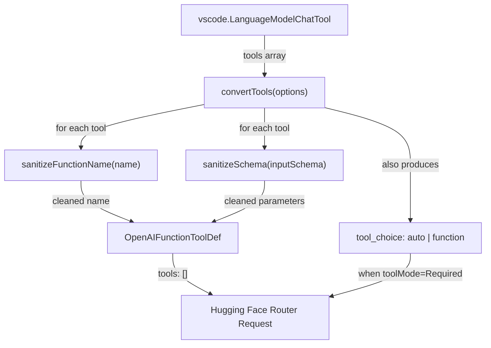
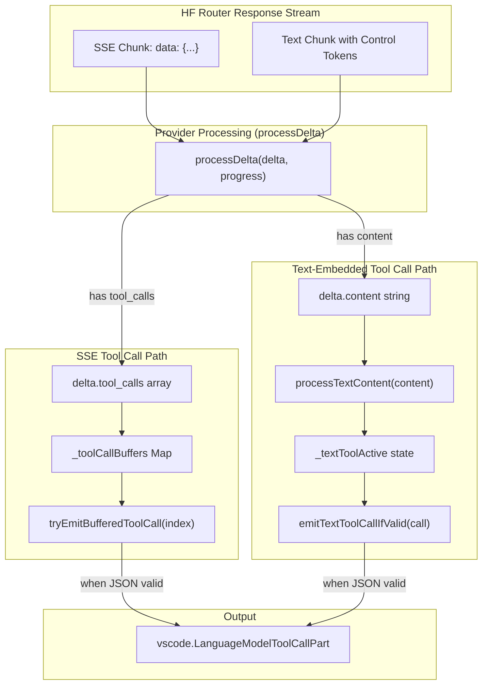
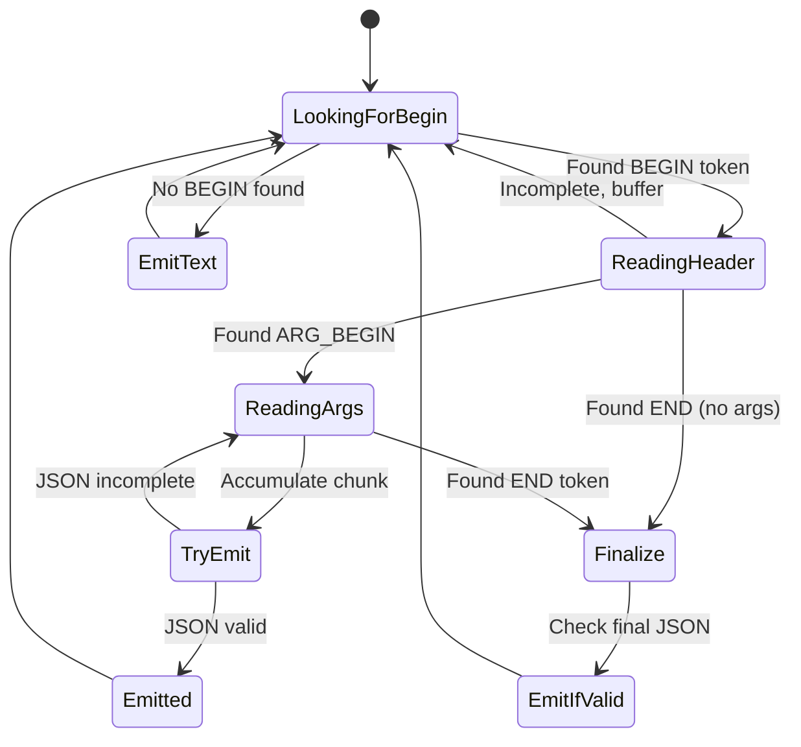
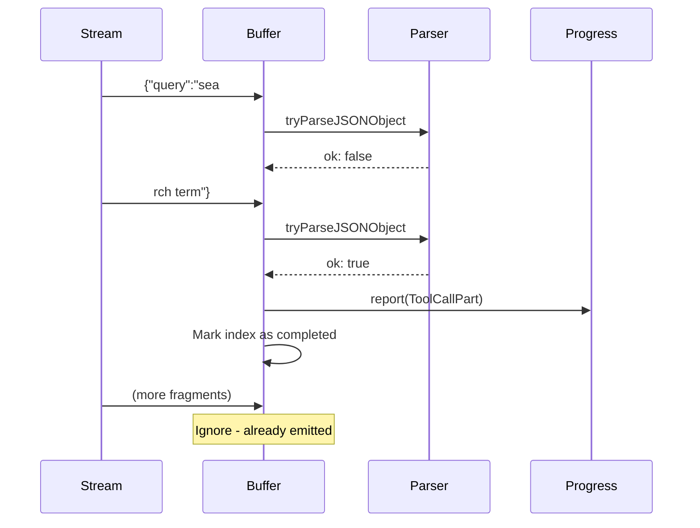
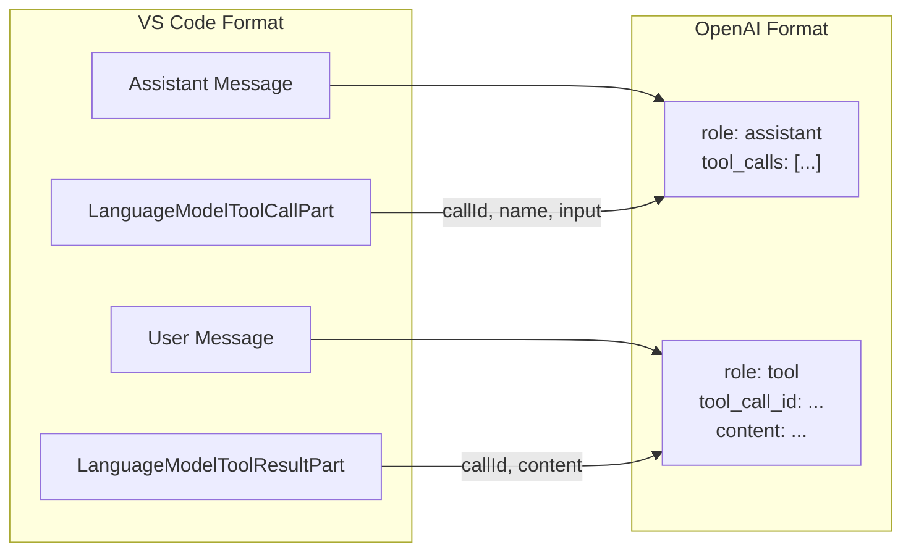
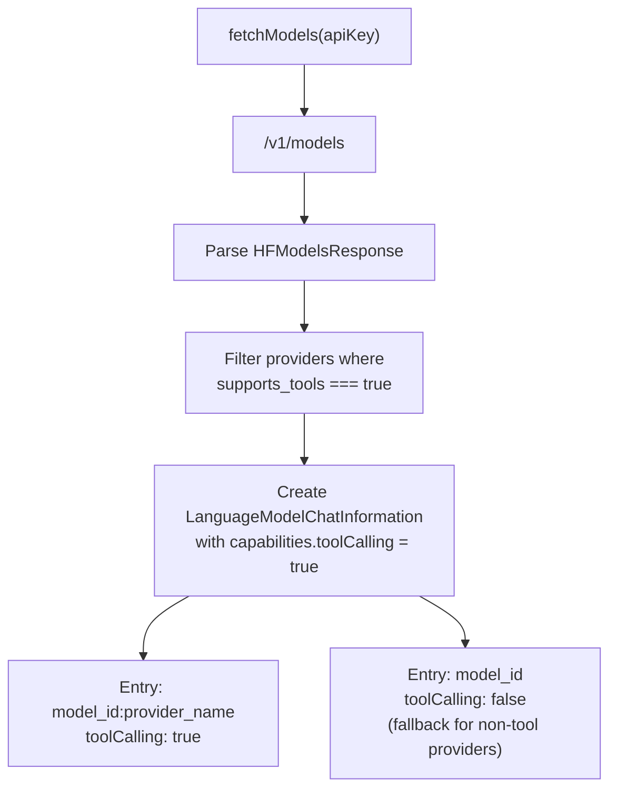

<!-- source: DeepWiki mcp.deepwiki.com · repo huggingface/huggingface-vscode-chat · page 4.3 Tool Calling Capabilities · fetched 2026-10-26 -->

# Tool Calling Capabilities

<details>
<summary>Relevant source files</summary>

The following files were used as context for generating this wiki page:

- [README.md](README.md)
- [src/provider.ts](src/provider.ts)
- [src/utils.ts](src/utils.ts)

</details>


This document describes the tool calling (function calling) features of the Hugging Face VS Code Chat extension, including how tools are defined, validated, converted, streamed, and reported to the VS Code chat interface. For information about the underlying chat provider implementation, see [Chat Provider Implementation](#3.3). For details on message conversion, see [Message Conversion Layer](#3.4).

## Purpose and Scope

The extension enables VS Code chat participants to invoke tools/functions through supported Hugging Face models. This page covers:

- Tool definition conversion from VS Code format to OpenAI-compatible format
- Tool name and schema validation and sanitization
- Dual-mode streaming support (SSE-based and text-embedded tool calls)
- Tool call buffering and deduplication mechanisms
- Progress reporting of tool calls to the VS Code UI

## Tool Definition and Conversion

The extension accepts tool definitions from VS Code's `LanguageModelChatRequestHandleOptions` and converts them to OpenAI-compatible function tool definitions for the Hugging Face Router API.

### Tool Definition Flow



**Sources:** [src/utils.ts:192-227](), [src/provider.ts:255]()

### Function Name Sanitization

Tool names are sanitized to meet API requirements using `sanitizeFunctionName`:

| Original Name | Sanitized Name | Reason |
|--------------|----------------|--------|
| `my-tool!` | `my-tool_` | Non-alphanumeric chars replaced with `_` |
| `123tool` | `tool_123tool` | Names must start with letter |
| `foo___bar` | `foo_bar` | Consecutive underscores collapsed |
| Long names (>64 chars) | Truncated to 64 chars | API length limits |

The function ensures all names match the pattern `^[a-zA-Z][a-zA-Z0-9_-]{0,63}$`.

**Sources:** [src/utils.ts:27-37]()

### Schema Sanitization

Tool parameter schemas are cleaned to ensure compatibility:

1. **Composite schema resolution** - `anyOf`/`oneOf`/`allOf` are flattened by selecting the first `type: "string"` branch, or the first branch if no string type exists
2. **Unknown keyword removal** - Only allowed JSON Schema keywords are preserved (type, properties, required, enum, items, min/max/pattern, etc.)
3. **Integer type inference** - Properties with names like `id`, `count`, `index`, `*_id` are auto-converted from `number` to `integer`
4. **Required field validation** - Non-string entries in `required` arrays are filtered out
5. **Recursive sanitization** - Applied to nested objects and array items

**Sources:** [src/utils.ts:68-136]()

### Tool Mode Support

The extension supports VS Code's `LanguageModelChatToolMode`:

| Mode | Behavior | OpenAI Mapping |
|------|----------|----------------|
| `Auto` (default) | Model decides whether to call tools | `tool_choice: "auto"` |
| `Required` | Model must call exactly one tool | `tool_choice: {type: "function", function: {name: "..."}}` |

If `Required` mode is used with multiple tools, the extension throws an error.

**Sources:** [src/utils.ts:218-224](), [src/provider.ts:257-259]()

## Streaming Tool Call Support

The extension supports two distinct mechanisms for receiving tool calls from the Hugging Face Router API, handling both standardized SSE format and text-embedded control tokens.

### Dual-Mode Architecture



**Sources:** [src/provider.ts:438-528]()

### SSE-Based Tool Calls

When the model returns tool calls in the standard OpenAI streaming format, the extension buffers and assembles them incrementally:

**Delta Format:**
```json
{
  "choices": [{
    "delta": {
      "tool_calls": [
        {
          "index": 0,
          "id": "call_abc123",
          "function": {
            "name": "search",
            "arguments": "{\"query\":"
          }
        }
      ]
    }
  }]
}
```

**Buffering Process:**

1. Each delta updates the buffer at `_toolCallBuffers[index]`
2. The `id` and `name` fields are stored when first encountered
3. The `arguments` field is concatenated as fragments arrive
4. `tryEmitBufferedToolCall` attempts to emit as soon as arguments become valid JSON
5. Once emitted, the index is added to `_completedToolCallIndices` to ignore further deltas

**Sources:** [src/provider.ts:488-520](), [src/provider.ts:709-733]()

### Text-Embedded Tool Calls

Some models emit tool calls within the text stream using control tokens:

**Control Token Format:**
```
<|tool_call_begin|>function_name:0<|tool_call_argument_begin|>{"arg":"value"}<|tool_call_end|>
```

**Token Structure:**

| Token | Purpose |
|-------|---------|
| `<|tool_call_begin|>` | Marks start of tool call |
| `function_name:0` | Function name and optional index |
| `<|tool_call_argument_begin|>` | Marks start of arguments |
| `{"arg":"value"}` | JSON arguments |
| `<|tool_call_end|>` | Marks end of tool call |

**Parsing State Machine:**



The parser maintains state in `_textToolActive` and buffers partial tokens in `_textToolParserBuffer` to handle streaming fragmentation.

**Sources:** [src/provider.ts:534-657]()

## Tool Call Emission and Deduplication

### Early Emission Strategy

The extension emits tool calls as soon as their arguments become valid JSON, rather than waiting for the complete stream. This provides faster UI feedback and reduces perceived latency.

**Emission Timing:**



**Sources:** [src/provider.ts:518-519](), [src/provider.ts:620-626]()

### Deduplication Mechanisms

To prevent duplicate tool calls when both SSE and text modes emit the same call, the extension uses multiple deduplication strategies:

| Strategy | Storage | Key Format | Purpose |
|----------|---------|------------|---------|
| Index-based (SSE) | `_completedToolCallIndices` | `number` | Prevents re-emission for same index |
| Content-based | `_emittedTextToolCallKeys` | `"name:canonical_json"` | Prevents duplicate calls with same content |
| Identity-based | `_emittedTextToolCallIds` | `"name:index"` | Prevents duplicates when index is known |

**Canonical JSON Comparison:**

```typescript
// Both arguments stringify to same canonical form
const canonical = JSON.stringify(parsed.value);
const key = `${name}:${canonical}`;
if (this._emittedTextToolCallKeys.has(key)) {
    return false; // Already emitted
}
```

This ensures that `{"a":1,"b":2}` and `{"b":2,"a":1}` are recognized as duplicates.

**Sources:** [src/provider.ts:659-686](), [src/provider.ts:726-729]()

## Validation and Error Handling

### Tool Name Validation

Before sending to the API, tool names are validated to contain only alphanumeric characters, hyphens, and underscores:

```typescript
validateTools(tools: readonly vscode.LanguageModelChatTool[]): void {
    for (const tool of tools) {
        if (!tool.name.match(/^[\w-]+$/)) {
            throw new Error(`Invalid tool name "${tool.name}"`);
        }
    }
}
```

**Sources:** [src/utils.ts:233-242]()

### Request Validation

The extension validates that tool call and tool result messages are properly paired:

1. Every assistant message with `LanguageModelToolCallPart` must be followed by a user message
2. That user message must contain `LanguageModelToolResultPart` instances
3. Each `callId` in tool calls must have a matching result

**Error Example:**
```
Invalid request: Tool call part must be followed by a User message 
with a LanguageModelToolResultPart with a matching callId.
```

**Sources:** [src/utils.ts:248-290]()

### Buffer Flush Behavior

When the stream ends with `finish_reason: "tool_calls"` or `"stop"`, the extension flushes all buffered tool calls:

| Finish Reason | Behavior |
|--------------|----------|
| `tool_calls` | Flush all buffers, throw error on invalid JSON |
| `stop` | Flush all buffers, throw error on invalid JSON |
| `[DONE]` signal | Flush all buffers, silently drop invalid JSON |
| Cancellation | Clean up all state, no emission |

**Sources:** [src/provider.ts:522-527](), [src/provider.ts:740-767]()

## Tool Call Message Conversion

When tool calls appear in the message history (e.g., in multi-turn conversations), they are converted to OpenAI format:

### VS Code to OpenAI Mapping



**Conversion Example:**

| VS Code Part | OpenAI Field | Value |
|-------------|--------------|-------|
| `ToolCallPart.callId` | `tool_calls[].id` | `"call_abc123"` |
| `ToolCallPart.name` | `tool_calls[].function.name` | `"search"` |
| `ToolCallPart.input` | `tool_calls[].function.arguments` | `'{"query":"test"}'` |
| `ToolResultPart.callId` | `tool_call_id` | `"call_abc123"` |
| `ToolResultPart.content` | `content` | Concatenated text parts |

**Sources:** [src/utils.ts:143-186]()

## Control Token Stripping

Text responses may contain provider-specific control tokens that should not be displayed to users. The extension strips these patterns from visible text:

| Pattern | Example | Purpose |
|---------|---------|---------|
| `<\|[a-zA-Z0-9_-]+_section_(?:begin\|end)\|>` | `<\|tool_calls_section_begin\|>` | Section delimiters |
| `<\|tool_call_(?:argument_)?(?:begin\|end)\|>` | `<\|tool_call_argument_begin\|>` | Tool call boundaries |

The stripping occurs in `stripControlTokens` before emitting text parts to the progress reporter.

**Sources:** [src/provider.ts:770-779]()

## Token Estimation

Tool definitions consume tokens from the model's context window. The extension estimates tool token usage:

```typescript
private estimateToolTokens(tools): number {
    const json = JSON.stringify(tools);
    return Math.ceil(json.length / 4);
}
```

This rough estimate (4 characters per token) is added to message token counts and validated against `model.maxInputTokens`.

**Sources:** [src/provider.ts:73-81](), [src/provider.ts:261-267]()

## Model Capability Discovery

The extension discovers which models support tool calling through the Hugging Face Router's `/v1/models` endpoint:



Models are registered with separate entries per provider that supports tools, allowing users to select provider-specific tool calling implementations.

**Sources:** [src/provider.ts:100-149]()

## Implementation Classes and Methods

### Key Provider Methods

| Method | Purpose | Returns |
|--------|---------|---------|
| `processDelta` | Route SSE chunk to SSE or text parser | `Promise<boolean>` |
| `processTextContent` | Parse text-embedded tool calls | `{emittedText, emittedAny}` |
| `tryEmitBufferedToolCall` | Emit SSE tool call when valid | `Promise<void>` |
| `emitTextToolCallIfValid` | Emit text tool call when valid | `boolean` |
| `flushToolCallBuffers` | Emit all buffered SSE tool calls | `Promise<void>` |
| `flushActiveTextToolCall` | Finalize in-progress text tool call | `Promise<void>` |

**Sources:** [src/provider.ts:438-767]()

### Key Utility Functions

| Function | Purpose | Location |
|----------|---------|----------|
| `convertTools` | VS Code tools → OpenAI format | [src/utils.ts:192-227]() |
| `sanitizeFunctionName` | Clean tool names | [src/utils.ts:27-37]() |
| `sanitizeSchema` | Clean JSON schemas | [src/utils.ts:68-136]() |
| `validateTools` | Verify tool name format | [src/utils.ts:233-242]() |
| `validateRequest` | Check tool call/result pairing | [src/utils.ts:248-290]() |
| `tryParseJSONObject` | Attempt JSON parse | [src/utils.ts:350-363]() |

**Sources:** [src/utils.ts:1-364]()

---

