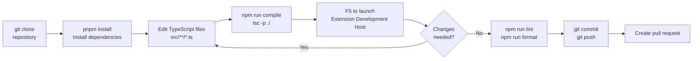
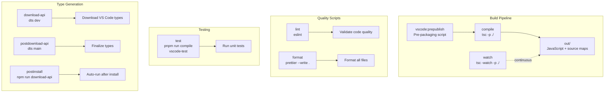
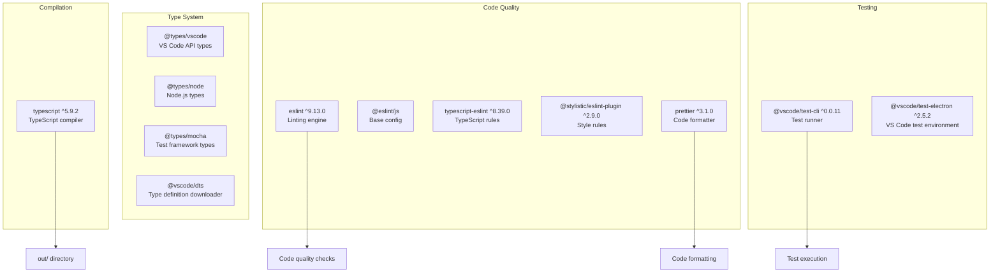
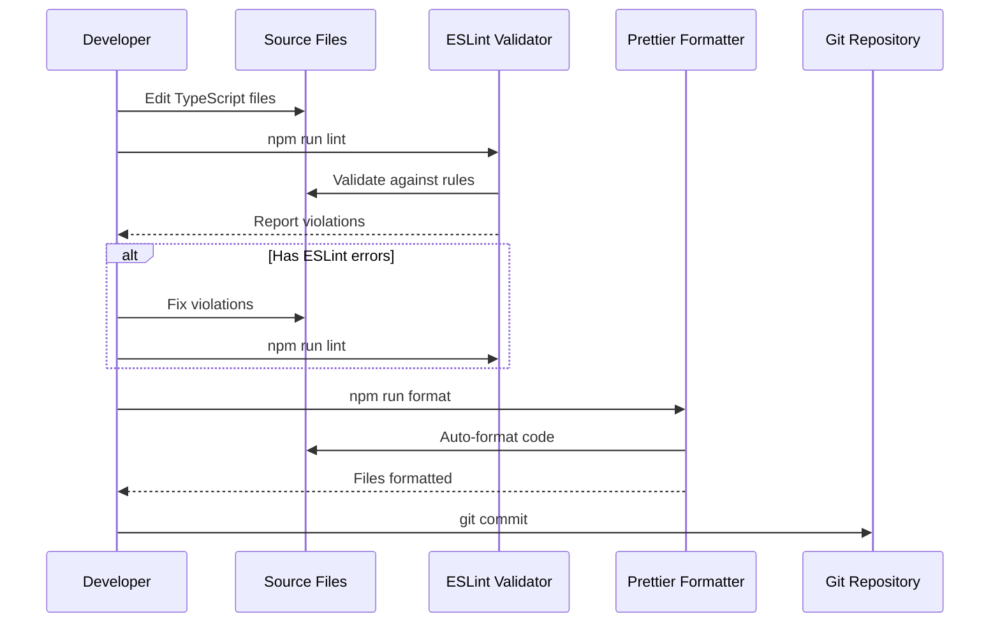
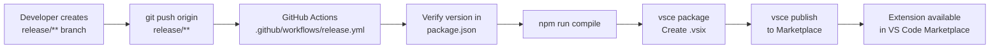

<!-- source: DeepWiki mcp.deepwiki.com · repo huggingface/huggingface-vscode-chat · page 5 Development Guide · fetched 2026-10-26 -->

# Development Guide

<details>
<summary>Relevant source files</summary>

The following files were used as context for generating this wiki page:

- [README.md](README.md)
- [package.json](package.json)
- [tsconfig.json](tsconfig.json)

</details>


## Purpose and Scope

This document provides a comprehensive guide for developers who want to contribute to or modify the huggingface-vscode-chat extension. It covers the development workflow, build process, testing infrastructure, code quality enforcement, and the release pipeline. This guide assumes familiarity with TypeScript, VS Code extension development, and Node.js tooling.

For end-user installation and configuration instructions, see [Getting Started](#2). For detailed architecture and implementation information, see [Architecture](#3). For specific configuration file reference, see [Configuration Reference](#6).

## Development Workflow Overview

The extension follows a standard TypeScript-based VS Code extension development workflow. The project uses `pnpm` as the package manager, TypeScript for type-safe development, and includes automated code quality enforcement through ESLint and Prettier.

### Typical Development Cycle



**Sources:** [README.md:31-45](), [package.json:56-66]()

## Prerequisites

Before starting development, ensure you have the following installed:

| Requirement | Version | Purpose |
|-------------|---------|---------|
| VS Code | ≥ 1.104.0 | Extension host and testing environment |
| Node.js | Compatible with pnpm 8.15.4 | Runtime for build tools |
| pnpm | 8.15.4 | Package manager |
| Git | Latest | Version control |

The VS Code version requirement is enforced in [package.json:12-14]() via the `engines.vscode` field.

**Sources:** [package.json:12-14](), [package.json:82](), [README.md:27-29]()

## Quick Start

### Clone and Install

```bash
git clone https://github.com/huggingface/huggingface-vscode-chat
cd huggingface-vscode-chat
pnpm install
```

The `pnpm install` command will automatically run the `postinstall` script defined in [package.json:60](), which downloads the VS Code API type definitions using `@vscode/dts`.

### Initial Build

```bash
npm run compile
```

This executes the TypeScript compiler (`tsc -p ./`) as defined in [package.json:61](), compiling all source files from `src/` to JavaScript in the `out/` directory with source maps enabled.

### Launch Extension Development Host

Press **F5** in VS Code to launch the Extension Development Host. This starts a new VS Code instance with the extension loaded for testing. The debugger will attach automatically, allowing you to set breakpoints in the TypeScript source files.

**Sources:** [README.md:31-38](), [package.json:56-66]()

## Development Scripts Reference

The [package.json:56-66]() file defines the following npm scripts for development workflows:

### Build Scripts



**Sources:** [package.json:56-66]()

### Script Descriptions

| Script | Command | Purpose |
|--------|---------|---------|
| `compile` | `tsc -p ./` | Compiles TypeScript to JavaScript using [tsconfig.json]() |
| `watch` | `tsc -watch -p ./` | Continuous compilation on file changes |
| `lint` | `eslint` | Validates code against ESLint rules |
| `format` | `prettier --write .` | Formats all files according to Prettier configuration |
| `test` | `pnpm run compile && vscode-test` | Compiles and runs test suite using `@vscode/test-cli` |
| `vscode:prepublish` | `npm run compile` | Pre-packaging hook for marketplace publishing |
| `download-api` | `dts dev` | Downloads development VS Code API definitions |
| `postdownload-api` | `dts main` | Downloads stable VS Code API definitions |
| `postinstall` | `npm run download-api` | Automatically downloads API types after dependency installation |

**Sources:** [package.json:56-66]()

## Project Structure

The extension follows a standard VS Code extension project layout:

```
huggingface-vscode-chat/
├── src/                    # TypeScript source files
│   ├── extension.ts        # Extension activation entry point
│   ├── provider.ts         # HuggingFaceChatModelProvider implementation
│   ├── utils.ts           # Conversion and validation utilities
│   ├── types.ts           # Type definitions
│   └── test/              # Test files
│       └── *.test.ts      # Mocha test suites
├── out/                    # Compiled JavaScript (generated)
│   ├── extension.js       # Compiled entry point
│   ├── provider.js        # Compiled provider
│   ├── utils.js           # Compiled utilities
│   └── *.js.map           # Source maps for debugging
├── package.json           # Extension manifest and npm scripts
├── tsconfig.json          # TypeScript compiler configuration
├── eslint.config.mjs      # ESLint configuration
├── .prettierrc            # Prettier configuration
└── .vscode/               # VS Code workspace settings
    └── tasks.json         # Build tasks
```

### Key Directories

- **`src/`**: Contains all TypeScript source code. The [tsconfig.json:7]() `rootDir` setting points here.
- **`out/`**: Build output directory specified in [tsconfig.json:9]() `outDir`. Generated JavaScript and source maps are placed here.
- **`node_modules/`**: Managed by pnpm, contains all development dependencies.

### Entry Points

- **Extension Entry**: [package.json:55]() specifies `./out/extension.js` as the `main` entry point.
- **Source Entry**: The TypeScript entry point is [src/extension.ts](), which exports `activate()` and `deactivate()` functions.

**Sources:** [package.json:55](), [tsconfig.json:7-9]()

## TypeScript Configuration

The [tsconfig.json]() file configures the TypeScript compiler with the following key settings:

| Setting | Value | Purpose |
|---------|-------|---------|
| `module` | `Node16` | Use Node.js module resolution |
| `target` | `ES2024` | Compile to modern JavaScript |
| `lib` | `["ES2024"]` | Include ES2024 standard library |
| `sourceMap` | `true` | Generate source maps for debugging |
| `rootDir` | `src` | TypeScript source root directory |
| `outDir` | `out` | JavaScript output directory |
| `strict` | `true` | Enable all strict type checking |
| `skipLibCheck` | `true` | Skip type checking of `.d.ts` files |
| `types` | `["node", "mocha"]` | Include Node.js and Mocha types |

The `strict` mode enabled in [tsconfig.json:8]() enforces:
- No implicit `any` types
- Strict null checks
- Strict function types
- Strict property initialization
- No implicit `this`

For detailed TypeScript configuration reference, see [TypeScript Configuration](#6.2).

**Sources:** [tsconfig.json:1-17]()

## Dependencies

The extension has **zero runtime dependencies**, as indicated by the empty `dependencies` object in [package.json:67](). All dependencies are development-only:



**Sources:** [package.json:67-81]()

### Development Tool Versions

All development dependencies are pinned to specific versions or version ranges in [package.json:68-81]() to ensure reproducible builds. The `pnpm-lock.yaml` file (generated by pnpm) locks exact dependency versions, including transitive dependencies.

## Development Environment Setup

For detailed instructions on setting up your development environment, including IDE configuration, debugging setup, and recommended VS Code extensions, see [Development Environment Setup](#5.1).

## Building and Compilation

The extension uses the TypeScript compiler for building. For detailed information about the compilation process, incremental builds, watch mode, and troubleshooting compilation errors, see [Building and Compilation](#5.2).

### Quick Build Commands

```bash
# One-time compilation
npm run compile

# Continuous compilation (watches for changes)
npm run watch
```

**Sources:** [package.json:61-64]()

## Testing

The extension uses Mocha as the test framework with VS Code's test infrastructure. For comprehensive testing documentation, including writing tests, running specific test suites, and debugging test failures, see [Testing](#5.3).

### Quick Test Commands

```bash
# Run all tests
npm run test
```

The test script first compiles the TypeScript code, then uses `@vscode/test-cli` to run tests in a VS Code environment as defined in [package.json:65]().

**Sources:** [package.json:65]()

## Code Quality Tools

The project enforces code quality through ESLint and Prettier. For detailed configuration, custom rules, and integration with your editor, see [Code Quality Tools](#5.4).

### Development Workflow with Code Quality



### Quick Quality Commands

```bash
# Check code quality
npm run lint

# Auto-format all files
npm run format
```

**Sources:** [package.json:62-63]()

## Release Process

The extension uses GitHub Actions for automated releases to the VS Code Marketplace. For detailed information about versioning, the CI/CD pipeline, and creating releases, see [Release Process](#5.5).

### Release Workflow Overview



**Sources:** [README.md:31-45]()

## Debugging

### Debugging the Extension

When launching the Extension Development Host with **F5**, VS Code automatically attaches the debugger. You can:

1. Set breakpoints in TypeScript files in `src/`
2. Breakpoints will work correctly because source maps are enabled in [tsconfig.json:6]()
3. Use the Debug Console to evaluate expressions in the extension context
4. Inspect variables, call stacks, and execution flow

### Debugging Tips

- The extension activates when the Copilot Chat interface is opened or when the `huggingface.manage` command is executed
- The `HuggingFaceChatModelProvider` is instantiated during extension activation in [src/extension.ts]()
- Set breakpoints in `provideLanguageModelChatResponse()` to debug chat request handling
- Set breakpoints in `processStreamingResponse()` to debug response parsing

**Sources:** [tsconfig.json:6](), [README.md:38]()

## Common Development Tasks

### Adding a New Feature

1. Create TypeScript files in `src/`
2. Update type definitions in [src/types.ts]() if needed
3. Add tests in `src/test/`
4. Run `npm run lint` and `npm run format`
5. Test with **F5** in Extension Development Host
6. Run `npm run test` to validate test suite

### Modifying the Provider

The `HuggingFaceChatModelProvider` in [src/provider.ts]() implements VS Code's `vscode.LanguageModelChatProvider` interface. When modifying:

1. Ensure compatibility with the VS Code API version specified in [package.json:13]()
2. Update conversion logic in [src/utils.ts]() if message format changes
3. Test with various model configurations and tool calling scenarios
4. Validate streaming response handling in `processStreamingResponse()`

### Updating Dependencies

```bash
# Update all dependencies to latest compatible versions
pnpm update

# Install a new development dependency
pnpm add -D <package-name>

# Update pnpm itself
npm install -g pnpm@8.15.4
```

After updating dependencies, always run the full test suite with `npm run test` to ensure compatibility.

**Sources:** [package.json:82]()

## Troubleshooting

### Common Issues

| Issue | Solution |
|-------|----------|
| TypeScript compilation errors | Run `npm run compile` to see detailed error messages. Check [tsconfig.json]() for configuration issues. |
| Extension not activating in Development Host | Check the Debug Console for activation errors. Ensure [package.json:40-47]() contributes are correct. |
| Tests failing | Ensure `npm run compile` completes successfully before running tests. Check test output for specific failures. |
| ESLint errors | Run `npm run lint` to see all violations. Many can be auto-fixed with editor integrations. |
| Source maps not working | Verify [tsconfig.json:6]() has `"sourceMap": true` and rebuild with `npm run compile`. |

### Getting Help

- Check the [Issues](https://github.com/huggingface/huggingface-vscode-chat/issues) page for known problems
- Review VS Code's [Extension API documentation](https://code.visualstudio.com/api)
- Consult the [Architecture](#3) documentation for system design details

**Sources:** [tsconfig.json:6](), [package.json:40-47](), [README.md:55]()

## Next Steps

- Set up your development environment: [Development Environment Setup](#5.1)
- Learn about the build process: [Building and Compilation](#5.2)
- Understand testing: [Testing](#5.3)
- Configure code quality tools: [Code Quality Tools](#5.4)
- Prepare for releases: [Release Process](#5.5)

---

