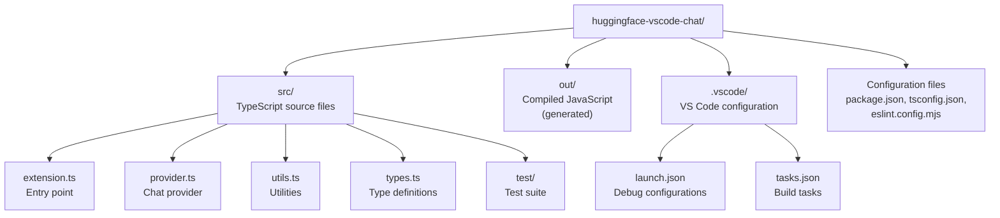
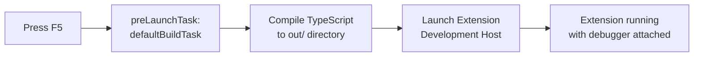
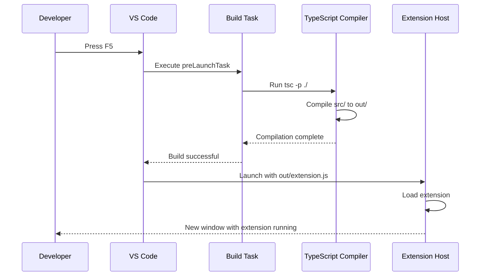
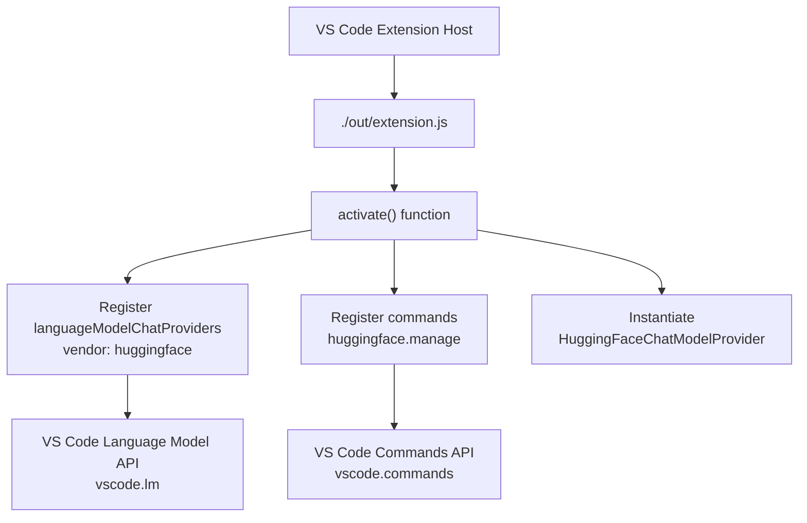

<!-- source: DeepWiki mcp.deepwiki.com · repo huggingface/huggingface-vscode-chat · page 5.1 Development Environment Setup · fetched 2026-10-26 -->

# Development Environment Setup

<details>
<summary>Relevant source files</summary>

The following files were used as context for generating this wiki page:

- [.vscode/launch.json](.vscode/launch.json)
- [.vscode/tasks.json](.vscode/tasks.json)
- [README.md](README.md)
- [package.json](package.json)
- [pnpm-lock.yaml](pnpm-lock.yaml)

</details>


## Purpose and Scope

This page provides instructions for setting up a local development environment for the `huggingface-vscode-chat` extension. It covers prerequisites, repository cloning, dependency installation, and VS Code workspace configuration needed to begin developing the extension.

For information about building and compiling the extension, see [Building and Compilation](#5.2). For testing procedures, see [Testing](#5.3). For code quality tools configuration, see [Code Quality Tools](#5.4).

---

## Prerequisites

### VS Code Version

The extension requires **VS Code 1.104.0 or higher** as specified in [package.json:13]().

```json
"engines": {
  "vscode": "^1.104.0"
}
```

### Node.js

The extension development toolchain requires Node.js version compatible with the development dependencies. The TypeScript compiler and tooling require **Node.js >=18.18.0** as indicated by various dependency engine requirements in [pnpm-lock.yaml:71]().

### Package Manager

The repository uses **pnpm 8.15.4** as the package manager, specified in [package.json:82]():

```json
"packageManager": "pnpm@8.15.4+sha512.0bd3a9be9eb0e9a692676deec00a303ba218ba279d99241475616b398dbaeedd11146f92c2843458f557b1d127e09d4c171e105bdcd6b61002b39685a8016b9e"
```

**Sources:** [package.json:12-14](), [package.json:82](), [pnpm-lock.yaml:71]()

---

## Repository Setup

### Cloning the Repository

Clone the repository from GitHub:

```bash
git clone https://github.com/huggingface/huggingface-vscode-chat
cd huggingface-vscode-chat
```

### Repository Structure



**Sources:** [README.md:32-38](), [package.json:55]()

---

## Dependency Installation

The extension has **zero runtime dependencies** and uses only development dependencies for the build and test toolchain. All dependencies are declared in the `devDependencies` section of [package.json:68-81]().

### Installing Dependencies

From the repository root, run:

```bash
npm install
```

or with pnpm directly:

```bash
pnpm install
```

The `postinstall` script [package.json:60]() automatically runs `npm run download-api` to fetch VS Code API type definitions using `@vscode/dts`.

### Development Dependency Categories

| Category | Packages | Purpose |
|----------|----------|---------|
| **TypeScript** | `typescript@5.9.2` | TypeScript compiler |
| **Type Definitions** | `@types/vscode@1.103.0`<br/>`@types/node@22`<br/>`@types/mocha@10.0.6` | Type definitions for VS Code API, Node.js, and Mocha |
| **Linting** | `eslint@9.34.0`<br/>`typescript-eslint@8.42.0`<br/>`@stylistic/eslint-plugin@2.13.0` | Code linting and style checking |
| **Formatting** | `prettier@3.6.2` | Code formatting |
| **Testing** | `@vscode/test-cli@0.0.11`<br/>`@vscode/test-electron@2.5.2`<br/>`mocha` | VS Code extension testing framework |
| **API Tools** | `@vscode/dts@0.4.1` | VS Code API definition downloader |

**Sources:** [package.json:68-81](), [pnpm-lock.yaml:7-43]()

---

## VS Code Workspace Configuration

The repository includes VS Code configuration files in the `.vscode/` directory that configure debugging and build tasks.

### Launch Configurations

The [.vscode/launch.json]() file defines two launch configurations:

#### 1. Run Extension

Launches the extension in a new Extension Development Host window:



Configuration details from [.vscode/launch.json:8-19]():
- **Name:** `Run Extension`
- **Type:** `extensionHost`
- **Args:** `--extensionDevelopmentPath=${workspaceFolder}`
- **Output Files:** `${workspaceFolder}/out/**/*.js`
- **Pre-Launch Task:** `${defaultBuildTask}` (TypeScript watch compilation)

#### 2. Extension Tests

Launches the extension test suite:

Configuration details from [.vscode/launch.json:20-33]():
- **Name:** `Extension Tests`
- **Type:** `extensionHost`
- **Args:** Includes `--extensionTestsPath=${workspaceFolder}/out/test/suite/index`
- **Pre-Launch Task:** `tasks: watch-tests`

**Sources:** [.vscode/launch.json:1-35]()

### Build Tasks

The [.vscode/tasks.json]() file defines NPM-based build tasks:

| Task | Script | Purpose | Problem Matcher |
|------|--------|---------|-----------------|
| `npm: watch` | `npm run watch` | Watch and compile TypeScript on file changes | `$tsc-watch` |
| `npm: watch-tests` | `npm run watch-tests` | Watch and compile test files | `$tsc-watch` |
| `tasks: watch-tests` | Composite task | Runs both watch tasks in parallel | None |

The default build task is `npm: watch` [.vscode/tasks.json:15-18](), configured as a background task that runs continuously.

**Sources:** [.vscode/tasks.json:1-40]()

---

## Development Workflow Setup

### Initial Compilation

After installing dependencies, perform an initial compilation:

```bash
npm run compile
```

This runs the TypeScript compiler as defined in [package.json:61](), compiling all source files from `src/` to `out/`.

### Launching the Extension Development Host



**Method 1: Using F5**
1. Open the repository in VS Code
2. Press `F5` to launch the Extension Development Host
3. The `Run Extension` configuration automatically:
   - Runs the watch task to compile TypeScript
   - Launches a new VS Code window with the extension loaded
   - Attaches the debugger

**Method 2: Using Debug Panel**
1. Open the Debug view (`Ctrl+Shift+D` or `Cmd+Shift+D`)
2. Select `Run Extension` from the dropdown
3. Click the green play button or press `F5`

**Sources:** [.vscode/launch.json:8-19](), [README.md:38]()

---

## Extension Entry Point

Once the development host launches, VS Code loads the extension from the compiled entry point:

- **Main Entry:** [package.json:55]() specifies `./out/extension.js`
- **Source File:** This is compiled from `src/extension.ts`
- **Activation:** The extension activates when the language model chat provider is needed



**Sources:** [package.json:55](), [package.json:40-53]()

---

## Verifying the Setup

After launching the Extension Development Host, verify the setup:

1. **Extension Loaded:** Check the Extension Development Host window title
2. **Provider Registered:** Open the Command Palette (`Ctrl+Shift+P`) and search for "Manage Hugging Face Provider"
3. **Chat Integration:** Click the model picker in Copilot Chat and verify "Hugging Face" appears as a provider

### Development Dependencies Installed

Verify all development tools are available:

```bash
# TypeScript compiler
npx tsc --version

# ESLint
npx eslint --version

# Prettier
npx prettier --version

# VS Code test CLI
npx vscode-test --version
```

**Sources:** [README.md:32-44](), [package.json:56-65]()

---

## Next Steps

With the development environment set up:

- **Build the extension:** See [Building and Compilation](#5.2) for compilation options and watch mode
- **Run tests:** See [Testing](#5.3) for test execution procedures
- **Configure code quality:** See [Code Quality Tools](#5.4) for linting and formatting setup
- **Understand the architecture:** See [System Overview](#3.1) for the extension's internal structure

**Sources:** [README.md:31-44](), [.vscode/launch.json:1-35](), [.vscode/tasks.json:1-40]()

---

