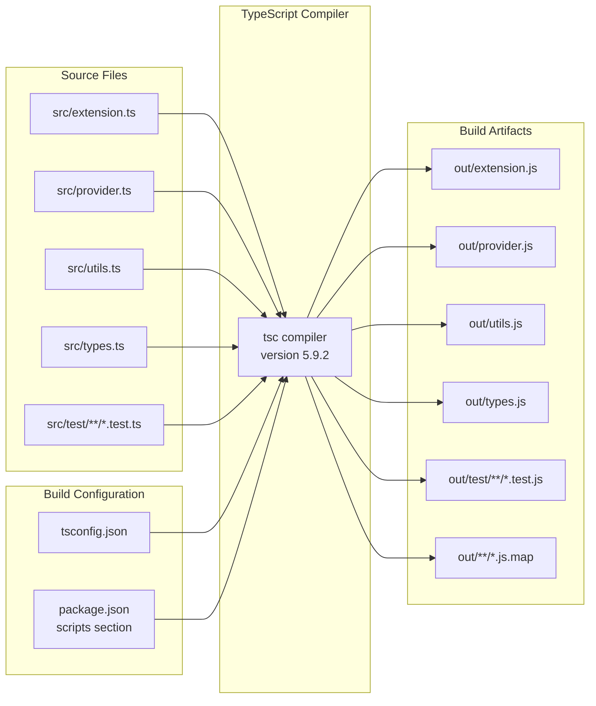
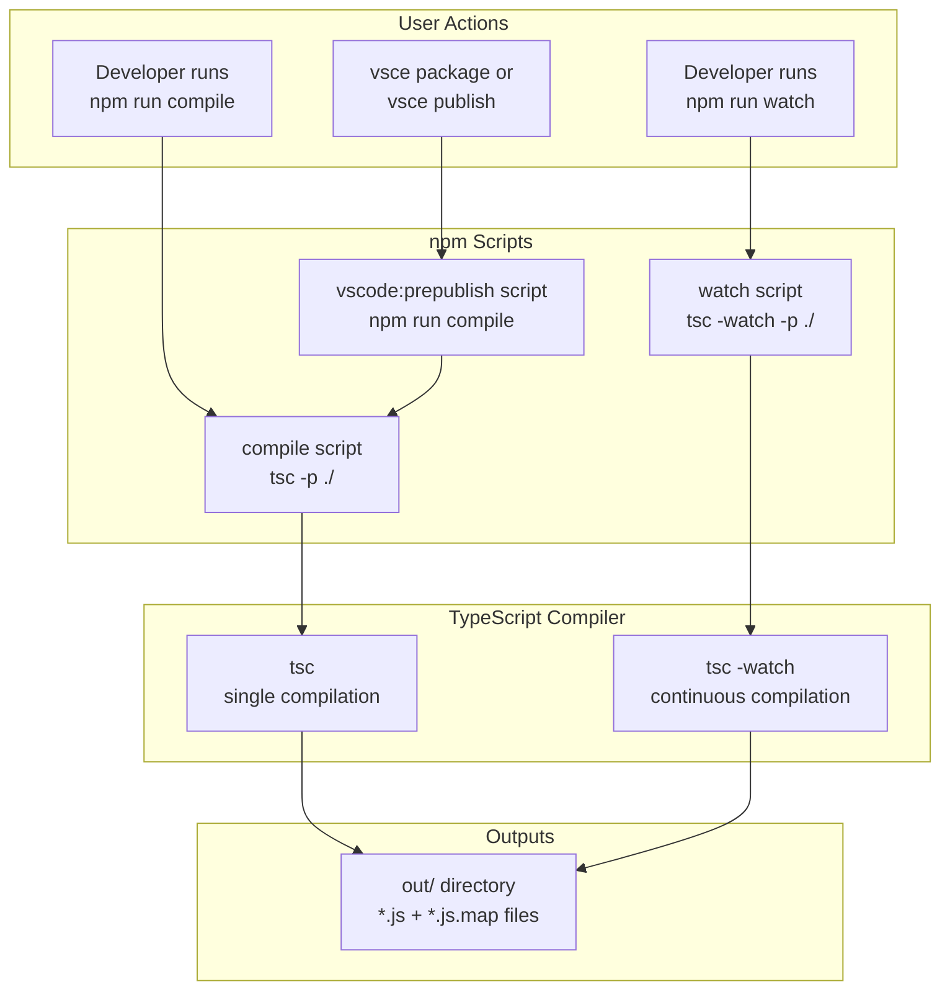
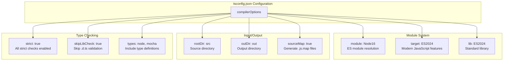
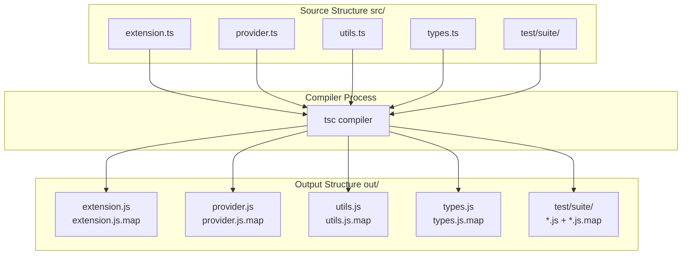
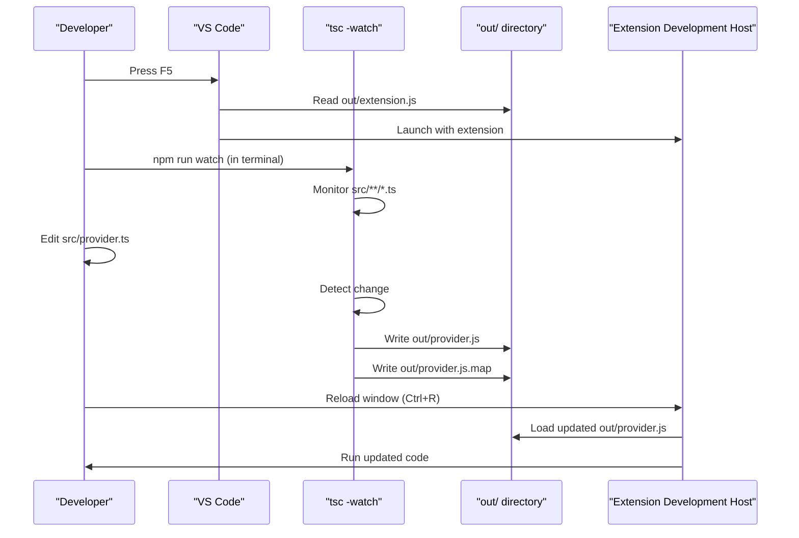

<!-- source: DeepWiki mcp.deepwiki.com · repo huggingface/huggingface-vscode-chat · page 5.2 Building and Compilation · fetched 2026-10-26 -->

# Building and Compilation

<details>
<summary>Relevant source files</summary>

The following files were used as context for generating this wiki page:

- [README.md](README.md)
- [package.json](package.json)
- [tsconfig.json](tsconfig.json)

</details>


## Purpose and Scope

This document describes the TypeScript compilation process for the huggingface-vscode-chat extension, including build scripts, compiler configuration, and generated artifacts. It covers how source code in `src/` is transformed into executable JavaScript in `out/`.

For information about setting up your development environment before building, see [Development Environment Setup](#5.1). For information about the CI/CD pipeline and publishing, see [Release Process](#5.5).

---

## TypeScript Compilation Overview

The extension is written entirely in TypeScript and must be compiled to JavaScript before it can run in VS Code. The compilation process is managed by the TypeScript compiler (`tsc`) with configuration specified in `tsconfig.json`.

### Compilation Flow



**Sources:** [README.md:31-44](), [package.json:56-65](), [tsconfig.json:1-17]()

---

## Build Scripts

The extension provides several npm scripts for building and compilation, defined in [package.json:56-65]().

### Primary Build Commands

| Script | Command | Purpose |
|--------|---------|---------|
| `compile` | `tsc -p ./` | One-time compilation of all TypeScript files |
| `watch` | `tsc -watch -p ./` | Continuous compilation on file changes |
| `vscode:prepublish` | `npm run compile` | Pre-packaging hook that ensures clean build |

### Script Relationships



**Sources:** [package.json:56-65](), [README.md:40-44]()

### Script Details

#### `npm run compile`

Executes a single compilation pass using `tsc -p ./`. The `-p` flag specifies the project directory containing `tsconfig.json`.

```bash
npm run compile
```

This is the standard build command used during:
- Initial development setup
- Manual builds
- Pre-publish preparation
- CI/CD pipelines

**Sources:** [package.json:61](), [README.md:36](), [README.md:41]()

#### `npm run watch`

Starts the TypeScript compiler in watch mode, automatically recompiling when source files change:

```bash
npm run watch
```

The watch mode is useful during active development because:
- Changes are compiled immediately
- No manual rebuild required
- Integrates with VS Code's debugging (F5 key)
- Compilation errors appear in real-time

**Sources:** [package.json:64](), [README.md:42]()

#### `npm run vscode:prepublish`

Lifecycle hook automatically executed by `vsce` before packaging or publishing:

```bash
npm run vscode:prepublish
```

This ensures that the latest compiled JavaScript is always included in the published extension package.

**Sources:** [package.json:57]()

---

## Build Configuration

The TypeScript compilation is configured via [tsconfig.json:1-17]().

### Compiler Options Breakdown



**Sources:** [tsconfig.json:1-17]()

### Key Configuration Settings

| Option | Value | Purpose |
|--------|-------|---------|
| `module` | `"Node16"` | Uses Node.js ESM resolution with `.js` extensions in imports |
| `target` | `"ES2024"` | Compiles to modern JavaScript with latest ECMAScript features |
| `lib` | `["ES2024"]` | Includes ES2024 standard library type definitions |
| `sourceMap` | `true` | Generates `.js.map` files for debugging TypeScript from JavaScript |
| `rootDir` | `"src"` | All source files must be under `src/` directory |
| `outDir` | `"out"` | Compiled JavaScript outputs to `out/` directory |
| `strict` | `true` | Enables all strict type-checking: `strictNullChecks`, `strictFunctionTypes`, etc. |
| `skipLibCheck` | `true` | Skips type checking of declaration files (`.d.ts`) for faster compilation |
| `types` | `["node", "mocha"]` | Includes Node.js and Mocha type definitions globally |

**Sources:** [tsconfig.json:2-11]()

### Why ES2024 Target?

The extension targets ES2024 to leverage modern JavaScript features while maintaining compatibility with VS Code's Electron runtime. VS Code 1.104.0+ (the minimum required version specified in [package.json:13]()) supports these features natively.

**Sources:** [tsconfig.json:4-5](), [package.json:12-14]()

---

## Build Artifacts

The compilation process generates JavaScript files and source maps in the `out/` directory, mirroring the structure of `src/`.

### Output Directory Structure



**Sources:** [tsconfig.json:7-9]()

### Artifact Types

#### JavaScript Files (`*.js`)

Executable JavaScript code that VS Code loads. The entry point is `out/extension.js`, referenced in [package.json:55]():

```json
"main": "./out/extension.js"
```

These files contain the compiled TypeScript with:
- ES2024 syntax preserved
- Type annotations stripped
- Module imports using `.js` extensions (per Node16 module resolution)

**Sources:** [package.json:55](), [tsconfig.json:2-4]()

#### Source Map Files (`*.js.map`)

Source maps enable debugging TypeScript code directly in VS Code by mapping compiled JavaScript back to original TypeScript. When you set breakpoints in `.ts` files, VS Code uses these maps to pause execution at the correct location.

Generated because [tsconfig.json:6]() sets `"sourceMap": true`.

**Sources:** [tsconfig.json:6]()

---

## Development Workflow

### Standard Development Build

For initial setup or after pulling changes:

```bash
npm install
npm run compile
```

This ensures all dependencies are installed and the extension is built before debugging.

**Sources:** [README.md:32-36]()

### Active Development with Watch Mode

For iterative development with automatic recompilation:

1. Start watch mode in a terminal:
   ```bash
   npm run watch
   ```

2. Press F5 in VS Code to launch Extension Development Host

3. Edit TypeScript files - they automatically recompile

4. Reload the Extension Development Host window to test changes

Watch mode continuously monitors the `src/` directory and recompiles on any `.ts` file change. Compilation errors appear immediately in the terminal.

**Sources:** [README.md:38](), [README.md:42](), [package.json:64]()

### Integration with VS Code Debugging

The extension's launch configuration (defined in `.vscode/launch.json`) automatically uses the compiled output from `out/`:



**Sources:** [README.md:38](), [README.md:42](), [package.json:55]()

---

## Build Verification

After compilation completes, verify the build succeeded:

### Check for Compilation Errors

The `tsc` compiler exits with status code 0 on success. Any type errors or syntax issues will:
- Display in the terminal
- Prevent file generation for affected modules
- Exit with non-zero status code

### Verify Output Files

Check that `out/` contains compiled files:

```bash
ls -la out/
# Should show:
# extension.js, extension.js.map
# provider.js, provider.js.map
# utils.js, utils.js.map
# types.js, types.js.map
# test/ directory with compiled tests
```

The presence of both `.js` and `.js.map` files indicates successful compilation with source maps enabled.

**Sources:** [tsconfig.json:6-9](), [package.json:55]()

### Test the Extension

Run the extension in the Extension Development Host:

```bash
# In VS Code, press F5
# Or manually compile and test:
npm run compile
code --extensionDevelopmentPath=$PWD
```

If the extension activates without errors, the build is valid.

**Sources:** [README.md:38]()

---

## Incremental Compilation

The TypeScript compiler performs incremental compilation by default, only recompiling changed files and their dependents. This significantly speeds up watch mode during development.

The compiler determines dependencies by analyzing:
- Import statements in `.ts` files
- Type dependencies across modules
- Configuration changes in `tsconfig.json`

When you modify `src/utils.ts`, only files importing from `utils.ts` (like `src/provider.ts` and `src/extension.ts`) are recompiled, not the entire project.

**Sources:** [package.json:64](), [tsconfig.json:1-17]()

---

## Common Build Issues

| Issue | Cause | Solution |
|-------|-------|----------|
| `Cannot find module` errors | Missing `npm install` or outdated dependencies | Run `npm install` to install/update dependencies |
| Type errors despite valid code | Stale `node_modules/@types` | Delete `node_modules/` and run `npm install` |
| `out/` directory missing | Compilation failed | Check terminal for TypeScript errors, fix and recompile |
| Breakpoints not working | Missing source maps | Verify `"sourceMap": true` in `tsconfig.json` |
| Extension not loading | `main` field incorrect | Ensure [package.json:55]() points to `"./out/extension.js"` |
| Watch mode not detecting changes | File system watcher limit | Increase system file watcher limit (Linux) |

**Sources:** [tsconfig.json:6](), [package.json:55]()

---

## Summary

The build process transforms TypeScript source code into executable JavaScript through the TypeScript compiler configured via `tsconfig.json`. The `npm run compile` script performs a single build, while `npm run watch` provides continuous compilation during development. All compiled artifacts are generated in the `out/` directory with source maps for debugging support.

For the next steps after building, see [Testing](#5.3) to run the test suite against your compiled extension.

**Sources:** [package.json:56-65](), [tsconfig.json:1-17](), [README.md:31-44]()

---

