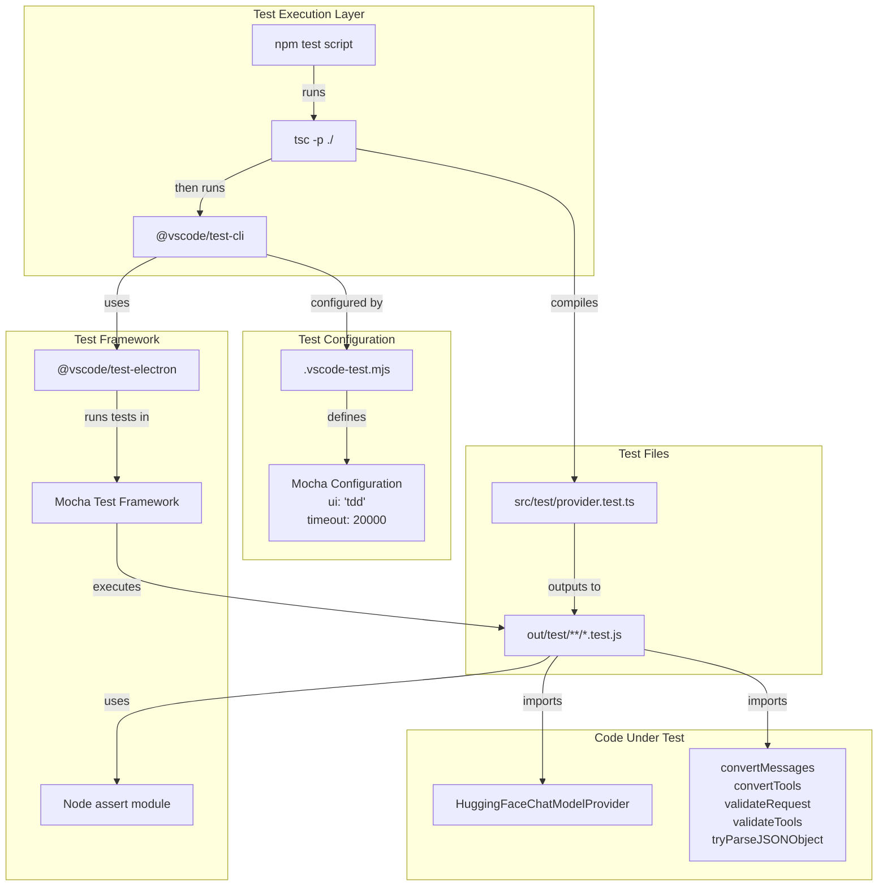
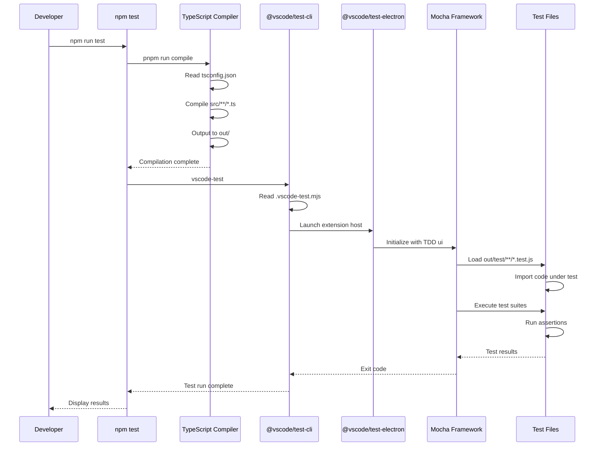
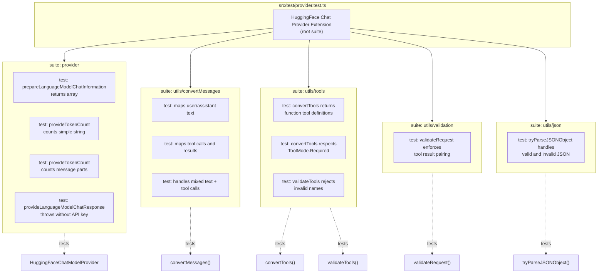

<!-- source: DeepWiki mcp.deepwiki.com · repo huggingface/huggingface-vscode-chat · page 5.3 Testing · fetched 2026-10-26 -->

# Testing

<details>
<summary>Relevant source files</summary>

The following files were used as context for generating this wiki page:

- [.vscode-test.mjs](.vscode-test.mjs)
- [.vscode/launch.json](.vscode/launch.json)
- [package.json](package.json)
- [src/test/provider.test.ts](src/test/provider.test.ts)

</details>


This document describes the testing infrastructure and practices for the huggingface-vscode-chat extension. It covers the test framework, test execution, test suite organization, and guidelines for writing and debugging tests. For information about code quality tools like linting and formatting, see [Code Quality Tools](#5.4). For build and compilation processes, see [Building and Compilation](#5.2).

## Overview

The extension uses a VS Code-specific testing infrastructure built on the Mocha test framework. Tests validate the core functionality of the chat provider, message conversion utilities, tool handling, and validation logic. All tests are located in the `src/test/` directory and are written in TypeScript.

**Sources:** [package.json:65-66](), [.vscode-test.mjs:1-10]()

## Test Infrastructure Architecture

The testing system consists of multiple layers that enable testing of VS Code extension code in an isolated environment:



**Sources:** [package.json:65-66](), [.vscode-test.mjs:1-10](), [src/test/provider.test.ts:1-4]()

### Framework Components

| Component | Purpose | Version/Details |
|-----------|---------|-----------------|
| `@vscode/test-cli` | Test runner orchestrator | ^0.0.11 |
| `@vscode/test-electron` | VS Code extension host environment | ^2.5.2 |
| `mocha` | Test framework | ^10.0.6 |
| `@types/mocha` | TypeScript type definitions | ^10.0.6 |

The test infrastructure uses the Test-Driven Development (TDD) style with Mocha's `suite()` and `test()` functions rather than BDD-style `describe()` and `it()`.

**Sources:** [package.json:72-76](), [.vscode-test.mjs:6-7]()

## Running Tests

### Command-Line Execution

Execute all tests using the npm test script:

```bash
npm run test
```

This command performs two sequential operations:
1. Compiles TypeScript source files using `tsc -p ./`
2. Runs tests using `vscode-test` CLI

**Sources:** [package.json:65-66]()

### Test Execution Flow



**Sources:** [package.json:65-66](), [.vscode-test.mjs:1-10]()

### Debugging Tests

VS Code provides a dedicated launch configuration for debugging tests:

1. Open the Run and Debug panel (Ctrl+Shift+D / Cmd+Shift+D)
2. Select "Extension Tests" from the dropdown
3. Set breakpoints in test files or source files
4. Press F5 to start debugging

The launch configuration is defined in [.vscode/launch.json:20-34]() and uses the following settings:

- **Type:** `extensionHost`
- **Extension Development Path:** Current workspace
- **Extension Tests Path:** `out/test/suite/index`
- **Pre-launch Task:** `tasks: watch-tests`

**Sources:** [.vscode/launch.json:20-34]()

## Test Suite Structure

The test file [src/test/provider.test.ts]() contains multiple test suites organized by the code modules they test:



**Sources:** [src/test/provider.test.ts:19-244]()

### Test Suite Categories

| Suite Name | Tests Count | Code Under Test | Purpose |
|------------|-------------|-----------------|---------|
| `provider` | 4 | `HuggingFaceChatModelProvider` | Tests provider lifecycle methods |
| `utils/convertMessages` | 3 | `convertMessages()` | Tests message conversion from VS Code to OpenAI format |
| `utils/tools` | 3 | `convertTools()`, `validateTools()` | Tests tool definition conversion and validation |
| `utils/validation` | 1 | `validateRequest()` | Tests message validation logic |
| `utils/json` | 1 | `tryParseJSONObject()` | Tests JSON parsing utility |

**Sources:** [src/test/provider.test.ts:19-244]()

## Test Coverage by Module

### Provider Tests

The provider test suite validates the core `HuggingFaceChatModelProvider` methods:

**prepareLanguageModelChatInformation** [src/test/provider.test.ts:21-34]()
- Verifies method returns an array
- Tests behavior without API key (silent mode)
- Uses mock `SecretStorage` implementation

**provideTokenCount** [src/test/provider.test.ts:36-89]()
- Tests token counting for simple strings
- Tests token counting for `LanguageModelChatMessage` objects with parts
- Validates return type is a positive number

**provideLanguageModelChatResponse** [src/test/provider.test.ts:91-120]()
- Verifies method throws when API key is missing
- Tests error handling in chat response generation

**Sources:** [src/test/provider.test.ts:20-121]()

### Message Conversion Tests

The conversion test suite validates transformation of VS Code message formats to OpenAI-compatible formats:

**User/Assistant Text Mapping** [src/test/provider.test.ts:124-142]()
- Converts `LanguageModelTextPart` to simple string content
- Maps `LanguageModelChatMessageRole` to OpenAI role strings

**Tool Call and Result Mapping** [src/test/provider.test.ts:144-155]()
- Converts `LanguageModelToolCallPart` to OpenAI `tool_calls` array
- Converts `LanguageModelToolResultPart` to `tool` role messages
- Validates tool call ID preservation

**Mixed Content Handling** [src/test/provider.test.ts:157-175]()
- Tests messages containing both text and tool calls
- Ensures text content is concatenated properly
- Verifies tool calls are extracted into separate array

**Sources:** [src/test/provider.test.ts:123-176]()

### Tool Conversion Tests

The tool conversion suite validates transformation of VS Code tool definitions:

**Function Tool Definition Generation** [src/test/provider.test.ts:179-194]()
- Converts `LanguageModelChatTool` to OpenAI function tool format
- Validates default `tool_choice` is "auto"
- Tests schema conversion with `additionalProperties`

**Tool Mode Handling** [src/test/provider.test.ts:196-208]()
- Tests `ToolMode.Required` conversion to forced tool choice
- Validates single tool forces specific function selection

**Tool Name Validation** [src/test/provider.test.ts:210-215]()
- Rejects tool names with invalid characters
- Tests name sanitization requirements

**Sources:** [src/test/provider.test.ts:178-216]()

### Validation Tests

**Tool Result Pairing** [src/test/provider.test.ts:219-234]()
- Ensures tool calls have corresponding tool results
- Validates tool call ID matching between calls and results
- Tests that missing tool results cause validation errors

**Sources:** [src/test/provider.test.ts:218-235]()

### JSON Parsing Tests

**Object Parsing** [src/test/provider.test.ts:238-242]()
- Tests successful parsing of valid JSON objects
- Rejects JSON arrays (non-object types)
- Handles malformed JSON gracefully

**Sources:** [src/test/provider.test.ts:237-243]()

## Writing New Tests

### Test Structure Pattern

All tests follow the TDD-style Mocha pattern with mock implementations for VS Code APIs:

```typescript
suite("Suite Name", () => {
    test("test description", async () => {
        // Arrange: Set up test data and mocks
        const mockSecretStorage = {
            get: async () => undefined,
            store: async () => {},
            delete: async () => {},
            onDidChange: (_listener: unknown) => ({ dispose() {} }),
        } as unknown as vscode.SecretStorage;
        
        // Act: Execute the code under test
        const result = await someFunction(mockSecretStorage);
        
        // Assert: Verify the results
        assert.ok(result);
    });
});
```

**Sources:** [src/test/provider.test.ts:19-244]()

### Mock SecretStorage Pattern

Since the provider requires `vscode.SecretStorage`, tests use a consistent mock implementation:

```typescript
const mockSecretStorage = {
    get: async () => undefined,
    store: async () => {},
    delete: async () => {},
    onDidChange: (_listener: unknown) => ({ dispose() {} }),
} as unknown as vscode.SecretStorage;
```

This mock is defined inline in each test at [src/test/provider.test.ts:22-26](), [src/test/provider.test.ts:37-41](), [src/test/provider.test.ts:62-66](), and [src/test/provider.test.ts:92-96]().

**Sources:** [src/test/provider.test.ts:22-26](), [src/test/provider.test.ts:37-41]()

### Assertion Methods

Tests use Node.js's built-in `assert` module:

| Method | Purpose | Example Usage |
|--------|---------|---------------|
| `assert.ok()` | Truthy assertion | `assert.ok(Array.isArray(result))` |
| `assert.equal()` | Equality assertion | `assert.equal(typeof est, "number")` |
| `assert.deepEqual()` | Deep equality | `assert.deepEqual(out, expected)` |
| `assert.throws()` | Exception assertion | `assert.throws(() => validateTools(bad))` |
| `assert.doesNotThrow()` | No exception assertion | `assert.doesNotThrow(() => validate(good))` |

**Sources:** [src/test/provider.test.ts:1-2](), [src/test/provider.test.ts:33-242]()

### Test Data Construction

Tests construct VS Code types using their constructors:

```typescript
const textPart = new vscode.LanguageModelTextPart("hello");
const toolCall = new vscode.LanguageModelToolCallPart("id", "name", { arg: 1 });
const toolResult = new vscode.LanguageModelToolResultPart("id", [textPart]);
const message: vscode.LanguageModelChatMessage = {
    role: vscode.LanguageModelChatMessageRole.User,
    content: [textPart],
    name: undefined,
};
```

**Sources:** [src/test/provider.test.ts:145-149](), [src/test/provider.test.ts:159-167]()

## Test Configuration

### Mocha Configuration

The test configuration in [.vscode-test.mjs]() specifies:

| Setting | Value | Purpose |
|---------|-------|---------|
| `files` | `'out/test/**/*.test.js'` | Test file glob pattern |
| `mocha.ui` | `'tdd'` | Use TDD-style suite/test |
| `mocha.timeout` | `20000` | 20-second timeout per test |
| `mocha.color` | `true` | Colorized console output |

**Sources:** [.vscode-test.mjs:3-9]()

### Test File Patterns

The test infrastructure expects:
- Source test files: `src/test/**/*.test.ts`
- Compiled test files: `out/test/**/*.test.js`
- Test discovery uses the compiled `.js` files

**Sources:** [.vscode-test.mjs:4]()

## Continuous Integration

While the repository includes test infrastructure, the CI/CD pipeline defined in GitHub Actions workflows primarily focuses on packaging and publishing. The test suite can be integrated into CI by adding a test step before the package step in the release workflow.

**Sources:** [package.json:65-66]()

## Best Practices

### Test Isolation

Each test should:
- Create its own mock instances
- Not depend on other tests' execution order
- Clean up resources (though current tests use simple mocks without cleanup needs)

### Async Handling

Provider methods are asynchronous and tests use `async`/`await`:

```typescript
test("async test", async () => {
    const result = await provider.provideTokenCount(model, "text", token);
    assert.ok(result > 0);
});
```

**Sources:** [src/test/provider.test.ts:36-59]()

### Error Testing

Tests verify both success and failure paths:

```typescript
// Success path
assert.doesNotThrow(() => validateRequest(valid));

// Failure path
assert.throws(() => validateRequest(invalid));
```

**Sources:** [src/test/provider.test.ts:227-233]()

### Type Safety

Tests import and use proper TypeScript types to ensure type-safe test data:

```typescript
interface OpenAIToolCall {
    id: string;
    type: "function";
    function: { name: string; arguments: string };
}
```

**Sources:** [src/test/provider.test.ts:6-10]()

---

