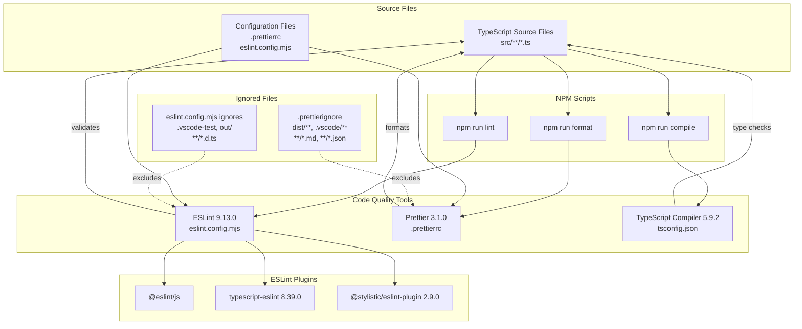
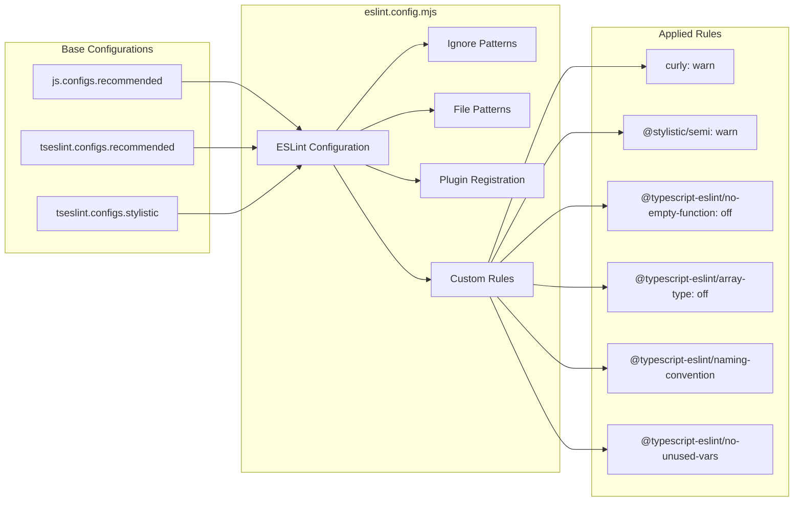
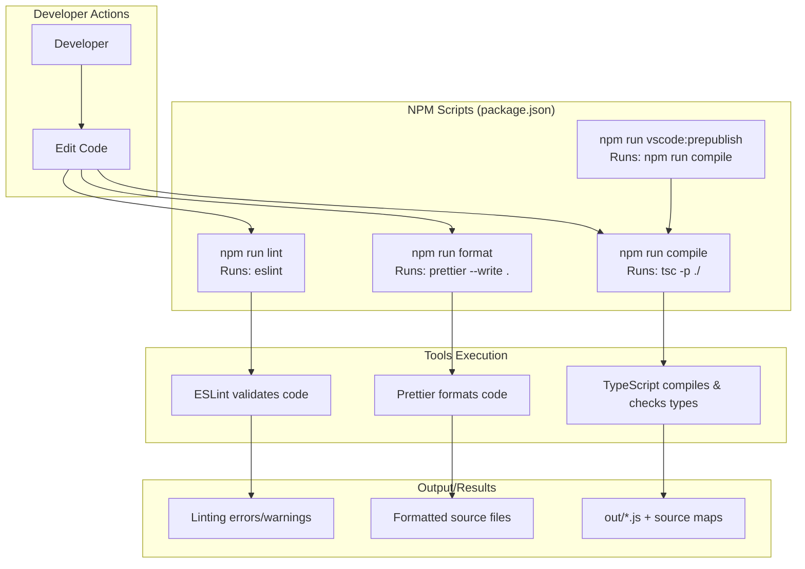
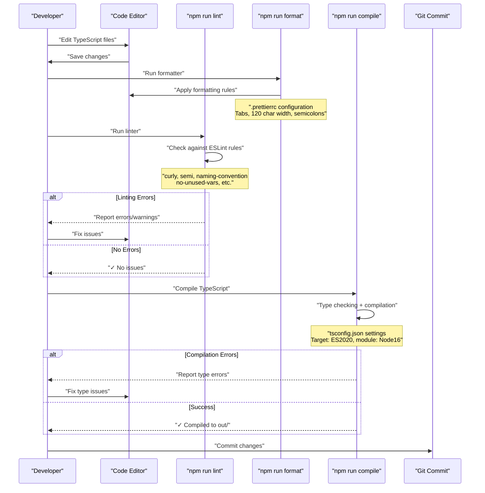

<!-- source: DeepWiki mcp.deepwiki.com · repo huggingface/huggingface-vscode-chat · page 5.4 Code Quality Tools · fetched 2026-10-26 -->

# Code Quality Tools

<details>
<summary>Relevant source files</summary>

The following files were used as context for generating this wiki page:

- [.prettierignore](.prettierignore)
- [.prettierrc](.prettierrc)
- [eslint.config.mjs](eslint.config.mjs)
- [package.json](package.json)

</details>


## Purpose and Scope

This document describes the code quality enforcement tools used in the huggingface-vscode-chat extension. It covers the configuration and usage of ESLint for linting, Prettier for code formatting, and how TypeScript compilation contributes to code quality. For information about building and compiling the extension, see [Building and Compilation](#5.2). For information about testing, see [Testing](#5.3).

## Overview

The extension uses three primary tools to maintain code quality:

1. **ESLint** - Static analysis and linting with TypeScript-specific rules
2. **Prettier** - Automatic code formatting for consistent style
3. **TypeScript Compiler** - Type checking and compilation



**Sources:** [package.json:56-66](), [eslint.config.mjs:1-49](), [.prettierrc:1-7](), [.prettierignore:1-10]()

## ESLint Configuration

### Configuration File Structure

The ESLint configuration is defined in `eslint.config.mjs` using the new flat config format. The configuration extends multiple recommended rulesets and adds custom rules.



**Sources:** [eslint.config.mjs:1-49]()

### Ignore Patterns

The following directories and file patterns are excluded from linting:

| Pattern | Description |
|---------|-------------|
| `.vscode-test` | VS Code test runner output |
| `out` | Compiled JavaScript output |
| `**/*.d.ts` | TypeScript declaration files |

**Sources:** [eslint.config.mjs:13-17]()

### File Patterns

ESLint processes the following file types:

```
**/*.{js,mjs,cjs,ts,jsx,tsx}
```

**Sources:** [eslint.config.mjs:20]()

### Rule Configuration

#### Core Rules

| Rule | Severity | Description |
|------|----------|-------------|
| `curly` | warn | Requires curly braces for all control statements |
| `@stylistic/semi` | warn | Requires semicolons at the end of statements |

**Sources:** [eslint.config.mjs:30-31]()

#### TypeScript-Specific Rules

| Rule | Configuration | Purpose |
|------|--------------|---------|
| `@typescript-eslint/no-empty-function` | off | Allows empty functions (common in VS Code API) |
| `@typescript-eslint/array-type` | off | No enforcement of array type syntax |
| `@typescript-eslint/naming-convention` | warn | Enforces camelCase/PascalCase for imports |
| `@typescript-eslint/no-unused-vars` | error | Errors on unused variables (except prefixed with `_`) |

**Sources:** [eslint.config.mjs:32-46]()

#### Naming Convention Details

The `naming-convention` rule specifically targets imports:

```javascript
{
  'selector': 'import',
  'format': ['camelCase', 'PascalCase']
}
```

This ensures all imported modules follow either camelCase or PascalCase naming.

**Sources:** [eslint.config.mjs:34-39]()

#### Unused Variables Configuration

The `no-unused-vars` rule allows variables prefixed with underscore to be unused:

```javascript
{
  'argsIgnorePattern': '^_'
}
```

This is useful for callback parameters that must be declared but aren't used.

**Sources:** [eslint.config.mjs:41-46]()

### Plugins

The configuration uses three plugin packages:

1. **@eslint/js** (v9.13.0) - Core JavaScript linting rules
2. **typescript-eslint** (v8.39.0) - TypeScript-specific linting rules
3. **@stylistic/eslint-plugin** (v2.9.0) - Stylistic formatting rules

**Sources:** [eslint.config.mjs:7-9](), [package.json:69-80]()

## Prettier Configuration

### Formatting Rules

Prettier is configured with the following style rules in `.prettierrc`:

| Option | Value | Description |
|--------|-------|-------------|
| `semi` | `true` | Add semicolons at the end of statements |
| `useTabs` | `true` | Use tabs for indentation |
| `tabWidth` | `2` | Tab width is 2 spaces |
| `printWidth` | `120` | Maximum line length of 120 characters |
| `trailingComma` | `"es5"` | Add trailing commas where valid in ES5 |

**Sources:** [.prettierrc:1-7]()

### Ignored Files

The `.prettierignore` file excludes the following paths from formatting:

| Pattern | Reason |
|---------|--------|
| `dist/**` | Distribution output |
| `.vscode/**` | VS Code configuration |
| `.vscode-test/**` | Test output |
| `.git-blame-ignore-revs` | Git metadata |
| `**/*.md` | Markdown files |
| `**/*.yml` | YAML files |
| `**/*.json` | JSON files |
| `**/*.mjs` | Module JavaScript files |
| `**/*vscode.d.ts` | VS Code type definitions |
| `.build/**` | Build output |

**Sources:** [.prettierignore:1-10]()

## NPM Scripts Integration

The code quality tools are integrated into the development workflow through npm scripts:



**Sources:** [package.json:56-66]()

### Script Reference

| Script | Command | Purpose |
|--------|---------|---------|
| `lint` | `eslint` | Run ESLint on all eligible files |
| `format` | `prettier --write .` | Format all files in place |
| `compile` | `tsc -p ./` | Compile TypeScript to JavaScript |
| `vscode:prepublish` | `npm run compile` | Pre-publish hook for packaging |

**Sources:** [package.json:62-64]()

## Code Quality Workflow

The following diagram illustrates the typical developer workflow when contributing to the codebase:



**Sources:** [package.json:56-66](), [eslint.config.mjs:1-49](), [.prettierrc:1-7]()

## TypeScript and Code Quality

While the TypeScript compiler (`tsc`) is primarily used for compilation, it also serves as a critical code quality tool through type checking. The compiler configuration in `tsconfig.json` enforces:

- Strict type checking
- No implicit any types
- Unused local/parameter detection
- Proper module resolution

When `npm run compile` is executed, TypeScript performs both type checking and code generation. Any type errors will prevent successful compilation, ensuring type safety before the extension can run.

**Sources:** [package.json:61]()

## DevDependencies Overview

All code quality tools are installed as development dependencies:

| Package | Version | Purpose |
|---------|---------|---------|
| `eslint` | ^9.13.0 | ESLint core |
| `@eslint/js` | ^9.13.0 | JavaScript linting rules |
| `typescript-eslint` | ^8.39.0 | TypeScript ESLint integration |
| `@stylistic/eslint-plugin` | ^2.9.0 | Stylistic rules |
| `prettier` | ^3.1.0 | Code formatter |
| `typescript` | ^5.9.2 | TypeScript compiler |

**Sources:** [package.json:68-80]()

## Best Practices

When working with the codebase, follow this sequence:

1. **Make code changes** in your editor
2. **Run `npm run format`** to apply consistent formatting
3. **Run `npm run lint`** to check for code quality issues
4. **Run `npm run compile`** to verify type correctness
5. **Fix any errors** reported by these tools before committing

The `vscode:prepublish` script automatically runs compilation before packaging, ensuring only well-formed code is distributed.

**Sources:** [package.json:56-66]()

---

